# pyRoad


pyRoad is a free, game-style Python learning site for elementary school students. Learners clear quests on a picture-book world map with Pybaem (파이뱀), a snake tutor, and run real Python in the browser — nothing to install.

For the Korean version of this document, see [docs/README(kr).md](docs/README%28kr%29.md). The service UI is Korean.

## Screenshots

<p align="center">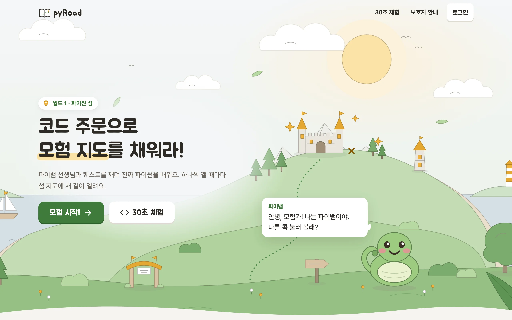</p>

<table>
  <tr>
    <td width="50%">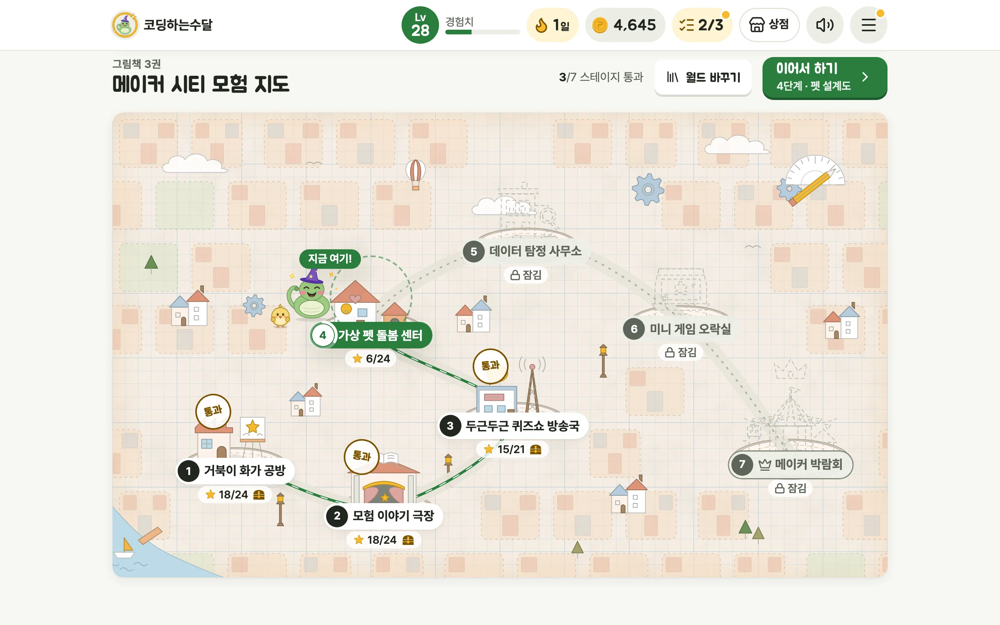<br><sub>World map — Maker City, three stages cleared</sub></td>
    <td width="50%">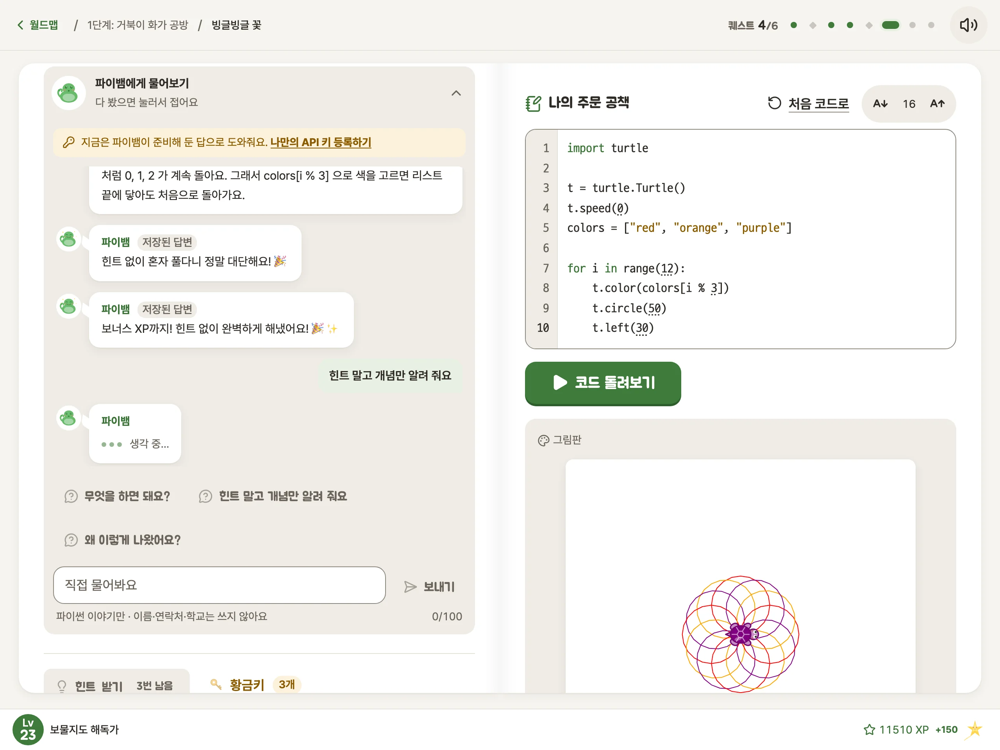<br><sub>Quest — turtle drawing result and the tutor chat</sub></td>
  </tr>
  <tr>
    <td>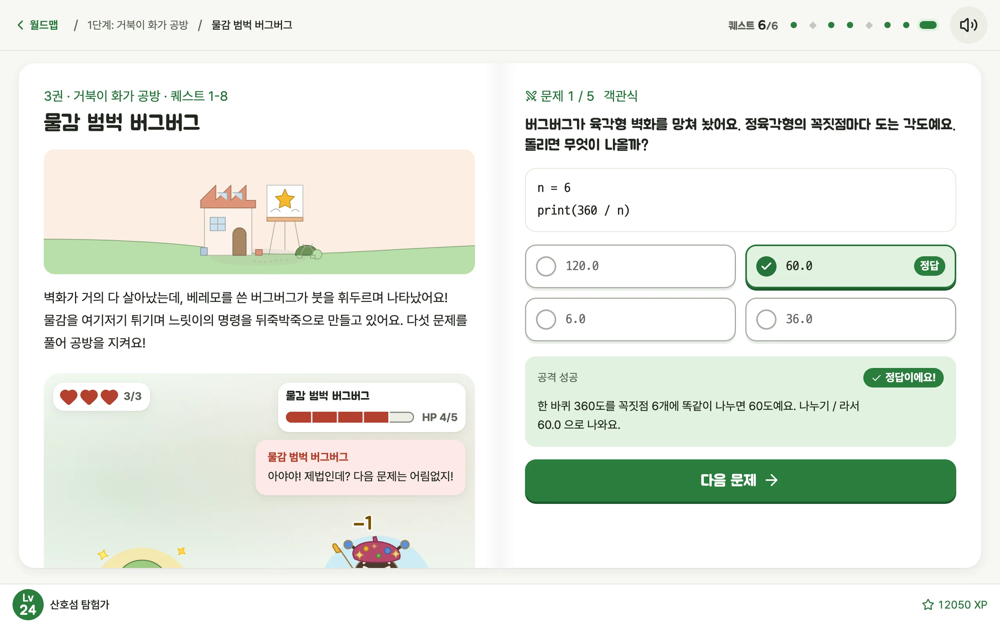<br><sub>Stage boss battle</sub></td>
    <td>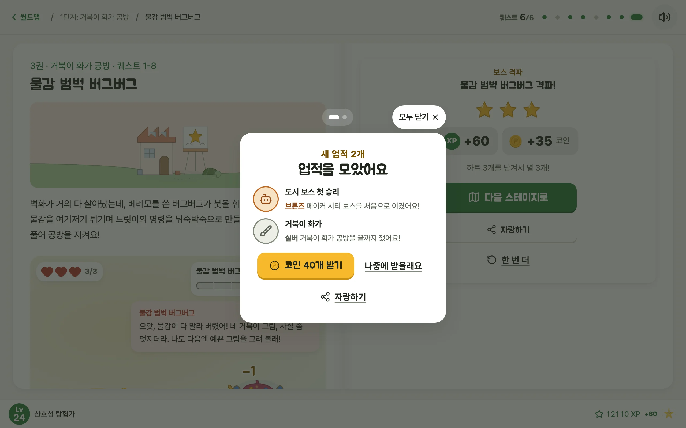<br><sub>Celebration — achievements after a boss win</sub></td>
  </tr>
  <tr>
    <td>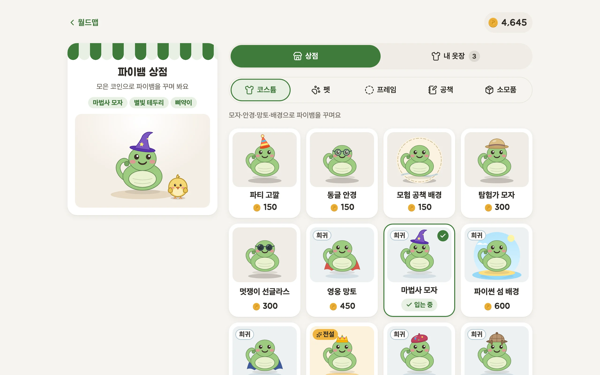<br><sub>Shop — decorate Pybaem with earned coins</sub></td>
    <td>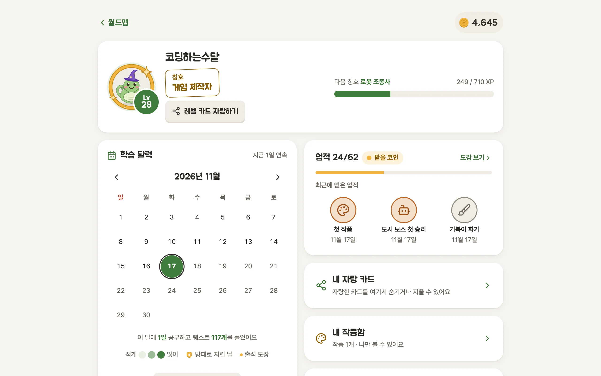<br><sub>Profile — level, title, learning calendar, achievements</sub></td>
  </tr>
  <tr>
    <td>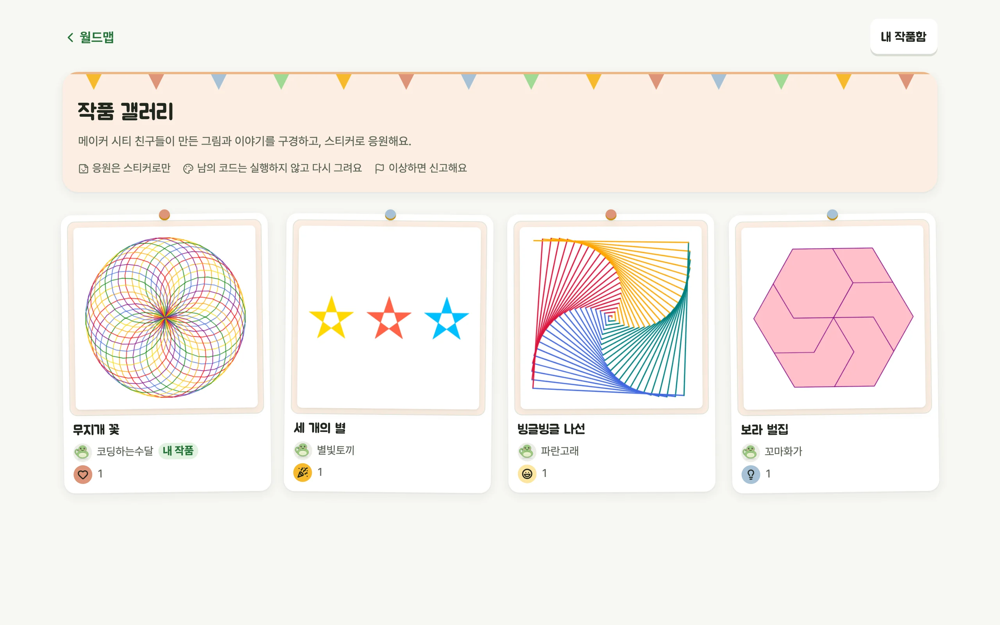<br><sub>Gallery — turtle artworks with stickers</sub></td>
    <td>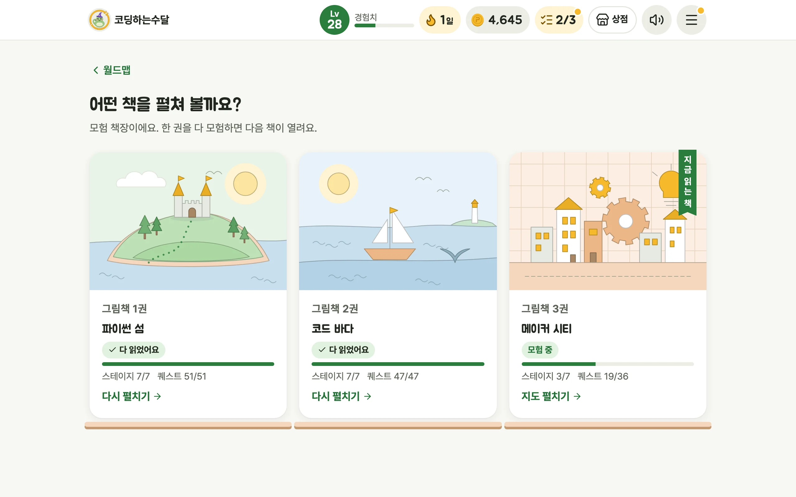<br><sub>Bookshelf — three worlds</sub></td>
  </tr>
</table>

<p align="center">
  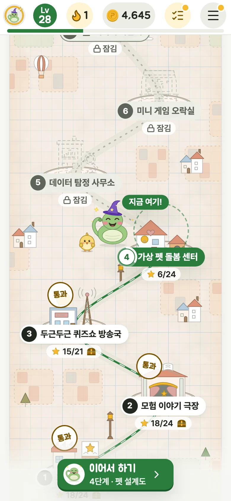
  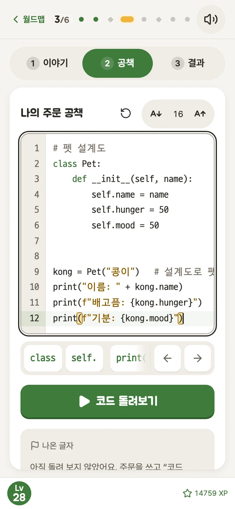
  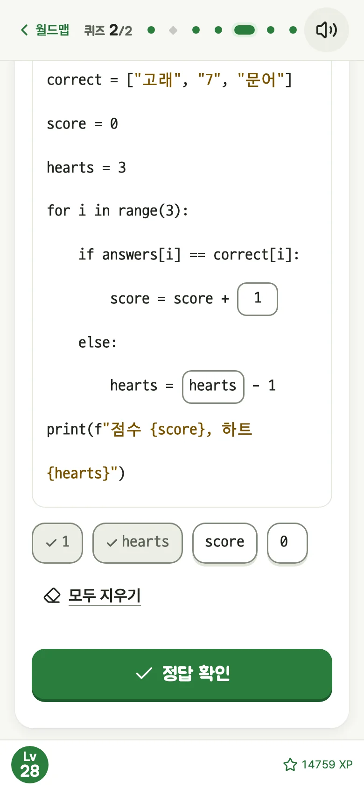
  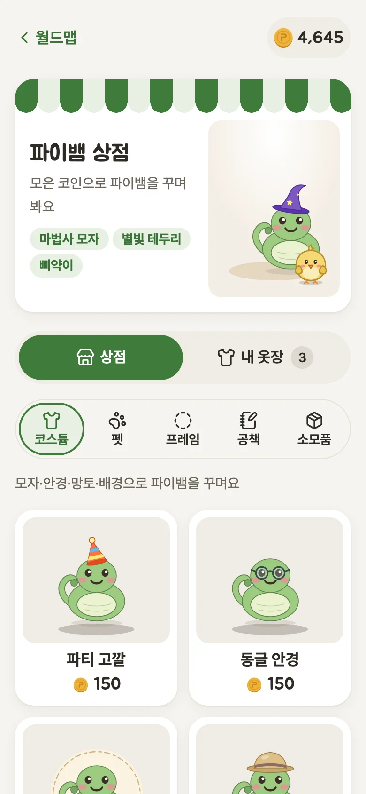
</p>

Screenshots are taken from a local stack with demo learners: `npm run shots:readme` (see [Screenshots](#updating-the-screenshots)).

## Features

- **Three worlds** — Python Island (basics), Code Sea (applied), Maker City (making things: turtle drawing, `input()` programs, simple games). 21 stages, 134 quests including a boss in every stage, plus 52 bonus quizzes.
- **Quest types** — code quests checked on the server, multi-step projects, and mobile-friendly quizzes: multiple choice, fill in the blank, code ordering, bug hunt.
- **In-browser Python** — self-hosted Pyodide in a Web Worker, with `input()`, turtle graphics and key-input games.
- **Boss battles** — answer rounds with three hearts; stars depend on the hearts left.
- **Rewards** — XP and levels with titles, coins, stars, stage treasure chests, daily missions, daily quiz, attendance stamps and achievements. Rewards and grading run only on the server.
- **Shop and decorating** — buy costumes, pets, frames and notebook themes with coins and dress up Pybaem.
- **Sharing and gallery** — share cards (level up, stage clear, achievement, weekly record, artwork) as public links; Maker City artworks can be published to a gallery with a fixed set of stickers, reporting and moderator hiding.
- **Guardian report** — a weekly learning report link a learner can create for a guardian.
- **AI tutor (Pybaem)** — quest intros, hints and fixed questions ("What should I do?", "Explain the concept", "Why did this happen?"). In v1.0 the tutor answers from **prepared (saved) answers**; the server-side AI is off (Gemini's terms do not allow services for users under 18, plan §12-Q80). A learner may register their **own Anthropic or OpenAI API key** (stored encrypted) to get AI answers.
- **Child protection** — Google, Kakao and Naver login with nickname-only public profiles. Learners under 14 need guardian consent; until then, writing that others can see (board, gallery, share links) stays off while learning continues. Minimal data collection (for example, Google name and profile photo are not stored), and accounts that never finished onboarding and have no activity are deleted after 30 days.
- **Responsive** — phone (360px and up), tablet and desktop, with reduced-motion and low-end device support.

## Tech Stack

- Framework: `Next.js 15.5` (App Router, Turbopack), `React 19`, `TypeScript`
- Styling: `Tailwind CSS v4`, `Base UI`, design tokens in `src/lib/design/`
- Auth / Database: `Supabase` (Auth, PostgreSQL, RLS)
- Python runtime: `Pyodide 314.0.7` (self-hosted, Web Worker)
- Editor: `CodeMirror 6`
- AI tutor: provider factory in `src/lib/tutor/providers/` (learner-owned Anthropic / OpenAI keys; server Gemini key only for local prompt testing)
- Animation / sound: `Framer Motion`, CSS keyframes, `canvas-confetti`, Web Audio
- Monitoring: `Sentry` (off without a DSN), first-party analytics
- Tooling: `ESLint`, `Prettier`, `Vitest`, `Playwright`; deployed on Vercel, CI on GitHub Actions

## Getting Started

Requirements: Node.js 22 (same as CI), Docker, Supabase CLI 2.115.0.

```bash
npm install
cp .env.example .env.local
npm run db:start     # local Supabase on ports 5452x (applies migrations and seed on first start)
npm run db:status    # copy API URL, ANON_KEY and SERVICE_ROLE_KEY into .env.local
npm run dev          # http://localhost:3000
```

Required env: `NEXT_PUBLIC_SUPABASE_URL`, `NEXT_PUBLIC_SUPABASE_ANON_KEY`, `SUPABASE_SERVICE_ROLE_KEY`. Everything else is optional and documented in `.env.example`. Social login providers are not configured on the local stack; e2e tests sign in with email test accounts instead (see [e2e/README.md](e2e/README.md)). Details: [supabase/README.md](supabase/README.md).

## Tests

```bash
npm run lint && npx prettier --check . && npx tsc --noEmit
npx vitest run         # unit tests
npm run test:content   # runs every solution in real Pyodide
npm run test:pyodide   # shared runner core
npm run test:rls:ci    # RLS / permission regression on an isolated stack
npm run test:e2e       # Playwright (login specs need npm run db:start)
npm run test:visual    # visual regression at 360 / 768 / 1280
```

CI runs on every PR and push; the required checks are listed in [docs/ci.md](docs/ci.md).

### Updating the screenshots

`npm run shots:readme` builds the app, creates demo learners on the local stack, writes `img/readme-*.webp` at 2x and deletes the learners afterwards ([scripts/readme-shots/](scripts/readme-shots/)).

## Documentation

- [Product requirements (PRD v2)](docs/2.PRD-v2.md)
- [Upgrade plan and progress](docs/4.upgrade-plan.md)
- [Design system](docs/design/tokens.md) — tokens, [components](docs/design/components.md), [motion](docs/design/motion-guidelines.md)
- [Content authoring](content/README.md)
- [v1.0 release runbook](docs/release/v1.0-runbook.md)
- [CI](docs/ci.md), [e2e](e2e/README.md), [database](supabase/README.md)

## License

The code is licensed under the [Apache License 2.0](LICENSE). Fonts (SIL OFL 1.1), sounds and other assets keep their own licenses, recorded in [docs/assets-license.md](docs/assets-license.md); third-party notices are shown on the in-app `/licenses` page.
