# pyRoad


pyRoad는 초등학생을 위한 무료 게임형 파이썬 학습 사이트입니다. 그림책 같은 월드맵에서 뱀 튜터 파이뱀과 퀘스트를 깨며, 설치 없이 브라우저에서 진짜 파이썬 코드를 실행합니다.

영문 문서는 [README.md](../README.md)입니다. 두 문서는 같은 내용을 담습니다.

## 스크린샷

<p align="center">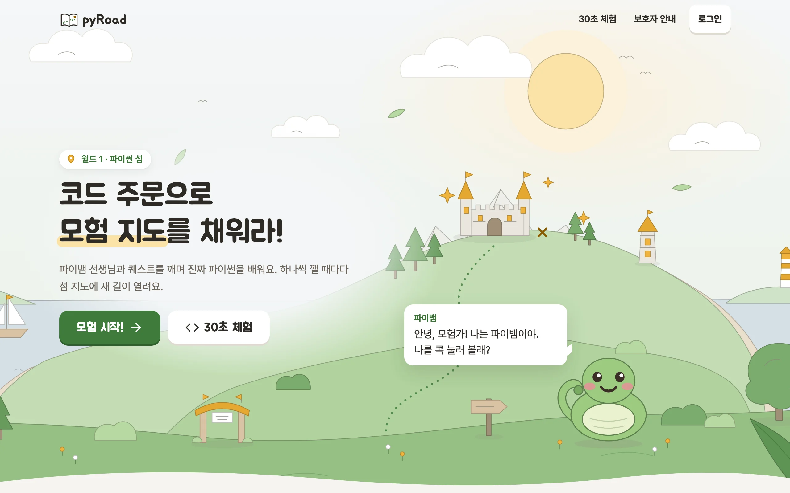</p>

<table>
  <tr>
    <td width="50%">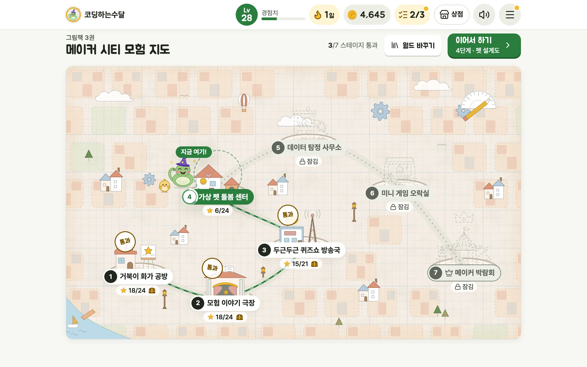<br><sub>월드맵 — 메이커 시티, 3단계까지 통과</sub></td>
    <td width="50%">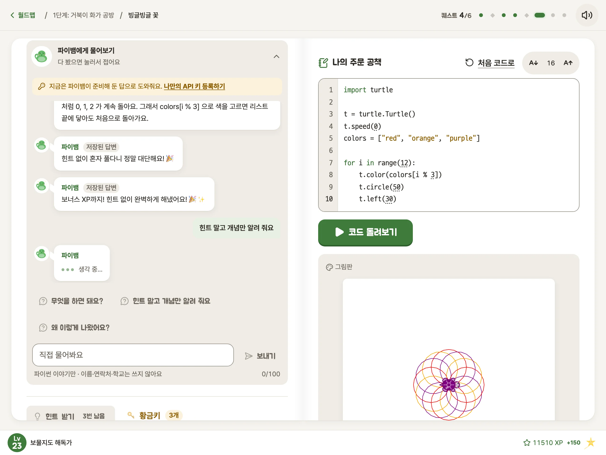<br><sub>퀘스트 — 거북이 그림 실행 결과와 파이뱀 대화</sub></td>
  </tr>
  <tr>
    <td>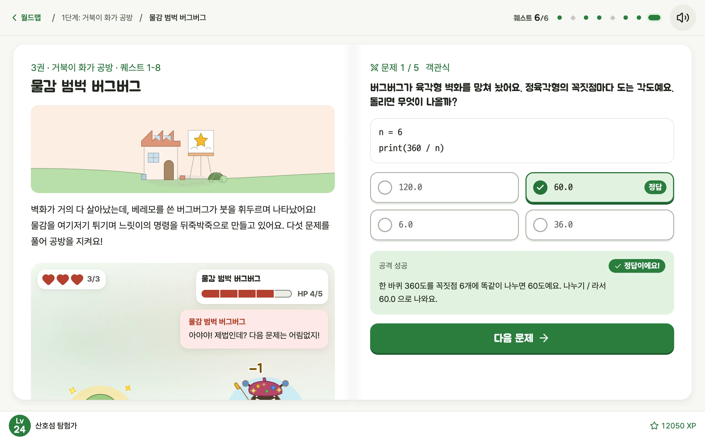<br><sub>스테이지 보스 배틀</sub></td>
    <td>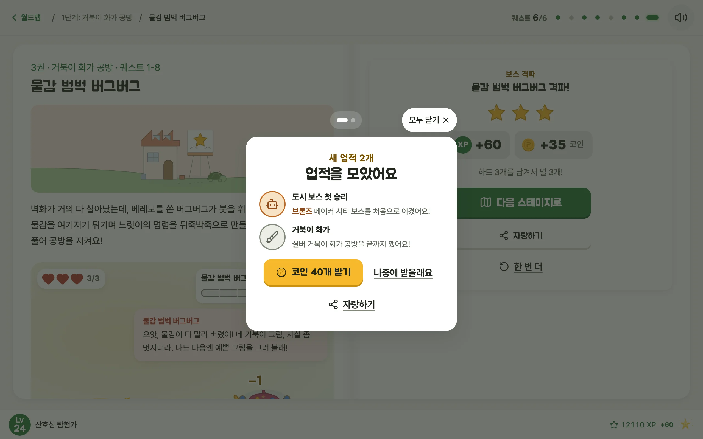<br><sub>축하 — 보스 승리 뒤 새 업적</sub></td>
  </tr>
  <tr>
    <td>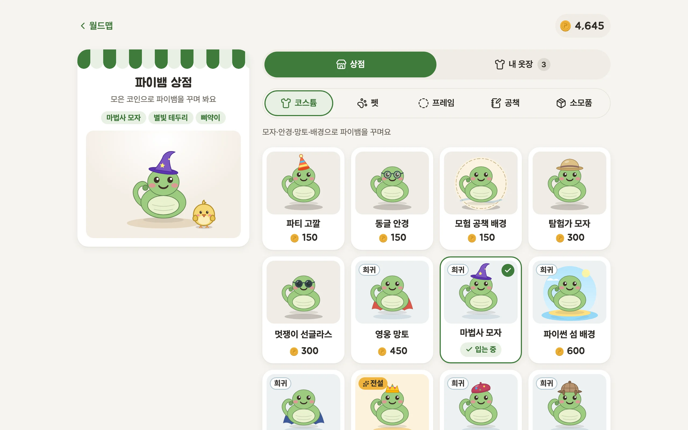<br><sub>상점 — 모은 코인으로 파이뱀 꾸미기</sub></td>
    <td>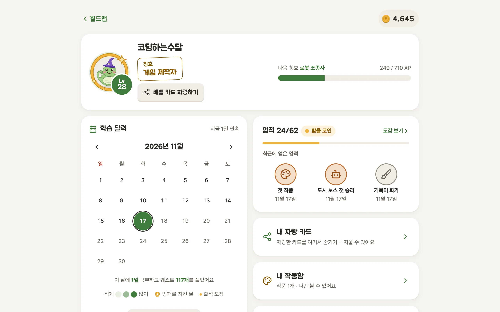<br><sub>프로필 — 레벨·칭호·학습 달력·업적</sub></td>
  </tr>
  <tr>
    <td>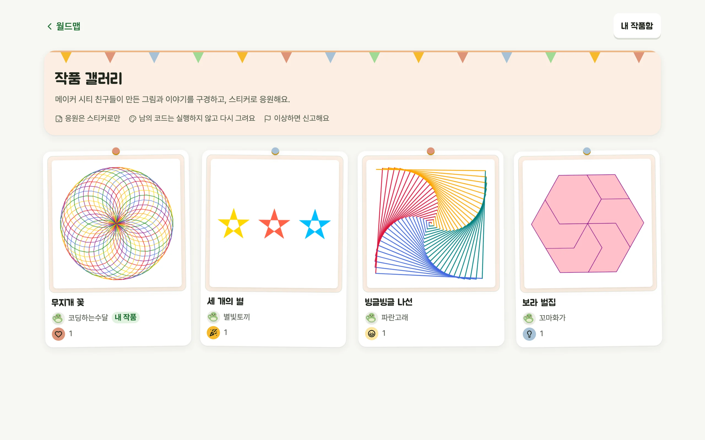<br><sub>갤러리 — 스티커로 응원하는 거북이 그림 작품</sub></td>
    <td>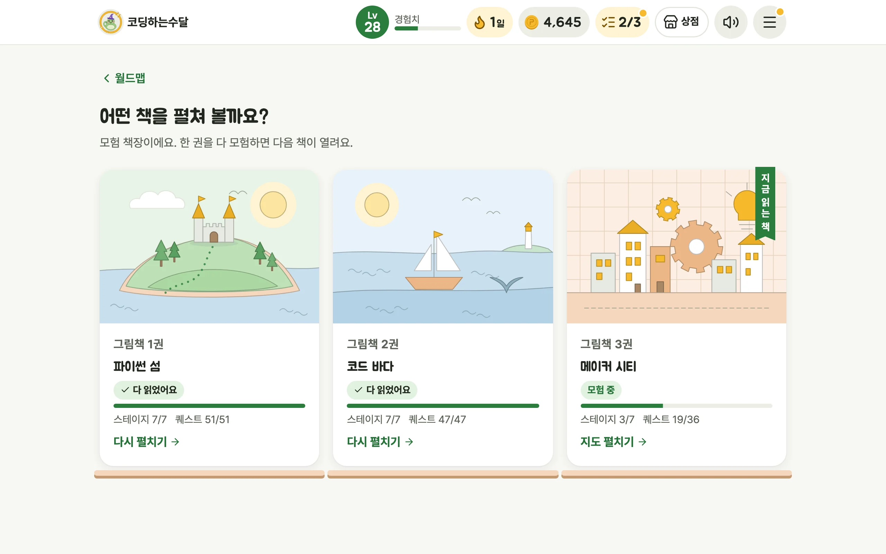<br><sub>책장 — 월드 3개</sub></td>
  </tr>
</table>

<p align="center">
  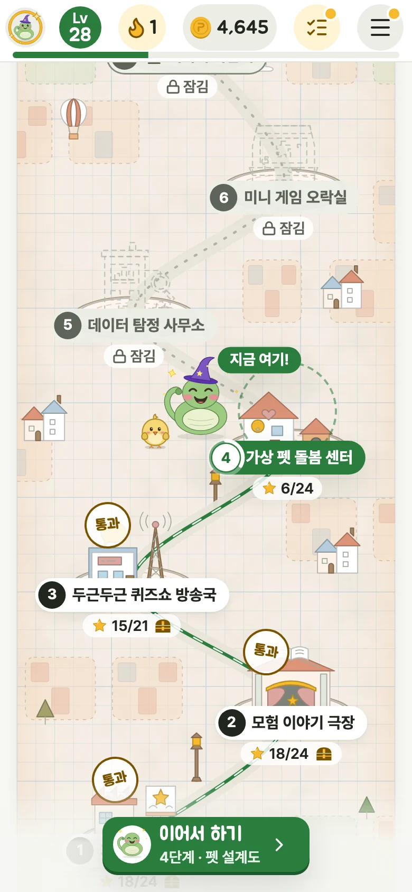
  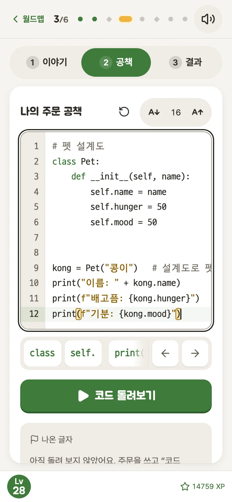
  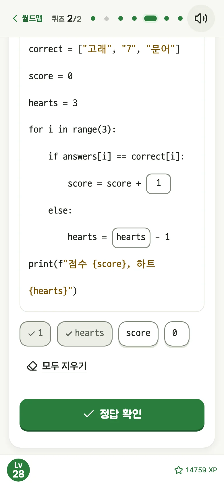
  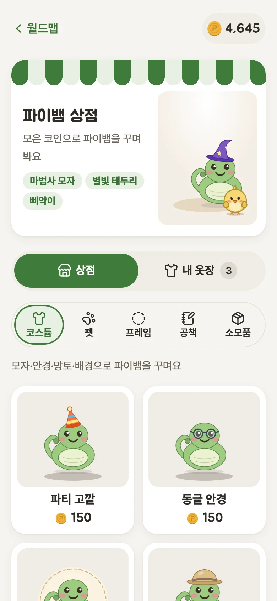
</p>

스크린샷은 로컬 스택에 데모 학생을 만들어 찍었습니다: `npm run shots:readme` ([스크린샷 갱신](#스크린샷-갱신)).

## 주요 기능

- **월드 3개** — 파이썬 섬(기초), 코드 바다(응용), 메이커 시티(만들기: 거북이 그림, `input()` 프로그램, 간단한 게임). 스테이지 21개, 스테이지마다 보스를 포함한 퀘스트 134개, 보너스 퀴즈 52개.
- **퀘스트 유형** — 서버가 채점하는 코드 퀘스트, 여러 단계 프로젝트, 폰에서 풀기 좋은 퀴즈 4종(객관식·빈칸 채우기·코드 순서 맞추기·버그 찾기).
- **브라우저 파이썬** — 자체 호스팅 Pyodide를 Web Worker에서 실행. `input()`, 거북이 그림, 키 입력 게임 지원.
- **보스 배틀** — 하트 3개로 문제를 풀고, 남은 하트만큼 별을 받습니다.
- **보상** — XP·레벨과 칭호, 코인, 별, 스테이지 보물상자, 오늘의 미션, 오늘의 퀴즈, 출석 도장, 업적. 보상과 채점은 서버에서만 처리합니다.
- **상점·꾸미기** — 코인으로 코스튬·펫·프레임·공책을 사서 파이뱀을 꾸밉니다.
- **자랑하기·갤러리** — 레벨 업·스테이지 클리어·업적·주간 기록·작품 자랑 카드를 공개 링크로 공유. 메이커 시티 작품은 갤러리에 올릴 수 있고, 정해진 스티커·신고·운영자 숨김이 있습니다.
- **보호자 리포트** — 학생이 보호자에게 줄 주간 학습 리포트 링크를 만들 수 있습니다.
- **AI 튜터(파이뱀)** — 퀘스트 소개, 힌트, 정해진 질문("무엇을 하면 돼요?", "개념만 알려 줘요", "왜 이렇게 나왔어요?"). v1.0의 튜터는 **준비해 둔(저장된) 답변**으로 답하고 서버 AI는 꺼져 있습니다(Gemini 약관이 18세 미만 대상 서비스 사용을 금지, 계획서 §12-Q80). 학생이 **본인 Anthropic 또는 OpenAI API 키**를 등록하면(암호화 저장) AI 답변을 받습니다.
- **아동 보호** — Google·카카오·네이버 로그인, 공개 정보는 닉네임과 아바타만. 만 14세 미만은 보호자 동의가 필요하고, 동의 전에는 학습은 그대로 하되 다른 사람에게 보이는 쓰기(게시판·갤러리·공유 링크)가 꺼집니다. 최소 수집(예: Google 이름·프로필 사진은 저장하지 않음), 온보딩을 끝내지 않고 활동 기록도 없는 계정은 30일 뒤 삭제.
- **반응형** — 폰(360px 이상)·태블릿·데스크톱, 동작 줄이기와 저사양 기기 대응.

## 기술 스택

- Framework: `Next.js 15.5` (App Router, Turbopack), `React 19`, `TypeScript`
- Styling: `Tailwind CSS v4`, `Base UI`, 디자인 토큰 `src/lib/design/`
- Auth / Database: `Supabase` (Auth, PostgreSQL, RLS)
- Python Runtime: `Pyodide 314.0.7` (자체 호스팅, Web Worker)
- Editor: `CodeMirror 6`
- AI Tutor: 프로바이더 팩토리 `src/lib/tutor/providers/` (학생 본인 Anthropic·OpenAI 키. 서버 Gemini 키는 로컬 프롬프트 시험용만)
- Animation / Sound: `Framer Motion`, CSS keyframes, `canvas-confetti`, Web Audio
- Monitoring: `Sentry`(DSN 없으면 꺼짐), 자체 분석
- Tooling: `ESLint`, `Prettier`, `Vitest`, `Playwright`. 배포 Vercel, CI GitHub Actions

## 시작하기

요구사항: Node.js 22(CI와 같음), Docker, Supabase CLI 2.115.0.

```bash
npm install
cp .env.example .env.local
npm run db:start     # 로컬 Supabase, 포트 5452x (처음 시작할 때 migrations·seed 적용)
npm run db:status    # API URL, ANON_KEY, SERVICE_ROLE_KEY 를 .env.local 에
npm run dev          # http://localhost:3000
```

필수 env: `NEXT_PUBLIC_SUPABASE_URL`, `NEXT_PUBLIC_SUPABASE_ANON_KEY`, `SUPABASE_SERVICE_ROLE_KEY`. 나머지는 선택이며 `.env.example`에 설명이 있습니다. 로컬 스택에는 소셜 로그인 provider가 설정되어 있지 않고, e2e는 이메일 테스트 계정으로 로그인합니다([e2e/README.md](../e2e/README.md)). 자세한 내용: [supabase/README.md](../supabase/README.md).

## 테스트

```bash
npm run lint && npx prettier --check . && npx tsc --noEmit
npx vitest run         # 단위 테스트
npm run test:content   # 모든 정답 코드를 실제 Pyodide로 실행
npm run test:pyodide   # 공용 실행 코어
npm run test:rls:ci    # 격리 스택에서 RLS·권한 회귀
npm run test:e2e       # Playwright (로그인 스펙은 npm run db:start 필요)
npm run test:visual    # 360·768·1280 시각 회귀
```

CI는 PR·푸시마다 돌고, 필수 체크 목록은 [docs/ci.md](ci.md)에 있습니다.

### 스크린샷 갱신

`npm run shots:readme`가 앱을 빌드하고 로컬 스택에 데모 학생을 만들어 `img/readme-*.webp`(2배 해상도)를 쓴 뒤 데모 학생을 지웁니다([scripts/readme-shots/](../scripts/readme-shots/)).

## 문서

- [제품 요구사항 (PRD v2)](2.PRD-v2.md)
- [업그레이드 계획서·진행 현황](4.upgrade-plan.md)
- [디자인 시스템](design/tokens.md) — 토큰, [컴포넌트](design/components.md), [모션](design/motion-guidelines.md)
- [콘텐츠 작성](../content/README.md)
- [v1.0 릴리즈 런북](release/v1.0-runbook.md)
- [CI](ci.md), [e2e](../e2e/README.md), [데이터베이스](../supabase/README.md)

## 라이선스

코드는 [Apache License 2.0](../LICENSE)으로 배포합니다. 폰트(SIL OFL 1.1)·사운드 등 에셋은 각자의 라이선스를 따르며 [docs/assets-license.md](assets-license.md)에 기록되어 있고, 제3자 고지는 앱의 `/licenses` 페이지에 있습니다.
