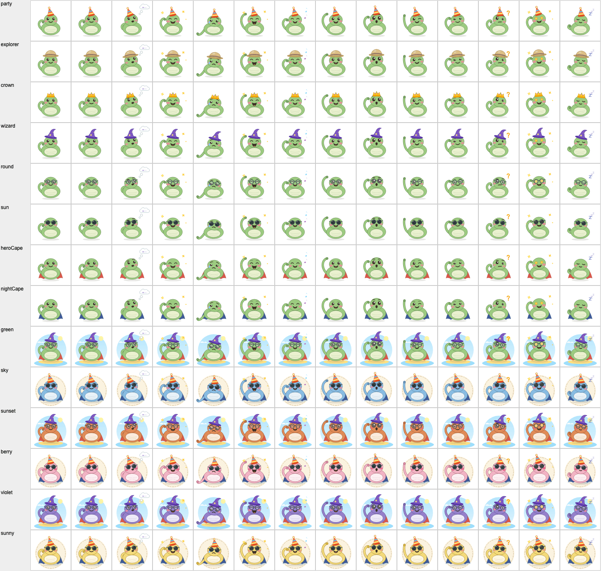
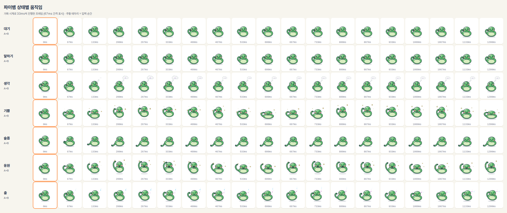
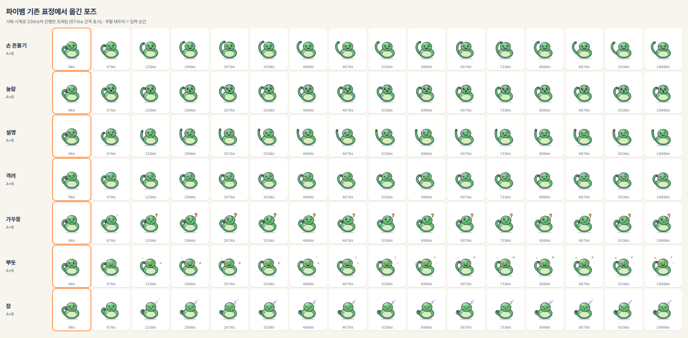
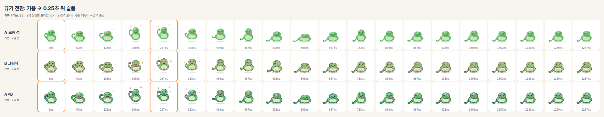
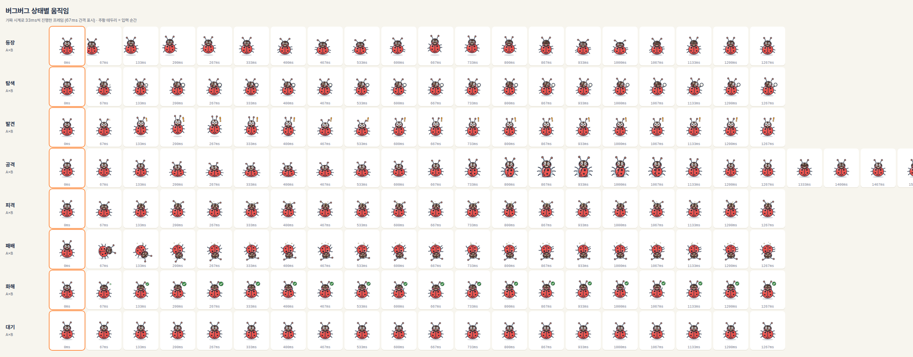
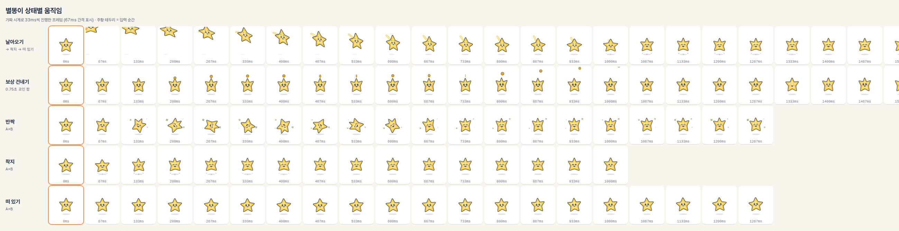
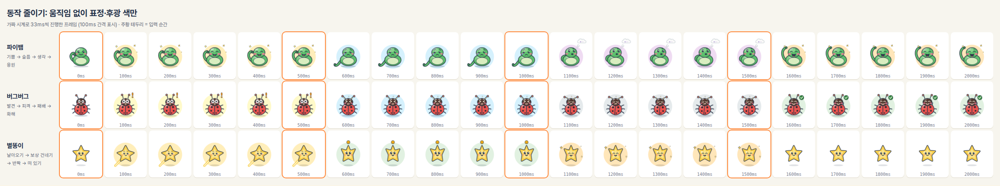
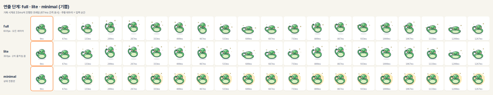

# 마스코트 SVG 리그 (P2-13)

> - 근거: [P0-07 마스코트 애니메이션](../spikes/P0-07-mascot-animation.md) (채택안: 코드 기반 SVG 리그, §4·§6.2 제작 계획) · [모션 가이드라인](motion-guidelines.md) (연출 단계·동작 줄이기) · [P2-01 무드보드](P2-01-moodboard.md) 캐릭터·모션 절 · 계획서 §2.5·§6, §12-Q26
> - 코드: `src/components/characters/rig/` · 테스트 `src/components/characters/rig/__tests__/` · 리뷰 페이지 `design/prototypes/src/rig-review/` (`dist/rig-review.html`)
> - 세 캐릭터(파이뱀·버그버그·별똥이)를 **같은 엔진**으로 움직입니다. 캐릭터 = 파라미터 정의 + 포즈 표 + 레이어(behavior) + geometry + 마크업.

## 1. 구조

```
src/components/characters/rig/
├── index.ts            서버에서도 import 가능한 것만 (정의·정지 그림·타입·정책)
├── style.ts            스타일 A·B·A×B 규칙 + DEFAULT_RIG_STYLE (시안 확정 후 이 한 줄만 바꿈)
├── costumes.tsx        코스튬 조각 (모자·안경·망토·배경, P9-04 꾸미기 렌더러 — §6¾)
├── RigStatic.tsx       정지 그림: RigStatic · PybaemStatic · BugBugStatic · ByeolttongiStatic (훅 없음)
├── LiveRig.tsx         'use client' 라이브 렌더러 RigView (연출 단계를 props로 받음, React 18·19 공용 API)
├── MascotRig.tsx       'use client' 앱 래퍼 PybaemRig · BugBugRig · ByeolttongiRig (useMotionTier() 연동)
├── core/
│   ├── engine.ts       RigEngine: 파라미터 스프링 · 깜빡임 · 따라보기 · 콕 찌르기 · 젤리 · 후광 · 잠들기/깨기
│   ├── ticker.ts       공유 rAF 하나 + 깨우기 타이머
│   ├── policy.ts       MotionBudget(P2-15) → RigPolicy
│   ├── layers.ts       공용 레이어: HopLayer(점프) · TalkLayer(말하기)
│   ├── face.ts         공용 얼굴 기하: 입·눈썹·둥근 별
│   ├── markup.tsx      <svg> 틀 · 종이 결 필터 · applyGeo(바뀐 속성만 DOM에)
│   ├── math.ts  types.ts
├── pybaem/  bugbug/  byeolttongi/
│   ├── params.ts       상태·라벨·포즈 키·중립·포즈 표·후광 색·스프링 묶음·정적 포즈·기존 표정 매핑
│   ├── behavior.ts     캐릭터 레이어 (숨쉬기·점프·종종걸음·비행…)
│   ├── geometry.ts     파라미터 → SVG 속성 (순수 함수, 라이브·SSR·공유 카드 공용)
│   ├── Markup.tsx      팔레트 3종 + 마크업 (훅 없음)
│   └── index.ts        RigDef (엔진이 읽는 정의)
```

흐름: `params`(포즈 표) → `engine`(스프링 + 레이어, 매 프레임 `Params`) → `geometry`(속성 문자열) → `applyGeo`(이전과 다른 속성만 `setAttribute`). React는 첫 렌더만 하고 그 뒤로는 리렌더하지 않습니다.

## 2. 쓰는 법

```tsx
// 서버 컴포넌트·공유 카드·아바타 (엔진 없음, 6~10KB gzip)
import { PybaemStatic, BugBugStatic } from '@/components/characters/rig';
<PybaemStatic expression="celebrating" size={64} filters={false} />   // 기존 표정 10종 그대로
<PybaemStatic state="sad" halo size={128} />                          // 동작 줄이기 모양(후광)

// 라이브 (클라이언트). 연출 단계·동작 줄이기는 useMotionTier()에서
import { PybaemRig } from '@/components/characters/rig/MascotRig';
const ref = useRef<RigHandle<PybaemState>>(null);
<PybaemRig ref={ref} state="think" talking={streaming} size={200} framing="stage" />
ref.current?.poke(); ref.current?.replay();

<ByeolttongiRig state="give" onCue={(c) => c === 'reward' && popCoin()} />  // 코인 팝 순간 신호
<BugBugRig state="appear" onAutoState={(s) => setBug(s)} />                 // 등장이 끝나면 'idle'
```

- **지연 로드**: 첫 화면은 `PybaemStatic`(서버에서 그림)으로 두고 `next/dynamic(() => import('…/MascotRig'), { ssr: false, loading: () => <PybaemStatic … /> })`로 바꿔도 **같은 모습**입니다. 라이브 리그의 첫 렌더가 같은 `staticGeo()`를 쓰고, 테스트가 두 마크업이 같은지 확인합니다(`static.test.tsx`).
- **스타일**: `style`을 생략하면 `DEFAULT_RIG_STYLE`(**`'B'`**, P2-06 사용자 리뷰에서 B 방향 확정·P2-07 2차에서 바꿈).
- **팔레트·코스튬**: `palette={skinPalette('sky')}`(스킨, §6½), `costume={{ hat: 'party', glasses: 'round', cape: '#E53935', bg: 'island' }}`(파이뱀). 표정 소품(별 눈·물음표·Zzz)과 코스튬은 서로 다른 슬롯이라 겹치지 않습니다(P0-10, 레이어 표는 §6¾).
- **접근성**: `role="img"` + `aria-label="파이뱀 선생님 - 기쁨"`. `label=""`이면 장식(`aria-hidden`).
- `<text>`·`<foreignObject>`·래스터 `<image>`를 쓰지 않습니다(공유 카드 직렬화기, P0-10). 예전 `PybaemSvg`의 "Zzz"·"?"도 경로로 바꿨습니다.

## 3. 상태 표

### 파이뱀 (튜터, 14상태)

| 상태 | 라벨 | 움직임 | 기존 표정 |
|---|---|---|---|
| `idle` | 대기 | 숨쉬기 3.2초 · 깜빡임 2.2~5.5초(18% 두 번) · 5~9초마다 두리번/꼬리 털기(full) | happy |
| `talk` | 말하기 | 음절 리듬으로 입 열고 닫기 + 끄덕. **`talking` 레이어는 어떤 상태 위에도 얹힘** | |
| `think` | 생각 | 갸웃 + 꼬리로 턱 톡톡 + 생각 풍선이 작은 방울부터 톡톡 | thinking |
| `happy` | 기쁨 | **점프 2번 + 젤리**, 반짝이 | celebrating |
| `sad` | 슬픔 | 처진 눈꺼풀·눈썹·꼬리, 눈물, **털썩**(점프 중이면 착지할 때) | |
| `cheer` | 응원 | 꼬리 번쩍 흔들며 연속 점프 | |
| `dance` | 춤 | 120bpm 좌우 + 박자마다 통통, 음표 | |
| `wave` | 손 흔들기 | 꼬리 흔들기 (점프 없음) | waving |
| `surprised` | 놀람 | 눈 크게 · o 입 · 쭉 늘어남 | surprised |
| `teach` | 설명 | 윙크 + 꼬리로 콕콕 가리키기 (지시봉 대신) | teaching |
| `encourage` | 격려 | 부드러운 미소 + 천천히 끄덕 | encouraging |
| `confused` | 갸우뚱 | 짝눈 · 삐뚤 입 · 물음표(경로) | confused |
| `proud` | 뿌듯 | 별 눈 + 반짝이 (예전 왕관은 `crown` 코스튬으로) | proud |
| `sleep` | 잠 | 감은 눈 ‿ · 느린 숨 5.5초 · Zzz(경로) | sleeping |

상호작용: 포인터 따라보기(눈 ±2.2 → 얼굴 ±1.6 → 머리 ±4°, 터치는 2.5초 보고 복귀), 콕 찌르기(눈웃음 + 볼 빨개짐 + 부르르 + 젤리). 오버래핑(full): 머리가 몸을 한 박자 늦게, 모자·망토 출렁.

### 버그버그 (에러·보스, 장난꾸러기 라이벌 겸 친구, 8상태)

| 상태 | 라벨 | 움직임 | 기존 표정 |
|---|---|---|---|
| `idle` | 대기 | 숨쉬기 · 더듬이 살랑 · 깜빡임 | |
| `appear` | 등장 | 옆에서 통통 뛰며 종종걸음으로 들어와 착지 먼지 → 1.25초 뒤 자동 `idle` | |
| `search` | 탐색 | 한쪽 눈 찡긋 + 돋보기 들고 두리번·옆걸음 | searching |
| `found` | 발견 | 깜짝 점프 · 눈 크게 · "!" · 더듬이 쫑긋 | found |
| `attack` | 공격 | 1.9초 주기: 찌그러졌다(준비) → 커지며 돌진(등딱지 열림) → 복귀. 씩 웃는 얼굴 + 송곳니 하나. 돌진 순간 `onCue('attack')` | |
| `hit` | 피격 | 찌그러짐 + 흔들림 + 별 어지러움 · > < 눈. **빨간 깜빡임 없음** | |
| `defeat` | 패배 | 뒤집혀 다리 버둥 + 흔들흔들 · 감은 눈 | |
| `makeup` | 화해 | 웃는 눈 · 통통 · 앞다리 흔들기 · 체크 배지 | fixed |

부위: 다리 6(삼각 보행) · 등딱지 좌우 반쪽(경첩에서 열림) · 날개 · 머리 · 더듬이 2(늦게 따라오는 스프링) · 공유 얼굴(흰자 + 눈동자).

### 별똥이 (보상 안내 요정, 5상태)

| 상태 | 라벨 | 움직임 | 기존 표정 |
|---|---|---|---|
| `idle` | 떠 있기 | 위아래 둥실 · 살짝 기울기 · 팔 흔들 | |
| `flyIn` | 날아오기 | 왼쪽 위에서 호를 그리며 0.9초 비행, **속도 방향으로 늘어남** + 꼬리 빛(lite는 짧게) → 자동 `land` | flying |
| `land` | 착지 | 찌그러짐 + 먼지 선 + 팔 번쩍 → 자동 `idle` | landing |
| `sparkle` | 반짝 | 2.6초마다 한 바퀴 + 반짝이 4개 | sparkling |
| `give` | 보상 건네기 | 코인을 머리 위로 → 0.75초에 팝(`onCue('reward')`, 화면의 코인 카운트와 맞춤) → 오른쪽 위로 날아감 → 자동 `idle` | |

별의 양옆 끝이 팔, 아래 두 끝이 다리입니다(몸 경로를 매 프레임 계산).

**"이번 동작은 끝까지"**: 점프·비행·한 바퀴·코인은 도중에 상태가 바뀌어도 끝까지 이어진 뒤 멈춥니다. 나머지 값은 모두 스프링이라 어느 순간 끊어도 순간이동이 없습니다(테스트: 무작위로 끊어도 프레임당 이동 12px 미만, 점프 중 슬픔은 입력 직후 이동이 점프 자체보다 크지 않음).

## 4. 연출 단계·동작 줄이기

`useMotionTier().budget`(P2-15)을 `rigPolicy()`가 그대로 읽습니다.

| | full | lite | minimal | 동작 줄이기 (별개 축, §12-Q26) |
|---|---|---|---|---|
| 루프 | 모든 레이어 | 모든 레이어 | **상태 전환만**, 끝나면 rAF에서 빠짐(대기 CPU 0) | **위치·크기·회전 변화 0** (`pinnedKeys` 고정), 표정 즉시 |
| 프레임 | 60fps (B는 12fps 계단) | **30fps 상한** | 전환 동안 30fps | 그릴 때만 |
| 2차 움직임 (두리번·오버래핑·더듬이 출렁·선 떨림) | 켬 | 끔 | 끔 | 끔 |
| 종이 결 필터 (B·A×B) | 켬 | **끔** (외곽선만) | 끔 | 단계 따름 (정지) |
| 눈 깜빡임 | 보통 | 보통 | 끔 | **느리게** (7초마다 0.4초, 사이에는 잠듦) |
| 후광 색 | 없음 | 없음 | 상태 색 | 상태 색 |
| 콕 찌르기 | 흔들림 + 표정 | 같음 | 표정만 1초 | 표정만 1초 |
| 소품 | 반짝이 회전 | 반짝이 정지 | 정지 | 정지 |
| 일회성 신호 (`reward`) | 코인 팝 순간 | 같음 | 즉시 | 즉시 |

후광 색은 P0-07 HALO_COLOR(기쁨 노랑, 슬픔 하늘, 생각 보라…)를 캐릭터별로 확장했습니다(`*_HALO`). 리뷰 페이지에서 색·진하기를 바꿔 볼 수 있습니다.

## 5. 스타일 A·B·A×B

| | A 모험 섬 | B 그림책 | A×B |
|---|---|---|---|
| 외곽선 | 없음 | **몸색 진한 톤 1.1** (P2-07 2차, 1차는 잉크 갈색 2.2). 소품·다리·더듬이는 제 색, 눈·입은 짙은 잉크 그대로 (`tonal`) | 남색 2.6 (모든 부위 같은 잉크) |
| 광택 | 단색 + 그늘·빛·하이라이트 도형 | 없음 (배 줄무늬) | 있음 |
| 종이 결 필터 | 없음 | **없음** (1차 변위 2.6 + 선 떨림 8fps) | 변위 1.5, 떨림 없음 |
| 렌더 | 60fps | 12fps 계단 | 60fps |
| 착지 젤리 | `jellyA` k520 c10 (ζ 0.22) | `jellyB` k480 c24 (ζ 0.55) | `jellyAB` k500 c16 (ζ 0.36) |

팔레트는 캐릭터마다 세 벌(`PYBAEM_PALETTES` 등)이고 CSS 변수가 아닌 리터럴 색입니다(resvg가 CSS 변수를 못 읽음, P0-07 §4.6).

**볼 색 보정** (무드보드 §8): 반투명 분홍은 초록 위에서 보색끼리 섞여 갈색이 됩니다. 몸색 위 합성색을 계산하면 예전 `#FF8A80`×0.36 → A `#9DA972`(HSL 73° 채도 24%, 올리브), 무드보드 제안 `#FF7A9A`×0.5 → A `#B39B82`(30°, 24%, 황갈색)로 **불투명도 0.5 안팎은 여전히 갈색**이었습니다(0.7 아래는 모두 색상 13~45°). 그래서 색은 제안대로 `#FF7A9A`로 하되 **불투명도를 평소 0.75 · 볼 빨개짐 0.85**로 올렸습니다(`cheekAlpha` 0.85 × 상태 불투명도 0.88~1). 합성색: 평소 A `#D88A8E`(357°, 50%) · B몸 위 `#E68E93`(357°, 64%) · A×B `#D68D8F`(358°, 47%), 웃을 때 A `#E88493`(351°, 69%) · A×B `#E78594`(351°, 67%). B 팔레트는 바랜 톤 `#F2879B`×0.84(평소 B몸 위 `#DC9994` 4°, 50%). 세 스타일 모두 분홍(색상 351~7°)으로 읽힙니다.

## 6. 성능

### A안 렌더 비용 최적화

- 그라디언트 3개(몸 방사형·그늘 선형·머리 방사형) → **단색 + 아래 그늘 초승달 + 왼쪽 위 빛 타원 + 흰 하이라이트** (A·A×B). A안 마크업에 `Gradient`·`<filter>`가 없음을 테스트가 확인합니다.
- 눈꺼풀 `clipPath`는 슬플 때(`lidSad > 0.01`)만 겁니다(평소 `clip-path="none"`).
- 모든 인스턴스가 rAF 하나를 공유하고, 화면 밖(IntersectionObserver)·숨긴 탭이면 멈춥니다. minimal·동작 줄이기는 할 일이 끝나면 목록에서 빠지고 다음 깜빡임·자동 다음 상태 시각에 타이머로 깹니다.
- `applyGeo`는 이전 프레임과 다른 속성만 씁니다. lite는 30fps 상한, B는 12fps 계단이라 그리기 횟수가 줄어듭니다.

### 번들 (esbuild minify, React 제외)

| 묶음 | min KB | gzip KB | brotli KB |
|---|---:|---:|---:|
| 라이브 리그 3종 (LiveRig + 정의 3 + 코스튬) | 66.5 | 23.4 | 20.4 |
| 파이뱀만 라이브 (LiveRig + PYBAEM) | 38.7 | 14.8 | 13.2 |
| 정지 그림 PybaemStatic만 | 26.8 | 10.3 | 9.3 |
| 정지 그림 3종 | 52.7 | 18.3 | 15.8 |

P0-07 스파이크(파이뱀 7상태) 10.5KB gzip보다 큰 것은 상태 7개 추가(기존 표정), 공용 엔진 일반화, 별 눈·Zzz·물음표 소품 때문입니다. 버그버그·별똥이는 쓰는 화면(에러·축하)에서만 불러오면 됩니다.

### 프레임 (P0-07 하네스 방식 재측정)

`design/prototypes/src/rig-review/bench.mjs` (P0-07 `bench/measure.mjs`와 같은 방식: 헤드리스 Chromium, 900×600 DPR 2, CDP `Emulation.setCPUThrottlingRate`, 워밍업 1.5초 뒤 5초 동안 rAF 간격, 메인 스레드 % = CDP `TaskDuration` 증가분 / 경과 시간, 후보 교차 3회 중앙값 [최소–최대]). `old-rig` = P0-07 스파이크 리그(A, 소품 끔)를 **같은 세션**에서 함께 잰 값입니다. 장면: single = 240px 파이뱀 춤 1개, busy = 파이뱀 춤 240 + 버그버그 공격 180 + 별똥이 반짝 180(스파이크 busy는 같은 파이뱀 3개 + 폭죽이라 직접 비교하지 않음).

**춤 (가장 무거운 경우)**, 부하 낮을 때 (54회, load 중앙값 7.3 [3.4–13.8], 20 vCPU)

| 후보 | 장면 | 4× fps | 6× fps | 4× p95 (ms) | 6× p95 (ms) | 4× 메인 % | 6× 메인 % |
|---|---|---:|---:|---:|---:|---:|---:|
| **새 리그 A** | single | 60.0 [60.0–60.0] | **58.6** [58.2–60.0] | 17 | 17 | **32** | 46 |
| 새 리그 A×B (외곽선 + 종이 결 필터) | single | 58.4 [58.0–60.0] | 58.8 [56.6–59.8] | 17 | 17 | 43 | 62 |
| 새 리그 B (필터·12fps) | single | 59.0 [58.8–60.0] | 60.0 [58.8–60.0] | 17 | 17 | 18 | 23 |
| 새 리그 A lite (30fps) | single | 60.0 [59.2–60.0] | 60.0 [60.0–60.0] | 17 | 17 | 25 | 37 |
| P0-07 스파이크 리그 A | single | 59.6 [55.4–60.0] | 59.6 [59.0–59.6] | 17 | 17 | 46 | 54 |
| 새 리그 A | busy (3종) | 60.0 [59.8–60.0] | 56.0 [54.2–59.6] | 17 | 33 | 50 | 83 |
| 새 리그 A×B | busy (3종) | 53.0 [50.0–54.4] | 54.2 [39.5–55.2] | 33 | 33 | 73 | 83 |
| 새 리그 B | busy (3종) | 57.6 [56.0–60.0] | 59.6 [51.0–59.6] | 17 | 17 | 33 | 33 |
| 새 리그 A lite | busy (3종) | 60.0 [59.4–60.0] | 59.8 [51.6–60.0] | 17 | 17 | 31 | 48 |

**대기 (파이뱀 idle, 대기 CPU)**, 같은 조건 (24회, load 중앙값 3.8)

| 후보 | 4× fps | 6× fps | 4× 메인 % | 6× 메인 % |
|---|---:|---:|---:|---:|
| A full | 60.0 | 60.0 | **16** (조용한 대기 30fps 전 26) | 26 (전 42) |
| A×B full | 60.0 | 60.0 | **19** (전 28) | 27 (전 48) |
| A×B lite | 60.0 | 60.0 | 17 (전 20) | 23 (전 27) |
| A×B minimal | 60.0 | 60.0 | **4** | 6 |

- **A안 캐릭터 1개 CPU 6×: 49.2fps(P0-07) → 58.6fps**, 같은 세션의 스파이크 리그 대비 메인 스레드 4× 46% → 32%. 그라디언트·상시 clipPath 제거와 바뀐 속성만 쓰기의 효과입니다(같은 세션에서 스파이크 리그도 59.6fps라 절대 fps보다 메인 스레드 %가 더 믿을 만한 비교입니다).
- **대기 CPU**: 조용한 대기(대기 상태 + 전환·일회성 동작·따라보기·콕 찌르기·말하기 없음)는 숨쉬기·깜빡임뿐이라 full도 30fps로 그립니다. 4×에서 A 26% → 16%, A×B 28% → 19%. minimal은 전환이 끝나면 rAF에서 빠져 4%(측정 페이지 자신의 rAF 루프 비용 수준)입니다.
- **A×B가 A보다 비싼 이유**는 외곽선 + 종이 결 필터(`feTurbulence` 2개 + `feDisplacementMap`)입니다. lite부터 필터를 빼므로 저사양 기기에서는 자동으로 가벼워집니다. 시안이 A×B로 확정되면 full에서도 필터를 정지 이미지 질감으로 바꾸는 것을 P2-09에서 검토할 만합니다.
- 바쁜 장면(3종) 6×는 54~56fps로 60을 조금 못 지킵니다. 저사양에서 P0-16 감지가 lite로 내리면 59.8fps입니다.
- **첫 프레임 생성 비용**: 마운트 때는 정적 geometry 마크업만 그리고(React 한 번), 엔진·IntersectionObserver는 **다음 rAF**에 만듭니다. 그래서 축하 카드처럼 큰 화면이 뜨는 첫 프레임의 긴 작업에 리그 생성이 끼지 않습니다(P2-05 측정에서 지적). 좌표 측정(`getBoundingClientRect`)은 포인터가 움직일 때 rAF당 한 번만.
- **멈춤**: 화면 밖(IntersectionObserver)·숨긴 탭(`visibilitychange`)·가려짐(`checkVisibility` visibility·opacity, 2초마다 확인)·`paused` prop(모달 뒤·접힌 패널).

## 6½. 파이뱀 스킨 · 사용자 아바타 (P3-13, §12-Q34)

공개 아바타는 아이가 고른 **파이뱀 색** 하나입니다(provider 프로필 사진은 쓰지 않음, §2.6). 스킨 = 팔레트 덮어쓰기라 Phase 9 꾸미기(F6)·공유 카드도 같은 값을 씁니다.

| id | 이름 | 몸 `body` | 외곽선 `outline` | 배 `belly` | 볼 `cheek` |
|---|---|---|---|---|---|
| `green` (기본) | 숲초록 | `#9CCB80` | `#5F804E` | `#EAF1CF` | `#F2879B` ×0.84 |
| `sky` | 하늘파랑 | `#88BCE2` | `#4C7596` | `#E9F2F8` | `#F2879B` ×0.84 |
| `sunset` | 노을주황 | `#E08B57` | `#94532B` | `#FBEBDD` | `#E8657A` ×0.82 |
| `berry` | 딸기분홍 | `#F2B3C4` | `#A45C70` | `#FDF0F3` | `#E45A7C` ×0.85 |
| `violet` | 보라별 | `#9580CB` | `#594888` | `#EEEAF8` | `#F2879B` ×0.84 |
| `sunny` | 햇살노랑 | `#F3DA7A` | `#9A7F22` | `#FDF8E2` | `#F08A86` ×0.84 |

- 원본: `src/lib/avatar/skins.ts`(`SKIN_IDS`·`PYBAEM_SKINS`·`getSkin`·`isSkinId`·`skinPalette`·`skinFromAvatarConfig`). 스타일 B 기준이고 `ink`(눈·입)·바닥 그림자는 모든 스킨이 같습니다. 외곽선은 몸색의 진한 톤(`tonal`), 분홍 몸(`berry`)은 볼이 묻히지 않게 더 진한 분홍
- 구분: 색상만이 아니라 **밝기를 벌렸습니다**(몸 L\* 노랑 87 · 분홍 79 · 초록 77 · 파랑 74 · 주황 66 · 보라 58). 색각 시뮬레이션(Machado 2009 적·녹·청황 이상)에서 모든 쌍의 몸색 ΔE ≥ 15를 단위 테스트가 지킵니다(`src/lib/avatar/__tests__/skins.test.ts`). 32px에서도 서로 다르게 보이는지 리뷰 시트로 확인
- 저장·공개: `users.avatar_config.skin` → 동기화 트리거가 6종 id만 `user_public_profiles.avatar_skin`으로 복사(모르는 값은 NULL = 숲초록, ① 00021). id 목록은 마이그레이션의 `ARRAY[…]`와 같아야 하고(테스트가 대조) 한번 쓴 id는 바꾸지 않습니다
- 그리기: `UserAvatar`(`src/components/profile/UserAvatar.tsx`, 32 게시판 · 48 월드맵 요약 · 96 프로필) = 둥근 `surface-2` 칩 + 칩과 같은 크기의 `PybaemStatic` idle(4% 위로). 장식(`aria-hidden`)이고 이름은 옆에 글자로. 공유 카드는 `avatar.skin`
- 색은 캐릭터 고유색이라 토큰이 아닙니다(tokens.md §6 예외 `src/lib/avatar/skins.ts`)

## 6¾. 꾸미기 렌더러 · 코스튬 슬롯 (P9-04)

아이템 1개 = **슬롯 + SVG 조각 + 미리보기**입니다. 조각은 `costumes.tsx` 한 곳에만 있고, 라이브(`PybaemRig`→`RigView`)·정지(`PybaemStatic`, 공유 카드·아바타·상점 썸네일 `ShopItemArt`·구매 카드)가 모두 같은 `PybaemMarkup`으로 그립니다(테스트: 코스튬을 입힌 라이브 첫 렌더 = 정지 그림). 포즈마다 따로 맞추지 않습니다 — 조각이 리그 그룹 안에 있어서 그룹의 움직임을 그대로 받습니다.

| 레이어 (뒤 → 앞) | 슬롯 | 들어가는 곳 | 따라가는 움직임 |
|---|---|---|---|
| 배경 `bg` | `island`·`paper` | `<svg>` 바로 아래, 리그(`root`) **밖** | 없음 (정지) |
| 후광·바닥 그림자 | — | 리그 밖 | 상태 색·점프 높이 |
| 망토 `cape` | 색 (`CAPE_COLORS`) | `root` 첫 자식 = **몸·꼬리 뒤** | 몸 전체(점프·찌그러짐) + 자락 `capeSwing` |
| 몸통·꼬리 | 스킨 팔레트 | `root` | |
| 얼굴·표정 소품(별 눈·눈물) | — | `head > face` | 시선 시차 |
| 안경 `glasses` | `round`·`sun` | `head > face` 맨 앞 | 머리 기울기 + 시선 시차 (눈동자는 안경 안에서 움직임) |
| 모자 `hat` | `party`·`explorer`·`crown`·`wizard` | `head` 맨 앞 (`hat` 그룹) | 머리 기울기·끄덕임 + 자체 출렁임 `hatRot` |
| 머리 밖 표정 소품(반짝이·생각 풍선·음표·Zzz·물음표) | — | `root` 맨 앞 | 몸 전체 |

- **좌표**: 모든 레이어가 같은 128×128 (머리 타원 cx 64 cy 44 rx 28 ry 24, 눈 52·76 / 40). 모자 끝은 상자 위로 나갈 수 있어(마법사 −12) 무대(`framing="stage"`, −20 −36 168 168)에서 다 보입니다. 아바타 상자(0 0 128 128)는 `overflow="visible"`이라 잘리지 않고 칩 밖으로 나옵니다 → `UserAvatar`는 모자를 쓰면 파이뱀을 80%로 줄이고 9% 내려 32px에서도 모자 끝까지 칩 안(P9-05). 모자 그룹에는 `data-hat`
- **소품 위치**: 모자 챙(탐험가 x ≤ 97)과 겹치지 않게 Zzz는 (106,19)부터, 물음표 (104,17), 생각 방울 (96,19)·(103,9)로 옮겼습니다(P9-04, 코스튬 없는 모습도 같은 자리)
- **선**: A 선 없음 · B 모자는 **제 색의 진한 톤 1.1**(`HAT_TONE`, 펫·별 눈과 같은 말씨) · A×B 잉크 1.6. 망토 B는 옅은 그늘 선
- **스킨**(§6½) = 팔레트 덮어쓰기라 몸·배·볼·외곽선만 바뀌고 코스튬 색은 그대로입니다
- **공유 카드 제약**(P0-10): `<text>`·`<foreignObject>`·`<image>`·`<use>`·SMIL(`<animate*>`·`<set>`) 금지. `static.test.tsx`가 **코스튬 10종 × 14상태 × 3스타일 × 스킨 6색**과 **펫 4종**을 모두 그려 검사하고, 조각이 제 그룹(배경 = 리그 밖, 망토 = root 첫 자식, 안경 = 얼굴, 모자 = 머리)에 있는지 DOM으로 확인합니다
- **견본**: 카탈로그 `/dev/design#costume` — 코스튬 × 포즈 격자(스킨 고르기) · 스킨 6색 × 다 입기 · 라이브 다 입기. e2e `design-catalog.spec.ts` "꾸미기 렌더러 (P9-04)" 360·1280
- **새 조각 추가**: `costumes.tsx`에 그리기(128 좌표, 금지 요소 없이) → 종류 타입에 id → `src/lib/shop/catalog.ts` `SHOP_ITEMS`·새 마이그레이션 `shop_items` INSERT(드리프트 테스트) → 격자에서 14상태 확인



- **꾸민 모습 반영(P9-05)**: 원본은 `users.avatar_config` 하나 → `avatarLook()`(`src/lib/avatar/look.ts`). 로그인 화면은 `MyLookProvider`(로그인 레이아웃, 상점이 장착하면 바로 갱신)의 `useMyPybaem()`을 리그에 펼치거나 `MyPybaemStatic`·`MyAvatar`, 게시판은 공개 프로필 `avatar_skin`·`avatar_look`(00042) → `publicLook()`. 학생의 파이뱀(지도·퀘스트 대화 패널·축하·휴식 알림·HUD·프로필·게시판)만 입히고, 로그인 전·시스템 화면(랜딩·로그인·약관·오류·PWA 안내)의 마스코트는 기본 모습

## 7. 캐릭터 추가 방법

1. `rig/<이름>/params.ts`: `STATES`·`STATE_LABEL`, 스프링으로 움직일 `POSE_KEYS`, `NEUTRAL`(파생 값 포함), `POSES`(상태별 차이만), `HALO`, `springOf`(face·body·envelope·prop), `LOOP_KEYS`(live가 아니면 0이 될 레이어 세기), `PINNED_KEYS`(동작 줄이기에서 고정할 위치·크기·회전), `staticParams`. 얼굴 키 이름(`eyeOpen`·`eyeHappy`·`lookX`·`mouthOpen`·`mouthSmile`·`browSad`·`blush`…)은 기존 캐릭터와 같게 써야 엔진의 깜빡임·따라보기·콕 찌르기와 `core/face.ts`가 그대로 동작합니다.
2. `behavior.ts`: `enter(ctx, prev, replay)`에서 일회성 동작 시작, `compose(ctx)`에서 `ctx.out`·`ctx.sq`에 레이어를 더함(`ctx.live`가 false면 소품 위상만 고정값), 끝까지 그려야 할 동작이 있으면 `busy()`. 반복 레이어의 세기는 엔벨로프 키로 곱해야 끊길 때 부드럽게 사라집니다.
3. `geometry.ts`: `Params` → `Geo`(요소 이름 → 속성 문자열). 대시가 있는 속성은 camelCase(`clipPath`)로.
4. `Markup.tsx`: 팔레트 3벌 + 훅 없는 마크업. 움직이는 요소마다 `ref={r('이름')} {...a('이름')}`. `<text>`·`<foreignObject>`·`<image>` 금지. 128×128 좌표계, `RigFrame`·`PaperFilter` 사용.
5. `index.ts`에 `RigDef`, `rig/index.ts`·`RigStatic.tsx`·`MascotRig.tsx`에 내보내기, 테스트의 `DEFS`·스냅샷 키, 리뷰 페이지 `CHARS`, `strips.mjs`에 행 추가.

## 8. 테스트·프레임 스트립·리뷰 페이지

- `npx vitest run src/components/characters/rig`: 정책 매핑, **파라미터 스냅샷**(세 캐릭터 정적 포즈 + 대기에서 각 상태로 0.25·0.5·1초 geometry), 끊기 전환 연속성(점프 중 슬픔 + 무작위 끊기), 동작 줄이기(고정 키 0 변화·표정 즉시·7초 깜빡임·잠들기), minimal(전환 뒤 정지), lite 30fps·B 12fps·2차 움직임 끔, 콕 찌르기·따라보기 반응 시간·말하기 레이어·`reward` 신호·자동 다음 상태, 정지 그림 금지 요소·A안 그라디언트 없음·라이브 첫 렌더 = 정지 그림.
- 가짜 시계 프레임 스트립: `cd design/prototypes && npm run build -- rig-review && node src/rig-review/strips.mjs [이름…]` → `docs/design/img/rig/` (Playwright `clock.install` + `pauseAt` + `runFor(33ms)`, P0-07 §3 주의점대로 `pauseAt` 필수).
- 리뷰 페이지: `dist/rig-review.html` (`#pybaem`·`#bugbug`·`#star`·`#poses`). 앱 코드를 상대 경로로 import해 같은 코드로 그립니다.









## 9. 🔶 모션 느낌 리뷰 (사용자 확인)

리뷰 페이지의 "모션 느낌 리뷰" 슬라이더로 바꿔 보고 값을 골라 주세요. 모두 `RigTuning` 숫자 하나입니다. 고른 값은 기본값(`DEFAULT_TUNING`·포즈 표)에 반영합니다.

| 항목 | 지금 값 | 슬라이더 범위 | 질문 |
|---|---|---|---|
| 점프 높이 | 기쁨 16 · 응원 10 (128 기준, ×1), 기쁨 2번, 1번 0.62초 | ×0.5~1.6 | 더 높게/낮게? 한 번만? |
| 젤리 정도 | 스타일 기본 A ζ0.22(1.36초) · A×B ζ0.36(0.85초) · B ζ0.55(0.6초) | ζ 0.12~0.75 | A×B 기본이 젤리답나, 과한가? |
| 슬픔 "털썩" | ×1 (젤리 속도 x+1.4, y−1.9) | ×0~2 | 귀여운가, 과한가? |
| 말하기 속도 | ×1 (음절 0.09~0.21초, 단어 사이 0.12~0.38초) | ×0.5~1.8 | 튜터 문장 길이·타이핑 효과(P6-01)와 맞나? |
| 따라보기 세기 | ×1 (눈 ±2.2 · 얼굴 ±1.6 · 머리 ±4°) | ×0.5~2 | 더 크게? |
| B안 선 떨림 | 변위 B 2.6 · A×B 1.5, 8회/초 (B만) + 12fps 계단 | 변위 0~4, 0~12회/초 | 손그림답나, 산만한가? |
| 동작 줄이기 후광 | 진하기 0.55, 색은 상태별 (`*_HALO`) | 0.2~0.9, 색 고르기 | 충분한 단서인가? |
| 볼 색 | `#FF7A9A`, 평소 0.75 · 웃을 때 0.85 (B `#F2879B`) | (코드) | 분홍으로 읽히나? 너무 진한가? |

## 10. 앱에 적용할 곳 (Phase 4~6)

이번에는 기존 사용처를 바꾸지 않았습니다(`PybaemSvg`의 "Zzz"·"?"만 경로로). 바꿀 곳:

| 화면 | 지금 | 바꿀 것 | 항목 |
|---|---|---|---|
| 대화 패널 `ConversationPanel.tsx` | `CharacterAvatar` + 키워드 표정 | `PybaemRig expression={useMessageExpression(m)} talking={streaming}` | P6-01 |
| 출력 패널 `OutputPanel.tsx` (실행 결과 표정) | `CharacterAvatar` `getOutputExpression()` | **완료**: 파이뱀은 이야기 쪽 대사창(P6-01·P6-07 `think`→`teach`), 에러는 결과 쪽지 아래 `BugbugAside` `BugBugRig state="appear"`(lite·minimal·동작 줄이기 `found`) → 고치면 `makeup` | P6-07 |
| 축하 `celebrations/LevelUpCard.tsx`·`StageClearCard.tsx`·`ProjectCompleteCard.tsx` | ~~`LottieCharacter`~~ | **완료(P6-08)**: `CelebrationMascot`(`celebrations/parts.tsx`) = 지연 로드 `PybaemRig` `proud` → `jumpAtMs`에 `happy`(점프 두 번 + 젤리, 오버레이에서는 반복 `cheer` 안 씀). 남은 것: 코인 `ByeolttongiRig state="flyIn"→"give"` + `onCue('reward')` | P6-08·P6-13 |
| 퀘스트 성공 (이야기 쪽 대사창) | `cheer` 고정 | **완료(P6-08)**: 통과하면 `happy` 1.6초(lite 70%, 동작 줄이기 0) → `cheer` (`useThinkBeat(…, HAPPY_MS)`) | P6-08 |
| 월드맵 `WorldMap.tsx` 현재 스테이지 | `CharacterAvatar` + `.mascot-bob` | `PybaemRig size={56} lookAt={false}` (대기 루프는 리그가) | P5 |
| 헤더·프로필·HUD 아바타 (`LandingHeader`·`ProfileSummary`·`QuestStatusBar`·`profile/page.tsx`) | `CharacterAvatar` | **완료(P9-05)**: `UserAvatar`(`PybaemStatic` + 테두리 `AvatarFrameRing`), 내 것은 `MyAvatar`, 게시판은 `publicLook` | P4·P9-05 |
| 랜딩 히어로 `landing/hero/HeroMascot.tsx` | ~~`LottieCharacter`~~ | **완료**: `PybaemStatic` SSR → 한가할 때 `import()`한 `PybaemRig`로 교체(누르면 반응·마우스 인사) | P4-01 |
| 공유 카드 (next/og) | — | `PybaemStatic`을 P0-10 직렬화기로 | P10 |
| `CharacterAvatar`·`*Svg.tsx`·`motionClasses.ts` | 기존 (`LottieCharacter`는 P6-08에서 삭제) | 위 교체가 끝나면 삭제 (`expressions.ts` 타입은 유지) | P6 끝 |
