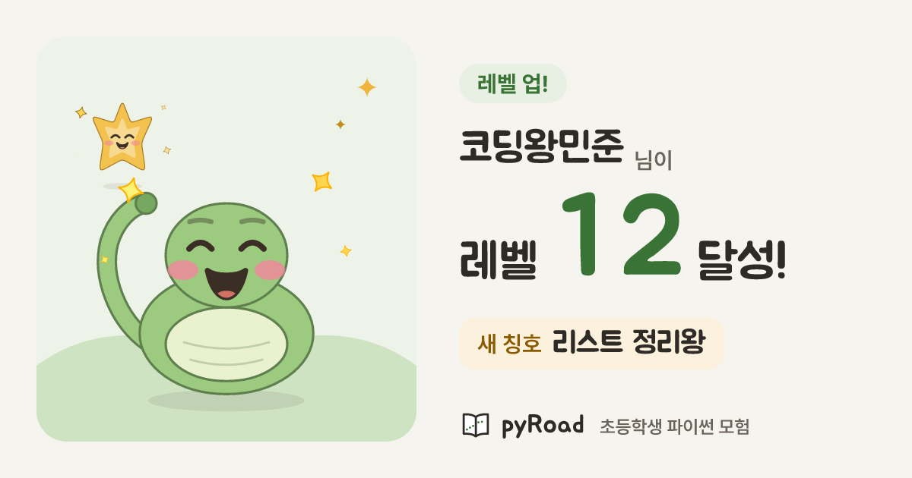
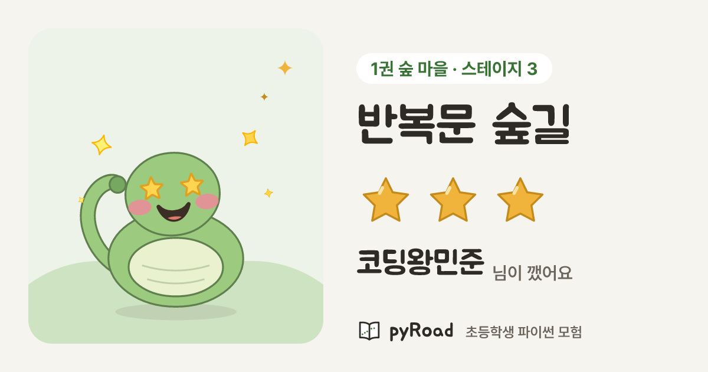
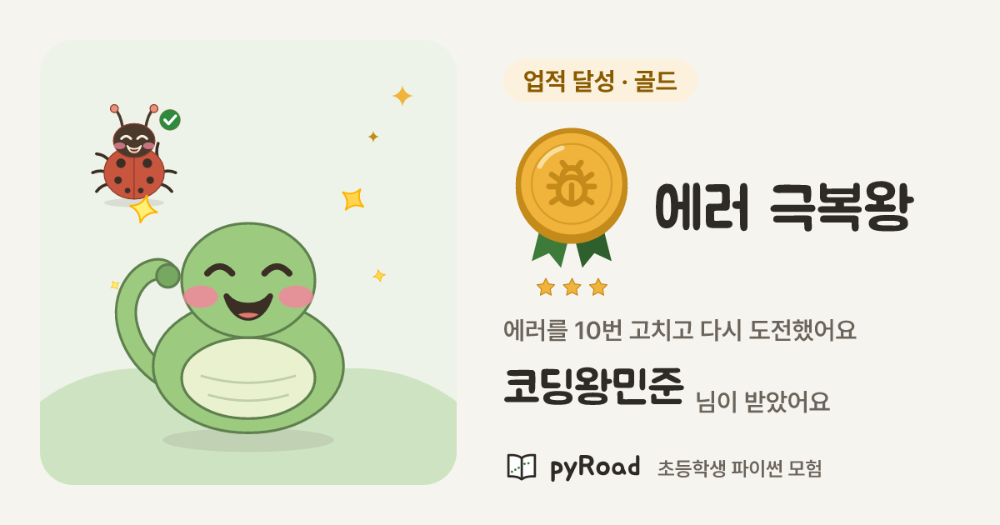
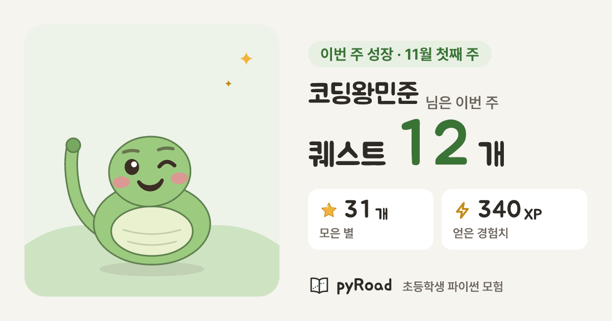

# 공유 카드 템플릿 (P2-19)

> - 근거: 계획서 §2.5(공유 카드)·§2.6(공개 정보)·§12-Q14(닉네임 글자)·§12-Q28~Q31(최종 시안) · [P0-10 스파이크](../spikes/P0-10-og-share-card.md) · [tokens.md](tokens.md) · [fonts.md](fonts.md) · [assets.md](assets.md) · [rig.md](rig.md)
> - 코드: `src/lib/share-card/` (테스트 `__tests__/share-card.test.tsx`) · 샘플 렌더 `scripts/share-card/render-samples.tsx` · 폰트 `src/fonts/share-card/`
> - 범위: 템플릿(디자인 + 렌더 코드)과 샘플(P2-19) + 카드 데이터(`share_cards`)·만들기 API·이미지 라우트(P9-07, §8). 공유 페이지·카카오·자랑하기 버튼·비공개는 P9-08~P9-11

## 1. 한눈에

| 레벨업 | 스테이지 클리어 |
|---|---|
|  |  |
| **업적** | **주간 성장** |
|  |  |

- **최종 시안 그대로**(§12-Q31): 단색 바탕 `bg #F6F4EF`, 테두리 없는 면, 색은 중립 + 초록(`primary`) + 금색(`accent`), 제목 Jua · 본문 pyRoad Sans(Pretendard). 종이 결·수채·흐림 그림자 없음.
- **캐릭터가 주인공**: 왼쪽 무대(월드 틴트 면 + 옅은 언덕)에 리그 정지 그림(스타일 B)을 크게(480px). 레벨업은 별똥이, 버그 업적은 버그버그가 손님으로 함께 나온다.
- **정보는 크게 하나**: 레벨 숫자 · 별 3개 · 메달 · 퀘스트 수. 썸네일(휴대폰에서 폭 약 300px, 1/4)에서도 읽히게 핵심은 100~150px, 꼭 읽혀야 하는 글자는 30px 이상.
- **공개 정보만**(§2.6): 닉네임 + 캐릭터(꾸미기) + 성과 숫자·이름. 실명·사진·학교·학년·학습 시각·요일별 활동은 넣지 않는다.
- 아래쪽 브랜드 줄 "pyRoad · 초등학생 파이썬 모험"은 4종 공통(자체 책 아이콘).

## 2. 템플릿 4종

공통 틀(`layout.tsx`): 1200×630, 여백 48px, 왼쪽 무대 500×534(반경 40) | 간격 56 | 오른쪽 글 548px(눈썹 → 닉네임 → 핵심 → 보조, 세로 가운데) + 아래 브랜드.

| 종류 | 데이터 (`types.ts`) | 눈썹 이름표 | 핵심 | 보조 | 캐릭터 |
|---|---|---|---|---|---|
| 레벨업 `levelup` | `level`, `title?`(새 칭호) | "레벨 업!" 초록 틴트 | "레벨 **12** 달성!" (숫자 150px 초록 글자, 자릿수가 늘면 줄어듦) | 새 칭호 금색 틴트 칸 | 파이뱀 응원 + 별똥이 반짝 |
| 스테이지 클리어 `stage` | `world`, `worldName`, `stageNo`, `stageName`, `stars`, `maxStars=3` | "1권 숲 마을 · 스테이지 3" 흰 칸 + 월드 ink | 스테이지 이름(Jua, 1~2줄) + 별 3개(100px, 2줄이면 84px) | "닉네임 님이 깼어요" | 파이뱀 뿌듯(별 눈) |
| 업적 `achievement` | `name`, `desc`, `tier`, `icon` | "업적 달성 · 골드" 티어 틴트 | 메달(160px) + 업적 이름(Jua, 1~2줄) | 설명 2줄 + "닉네임 님이 받았어요" | 파이뱀 기쁨 (+ `bug` 업적은 버그버그 화해) |
| 주간 성장 `weekly` | `weekLabel`, `quests`, `xp`, `stars` (합계만) | "이번 주 성장 · 11월 첫째 주" | "퀘스트 **12** 개" | 모은 별·얻은 경험치(XP, 번개) 두 칸 | 파이뱀 설명(윙크) |

- 데이터 → 엘리먼트: `renderShareCard(data)`(`cards.tsx`). 이미지 저장 파일 이름은 `SHARE_CARD_FILENAME`.
- 주간 카드는 **합계만**(§12-Q67 ②): 이번 주 퀘스트 수·XP·별. 요일별 활동(활동한 요일이 드러남)은 보호자 리포트(P9-15)에만. P2-19의 연속 공부·배운 것 칩은 P9-07에서 빼고 XP 칸으로 바꿈.

## 3. 상태

| 상태 | 규칙 | 샘플 |
|---|---|---|
| 빈 별 | `stars`를 0~`maxStars`로 자르고 채운 별 + 빈 별(중립 면 `line` + 옅은 선). 0개도 별 3칸이 다 보인다 | [별 1개](img/share-card/stage-w2-long-1star.png) · [별 0개](img/share-card/stage-w3-0stars.png) |
| 티어 브론즈·실버·골드 | 색 + **이름표 글자 + 메달 아래 별 점 1·2·3개**(색을 못 구별해도 알 수 있게). 리본은 브랜드 초록 | [골드](img/share-card/achievement-gold.png) · [실버](img/share-card/achievement-silver.png) · [브론즈](img/share-card/achievement-bronze-long.png) |
| 월드 1·2·3 틴트 | 무대 바탕 = `w{N}Soft`, 언덕 = `w{N}`를 45% 섞은 색, 스테이지 이름표 글자 = `w{N}Ink`. 스테이지 카드는 그 스테이지의 월드, 나머지는 `world`(기본 1) | 월드 1·2·3: 위 스테이지 샘플 3장 |
| 긴 닉네임 | 최대 10자(§12-Q14·P3-11). 10자는 **자르지 않고** 크기만 54 → 38px까지 줄인다(Jua 한글 폭은 가장 넓은 글자 0.872em로 어림 — 평균으로 잡았던 P2-19 값은 넓은 글자 10자가 CSS 말줄임에 걸렸음, P9-07)(붙는 말이 가장 긴 카드에서도, 테스트). 규칙 밖 입력은 10자 + `…` | [레벨업](img/share-card/levelup-long.png) · [주간](img/share-card/weekly-long.png) |
| 긴 제목 | 한 줄에 64px 이상이면 한 줄(최대 84), 아니면 2줄(64~48px), 그래도 넘치면 2줄 분량에서 `…`. 마지막 안전장치 `lineClamp: 2` | [2줄](img/share-card/stage-w2-long-1star.png) · [줄임표](img/share-card/achievement-bronze-long.png) |
| 큰 숫자 | Jua에는 고정폭 숫자가 없어 숫자마다 0.6em 칸(`Digits`). 레벨·퀘스트 수는 자릿수가 늘면 줄을 넘지 않게 크기를 줄인다(`fitNumberRow`) | [레벨 128](img/share-card/levelup-long.png) · [퀘스트 108](img/share-card/weekly-long.png) |
| 꾸미기 | 카드 스냅샷의 공개 꾸민 모습(스킨 + 모자·안경·망토·배경 아이템 id, P9-05 `public_avatar_look`과 같은 값) → `avatarLook` → 리그 정지 그림. 배경 아이템은 캐릭터 뒤 원으로 무대 안에. **펫·테두리는 그리지 않음**(공개 아바타와 같게 펫 없음, 테두리는 아바타 칩 장식이라 무대가 액자 역할) | [다 입기](img/share-card/levelup-costume.png) · [왕관·선글라스·망토 + 긴 닉네임](img/share-card/stage-costume-long.png) · [고깔·안경·종이 배경](img/share-card/achievement-costume.png) · [탐험가 + 망토](img/share-card/weekly-long.png) |

### 색 (모두 토큰 또는 토큰을 섞은 색, `tokens.ts`)

| 쓰임 | 색 | 대비 |
|---|---|---|
| 본문 / 바탕 | `text` / `bg` | 12.96 |
| 보조 글자 / 바탕 · 흰 칸 · 보조 면 | `textMuted` / `bg`·`surface`·`surface2` | 5.30 · 5.83 · 4.94 |
| 초록 숫자·이름표 / 바탕 · 초록 틴트 | `primaryText` / `bg`·`primarySoft` | 5.18 · 4.88 |
| 월드 이름표 / 흰 칸 | `w1Ink` · `w2Ink`·`w3Ink` / `surface` | 5.69 · 5.83 |
| 골드 이름표 | `accentText #8A5A00` / `accentSoft #FBF1DC` (면 `accent`, 테두리 `accentLip`) | 5.28 |
| 실버 이름표 | `textMuted #6B645B` / `surface2 #EFECE5` (면 `lineStrong` 36% + 흰색 = `#D6D4D0`, 테두리 `lineStrong`) | 4.94 |
| 브론즈 이름표 | `#9C4E15` / `#F4DFCB` (면 = `error` 42% + `accent` = `#D68337`, 테두리 `#BC6525`) — 금색·오류색을 섞은 구릿빛, 새 색상군 없음 | 4.62 |

모든 글자 조합 AA(테스트가 확인). 메달·별·리본·언덕은 장식.

## 4. 크기·안전 영역

- 마스터 **1200×630** PNG(`CARD`). 카카오는 스크랩 이미지를 800×400(2:1)으로 스마트 크롭해 1200×630에서 **위아래 15px**씩 잘린다(P0-10 §4.7). 핵심 요소는 위아래 **20px 안쪽**(`SAFE`) — 실제로는 바깥 여백 48px라 모든 요소가 안쪽에 있다.
- 확인용 가이드(빨간 띠 = 잘리는 15px, 선 = 20px): [레벨업](img/share-card/guide/levelup.png) · [스테이지](img/share-card/guide/stage.png) · [업적](img/share-card/guide/achievement.png) · [주간](img/share-card/guide/weekly.png)
- 썸네일 크기(300×150)로 줄여 봐도 핵심 정보(레벨 숫자·스테이지 이름·별·메달·퀘스트 수)와 닉네임이 읽힌다(직접 확인).

## 5. satori 제약 (P0-10 §4.5) — 지킨 방법

| 제약 | 이 템플릿 |
|---|---|
| flex만, 자식 2개 이상이면 `display: flex` | 모든 div. 테스트가 트리를 펼쳐 확인 |
| zIndex 없음 | 겹침은 DOM 순서(언덕 → 반짝이 → 손님 → 주인공). 테스트가 `zIndex` 금지 |
| 흐림 그림자·필터 비쌈 | `boxShadow`·`textShadow`·`filter` 0개(테스트). 메달 깊이는 단색 아랫면 원, 발밑 그림자는 리그에 든 단색 타원 |
| SVG `<text>`·`<foreignObject>`·래스터 `<image>` 안 그려짐 | 캐릭터·아이콘은 SVG 문자열 → data URI ``. 모든 상태·아이콘을 `findForbiddenSvg`로 검사 |
| 인라인 `<svg>` 안 함수 컴포넌트 안 펼침 | 리그 정지 그림을 자체 직렬화기(`svg.ts`, `react-dom/server` 없이)로 문자열화 |
| 이모지(Twemoji CDN) | 별·불꽃·메달·책 모두 자체 SVG(`icons.ts`). 카드 글자에 이모지 없음(테스트) |
| WOFF2 못 읽음 | TTF/OTF (§6) |

### 배경: 단색으로 둠 (진짜 질감 래스터는 안 씀)

- 최종 시안이 "단일 톤 바탕"(§12-Q29: 종이 결이 난잡함)이고 카드도 같은 결을 따른다. Q28이 공유 카드 배경을 래스터 허용 대상으로 열어 두었지만 지금 디자인에는 필요한 질감이 없어 `assets/share-card/`(P2-16 `card-bg`)는 비워 둔다. 이미지 생성 도구도 없다. 나중에 일러스트 배경을 넣으면 P2-16 절차(`assets-src/raster/` → `npm run assets:raster`, 1200×630 팔레트 PNG ≤ 100KB, 잠금 파일)로 넣고 무대 `backgroundImage`로 깐다.
- **`backgroundRepeat` 확인 (P2-16 리스크)**: satori(`@vercel/og` 0.7.2)에서 `repeat`(기본값)·`repeat-x`·`no-repeat`가 모두 CSS대로 동작했다. `public/textures/paper-grain.v1.png`(128px)를 data URI로 1200×630에 깔면 이음매 없이 반복된다. 대신 PNG가 11KB(단색) → **117KB**로 커지고 렌더가 약 100ms 늘어난다 → 잔 질감 타일을 카드 전면에 까는 것은 권하지 않는다. 확인 명령: `npm run share-card:render -- --lab=<폴더>`.

## 6. 폰트

`src/fonts/share-card/` (생성물, `npm run fonts:build -- --share-card`, 이름 변경·OFL 규칙은 [fonts.md](fonts.md)와 같음):

| 파일 | 이름 · 굵기 | 글자 | 쓰임 | 크기 (gzip) |
|---|---|---|---|---|
| `jua/Jua-KS2350.ttf` | `Jua` 400 | KS X 1001 2,350자 + 호환 자모 + ASCII + 기호 | 제목·닉네임·큰 숫자 | 1,298KB (364KB) |
| `pyroad-sans/pyRoadSans-SemiBold-KS2350.otf` | `pyRoad Sans` 600 | 2,350자 + … | 본문·설명 | 355KB (239KB) |
| `pyroad-sans/pyRoadSans-Bold-Full.otf` | `pyRoad Sans` 700 | **11,172자** + … | 이름표·숫자 + **대체 폰트** | 1,248KB (880KB) |
| 합계 | | | | **2,901KB (1,483KB)** |

- satori는 글자가 없으면 `fonts` 목록의 다른 폰트에서 **그 글자만** 가져온다. 그래서 Jua에 없는 `…·×`나 콘텐츠의 드문 글자는 pyRoad Sans Bold로 그려지고, 외부 네트워크(Google Fonts)는 쓰지 않는다.
- 닉네임 허용 글자(§12-Q14: 2,350자 + 영문·숫자)가 세 파일 모두에 있는지, Bold에 11,172자가 다 있는지는 `fonts:check`와 테스트가 본다.
- 로더 `fonts.ts`: 경로를 고정 문자열로 읽고(파일 추적, P0-10 §4.6), `fonts` 배열을 프로세스에 한 번만 만든다(satori 파싱 캐시가 배열 객체 기준).

## 7. 렌더 비용 (실측 2026-11-06)

`npm run share-card:render` — 운영과 같은 `next/og`(satori + resvg-wasm), Node 22, WSL2 20 vCPU, load 1.5~6(다른 에이전트 작업 중이라 상대값으로 볼 것).

| 샘플 | PNG | 첫 렌더 ms | warm 중앙값 ms |
|---|---|---|---|
| `levelup` | 67KB | 435 (cold: wasm·폰트 파싱 포함) | 238 |
| `levelup-long` | 70KB | 230 | 227 |
| `stage-w1-3stars` | 59KB | 264 | 274 |
| `stage-w2-long-1star` | 71KB | 280 | 281 |
| `stage-w3-0stars` | 63KB | 276 | 287 |
| `achievement-gold` | 79KB | 305 | 296 |
| `achievement-silver` | 72KB | 255 | 247 |
| `achievement-bronze-long` | 82KB | 259 | 246 |
| `weekly` | 66KB | 270~409 | 272~502 |
| `weekly-long` | 71KB | 367 | 318 |

- 장당 **약 0.23~0.32초**(부하가 높을 때 0.5~0.7초), PNG **59~82KB**. P0-10 시안 카드(0.8~1.3초, 146~310KB)보다 3~4배 싸다: 흐림 그림자·SVG 필터·수채 장식이 없어서(P0-10 §4.2에서 비용의 대부분이 필터였음).
- 그래도 요청마다 그리면 CPU가 아깝고 첫 카카오 스크랩이 cold를 탄다 → CDN 캐시는 여전히 필요(§8).

## 8. 카드 데이터·만들기 API·이미지 라우트 (P9-07 ✅)

- **데이터** `share_cards`(00043): id = 128비트 난수 base64url 22자, `kind`·`ref`(레벨·스테이지 id·업적 id·주 월요일, 사용자·종류·ref당 1행), `snapshot`(공개 정보만 — 최상위 키를 DB CHECK와 `snapshot.ts`(zod `strict`)가 같은 목록으로 고정), `version`, `is_public`, `expires_at`(**90일 뒤 자동 비공개**, §12-Q67). 본인 행 읽기만, 쓰기는 RPC만.
- **만들기** `POST /api/share-cards` `{ kind, ref? }` → `guardianWriteGate`(P3-15) → service_role `create_share_card`: 성과 숫자는 클라이언트 값을 받지 않고 실제 기록으로 계산(레벨 = `current_level`, 스테이지 = 코드 퀘스트를 다 끝낸 것만·별 = 그 스테이지 별 합 ÷ 만점 × 3 내림, 업적 = 얻은 것만·메달 그림은 분류에서, 주간 = 이번 주 처음 끝낸 퀘스트 수·그 XP·그 별). 닉네임은 공개 이름, 아바타는 공개 꾸민 모습(펫 없음). 같은 카드를 다시 만들면 같은 id로 다시 공개 + 새 90일, 스냅샷이 바뀌었으면 `version + 1`. 응답 `{ id, kind, version, expiresAt, imageUrl }`, 거절은 아이용 문구(`stage_not_cleared`·`achievement_not_earned`·`nothing_this_week` 409).
- **이미지** `GET /api/share-cards/{id}/image?v={version}`: `runtime = 'nodejs'`, service_role `share_card_public`(공개·만료 전만, user_id 없음) → `cardFromSnapshot` → `renderShareCard`. **쿼리 문자열은 읽지 않음**(`v`는 캐시 키). 헤더: `cache-control: public, max-age=3600`, `vercel-cdn-cache-control: public, max-age=31536000`, `vercel-cache-tag: share-card-{id}`, `content-disposition: inline; filename="pyroad-<종류>.png"`, `x-robots-tag: noindex`. 단 두 max-age는 **만료 시각까지 남은 초를 넘지 않음**(CDN 사본이 90일 비공개를 늦추지 않게). 키는 소문자로: `ImageResponse`의 기본 `cache-control`(1년 immutable)을 덮어야 해서. 없음·비공개·만료·모양이 틀린 스냅샷은 404 `no-store`.
- **함수 번들**: `next.config.ts` `outputFileTracingIncludes`(`./src/fonts/share-card/**/*.{ttf,otf}`). 빌드 뒤 `route.js.nft.json` 폰트 = 카드 폰트 3개 + `@vercel/og` 기본 Noto(라틴) 1개, 추적 파일 합 약 8.3MB(2026-11-13).
- **스냅샷 비교 테스트** `__tests__/png-snapshot.test.tsx`: 샘플마다 운영 엔진으로 그려 커밋한 PNG와 픽셀 비교(채널 차이 24 넘는 픽셀 0.2% 미만). 숫자 한 자리만 바뀌어도(0.5%) 실패. 의도한 변경이면 `npm run share-card:render` 후 PNG를 같은 커밋에.
- **P9-08로**: 공유 페이지는 `loadPublicShareCard(id)`(`publicCard.ts`, null = 404)와 `shareCardImagePath(id, version)`을 쓰면 된다. 미들웨어 matcher에서 `/share`·`/api/share-cards` 제외, 함수 리전. **P9-11로**: 비공개·삭제 뒤 `dangerouslyDeleteByTag('share-card-{id}')`, 다시 공개 = `expires_at = now() + 90일`.
- **P4-10** ✅ 사이트 OG 이미지도 같은 틀·폰트(`CardFrame`·`Stage`·`loadShareCardFonts`)로: `src/lib/share-card/site.tsx`(`SiteOgCard`) → `src/app/opengraph-image.tsx`(`force-static`, 빌드 때 한 번 생성, 런타임 함수·폰트 파일 추적 없음). 무대는 월드 1 틴트에 지도(먼·가까운 언덕, 점선 잉크 길 → 금색 X, 깃발 탑, 나무, 해) + 손 흔드는 파이뱀, 글은 "무료 · 설치 없이 웹에서" / "파이뱀과 떠나는 파이썬 모험"(둘째 줄 형광펜) / "퀘스트를 깨며 진짜 파이썬 코드를 배워요". `Stage`에 `backdrop`(바탕 그림)·`ground`(기본 언덕 끄기)·`heroLeft`를 더함. 샘플 [site-og](img/share-card/site-og.png) · [가이드](img/share-card/guide/site-og.png), `npm run share-card:render -- --only=site-og`
- **P2-12 카탈로그**는 이 문서의 샘플 PNG를 링크하면 된다(개발 전용 미리보기 라우트는 만들지 않음: 운영 번들에 폰트를 싣지 않으려고).

## 9. 고치는 법

```bash
npm run share-card:render                      # 샘플 PNG 다시 그리기 (+ 렌더 시간 표)
npm run share-card:render -- --only=stage      # 일부만
npx vitest run src/lib/share-card              # 글자 규칙·상태·금지 요소·폰트 커버리지
npm run fonts:build -- --share-card            # 카드 폰트 다시 만들기 (python3 + fontTools)
npm run fonts:check && npm run tokens:check
```

- 샘플 데이터는 `samples.ts`(지어낸 닉네임). 새 상태를 만들면 샘플을 추가하고 PNG를 같은 커밋에.
- 색은 `@/lib/design/tokens`에서만(리터럴 금지, `tokens:check`). 새 글자 조합은 테스트의 대비 목록에 추가.
