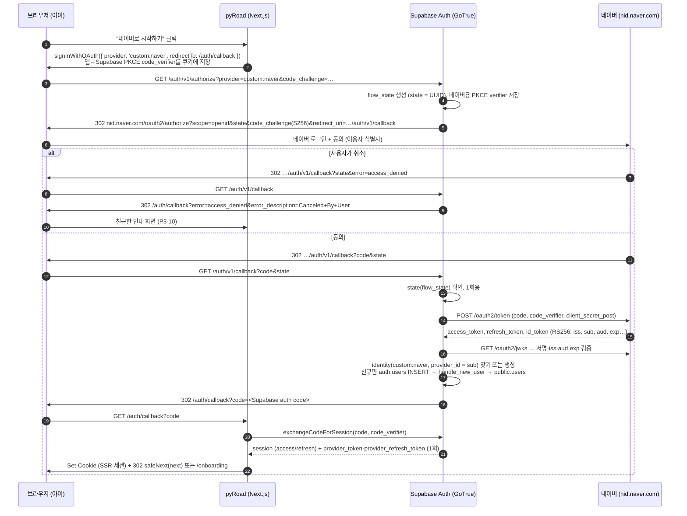

# P0-03 Naver 로그인 (Supabase 커스텀 provider)

> - 작성일: 2026-11-03 · 브랜치 `feat/phase0`
> - 코드: [`spikes/p0-03-naver/`](../../spikes/p0-03-naver/)
> - 관련: [업그레이드 계획서](../4.upgrade-plan.md) §2, P3-03~P3-10, P3-16, §11, §12-Q5·Q12, B23, B24, B28
> - 범위: 공식 문서 + 코드 프로토타입 + mock 테스트 (사용자 결정 2026-11-03). 실제 네이버 앱 등록과 실제 로그인은 Phase 3에서 진행

## 1. 결론: **채택** (방식 변경: OAuth2 매핑 → OIDC provider)

- 계획서가 가정한 **"`custom:naver` OAuth2 provider + 중첩 userinfo 매핑"은 불가**입니다. Supabase Auth(GoTrue)는 userinfo JSON을 평탄한 표준 클레임(`sub`, `email`, `nickname` …)으로만 읽고, `attribute_mapping`은 최상위 키 복사만 합니다. 네이버 응답은 `{ resultcode, message, response: { id, … } }`라서 `sub`가 비고, 로그인은 `error missing provider id`로 실패합니다. 매핑과 `custom_claims_allowlist`를 써도 같습니다 (코드 확인 + 실측).
- 대신 **네이버가 OpenID Connect를 지원**합니다(`https://nid.naver.com/.well-known/openid-configuration`, RS256 id_token, PKCE S256). Supabase 커스텀 provider를 **OIDC 타입**(issuer `https://nid.naver.com`, `email_optional: true`)으로 만들면, GoTrue가 id_token의 평탄한 `sub`로 사용자를 식별하고 userinfo는 부르지 않습니다. 중첩 구조 문제가 아예 생기지 않으므로 **서버 브릿지는 필요 없습니다.** 앱 코드는 Google과 같은 `signInWithOAuth({ provider: 'custom:naver' })` + 기존 `/auth/callback`입니다.
- 실제 GoTrue v2.197.0(로컬 Supabase CLI)과 네이버 동작을 흉내 낸 HTTPS mock으로 정상 로그인, 재로그인(같은 사용자), 이메일 없음, 동의 취소, state 변조, 콜백 재전송, 이메일 충돌, 삭제 후 재가입, 수동 연결까지 **E2E 21개 + 단위 12개가 통과**했습니다. 실제 네이버 discovery 문서를 GoTrue admin API가 검증하고 실제 네이버 authorize URL을 만드는 것도 확인했습니다.
- 실제 앱으로만 확인할 수 있는 항목이 3가지 남습니다(§7). P3-04 첫날 테스터 계정으로 확인하고, 문제가 있으면 **대안 B**(OAuth2 + userinfo 평탄화 어댑터) → **대안 C**(서버 브릿지) 순서로 전환합니다. 두 대안도 프로토타입과 테스트를 만들어 두었습니다.
- 아동 개인정보 측면에서도 유리합니다. 네이버에 **이용자 식별자만** 요청하면 이름·이메일·사진을 아예 받지 않고(§2.6), 검수 때 "제공 정보 활용처" 자료도 필요 없습니다.

## 2. 검증한 질문

| # | 질문 | 답 | 근거 |
|---|---|---|---|
| 1 | Supabase Auth가 커스텀 OAuth2/OIDC provider를 지원하나? | **지원 (GA).** 2026-04-08 출시. 식별자는 `custom:` 접두사. Free 플랜은 프로젝트당 3개, Pro 이상 무제한. 대시보드(Authentication > Sign In / Providers > Custom Providers) 또는 admin API(`supabase.auth.admin.customProviders.*`, `POST /auth/v1/admin/custom-providers`, service role/secret 키)로 설정. 로컬 `config.toml`에는 항목이 없음(CLI 2.115.0) → 로컬도 admin API. 호출은 `signInWithOAuth({ provider: 'custom:naver' })`. 현재 repo의 supabase-js 2.101.0에 `custom:${string}` 타입과 `admin.customProviders`가 이미 있어 업그레이드 불필요 | 문서 확인 (Supabase docs·blog), 실측 (로컬 admin API, `scripts/create-naver-provider.ts`) |
| 2 | 네이버 로그인 API 사실관계 | §4.7 표 참고. OIDC 지원, id_token에는 식별자만, 프로필은 중첩 JSON, 식별자 외 모든 항목은 사용자가 거부 가능, 로그아웃 API 없음, 토큰 폐기 API 있음, 검수 2~3 영업일(검수 전 관리자·테스터만) | 문서 확인 (developers.naver.com), 실측 (실제 discovery·JWKS 조회) |
| 3 | 커스텀 provider가 중첩 userinfo(`response.id`)를 매핑할 수 있나? | **불가.** `attribute_mapping`은 이미 평탄화된 Claims에서 최상위 키만 복사(점 경로 없음). OIDC 타입은 id_token의 `sub`를 쓰므로 문제 회피 | 코드 확인 (`internal/api/provider/custom_oauth.go`), 실측 (E2E "원안" 2건) |
| 3' | 안 되면 서버 브릿지는? | 필요 없음. 대안으로 B(어댑터), C(브릿지, `generateLink` + `verifyOtp`, 합성 이메일) 설계·검증. 자체 JWT 발급, 익명 로그인 + 연결, Third-party auth는 불가 판단 | 실측 (E2E B-1, C-1·C-2), 코드·문서 확인 |
| 4 | 보안 (state·nonce, 오픈 리다이렉트, 토큰 보관, rate limit, 이메일 충돌 탈취) | §4.8. state·PKCE·재전송은 GoTrue가 막음(실측). 이메일 충돌로 기존 계정에 붙지 않음(실측). nonce는 보내지 않지만 code flow + PKCE라 허용 가능. 앱의 `next` 검증(B23)은 별도 수정 필요 | 실측 (E2E A-5·A-6·A-8), 코드 확인 |

## 3. 방법 & 환경

| 항목 | 버전·내용 |
|---|---|
| Supabase CLI | 2.115.0, scratch 디렉토리에 별도 스택(`project_id = p003naver`, 포트 5542x, realtime·storage·studio 등 제외). 끝난 뒤 `supabase stop --no-backup`으로 삭제 |
| GoTrue | **v2.197.0** (CLI 기본값은 v2.195.0. `supabase/.temp/gotrue-version`으로 고정). 소스는 `supabase/auth` master `004f767`(2026-11-03)과 v2.197.0 태그를 대조, `custom_oauth.go` 차이 없음. 의존성 go-oidc v3.20.0, golang.org/x/oauth2 v0.36.0 |
| DB | Supabase Postgres 17.6.1.159, repo의 `00001`·`00002` 마이그레이션 적용(`handle_new_user` 포함) |
| 클라이언트 | `@supabase/supabase-js` 2.101.0 (repo와 같은 버전), Node 22.23.2 (TS 타입 제거 실행, `node:test`) |
| 실행 환경 | Docker Desktop 29.8.2 / WSL2 |

**실험실 구성**. GoTrue는 커스텀 provider의 URL이 **https이고 사설 IP가 아닐 때만** 허용합니다(생성 시 admin API, 실행 시 OIDC discovery·JWKS 조회, DB CHECK 제약 모두). 그래서 GoTrue 코드를 바꾸지 않고 다음과 같이 꾸몄습니다 (`scripts/lab-up.sh`).

1. 일회용 테스트 CA로 `mock-nid.p003.test` 인증서를 만들고, mock 네이버를 HTTPS로 띄움
2. Docker 네트워크를 `100.64.53.0/24`(CGNAT 대역, RFC1918 아님)로 만들어 SSRF 검사를 통과시킴
3. CLI가 만든 auth 컨테이너를 같은 이미지·환경변수·이름으로 다시 만들고 `SSL_CERT_DIR`에 테스트 CA만 추가
4. 테스트 클라이언트(브라우저 역할)도 같은 네트워크의 컨테이너에서 실행. 호스트로는 아무 포트도 열지 않음
5. mock provider는 **공식 admin API**(`customProviders.createProvider`)로 등록 → 운영과 같은 검증 경로

**mock 네이버의 충실도** (`mock-naver/server.ts`). 문서와 실제 discovery를 따라 구현: discovery 문서는 실제와 같은 필드, 토큰 엔드포인트는 `client_secret_post`만 허용(Basic만 오면 401, code는 소모하지 않음), `expires_in`은 문자열 `"3600"`, 오류는 HTTP 200 + `{error}`, id_token은 RS256에 `iss/sub/aud/azp/exp/iat/jti(/nonce)`만, 프로필은 중첩 JSON, 취소는 `error=access_denied&error_description=Canceled By User`, code는 1회용, PKCE S256 검증. **mock이 증명하지 못하는 것**은 실제 네이버의 세부 동작이며 §7에 따로 적었습니다.

**부수 발견 (Phase 1 참고)**. 이 로컬 Postgres 이미지는 `postgres`가 만든 public 테이블에 `anon/authenticated/service_role`의 SELECT·INSERT·UPDATE·DELETE 기본 권한을 주지 않습니다(`pg_default_acl`이 `Dxtm`만). repo 마이그레이션에는 GRANT가 없어 로컬 새 DB에서는 `permission denied for table users`가 납니다. 테스트에서는 운영과 같게 GRANT를 직접 줬습니다. 로컬 개발 환경을 만들 때(Phase 1) 마이그레이션에 명시적 GRANT가 필요한지 확인하세요.

**문서 출처** (2026-11-03 확인)
- Supabase: [Custom OAuth/OIDC Providers](https://supabase.com/docs/guides/auth/custom-oauth-providers), [Self-hosted custom providers](https://supabase.com/docs/guides/self-hosting/self-hosted-custom-oauth-providers), [출시 블로그](https://supabase.com/blog/custom-oauth-oidc-providers), [Rate limits](https://supabase.com/docs/guides/auth/rate-limits)
- GoTrue 소스: `internal/api/provider/custom_oauth.go`, `provider.go`(Claims), `oidc.go`, `internal/api/external.go`, `identity.go`, `custom_oauth_admin.go`, `internal/models/linking.go`, `identity.go`, `internal/utilities/url_validator.go`
- 네이버: [로그인 API 명세](https://developers.naver.com/docs/login/api/api.md), [개발 가이드](https://developers.naver.com/docs/login/devguide/devguide.md)(3.5 OIDC, 4.3 토큰 폐기, 4.4 연결 끊기 알림, 5.3 네이버앱 스킴 로그인), [프로필 API](https://developers.naver.com/docs/login/profile/profile.md), [사전 검수 가이드](https://developers.naver.com/docs/login/verify/verify.md), [애플리케이션 등록](https://developers.naver.com/docs/common/openapiguide/appregister.md), [FAQ](https://developers.naver.com/products/intro/faq/faq.md), 실제 discovery 스냅샷 `fixtures/naver-openid-configuration.2026-11-03.json`

## 4. 결과

### 4.1 원안 불가: OAuth2 provider + 중첩 userinfo (코드 확인 + 실측)

```go
// custom_oauth.go — userinfo JSON을 평탄한 Claims 구조체로 바로 디코드
claims, raw, err := fetchUserinfoClaims(ctx, tok, p.config, p.userinfoURL)
// applyAttributeMapping — 이미 디코드된 claims에서 "최상위 키"만 찾음
if value, exists := claimsMap[v]; exists { claimsMap[targetField] = value }
// models/identity.go — sub가 비면 structs.Map이 키를 빼서 여기서 실패
providerId, ok := identityData["sub"]; if !ok { return nil, errors.New("error missing provider id") }
```

| 설정 | 결과 (실측) |
|---|---|
| OAuth2, userinfo = 네이버 `/v1/nid/me` | 앱 콜백 `error=server_error&error_description=error missing provider id`, 사용자 생성 없음 |
| 위 + `attribute_mapping: { sub: "response.id", … }` + `custom_claims_allowlist: ["response"]` | 같은 오류. 점 경로를 해석하지 않음 |
| 실제 네이버 URL로 같은 OAuth2 provider 생성 | 생성 자체는 성공(R-4) → 문제는 첫 로그인 때 드러남 |

빈 `sub`일 때 다른 사용자로 로그인되는 일은 없습니다(빈 identity를 만들지 못하고 실패, fail-closed). 참고로 `email_verified`는 매핑 대상에서 금지되어 있습니다.

### 4.2 채택안: `custom:naver` OIDC provider (실측)

E2E A-1에서 관찰한 흐름입니다.

- GoTrue가 만든 네이버 authorize URL: `…/oauth2/authorize?client_id&code_challenge&code_challenge_method=S256&redirect_to&redirect_uri=<API>/auth/v1/callback&response_type=code&scope=openid&state=<flow_state UUID>`. `client_secret` 없음, **nonce 없음**. `redirect_to`도 네이버로 같이 넘어감(무해할 것으로 보이나 실 앱 확인 항목)
- 토큰 교환: GoTrue(x/oauth2 자동 감지)가 먼저 `client_secret_basic`으로 시도 → 401 → `client_secret_post`로 재시도해 성공. 네이버 discovery는 `client_secret_post`, `none`만 표시
- id_token 서명·`iss`·`aud`·`exp`를 JWKS로 검증한 뒤 사용자 생성
- 결과 사용자
  - `email` 비어 있음, `app_metadata.provider = "custom:naver"`
  - `identities[0] = { provider: "custom:naver", id(provider_id): <네이버 sub> }`
  - `user_metadata = { iss, sub, aud: [client_id], exp, iat, email_verified: false, phone_verified: false }` (이름·닉네임·사진·이메일 없음)
  - `handle_new_user`가 `public.users`에 `display_name = ''`, `avatar_url = ''`로 행을 만듦
- 이 세션으로 PostgREST에서 본인 `users` 행 조회 성공(RLS `auth.uid()` 동작), `refreshSession()`·`getUser()` 성공
- `exchangeCodeForSession` 응답에 `provider_token`, `provider_refresh_token`이 **한 번** 들어옴 → 탈퇴 시 네이버 연동 해제에 사용 가능(§6 P3-16)

### 4.3 예외 흐름 (실측)

| ID | 상황 | 결과 |
|---|---|---|
| A-2 | 같은 네이버 계정 재로그인 | 같은 Supabase user id, identity 1개 |
| A-3 | 다른 네이버 계정 | 다른 사용자 |
| A-4 | 동의 화면에서 취소 | 앱 콜백 `/auth/callback?error=access_denied&error_description=Canceled+By+User` (쿼리와 fragment 둘 다), 사용자 생성 없음 |
| A-5 | 네이버 → GoTrue 콜백의 state 변조 | **Site URL**(`/`)로 `error=invalid_request&error_code=bad_oauth_state&error_description=OAuth state not found or expired`, 사용자 없음 |
| A-6 | 같은 콜백 URL 재전송 | `error_code=flow_state_already_used` |
| A-6 | 다른 브라우저(code_verifier 없음)에서 code 교환 | `PKCE code verifier not found in storage…` 오류 |
| A-7 | `email_optional` 기본값(false) | `error=server_error`, `Error getting user email from external provider` → **반드시 `email_optional: true`** |
| A-8 | 같은 이메일의 기존 계정이 있음 | 자동 연결 없음, 별도 사용자 생성, 기존 계정 identity 그대로 |
| A-9 | `admin.deleteUser` 후 재로그인 | `public.users` cascade 삭제, 새 user id로 재가입 |
| A-10 | `signInWithOAuth`의 `queryParams` | 네이버 authorize URL로 그대로 전달(예: `appscheme=true`, `prompt=login`) |
| A-11 | 이메일 있는 계정(Google 역할)에 `linkIdentity('custom:naver')` | 성공. 이후 네이버 로그인은 그 계정으로 들어감 |
| A-12 | 이메일 없는 계정(네이버)에 이메일 없는 다른 identity 연결 | 실패: `Error sending confirmation email`. GoTrue는 이메일 없는 사용자에 연결할 때 새 identity의 이메일을 확인 메일로 검증하려 함(`identity.go`) |

### 4.4 실제 네이버 메타데이터 (실측, 앱 등록 없이)

| ID | 확인 | 결과 |
|---|---|---|
| R-1 | `createProvider({ provider_type: 'oidc', issuer: 'https://nid.naver.com', … })` | 성공. GoTrue가 실제 discovery를 받아 검증·저장 |
| R-2 | `signInWithOAuth({ provider: 'custom:naver' })` | `https://nid.naver.com/oauth2/authorize?…scope=openid&code_challenge_method=S256…`. 더미 client로 1회 요청 시 네이버 HTTP 400(정상: 미등록 client) |
| R-3 | `http://` issuer | 생성 거부(`URL must use HTTPS`) |
| R-4 | 원안 설정을 실제 네이버 URL로 생성 | 생성 성공(→ 실패는 로그인 때) |

실제 discovery 요약: `issuer https://nid.naver.com`, `token_endpoint /oauth2/token`, `jwks_uri /oauth2/jwks`, `revocation_endpoint /oauth2/revoke`, `userinfo_endpoint https://openapi.naver.com/v1/nid/me`(중첩, 비표준), `scopes_supported [openid, profile]`, `subject_types_supported [pairwise]`, `code_challenge_methods_supported [S256]`, `claims_supported [iss, sub, aud, exp, iat, jti, azp, nonce]`. JWKS 키 1개(RSA).

### 4.5 대안 B: OAuth2 provider + userinfo 어댑터 (실측)

`adapter/naverUserinfoAdapter.ts`를 provider의 `userinfo_url`로 등록합니다. GoTrue가 보내는 `Bearer <네이버 access token>`을 네이버 `/v1/nid/me`로 전달하고 `{ sub: response.id }`만 돌려줍니다(기본값. 닉네임·사진은 옵션, **이메일은 절대 전달하지 않음**). E2E B-1에서 로그인·재로그인 동일 사용자 확인. 비밀값이 필요 없는 Route Handler 하나(약 50줄)지만, GoTrue의 SSRF 검사 때문에 **공개 HTTPS URL**이어야 하고 로그인 경로에 우리 서버가 하나 더 끼어듭니다.

### 4.6 대안 C: 서버 브릿지 (실측)

`bridge/naverBridge.ts`(start·callback), `bridge/supabaseAdapters.ts`(service role). HMAC 서명 state 쿠키(`HttpOnly`, `SameSite=Lax`, `path=/auth/naver`, 10분) → 네이버 legacy OAuth2 → `/v1/nid/me` → `admin.createUser`(합성 이메일 `n_<HMAC(pepper, naver id)>@<우리 서브도메인>`, `app_metadata.naver_id`) → `admin.generateLink({ type: 'magiclink' })` → 서버에서 `verifyOtp({ token_hash })` → 실제 GoTrue 세션. 단위 테스트(정상, 이메일 없음, 재로그인, 취소, state 불일치·누락·위조·만료, 토큰·프로필 오류)와 실제 GoTrue E2E(C-1 세션 refresh·`getUser`·RLS, C-2 재로그인 동일 사용자) 통과.

세션 발급 방식 비교

| 방식 | 판단 | 이유 |
|---|---|---|
| `generateLink` + `verifyOtp(token_hash)` (합성 이메일) | **가능 (C 채택 시 이 방식)** | 실제 GoTrue 세션(refresh·`auth.sessions`·RLS·삭제 정상). 메일은 보내지 않음. 단점: `auth.users.email`에 가짜 주소, identity가 `email`로 남음, `/verify`가 **IP당 5분 30회**(서버에서 부르면 Vercel IP에 몰림 → `Sb-Forwarded-For` + 새 secret API 키 필요, 기존 service_role 키는 미지원) |
| 휴대폰 번호 | 불가 | 네이버 휴대폰은 선택 항목 + 검수 시 사업자 확인, 아동 개인정보 과다 |
| 자체 JWT 서명 | 불가 | `auth.sessions` 행이 없어 미들웨어의 `getUser()`가 실패, refresh 불가, 신규 비대칭 서명 키와도 충돌 |
| 익명 로그인 + 연결 | 불가 | 다른 기기에서 같은 사용자로 돌아올 방법이 없음(결국 C1 문제로 회귀) |
| Third-party auth (Firebase·Auth0·Cognito·Clerk·WorkOS) | 불가 | 사용자가 `auth.users`에 없어 FK·`handle_new_user`·RLS 설계와 맞지 않고, 네이버는 지원 발급자가 아님 |

### 4.7 네이버 로그인 사실 정리 (문서 확인, * 표시는 실측)

| 항목 | 내용 |
|---|---|
| 엔드포인트 (OIDC) | authorize `https://nid.naver.com/oauth2/authorize`, token `POST https://nid.naver.com/oauth2/token`, JWKS `/oauth2/jwks`, revoke `/oauth2/revoke`, discovery `/.well-known/openid-configuration`* |
| 엔드포인트 (legacy OAuth2) | `/oauth2.0/authorize`, `/oauth2.0/token`(발급·갱신), `/oauth2.0/revoke` |
| 프로필 | `GET https://openapi.naver.com/v1/nid/me` (Bearer) → `{ resultcode: "00", message: "success", response: { id, nickname, name, email, gender, age, birthday, profile_image, birthyear, mobile } }`. 실패 `401 {resultcode:"024"}`. 샘플: `fixtures/naver-samples.json` |
| 식별자 | `response.id` / id_token `sub`: 앱(Client ID)마다 다른 값(pairwise*). 2021-05-01 이후 앱은 64자 이내 BASE64 문자열. Client ID를 바꾸면 기존 사용자를 식별할 수 없음 → **앱 1개를 계속 사용** |
| id_token | RS256, 클레임 `iss, sub, aud, azp, exp, iat, jti, nonce`만. **프로필 정보 없음** |
| 동의 항목 | "이용자 식별자"만 기본. 그 외(이름, 이메일, 별명, 사진, 성별, 연령대, 생일, 출생연도, 휴대전화)는 앱이 선택하고 **사용자가 개별 거부 가능**. 재동의 `auth_type=reprompt` |
| 이메일 | 선택 동의라 없을 수 있음. 값은 "연락처 이메일"(사용자가 바꿀 수 있음)이라 검증된 로그인 식별자로 보면 안 됨 |
| state | legacy authorize·token에서 필수, OIDC authorize에서는 선택. GoTrue는 항상 보냄 |
| PKCE | OIDC 엔드포인트만 S256 지원(문서·discovery). legacy는 문서에 없음 |
| 토큰 | access 1시간(`expires_in` 문자열), refresh로 갱신. 토큰 오류도 HTTP 200 + `error` |
| 폐기(탈퇴) | `POST /oauth2.0/revoke` 또는 discovery의 `/oauth2/revoke`, `client_secret_post`, 연결된 쌍까지 폐기, 이미 없어도 200 → **상태 코드로만 판단** |
| 연결 끊기 알림 | 사용자가 네이버에서 동의 철회·탈퇴하면 등록한 URL로 `POST`(clientId, `encryptUniqueId`(AES-128-CBC, 키 = MD5(client_secret) 앞 16바이트), timestamp, signature). 재시도 없음 |
| 로그아웃 | 네이버 로그아웃 API 없음(정책상). 공용 PC에서는 네이버 세션이 남음 → 재로그인 강제는 OIDC `prompt=login`(discovery `prompt_values_supported`) 또는 `auth_type=reauthenticate` |
| 인앱 브라우저 | 인앱 WebView에서도 ID/PW 로그인 가능(Google처럼 막지 않음). "네이버 앱으로 자동로그인"은 Android 크로미움·WebView에서 `appscheme=true`(SDK 미사용 시), iOS는 모든 모바일 브라우저. WKWebView는 커스텀 스킴을 막을 수 있어 버튼이 무반응일 수 있음 |
| 앱 등록 | 개발자센터에서 휴대폰 인증 후 등록(단체 회원 권장). 서비스 URL(도메인 기준), Callback URL 환경별 최대 5개, 앱 이름(10자 이내 권장)·로고가 동의 화면에 노출 |
| 검수 | 등록 직후 "개발 중": 등록자·관리자·테스터 ID만 로그인 가능. 검수 신청 → 2~3 영업일(FAQ는 3~4일) 이메일 통보, 반려 시 재검수. 식별자 외 항목을 고르면 실제 활용 화면 캡처 필요(통계 목적은 반려), 가입 시 별도 비밀번호 요구 시 반려, 네이버를 연상시키는 이름·로고 반려. 같은 서비스 URL로 승인된 앱이 있으면 그 앱 사용 안내 |
| 만 14세 | "만 14세 이상만 가입 가능"은 약관 동의 대행(네이버 로그인 플러스) 옵션 → pyRoad는 **켜지 않음**. 법정대리인 동의는 네이버가 대신해 주지 않으므로 P3-15를 그대로 진행 |

### 4.8 보안 검토

- **state·CSRF·재전송**: GoTrue가 state로 DB의 flow_state UUID를 쓰고 1회만 허용합니다(A-5, A-6). 앱↔GoTrue PKCE(`code_verifier`는 `@supabase/ssr` 쿠키)와 GoTrue↔네이버 PKCE(S256) 두 겹입니다.
- **nonce**: 리다이렉트 흐름에서 GoTrue는 nonce를 만들지 않습니다(`skip_nonce_check`는 `signInWithIdToken` 전용). id_token을 서버가 TLS로 토큰 엔드포인트에서 직접 받는 code flow + PKCE라 OIDC Core 기준 필수는 아닙니다. 서명·`iss`·`aud`·`exp`는 go-oidc가 검증합니다.
- **오픈 리다이렉트**: GoTrue는 `redirectTo`를 Redirect URLs 허용 목록과 비교합니다. 운영에서는 와일드카드 없이 정확한 URL만 둡니다. 앱의 `next`(B23)는 GoTrue와 무관하게 앱이 고쳐야 합니다(`bridge/safeNext.ts`: 단일 `/`로 시작, `//`·`\`·스킴·제어문자 거부, 허용 경로만). 참고: 계획서의 위치 `route.ts:134`는 현재 파일(27줄) 기준 7행(`next` 읽기)과 16~20행(리다이렉트)입니다.
- **토큰 보관**: GoTrue는 네이버 토큰을 code 교환 전까지만 `auth.flow_state`에 두고, `exchangeCodeForSession` 때 한 번 돌려준 뒤 그 행을 지웁니다(`token.go` PKCE grant). 우리도 저장하지 않습니다. client secret은 `auth.custom_oauth_providers`에 저장(DB 암호화 설정 시 암호화)되며 `updateProvider`로 교체합니다. provider 생성·수정은 service role 키가 필요하므로 앱이 아니라 운영 스크립트·대시보드에서만 합니다.
- **이메일 충돌 탈취**: GoTrue는 검증된 이메일만 자동 연결합니다. OIDC에는 이메일이 없고(A-8), 어댑터(B)는 이메일을 전달하지 않으며, 브릿지(C)는 우리 도메인의 합성 이메일을 씁니다. 세 방식 모두 Google 계정에 자동으로 붙지 않습니다.
- **rate limit**: `/auth/v1/token`(PKCE 교환 포함) IP당 5분 150회, `/verify` 5분 30회. `/auth/callback`에서 서버가 교환하는 구조는 현재 Google과 같습니다. 대안 C를 쓰면 `/verify`가 병목이라 `Sb-Forwarded-For`가 필요합니다.
- **공용 기기**: 네이버 로그아웃 API가 없어 학교 PC에서 다음 아이가 이전 아이 계정으로 바로 들어갈 수 있습니다. 공용 기기 모드에서는 `queryParams: { prompt: 'login' }`으로 매번 비밀번호를 받거나, 로그아웃 화면에서 네이버 로그아웃을 안내합니다(A-10에서 파라미터 전달 확인, 네이버 동작은 실기기 확인).
- **SSRF**: GoTrue가 provider URL을 https + 공인 IP로 제한하는 것은 장점입니다. 대안 B의 어댑터도 공개 HTTPS여야 합니다.

## 5. 선택지 비교

| | **A. `custom:naver` OIDC (채택)** | 원안: OAuth2 + 매핑 | B. OAuth2 + userinfo 어댑터 | C. 서버 브릿지 (generateLink + verifyOtp) | 자체 JWT / 익명 + 연결 / Third-party |
|---|---|---|---|---|---|
| 동작 | 실측 통과 (실 앱 확인 3건 남음) | **불가** (`error missing provider id`) | 실측 통과 | 실측 통과 | 불가 |
| 보안 | state·PKCE 2겹·JWKS 검증 모두 GoTrue | - | A와 같음 + 어댑터 공개 엔드포인트 1개 | 직접 구현(state 쿠키, 토큰 교환), 서비스 키 사용 범위 넓음 | - |
| 구현량 | provider 생성 + 버튼 + 콜백 오류 처리 (약 0.5일) | - | A + Route Handler 1개 (+0.5일) | Route Handler 2개 + 사용자 조회·생성 + 세션 쿠키 + 테스트 (3~5일) | - |
| refresh | GoTrue 기본 | - | GoTrue 기본 | GoTrue 기본 (단 `/verify` 병목) | 자체 JWT는 불가 |
| 이메일 없음 | `email_optional: true`로 해결 | - | 같음 | 합성 이메일 필요 | - |
| 계정 연결 | `linkIdentity` 가능 (이메일 있는 계정에 붙이기만) | - | 같음 | 일반 사용자라 가능, 단 email identity가 남음 | - |
| 계정 삭제 | `admin.deleteUser` 그대로 + 네이버 revoke | - | 같음 | 같음 + 합성 이메일 정리 | - |
| 유지보수 | Supabase가 관리 (provider 설정만) | - | 어댑터 가용성이 로그인 가용성 | 인증 코드를 우리가 계속 관리 | - |
| 플랜 | Free(커스텀 provider 3개 중 1개) | - | Free | Free (`Sb-Forwarded-For`에 새 secret 키) | - |

## 6. 이후 Phase 영향 (계획서 수정 제안)

변경되는 항목: P0-03(결론), §2(새 절), P3-03, P3-04, P3-06, P3-07, P3-09, P3-10, P3-16, P3-17, P3-19, §11.

**P0-03 결과 줄**
> - [x] **P0-03** 스파이크: **Naver 로그인** → **채택(방식 변경)**. Supabase 커스텀 provider를 **OIDC 타입**(`custom:naver`, issuer `https://nid.naver.com`, `email_optional: true`)으로 연결. 원안의 OAuth2 + 중첩 userinfo 매핑은 GoTrue가 지원하지 않아 불가(`error missing provider id`). OIDC에서는 id_token의 평탄한 `sub`로 사용자를 식별하므로 중첩 구조가 문제되지 않고 서버 브릿지가 필요 없음. 대안 B(userinfo 어댑터)·C(서버 브릿지)는 프로토타입으로 보관. [보고서](spikes/P0-03-naver-login.md)

**§2 새 절 (P0-11에서 반영)**
> ### 2.7 소셜 로그인 (P0-03·P0-04)
> - 모든 소셜 로그인은 Supabase Auth가 처리합니다: `signInWithOAuth` → `/auth/callback`에서 `exchangeCodeForSession`. 자체 토큰 발급이나 서버 브릿지는 만들지 않습니다.
> - **Naver**: `custom:naver` OIDC provider (issuer `https://nid.naver.com`, scope `openid`, PKCE 켬, `email_optional: true`). 네이버에는 **이용자 식별자만** 요청합니다. 닉네임과 캐릭터는 온보딩에서 받습니다.
> - 사용자 키는 provider identity(`auth.identities.provider_id`)입니다. 이메일로 계정을 찾거나 합치지 않습니다. Naver 사용자는 `auth.users.email`이 비어 있습니다.
> - **Kakao**: P0-04 결론 반영.

**P3-03**
> - [ ] **P3-03** Naver Developers 앱 등록(네이버 단체 회원 계정 권장, 앱은 하나만 만들어 계속 사용): 서비스 URL, Callback URL `https://<project-ref>.supabase.co/auth/v1/callback`(+ 개발용 로컬 callback), 제공 정보는 **이용자 식별자만**, 앱 이름·로고, 멤버관리에 테스터 ID 등록 → 로그인 화면 캡처로 **사전 검수 신청**(2~3 영업일, 반려 시 재검수). 검수 전에는 관리자·테스터 ID만 로그인 가능. 신청 전 "네이버 로그인 적용 불가 서비스" 도움말에서 아동 대상 서비스 제한 여부 확인. "만 14세 이상만 가입 가능" 옵션은 켜지 않음

**P3-04**
> - [ ] **P3-04** Naver 연동: Supabase에 `custom:naver` **OIDC** provider 생성(대시보드 Custom Providers > Auto-discovery 또는 `spikes/p0-03-naver/scripts/create-naver-provider.ts`). `email_optional: true` 필수(기본값이면 "Error getting user email from external provider"). 로그인은 `signInWithOAuth({ provider: 'custom:naver', options: { redirectTo: origin + '/auth/callback' } })`, 콜백은 기존 `/auth/callback` 그대로. 첫날 테스터 계정으로 확인: ① 토큰 교환 성공(GoTrue가 Basic 시도 후 `client_secret_post`로 재시도) ② id_token `sub` = 프로필 API `response.id` ③ Callback URL에 supabase.co 도메인 등록 가능 ④ 취소 시 `error=access_denied`. 실패하면 대안 B(userinfo 어댑터) → C(서버 브릿지) 순서 (P0-03 §5)

**P3-06**
> - [ ] **P3-06** `handle_new_user` 트리거 정규화: provider별 메타데이터 처리(P0-04 정규화 표), 이메일 없는 계정 대응, `search_path` 설정(B24). **`custom:naver`는 `user_metadata`에 id_token 클레임(`iss, sub, aud, exp, iat`)만 있고 이름·닉네임·사진·이메일이 없음** → `display_name`·`avatar_url`은 빈 값으로 두고 온보딩(P3-11)에서 받음(그 전에는 P3-12 "모험가1234" 표시). provider 값은 `app_metadata.provider`에 `custom:naver`로 들어오므로 `last_login_provider`에는 `naver`로 바꿔 저장

**P3-07**
> - [ ] **P3-07** 계정 연결 정책: **자동 연결 없음**. Naver(OIDC)는 이메일을 주지 않아 같은 이메일 자동 연결이 일어나지 않음(P0-03 A-8: 같은 이메일 계정이 있어도 별도 사용자). 수동 연결(`linkIdentity`, `enable_manual_linking`)은 **이메일 있는 계정(Google)에 Naver를 붙이는 방향만** 동작(A-11). 이메일 없는 계정끼리(Naver ↔ 이메일 없는 Kakao)는 GoTrue가 확인 메일을 보내려다 실패(A-12). 프로필의 "계정 연결"은 Google 계정에서만 제공하거나 v1.0 이후로 미룸

**P3-09**
> - [ ] **P3-09** 인앱 브라우저 처리 갱신: 카카오톡 인앱에서는 카카오 로그인을 우선 노출하고 **Google만** 외부 브라우저로 유도. 네이버 로그인은 인앱 WebView에서도 되므로 외부 브라우저로 보내지 않음(현재 `useGoogleLogin`은 모든 인앱을 외부로 보냄). 인앱에서는 `queryParams: { appscheme: 'true' }`로 "네이버 앱으로 자동로그인" 버튼 활성화 검토. 공용 기기 모드에서는 `queryParams: { prompt: 'login' }`(네이버 로그아웃 API 없음)

**P3-10**
> - [ ] **P3-10** 로그인 실패·취소·동의 거부 안내: `/auth/callback`이 `error`·`error_code`·`error_description`을 읽어 사유별 안내로 보냄(현재는 `code`가 없으면 모두 `/?error=auth`). 실측 값: 취소 `error=access_denied`(`Canceled By User`), state 만료·변조 `error_code=bad_oauth_state`(이때는 Site URL `/`로 도착하므로 랜딩에서도 처리), 재전송 `flow_state_already_used`, 다른 브라우저에서 콜백이 열림 → `exchangeCodeForSession` 오류(PKCE verifier 없음, "처음 로그인한 브라우저에서 다시 시도" 안내), provider 설정 오류 `server_error`. B23(`next` 검증)을 함께 수정(`spikes/p0-03-naver/bridge/safeNext.ts`)

**P3-16**
> - [ ] **P3-16** 계정 삭제 시 provider 연결 해제: `admin.deleteUser`는 네이버 연동을 끊지 않음. 탈퇴 직전에 네이버로 다시 로그인(재인증)하게 하고 `exchangeCodeForSession` 응답의 `provider_refresh_token`으로 `POST https://nid.naver.com/oauth2/revoke`(client_secret_post, HTTP 200이면 성공)를 부른 뒤 삭제. 네이버 토큰은 DB에 저장하지 않음. (선택) 네이버 "연결끊기 Callback URL" 수신 API: AES 복호화한 식별자로 `auth.identities`(`provider = 'custom:naver'`)를 찾아 표시 또는 삭제 예약. 기존 `/api/account/delete` 흐름 점검(B28)

**P3-17 / P3-19 (추가 문구)**
> - P3-17: 로컬 GoTrue는 커스텀 provider를 https + 공인 IP로만 허용하므로, Naver e2e는 `spikes/p0-03-naver`의 실험실 방식(테스트 CA + 100.64 네트워크 + mock)을 쓰거나 앱 단에서 `signInWithOAuth`를 목업
> - P3-19: 네이버 앱 인앱, 카카오톡 인앱(Android·iOS)에서 네이버 로그인과 "네이버 앱으로 자동로그인" 버튼, 공용 PC에서 `prompt=login` 동작 확인

**§11 리스크 표 (네이버 행 교체)**
> | 네이버 로그인 연동 방식 | 로그인 일정 지연 | P0-03에서 OAuth2 매핑 불가를 확인하고 OIDC provider(`custom:naver`)로 해결. 실 앱에서만 확인되는 3가지(토큰 교환 인증 방식, `sub` = 프로필 `id`, supabase.co Callback 등록)는 P3-04 첫날 테스터 계정으로 확인. 실패 시 대안 B(어댑터, 약 0.5일)·C(서버 브릿지, 3~5일) |
> | 네이버 검수 지연·반려 | 출시 지연 | 이용자 식별자만 요청해 제공정보 자료 제출을 없애고, 앱 등록 직후 테스터로 개발. 검수는 화면 기획서로도 먼저 신청 가능(2~3 영업일) |

## 7. 남은 리스크 & 사용자 확인·작업 필요

**사용자 작업** (Phase 3 실행 절차·검수 자료·스모크 표: [v0.4-phase3-providers.md](../release/v0.4-phase3-providers.md))
1. **네이버 앱 등록 계정 결정**: 개인 계정으로 등록하면 그 계정이 관리자입니다. 단체 회원 계정 권장. Client ID는 바꿀 수 없고, 바꾸면 기존 사용자의 식별자가 달라집니다.
2. **서비스 도메인 확정**: 서비스 URL과 검수 화면 캡처에 필요합니다.
3. **검수 일정**: 앱 등록과 테스터 등록은 지금 해도 됩니다. 검수 신청은 로그인 화면이 생긴 뒤(Phase 3) 또는 화면 기획서로 먼저 할 수 있습니다.
4. **Supabase 플랜**: Free로 충분합니다(커스텀 provider 3개 중 1개 사용, Kakao는 내장 provider).

**실 앱으로만 확인 가능 (P3-04 첫날)**
- R1. 실제 네이버 토큰 엔드포인트가 GoTrue의 Basic 시도를 거절한 뒤 `client_secret_post` 재시도를 받아 주는지(code가 첫 시도에서 소모되지 않는지). 실패하면 대안 B로 갑니다.
- R2. id_token `sub`와 프로필 API `response.id`가 같은 값인지(`provider_token`으로 `/v1/nid/me`를 한 번 불러 비교). A만 쓰면 상관없지만, 나중에 B·C로 바꾸거나 다른 시스템과 맞출 때 중요합니다.
- R3. 네이버가 Callback URL로 `https://<ref>.supabase.co/auth/v1/callback`(서비스 URL과 다른 도메인)을 받아 주는지. 문서에 제한은 없습니다. 안 되면 Supabase 커스텀 도메인(유료 애드온, §12-Q10 비용 판단 필요) 또는 대안 C.
- R4. GoTrue가 함께 보내는 `redirect_to` 파라미터를 네이버가 무시하는지, `appscheme=true`·`prompt=login`이 OIDC 엔드포인트에서 동작하는지, OIDC로 받은 토큰의 폐기가 discovery의 `/oauth2/revoke`(API 명세에는 `/oauth2.0/revoke`)에서 되는지.

**기타 리스크**
- 운영 Supabase의 GoTrue 버전은 로컬(v2.197.0)과 다를 수 있습니다. 위 확인을 운영(또는 스테이징) 프로젝트에서 하면 함께 검증됩니다.
- 네이버 "로그인 적용 불가 서비스" 도움말은 공개 페이지에서 찾지 못했습니다. 아동 대상 서비스 제한이 있는지 검수 전에 개발자센터에서 확인해야 합니다.
- 이메일 없는 계정끼리는 연결할 수 없습니다(A-12). Kakao도 이메일 없이 받기로 했으므로(Q12) Naver ↔ Kakao 연결은 지원하지 않는 것으로 정리하는 편이 안전합니다.

## 8. 재현 방법

```bash
cd spikes/p0-03-naver
npm install                      # @supabase/supabase-js 2.101.0 (node_modules는 gitignore)
npm test                         # 단위 12개 (네트워크 불필요)

# E2E: 별도 로컬 스택 (포트 5542x, GoTrue v2.197.0)
S=<scratch>/P0-03                # 예: 세션 scratchpad
mkdir -p $S/stack && cd $S/stack && supabase init
#  config.toml: project_id="p003naver", 포트 5542x(api 55421, db 55422, shadow 55420, studio 55423,
#  inbucket 55424, analytics 55427, pooler 55429, inspector 55433),
#  additional_redirect_urls=["http://127.0.0.1:3000/auth/callback"], enable_manual_linking=true
cp <repo>/supabase/migrations/00001_*.sql supabase/migrations/20260101000001_initial_schema.sql
cp <repo>/supabase/migrations/00002_*.sql supabase/migrations/20260101000002_security_hotfix.sql
mkdir -p supabase/.temp && printf v2.197.0 > supabase/.temp/gotrue-version
supabase start -x realtime,storage-api,imgproxy,edge-runtime,logflare,vector,studio,postgres-meta,supavisor,mailpit
docker exec supabase_db_p003naver psql -U postgres -c \
  "GRANT SELECT, INSERT, UPDATE, DELETE ON ALL TABLES IN SCHEMA public TO authenticated, service_role;"  # §3 부수 발견

cd <repo>/spikes/p0-03-naver
LAB_DIR=$S/lab sh scripts/lab-up.sh                                     # 테스트 CA, 100.64 네트워크, mock, auth 재생성
SUPABASE_STACK_DIR=$S/stack LAB_DIR=$S/lab sh scripts/e2e.sh            # E2E 21개 (실제 네이버 discovery 포함)
#  RUN_REAL_NAVER_DISCOVERY=0 이면 실제 네이버 요청(R-1~R-4) 생략

sh scripts/lab-down.sh && (cd $S/stack && supabase stop --no-backup)   # 정리
```

운영 provider 생성(Phase 3): `SUPABASE_URL=… SUPABASE_SERVICE_ROLE_KEY=… NAVER_CLIENT_ID=… NAVER_CLIENT_SECRET=… node scripts/create-naver-provider.ts` (설정 본문 `provider/custom-naver.provider.json`, 비밀값은 출력하지 않음).

| 파일 | 내용 |
|---|---|
| `mock-naver/server.ts` | 네이버 OIDC·legacy·프로필·폐기 mock (의존성 없음) |
| `adapter/naverUserinfoAdapter.ts` | 대안 B userinfo 평탄화 어댑터 (Fetch API, Route Handler에 그대로 사용 가능) |
| `bridge/naverBridge.ts`, `bridge/supabaseAdapters.ts`, `bridge/safeNext.ts` | 대안 C 브릿지, 세션 발급, `next` 검증(B23) |
| `provider/custom-naver.provider.json`, `scripts/create-naver-provider.ts` | 운영용 provider 설정·생성 스크립트 |
| `fixtures/naver-samples.json` | 네이버 응답 샘플(전체 동의·이메일 없음·식별자만·오류), 토큰·id_token·콜백, 관찰한 Supabase 메타데이터 (P0-04 정규화에 재사용) |
| `fixtures/naver-openid-configuration.2026-11-03.json` | 실제 discovery 스냅샷 |
| `tests/unit/*`, `tests/e2e/*`, `scripts/lab-*.sh`, `scripts/e2e.sh` | 테스트와 실험실 |

## 부록: 최종 로그인 흐름


