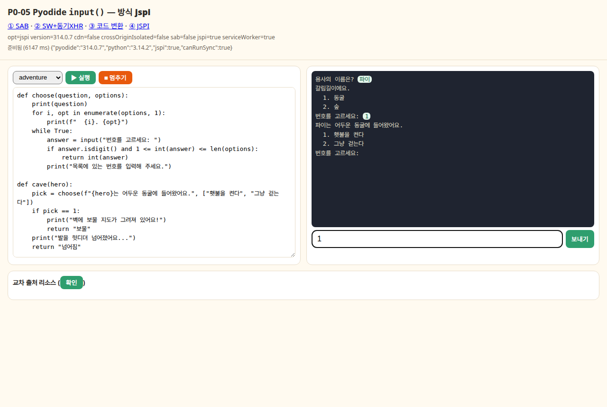
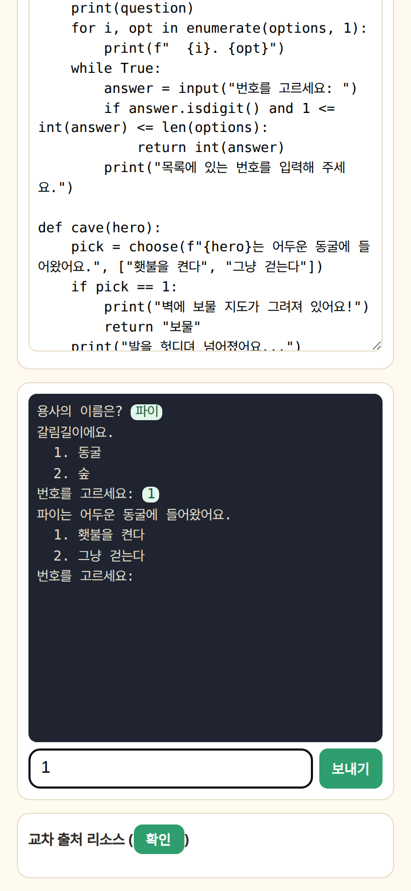

# P0-05 스파이크: Pyodide `input()` 지원 방식

> - 작성일: 2026-11-03 · 브랜치 `feat/phase0`
> - 관련 작업: [업그레이드 계획서](../4.upgrade-plan.md) P0-05 → P11-01, P11-03, P11-04, P11-05, P11-15, B09, B14, B15, B22, B26, B27, §11
> - 코드: [`spikes/p0-05-pyodide-input/`](../../spikes/p0-05-pyodide-input/)
> - 표기: **(실측)** 이 스파이크에서 직접 돌려 본 결과 / **(문서 확인)** 공식 문서·호환성 데이터로 확인한 사실 / **(추정)** 근거는 있지만 확인하지 못한 것

---

## 1. 결론

**채택.** 기본 방식은 **④ JSPI**(`pyodide.ffi.run_sync`)입니다. 헤더, Service Worker, 코드 변환이 모두 필요 없고, 3개 엔진에서 `input()`이 함수·클래스·`__init__`·람다·제너레이터 어디에 있어도 CPython과 똑같이 동작했습니다 (실측). JSPI가 없는 브라우저(Safari/iOS 26 이하, Firefox 152 이하·ESR, Chromium 136 이하)에서는 **② Service Worker + 동기 XHR**로 폴백합니다. SW scope를 실행기 경로로만 좁히면 Next.js 페이지에는 영향이 없습니다 (실측). 둘 다 안 되는 iOS 26 이하 인앱 브라우저(카카오톡 등 WKWebView)에서는 "Safari로 열기"를 안내합니다.

① SharedArrayBuffer + COOP/COEP는 **채택하지 않습니다**. 이유는 세 가지입니다. Android WebView(카카오톡 Android 인앱)에서는 헤더를 붙여도 SAB를 쓸 수 없습니다 (문서 확인). Safari는 `credentialless`를 지원하지 않아 `require-corp`를 써야 합니다. 그리고 퀘스트 라우트에만 붙인 헤더는 소프트 내비게이션에서 적용되지 않습니다 (실측). ③ 코드 변환은 가상 펫(3-4)의 `__init__` 안 `input()`을 비롯해 14개 케이스 중 8개에서 결과가 틀리거나 에러가 나서 쓰지 않습니다 (실측).

---

## 2. 검증한 질문

1. 네 가지 방식(① SAB+Atomics, ② SW+동기 XHR, ③ `await input()` 코드 변환, ④ JSPI)이 Chromium·Firefox·WebKit에서 실제로 동작하는가? 입력 왕복 지연은 얼마인가?
2. `input()`이 함수·루프·클래스·`__init__`·람다·제너레이터·재귀 안에 있어도 동작하는가? 에러 줄 번호는 맞는가?
3. 멈추기(Stop): 입력 대기 중, CPU 무한 루프, `time.sleep` 루프에서 Worker를 죽이지 않고 멈출 수 있는가? (B14, P11-03)
4. 입력 대기 중 새로고침이나 첫 방문(SW 미등록)에서 어떻게 되는가?
5. COOP/COEP를 붙이면 우리가 쓰는(쓸) 교차 출처 리소스(jsdelivr의 Pyodide, Google·카카오·네이버 아바타, Kakao SDK, Supabase API, 팝업)는 어떻게 되는가? `credentialless`는 어디서 되는가?
6. **Next.js에서 헤더를 퀘스트 라우트에만 붙일 수 있는가?** `/world`에서 `next/link`로 `/quest/...`에 들어가면(소프트 내비게이션) `crossOriginIsolated`가 켜지는가? (B22와 충돌하는가?)
7. 최신 Pyodide(314.0.7)와 현재 앱 버전(0.27.5)은 무엇이 다른가? (B26)
8. 검증용 "입력 시나리오"(P11-05)는 동기 트릭 없이 `setStdin`만으로 되는가?

---

## 3. 방법 & 환경

| 항목 | 내용 |
|---|---|
| Pyodide | **314.0.7** (npm `latest`, 2026-09-14, Python 3.14.2). 비교용 **0.27.5** (현재 워커, Python 3.12.7), 0.29.3 (현재 `package.json`, Python 3.13.2. Node 테스트만) |
| 로드 방식 | 스파이크 디렉터리에 npm으로 받은 파일을 직접 서빙(self-host). jsdelivr CDN은 별도 1회 테스트 |
| 브라우저 (실측) | Playwright 1.62.1 번들: **Chromium 151**, **Firefox 153**, **WebKit 26.5**(Linux WPE 빌드), 모두 headless |
| 서버 | `server.mjs` (Node, 포트 3105). URL 접두사로 헤더 모드 전환: `plain`·`coop`·`coep`(require-corp)·`cred`(credentialless)·`dip`(Document-Isolation-Policy)·`csp`·`cspcoep` |
| 교차 출처 | `localhost:3105` ↔ `127.0.0.1:3105`를 서로 다른 출처로 사용 (CORP·CORS 헤더 조합을 결정적으로 재현) + 실제 외부 URL(Google·네이버·Kakao) |
| Next.js | 스크래치 디렉터리에 Next **15.5.14**(저장소와 동일) 최소 앱 → `next build --turbopack` → `next start -p 3105`. 소스 사본은 `spikes/p0-05-pyodide-input/next-app/` |
| Node | v22.23.2, `pyodide` npm 패키지로 scripted stdin 프로토타입 |

측정 시 주의할 점입니다.
- 측정하는 동안 같은 머신에서 다른 에이전트가 함께 돌아 load average가 약 40(20코어)이었습니다. **준비 시간(Pyodide 로드)의 절댓값은 부풀려져 있습니다**. 방식 간 비교와 지연의 자릿수만 참고하세요.
- "입력 왕복"은 메인 스레드에서 답을 보낸 시점부터 다음 `input()` 요청이 메인에 도착할 때까지입니다 (echo 루프 40회). 출력 DOM 갱신 비용이 포함됩니다. "채널"은 답을 보낸 시점부터 워커가 깨어난 시점까지만 잰 값입니다.
- WebKit은 Linux WPE 빌드라 **iOS Safari나 iPad와 동일하지 않습니다**. 예를 들어 이 빌드에는 JSPI가 켜져 있지만, 정식 Safari는 27부터 지원합니다 (문서 확인). 또 이 환경의 WPE는 외부 HTTPS 요청이 모두 실패해서(TLS 모듈 부재로 추정), WebKit의 "실제 외부 URL"·CDN 결과는 판단에서 제외했습니다.
- 저장소의 Playwright(1.58.2)는 설치된 브라우저 빌드(1234/1538/2336)와 버전이 맞지 않아 스파이크 전용으로 1.62.1을 썼습니다. WebKit은 시스템 라이브러리가 없어서 `apt-get download`로 받은 라이브러리를 `LD_LIBRARY_PATH`로 붙였습니다 (§8).

---

## 4. 결과

### 4.1 한눈에 보기

| 방식 | Chromium 151 | Firefox 153 | WebKit 26.5 (WPE) | 비고 |
|---|---|---|---|---|
| ① SAB (COOP+COEP require-corp) | ✅ 14/14 | ✅ 14/14 | ✅ 14/14 | 무한 루프도 Worker 유지한 채 멈춤 |
| ② SW + 동기 XHR (헤더 없음) | ✅ 14/14 | ✅ 14/14 (첫 요청 재시도 필요) | ✅ 14/14 | SW scope를 워커 경로로만 좁혀도 동작 |
| ③ 코드 변환 (헤더 없음) | ⚠️ 6/14 | ⚠️ 6/14 | ⚠️ 6/14 | `__init__`·lambda·제너레이터 등 실패 |
| ④ JSPI (헤더 없음) | ✅ 14/14 | ✅ 14/14 | ✅ 14/14 | `time.sleep` 루프도 즉시 멈춤 |

(실측. 14개 케이스는 `web/programs.js`의 `CASES`. "숫자 맞추기"(while + 함수 안 input + try/except), 함수 체인, 메서드, `__init__`, 별칭, lambda/`sorted(key=)`, 제너레이터, 컴프리헨션, 재귀, 콜백, `map(input, …)`, 이름 충돌, `sys.stdin.readline()`, `int(input())` 에러 줄 번호)

데모 화면 (④ JSPI, 텍스트 어드벤처 진행 중). 프롬프트는 출력 영역에 이어서 나오고, 학생 답은 초록 말풍선으로 남고, 아래 입력 박스에서 Enter로 보냅니다.

<p>
  
  
</p>

### 4.2 준비 시간과 입력 왕복 지연 (실측, Pyodide 314.0.7 self-host)

| 브라우저 | 방식 | 준비(ms) | input 왕복 median / p95 (ms) | 채널(메인→워커) median | 비고 |
| --- | --- | --- | --- | --- | --- |
| chromium | ① SAB | 6739 | 1 / 6.5 | 0 |  |
| chromium | ② SW+동기XHR | 6653 | 12.3 / 24.9 | 7.6 | SW 채널 ok |
| chromium | ③ 코드 변환 | 10260 | 26.2 / 74.9 | 5.5 |  |
| chromium | ④ JSPI | 4887 | 2.4 / 8 | 0.2 | can_run_sync=true |
| firefox | ① SAB | 21193 | 2.1 / 14.2 | 0.1 |  |
| firefox | ② SW+동기XHR | 21537 | 32 / 69 | 24 | SW 채널 ok |
| firefox | ③ 코드 변환 | 37639 | 25 / 59 | 2 |  |
| firefox | ④ JSPI | 17565 | 9 / 20 | 1 | can_run_sync=true |
| webkit | ① SAB | 7318 | 5.9 / 15.3 | 0.3 |  |
| webkit | ② SW+동기XHR | 6451 | 11 / 22 | 4 | SW 채널 ok |
| webkit | ③ 코드 변환 | 19229 | 32 / 66 | 3 |  |
| webkit | ④ JSPI | 7149 | 11 / 31 | 0 | can_run_sync=true |

- **모든 방식이 체감 지연 없음.** 입력 왕복(DOM 갱신 포함) median이 1~32ms로, 사람이 느끼는 기준(약 100ms)보다 한참 아래입니다.
- 채널만 보면 ① SAB가 가장 빠르고(1ms 미만), ② SW가 가장 느립니다(4~24ms. SW를 한 번 거치기 때문).
- 준비 시간(워커 생성 → Pyodide 로드 완료)은 머신 부하 때문에 크게 흔들렸습니다 (같은 Chromium에서 4.9~10초, Firefox 17~38초). 같은 머신 Node에서는 314.0.7 로드가 5.6초였습니다. 방식 사이의 차이는 측정 잡음 수준입니다.

### 4.3 `input()` 위치별 동작 (실측, 3개 엔진 공통)

| 케이스 | ① SAB | ② SW+동기XHR | ③ 코드 변환 | ④ JSPI |
| --- | --- | --- | --- | --- |
| loop | ✅ | ✅ | ✅ | ✅ |
| chain | ✅ | ✅ | ✅ | ✅ |
| method | ✅ | ✅ | ✅ | ✅ |
| init | ✅ | ✅ | ❌ TypeError: __init__() should return None, not 'coroutine' | ✅ |
| alias | ✅ | ✅ | ❌ (잘못된 출력) | ✅ |
| lambda | ✅ | ✅ | ❌ SyntaxError: 'await' outside async function | ✅ |
| generator | ✅ | ✅ | ❌ TypeError: 'async_generator' object can't be awaited | ✅ |
| comprehension | ✅ | ✅ | ✅ | ✅ |
| recursion | ✅ | ✅ | ✅ | ✅ |
| callback | ✅ | ✅ | ❌ (잘못된 출력) | ✅ |
| map | ✅ | ✅ | ❌ (잘못된 출력) | ✅ |
| collision | ✅ | ✅ | ❌ TypeError: 'int' object can't be awaited | ✅ |
| stdin | ✅ | ✅ | ❌ OSError: [Errno 29] I/O error | ✅ |
| errorline | ✅ | ✅ | ✅ | ✅ |

- ①②④는 CPython 내장 `input()`과 같은 의미입니다. ①②는 `pyodide.setStdin`의 동기 콜백 안에서 기다리고, ④는 `builtins.input`과 `sys.stdin`을 `run_sync` 기반 함수로 바꿉니다.
- ③ 코드 변환의 실패 양상이 학생에게 특히 나쁩니다.
  - `ask = input`, `repeat(input, 2)`, `map(input, …)`는 입력을 받지 않고 `답: <coroutine object __pyroad_async_input at 0x…>`를 출력합니다 (에러 대신 `RuntimeWarning`만 나옴).
  - 가상 펫의 `__init__` 안 `input()` → `TypeError: __init__() should return None, not 'coroutine'`
  - lambda 안 → `SyntaxError: 'await' outside async function` (학생 코드에는 `await`가 없음)
  - 학생이 `get`이라는 메서드에서 `input()`을 쓰면 `dict.get(...)`까지 `await`되어 `TypeError` (이름 기반 분석의 한계)
- 에러 줄 번호: 4개 방식 모두 `int(input())`의 `ValueError`를 학생 코드 **3번째 줄**로 정확히 표시했습니다. ③도 AST를 직접 `compile`하면 줄 번호가 유지됩니다 (`ast.unparse`를 쓰면 깨짐). 실행기는 `linecache`에 학생 코드를 등록해서 트레이스백에 소스 줄도 함께 나옵니다.

### 4.4 멈추기(Stop) (실측)

"정상 중단"은 Worker를 살린 채 `KeyboardInterrupt`로 끝낸 경우, "terminate"는 1초 안에 안 끝나서 Worker를 죽이고 새로 준비한 경우입니다.

| 브라우저 | 방식 | 입력 대기 중 | CPU 무한 루프 | time.sleep 루프 | time.sleep(0.5) 실측 |
| --- | --- | --- | --- | --- | --- |
| chromium | ① SAB | 정상 중단 19ms | 정상 중단 8ms | 정상 중단 126ms | slept 0.5 (512ms) |
| chromium | ② SW+동기XHR | 정상 중단 33ms | terminate 5500ms (재준비 4498ms) | terminate 4770ms (재준비 3769ms) | slept 0.5 (506ms) |
| chromium | ③ 코드 변환 | 정상 중단 63ms | terminate 10875ms (재준비 9873ms) | terminate 13750ms (재준비 12739ms) | slept 0.58 (561ms) |
| chromium | ④ JSPI | 정상 중단 17ms | terminate 5304ms (재준비 4302ms) | 정상 중단 27ms | slept 0.5 (507ms) |
| firefox | ① SAB | 정상 중단 19ms | 정상 중단 24ms | 정상 중단 121ms | slept 0.51 (520ms) |
| firefox | ② SW+동기XHR | 정상 중단 41ms | terminate 19353ms (재준비 18238ms) | terminate 17609ms (재준비 16607ms) | slept 0.5 (525ms) |
| firefox | ③ 코드 변환 | 정상 중단 268ms | terminate 30153ms (재준비 29144ms) | terminate 27463ms (재준비 26332ms) | slept 0.54 (561ms) |
| firefox | ④ JSPI | 정상 중단 64ms | terminate 19111ms (재준비 18109ms) | 정상 중단 69ms | slept 0.54 (571ms) |
| webkit | ① SAB | 정상 중단 7ms | 정상 중단 6ms | 정상 중단 131ms | slept 0.5 (506ms) |
| webkit | ② SW+동기XHR | 정상 중단 22ms | terminate 8297ms (재준비 7292ms) | terminate 10358ms (재준비 9357ms) | slept 0.55 (505ms) |
| webkit | ③ 코드 변환 | 정상 중단 56ms | terminate 21972ms (재준비 20923ms) | terminate 23499ms (재준비 22493ms) | slept 0.53 (554ms) |
| webkit | ④ JSPI | 정상 중단 31ms | terminate 10416ms (재준비 9412ms) | 정상 중단 45ms | slept 0.51 (513ms) |

- **입력 대기 중**: 4개 방식 모두 7~268ms 안에 정상 중단됩니다.
- **CPU 무한 루프(`while True: n += 1`)**: Worker를 살린 채 멈출 수 있는 것은 ① SAB(`setInterruptBuffer`)뿐입니다 (6~24ms). 나머지는 Worker를 다시 만들어야 하고, 재준비에 Chromium 3.8~4.5초(②④)가 걸렸습니다. 부하가 심했던 측정에서는 Chromium 10~13초, Firefox 16~29초, WebKit 7~22초까지 늘었습니다.
- **`time.sleep` 루프**: ① 즉시, ④도 즉시 멈춥니다(27~69ms). ④는 `time.sleep`을 "JS 타이머를 `run_sync`로 기다리고, 멈춤 요청이 오면 바로 깨는" 함수로 바꿨습니다. ②③은 `time.sleep`이 워커를 막아서 terminate가 필요합니다.
- 구현하면서 찾은 함정 3가지 (실측):
  1. SAB가 없는 방식에서 워커 안의 비공유 버퍼로 `setInterruptBuffer`를 쓰면, `runPythonAsync` 실행 중에는 WebLoop 콜백이 신호를 먼저 가져가서 학생 코드가 멈추지 않거나 실행이 끝나지 않았습니다. → ③④는 interrupt buffer를 쓰지 않고 "멈춤 요청" 플래그를 대기 지점에서 확인합니다.
  2. Pyodide 314는 JS `null`을 Python `None`이 아니라 `jsnull`로 넘깁니다. 처음에는 멈춤 신호를 `null`로 보내서 `input()`이 그대로 다음 줄로 진행했습니다. → `undefined`로 보냅니다.
  3. terminate한 Worker가 늦게 보낸 `error` 이벤트(`NoGilError`)가 새 Worker의 준비 Promise를 reject해서 멈추기 후 실행기가 먹통이 됐습니다. → Worker에 세대 번호를 붙여 이전 Worker의 이벤트를 무시합니다 (B14).

### 4.5 새로고침·첫 방문·Service Worker 세부 (실측)

| 브라우저 | ① SAB | ② SW+동기XHR | ③ 코드 변환 | ④ JSPI |
| --- | --- | --- | --- | --- |
| chromium | ✅ (4315ms) | ✅ (5042ms, SW ok) | ✅ (10158ms) | ✅ (5099ms) |
| firefox | ✅ (19276ms) | ✅ (17019ms, SW ok) | ✅ (27291ms) | ✅ (15445ms) |
| webkit | ✅ (6140ms) | ✅ (7580ms, SW ok) | ✅ (18640ms) | ✅ (10815ms) |

입력을 기다리는 도중에 새로고침해도 4개 방식 모두 다시 준비되고 실행됐습니다. ②의 첫 방문(SW 미등록)은 `register` → `activate`(`skipWaiting` + `clients.claim`)를 기다린 뒤 워커를 만드는 순서라서 문제가 없었습니다 (모든 테스트가 새 브라우저 컨텍스트, 곧 첫 방문).

SW가 Dedicated Worker의 요청을 가로채는지는 Pyodide 없이 따로 확인했습니다 (`web/swprobe.html`, 첫 방문과 새로고침, classic·module 워커).

| | SW scope = 워커 경로만 (`web/sw/`, 페이지는 scope 밖) | SW scope = 페이지 전체 |
|---|---|---|
| Chromium 151 | ✅ 모든 요청 가로챔 (동기 XHR 13~14ms) | ✅ |
| Firefox 153 | ⚠️ 새 워커의 **첫 동기 XHR 2개 + 첫 fetch는 네트워크로 나감**, 첫 `await` 이후부터 가로챔 (동기 XHR 32~94ms) | ⚠️ 같음 |
| WebKit 26.5 | ✅ (동기 XHR 6~12ms) | ✅ |

- **scope를 워커 경로로만 좁혀도 동작합니다.** 워커는 자기 스크립트 URL로 SW와 짝지어지기 때문입니다. 따라서 Next.js 페이지 탐색은 SW를 전혀 거치지 않게 만들 수 있습니다 (B22, 라우팅과 무관).
- Firefox의 첫 요청 문제는 워커가 Pyodide를 로드한 **뒤** async `fetch`로 한 번 깨우고 `ping`을 재시도하는 방식으로 해결했습니다 (`web/sw/worker-sw.js`).
- 강력 새로고침(Shift+Reload)은 Playwright로 재현할 수 없어 확인하지 못했습니다. 워커가 시작할 때 `ping`으로 채널을 확인하고, 실패하면 안내하도록 해 두었습니다.

### 4.6 검증용 입력 시나리오 (P11-05, Node 실측)

`node/scripted-stdin.mjs`에서 `pyodide.setStdin({ stdin: () => queue.shift() ?? null })`만으로 입력을 넣었습니다. 동기 트릭은 필요 없습니다. 결과 전문은 [`results/node-scripted-stdin.txt`](../../spikes/p0-05-pyodide-input/results/node-scripted-stdin.txt)에 있습니다.

| 시나리오 | 결과 (314.0.7 / 0.29.3 동일) |
|---|---|
| 숫자 맞추기, `random.seed(42)` 주입(정답 82), 입력 `['abc','50','75','82']` | `숫자로 입력해 주세요!` → `더 큰 수예요!` ×2 → `정답! 3번 만에 맞혔어요.` (B09 해결 방법) |
| 입력이 모자람 (`['50']`) | `EOFError: EOF when reading a line` (함수 안 6번째 줄) → "입력이 더 필요해요"로 안내 가능 |
| `int(input())`에 `'열살'` | `ValueError` 3번째 줄 |
| `sys.stdin.readline()` / `input()` | `'first\n'` / `'second'` (CPython과 같음, 개행 자동 처리) |
| 실행마다 새 namespace | 이전 실행의 변수 → `NameError` (B15 상태 누출 없음) |

- stdout에는 프롬프트만 들어가고 학생 답은 들어가지 않습니다 (CPython `python prog.py < input.txt`와 같음). 화면처럼 답까지 보이는 기록이 필요하면 `echo` 옵션으로 붙일 수 있습니다.
- 브라우저에서도 같은 코드입니다. 검증 실행은 답이 미리 정해져 있으므로 ①~④ 어떤 방식이든 `setStdin` 큐로 돌리면 됩니다 (④처럼 `builtins.input`을 바꾼 실행기는 검증 실행 동안 원래 함수로 되돌려야 함).

### 4.7 COOP/COEP의 부작용 (실측, 정적 서버)

| 항목 | 헤더 없음 | COOP만 | COOP+COEP<br>require-corp | COOP+COEP<br>credentialless | Document-<br>Isolation-Policy |
| --- | --- | --- | --- | --- | --- |
| crossOriginIsolated | X X X | X X X | O O O | O O X | O X X |
| img 헤더 없음 | O O O | O O O | X X X | O O O | O O O |
| script ACAO:* (속성 없음) | O O O | O O O | X X X | O O O | O O O |
| script ACAO:* + crossorigin 속성 | O O O | O O O | O O O | O O O | O O O |
| img ACAO:* + crossorigin 속성 | O O O | O O O | O O O | O O O | O O O |
| img CORP: cross-origin | O O O | O O O | O O O | O O O | O O O |
| img ACAO:* (crossorigin 속성 없음) | O O O | O O O | X X X | O O O | O O O |
| 네이버 이미지 ssl.pstatic.net | O O X | O O X | X X X | O O X | O O X |
| 네이버 이미지 + crossorigin | O O X | O O X | O O X | O O X | O O X |
| Kakao SDK + crossorigin | O O X | O O X | O O X | O O X | O O X |
| Kakao SDK (속성 없음) | O O X | O O X | X X X | O O X | O O X |
| Google 아바타 lh3.googleusercontent.com | O O X | O O X | O O X | O O X | X O X |
| fetch CORS (Supabase API 같은 경우) | O O O | O O O | O O O | O O O | O O O |
| 교차 출처 팝업과 postMessage(opener) | O O O | X X X | X X X | X X X | O O O |

- `require-corp`는 3개 엔진 모두 격리되지만, **CORP 헤더가 없는 교차 출처 이미지·스크립트를 차단**합니다. 네이버 프로필 이미지(`pstatic.net`, CORP 없음)와 Kakao SDK(`t1.kakaocdn.net`, CORS만 있음)는 `crossorigin` 속성을 붙이거나 `next/image` 프록시를 거쳐야 합니다. Google 아바타(`lh3`)는 `CORP: cross-origin`을 보내서 통과했습니다. jsdelivr(Pyodide)도 `CORP: cross-origin` + `ACAO: *`를 보냅니다 (문서·curl 확인).
- **`credentialless`는 WebKit에서 격리되지 않습니다** (실측. caniuse 기준 Safari·iOS 전 버전 미지원, 문서 확인). iPad 학생을 생각하면 `require-corp`밖에 선택지가 없습니다.
- `COOP: same-origin`만으로도 **교차 출처 팝업과의 `opener` 연결이 끊깁니다** (3개 엔진). OAuth·공유 SDK가 팝업 + `postMessage`를 쓰면 깨집니다. 현재 Supabase OAuth는 리다이렉트 방식이라 영향이 없지만, Phase 9 Kakao SDK 공유(데스크톱 팝업)는 확인이 필요해집니다.
- `Document-Isolation-Policy`(헤더 하나로 문서 단위 격리)는 Chromium에서만 동작했습니다.
- WebKit의 외부 URL 행이 모두 X인 것은 이 샌드박스 WPE 빌드가 외부 HTTPS를 못 하기 때문이고(§3), 같은 조건의 로컬 교차 출처 행(위 6줄)은 Chromium·Firefox와 같습니다. Google 아바타가 Chromium DIP 모드에서 X인 것은 1회 관찰입니다 (1차 실행에서는 credentialless에서도 X였다가 2차에서는 O. 외부 응답에 따라 흔들림).
- Supabase API 같은 CORS `fetch`는 모든 모드에서 정상입니다.

### 4.8 Next.js: 퀘스트 라우트에만 헤더를 붙이면? (실측, Next 15.5.14 production)

`next.config.ts`의 `headers()`(`source: '/quest/:path*'`)와 `middleware.ts` 두 가지로 퀘스트 라우트에만 COOP/COEP를 붙였습니다. 두 방법 모두 응답 헤더는 정확히 붙었습니다 (문서 요청과 RSC 요청 모두). 아래 표는 **Chromium·Firefox·WebKit 결과가 34단계 모두 같았습니다**.

| 단계 | 라우트 한정 헤더 (next.config / middleware 같음) | + QuestLink (비격리면 하드 내비게이션) | 앱 전체 헤더 |
|---|---|---|---|
| `/quest/1` 직접 열기 | 격리 ✅ | 격리 ✅ | 격리 ✅ |
| `/world` 직접 열기 | 비격리 (교차 출처 이미지 정상) | 비격리 | 격리 (CORP 없는 이미지 **차단**) |
| `/world` → `/quest/1` (`next/link`) | **비격리 ❌** (문서 재로드 없음, SAB 사용 불가) | 격리 ✅ (문서 재로드 1회) | 격리 ✅ (소프트) |
| `/quest/1` → `/quest/1` (`<a href>`) | 격리 ✅ (재로드) | - | - |
| `/quest/1` → `/quest/2` (`next/link`) | 격리 유지 ✅ (소프트) | 격리 유지 ✅ (소프트) | 격리 유지 ✅ |
| `/quest/2` → `/world` (`next/link`) | **격리 유지**: 월드맵이 COEP 아래에서 그려져 CORP 없는 이미지 **차단** | 같음 | 같음 |
| 뒤로 가기 | 격리 유지 (소프트) | 같음 | 같음 |
| `/world` 새로고침 | 비격리로 돌아감 | 비격리 | 격리 |

`next/image`(같은 출처 `/_next/image` 프록시)는 모든 경우에 정상이었습니다.

정리하면 다음과 같습니다.
- 헤더는 **문서를 새로 받을 때만** 적용됩니다. `next/link` 소프트 내비게이션으로는 격리 상태가 바뀌지 않습니다 (켜지지도, 꺼지지도 않음).
- 그래서 "퀘스트 라우트에만 적용"은 실제로는 **(a) 비격리 페이지 → 퀘스트 진입을 매번 하드 내비게이션으로 하고**(QuestLink 패턴. 그때마다 문서 재로드 + Pyodide 재초기화로 B22가 줄이려는 비용을 다시 냄), **(b) 퀘스트에서 소프트로 나간 월드맵·프로필·게시판도 COEP를 견뎌야 한다**는 뜻입니다. (b) 때문에 사실상 **앱 전체가 COEP 규칙을 지켜야** 합니다.
- 퀘스트 → 퀘스트 소프트 내비게이션은 격리를 유지하므로 B22와 직접 충돌하지는 않습니다. 하지만 위 (a)(b) 비용이 남습니다. **④ JSPI를 쓰면 이 문제 자체가 사라집니다.**

### 4.9 Pyodide 314.0.7 vs 0.27.5 (실측 + 문서 확인)

같은 실행기를 0.27.5로 돌린 결과입니다 (① SAB, ④ JSPI만, module worker).

| 브라우저 | 방식 | 준비(ms) | loop/init/stdin 케이스 | time.sleep 루프 멈추기 | time.sleep(0.5) |
| --- | --- | --- | --- | --- | --- |
| chromium | ① SAB | 3997 | loop:✅ init:✅ stdin:✅ | 정상 중단 118ms | slept 0.52 |
| chromium | ④ JSPI | 7594 | loop:✅ init:✅ stdin:✅ | 정상 중단 41ms | slept 0.5 |
| firefox | ① SAB | 11040 | loop:✅ init:✅ stdin:✅ | 정상 중단 141ms | slept 0.51 |
| firefox | ④ JSPI | 15013 | loop:✅ init:✅ stdin:✅ | 정상 중단 27ms | slept 0.51 |
| webkit | ① SAB | 7644 | loop:✅ init:✅ stdin:✅ | 정상 중단 134ms | slept 0.5 |
| webkit | ④ JSPI | 7603 | loop:✅ init:✅ stdin:✅ | 정상 중단 64ms | slept 0.51 |

| 항목 | 0.27.5 (현재 워커) | 314.0.7 (최신 안정) |
|---|---|---|
| Python | 3.12.7 | 3.14.2 |
| 워커 형태 | classic(`importScripts`)·module 둘 다 됨 | **module worker만** (`pyodide.js`가 classic worker에서 `"Classic web workers are not supported"`를 던짐, 실측. 314.0.0 changelog, 문서 확인). `pyodide.asm.js` → `pyodide.asm.mjs` |
| JSPI `run_sync` | 됨 (3개 엔진 실측) | 됨 |
| `time.sleep` | 워커를 막는 대기 | JSPI로 들어간 실행에서는 이벤트 루프에 양보 (0.28.0부터, 문서 확인. 실측: sleep 중 ping 응답 1ms) |
| JS `null` → Python | `None` | `jsnull` (주의) |
| 코어 크기 (wasm+asm+stdlib+lock, gzip) | 약 5.6MB | 약 6.2MB |

스파이크 실행기는 두 버전 모두에서 같은 결과를 냈습니다 (④는 `time.sleep`을 직접 감싸므로 0.27.5에서도 즉시 멈춤). 314로 통일할 때 바꿔야 하는 것은 **module worker 전환**과 **`null`/`None` 처리** 두 가지입니다.

### 4.10 CSP와 CDN (실측)

엄격한 CSP(`default-src 'self'; script-src 'self' 'wasm-unsafe-eval'; worker-src 'self'; connect-src 'self'`)에서 로드 + 숫자 맞추기 실행:

| 브라우저 | ② SW @ csp | ④ JSPI @ csp | ① SAB @ csp+COOP/COEP |
| --- | --- | --- | --- |
| chromium | ✅ | ✅ | ✅ |
| firefox | ✅ | ✅ | ✅ |
| webkit | ✅ | ✅ | ✅ |

- `'unsafe-eval'` 없이 `'wasm-unsafe-eval'`만으로 Pyodide, module worker, SW가 모두 동작했습니다 (B27).

jsdelivr CDN에서 Pyodide를 불러온 경우 (① SAB, COEP require-corp):

| 브라우저 | 결과 |
| --- | --- |
| chromium | ✅ 준비 11540ms, 실행 ✅ |
| firefox | ✅ 준비 19984ms, 실행 ✅ |
| webkit | ❌ Importing a module script failed. |

- jsdelivr CDN의 Pyodide를 `require-corp` 문서의 워커에서 불러와도 Chromium·Firefox는 정상입니다 (jsdelivr가 CORP를 보냄). WebKit 실패는 §3의 샌드박스 네트워크 제약입니다.

---

## 5. 선택지 비교

| | ① SAB + Atomics | ② SW + 동기 XHR | ③ 코드 변환 (`await input()`) | ④ JSPI (`run_sync`) |
|---|---|---|---|---|
| **필요 조건** | COOP `same-origin` + COEP `require-corp`(Safari는 credentialless 미지원) | SW 등록 + 워커가 SW 제어를 받아야 함 | 없음 | 브라우저 JSPI 지원 + `runPythonAsync`로 실행 |
| **CPython과 같은 의미** | ✅ 14/14 (실측) | ✅ 14/14 (실측) | ❌ 6/14. `__init__`·lambda·제너레이터·별칭·콜백·`map`·`sys.stdin` 실패, 이름이 같은 메서드도 오변환 (실측) | ✅ 14/14 (실측) |
| **Chrome/Edge** | ✅ 92+ (문서 확인) / 실측 ✅ | ✅ / 실측 ✅ | ✅ | ✅ **137+** (2025-05, 문서 확인) / 실측 ✅ |
| **Firefox** | ✅ 79+ / 실측 ✅ | ✅ (첫 요청 미가로채기 → 재시도 필요) / 실측 ✅ | ✅ | ✅ **153+** (2026-07-21, 문서 확인) / 실측 ✅. ESR 140은 ❌ |
| **Safari (macOS)** | ✅ 15.2+ (require-corp만) / 실측 WebKit ✅ | ✅ (실측 WebKit ✅) | ✅ | ✅ **27+** (2026-09-14, 문서 확인). 26 이하 ❌ |
| **iOS Safari (iPad)** | ✅ 15.2+ (문서 확인) | ✅ (추정, 실기기 확인 필요) | ✅ | ✅ iOS 27+. **iOS 27을 못 받는 구형 iPad ❌** |
| **Android Chrome / Samsung Internet** | ✅ (Chrome 88+) / 삼성은 Chromium 매핑 | ✅ | ✅ | ✅ Chromium 137+ 기반이면 (문서 확인: mirror) |
| **카카오톡 인앱 Android (시스템 WebView)** | ❌ **WebView는 SAB 미지원** (MDN BCD `webview_android: false`, 문서 확인) | ✅ (추정) | ✅ | ✅ WebView 137+ (문서 확인: mirror, 실기기 확인 필요) |
| **카카오톡 인앱 iOS (WKWebView)** | △ Safari와 같은 엔진이라 가능할 것 (추정) | ❌ WKWebView는 App-Bound Domains가 아니면 SW 불가 (문서 확인) | ✅ | iOS 27+면 ✅ (추정), 26 이하 ❌ |
| **헤더 부작용** | 큼: CORP 없는 교차 출처 이미지·스크립트 차단, 교차 출처 팝업의 opener 끊김, 라우트 단위 적용 불가(소프트 내비게이션) | 없음 (SW scope를 실행기 경로로 한정하면 페이지에도 영향 없음) | 없음 | 없음 |
| **입력 왕복 지연** | 가장 빠름 (채널 < 1ms) | 가장 느림 (채널 수~수십 ms, 그래도 체감 불가) | 빠름 | 빠름 |
| **멈추기: 입력 대기 중** | ✅ 즉시 | ✅ 즉시 | ✅ 즉시 | ✅ 즉시 |
| **멈추기: `time.sleep` 루프** | ✅ 즉시 (interrupt buffer) | ❌ Worker 재시작 | ❌ Worker 재시작 | ✅ 즉시 (314의 `time.sleep`이 이벤트 루프에 양보) |
| **멈추기: CPU 무한 루프** | ✅ **즉시, Worker 유지** (`setInterruptBuffer`) | ❌ Worker 재시작 | ❌ Worker 재시작 | ❌ Worker 재시작 |
| **구현 복잡도** | 중: SAB 프로토콜 + 앱 전체 헤더·리소스 정비 | 중상: SW + long-poll + 첫 방문·Firefox 예외 처리 | 상: AST 변환기, 실패 케이스 안내 | **하**: Python 함수 2개 + Promise 1개 |
| **리스크** | 헤더가 앱 전체(Phase 9 Kakao SDK, 아바타, 임베드)를 제약. Android 인앱 불가 | SW 수명·강력 새로고침·관리 정책, iOS 인앱 불가 | 학생에게 이해할 수 없는 에러 (`coroutine`, `await`) | Pyodide API가 experimental, 구형 Safari/iOS·Firefox ESR 미지원 |
| **판정** | 불채택 | **폴백 채택** | 불채택 (필요하면 iOS 인앱 "제한 모드" 후보) | **기본 채택** |

`setStdin`만으로 되는 경우: 답을 실행 전에 모두 알고 있는 **검증 실행(P11-05)**은 어떤 방식도 필요 없습니다. `setStdin`의 동기 콜백이 큐에서 꺼내 주면 됩니다 (§4.6).

`setInterruptBuffer`는 ①에서만 "공짜"입니다. ②·③·④는 SAB가 없으므로 워커 안의 비공유 버퍼만 쓸 수 있는데, ③·④처럼 `runPythonAsync`로 실행하면 이벤트 루프의 WebLoop 콜백이 신호를 먼저 소비해서 학생 코드에 `KeyboardInterrupt`가 전달되지 않았습니다 (실측). 그래서 ④는 `input()`과 `time.sleep` 대기 지점에서 "멈춤 요청" 플래그를 직접 확인하도록 구현했습니다.

---

## 6. 이후 Phase 영향

아래는 [업그레이드 계획서](../4.upgrade-plan.md)에 넣을 **교체 문구 제안**입니다. 이 보고서는 계획서를 직접 고치지 않습니다. P0-11에서 반영합니다.

### 6.1 Phase 11

**P11-01** (교체)
> - [ ] **P11-01** `input()` 지원 (P0-05 결론: **JSPI 기본 + Service Worker 동기 XHR 폴백**). 워커에서 `builtins.input`과 `sys.stdin`을 `pyodide.ffi.run_sync` 기반으로 바꾸고, `can_run_sync()`가 False면 SW(scope는 실행기 경로 `/pyodide/runner/`로 한정)가 붙잡아 두는 동기 XHR로 답을 받는다. 둘 다 안 되면(iOS 26 이하 인앱) "Safari로 열기" 안내. 입력 대기 UI는 출력 영역 아래 대화창형 입력 박스 (프롬프트는 출력에 이어서 표시, 학생 답은 말풍선, Enter 전송, 모바일 `enterkeyhint="send"`, 멈추기 버튼)

**P11-03** (교체)
> - [ ] **P11-03** 프로젝트 모드 실행 제한 조정. 입력 대기와 `time.sleep` 중의 멈추기는 Worker를 살린 채 즉시 `KeyboardInterrupt`로 끝낸다 (P0-05 실측 17~69ms). CPU 무한 루프는 시간 제한 후 Worker terminate → 재시작 (Chromium 실측 2~5초, 저사양 기기는 더 김. 재준비 연출 표시). 종료된 Worker의 늦은 이벤트는 세대 번호로 무시. 출력 길이 상한

**P11-04** (보완)
> - [ ] **P11-04** (도전) 키 이벤트와 프레임 루프 지원. Pyodide 314는 JSPI 환경에서 `time.sleep`이 이벤트 루프에 양보하므로(P0-05 실측), `while True: … time.sleep(1/30)` 루프 안에서 키 입력을 메시지로 받아 `get_key()` 같은 **폴링 API**로 제공하는 방식을 우선 검토. JS가 호출하는 Python 콜백(`onkey(handler)`) 안에서는 `run_sync`를 쓸 수 없음

**P11-05** (교체)
> - [ ] **P11-05** 프로젝트 검증 방식 확장. 입력 시나리오(`inputs: [...]`, `seed`)를 `pyodide.setStdin` 큐로 넣고 출력을 검사 (동기 트릭 불필요. 브라우저 워커와 Node CI가 같은 코드). 입력이 모자라면 `EOFError` → "입력이 더 필요해요", 랜덤은 `random.seed` 주입. 그리기 명령 검증

**P11-15** (보완): "`input()` 버전 + 검증 시나리오에 `seed` 주입으로 B09(정답도 약 55% 불합격) 해결. 예: seed 42 → 정답 82, 입력 `['abc','50','75','82']` → '정답! 3번 만에'" (실측, §4.6)

**완료 기준** (보완): "`input()`을 쓰는 프로그램을 데스크톱과 모바일 모두에서 실행할 수 있다" → "… 실행할 수 있다. JSPI 없는 기기에서는 SW 폴백으로, 둘 다 안 되면 안내 문구가 나온다"

### 6.2 Phase 1 버그 항목

**B14** (수정 방법 추가)
> - 수정: 언마운트·재시도 때 이전 Worker를 terminate하고, **Worker 세대 번호로 종료된 Worker의 늦은 메시지·에러를 무시** (P0-05에서 재현: 종료된 Worker의 `NoGilError`가 새 Worker의 준비를 실패시킴)

**B22** (수정 방법 보완)
> - 수정: Worker를 레이아웃 단위 싱글톤으로 두고 `router.refresh()` 사용. P0-05 결론상 COOP/COEP를 쓰지 않으므로 소프트 내비게이션 제약이 없음 (헤더 방식이었다면 비격리 페이지 → 퀘스트 진입마다 하드 내비게이션이 필요했음)

**B26** (수정 방법 구체화)
> - 수정: Pyodide를 **314.0.7로 통일**하고 `public/pyodide/314.0.7/`에 자체 호스팅 (코어 약 13MB, gzip 약 6.2MB) + jsdelivr 폴백. **314는 classic worker(`importScripts`)를 지원하지 않으므로** `new Worker(url, { type: 'module' })` + `import { loadPyodide } from '/pyodide/314.0.7/pyodide.mjs'`로 전환. JS `null`이 `None`이 아니라 `jsnull`이 되는 변화 주의. `src/middleware.ts` matcher에서 `/pyodide/` 제외 (지금 matcher는 이미지 확장자만 제외하므로, self-host하면 `.wasm`·`.zip`·`.mjs` 요청마다 Supabase 세션 갱신이 돈다)

**B27** (수정 방법 추가)
> - 수정: CSP `script-src 'self' 'wasm-unsafe-eval'`(`'unsafe-eval'` 불필요, P0-05 실측), `worker-src 'self'`, `connect-src 'self' <Supabase> <jsdelivr 폴백>`. **COOP/COEP는 붙이지 않음** (P0-05)

**B15** (참고): 스파이크의 실행기는 실행마다 새 namespace를 만들고(`__pyroad_new_ns`), `linecache`에 학생 코드를 넣어 트레이스백에 소스 줄을 보여 줍니다. 그대로 가져다 쓸 수 있습니다. JSPI를 쓰면 학생 코드가 `js`·`pyodide.ffi`로 `run_sync(js.fetch(...))`를 부를 수 있어서, B15의 `js` 계열 모듈 차단이 더 중요해집니다.

### 6.3 §11 리스크 표 (교체)

| 리스크 | 영향 | 대응 |
|---|---|---|
| `input()` 지원 방식의 브라우저 편차 (JSPI 없는 Safari·iOS 26 이하, Firefox ESR, iOS 인앱) | 일부 기기에서 입력 프로그램 실행 불가 | JSPI 기본 + SW 동기 XHR 폴백, iOS 26 이하 인앱은 외부 브라우저 안내, 실기기 점검(P12-04). COOP/COEP는 쓰지 않음 (P0-05) |

### 6.4 Phase 1에서 미리 준비할 것

- **Worker 전환 (B26과 같이)**: module worker + Pyodide 314.0.7 self-host. 메시지 프로토콜을 지금부터 `run / stdout / stderr / input-request / answer / stop / done` 형태로 잡아 두면 P11-01은 입력 박스 UI만 추가하면 됩니다 (스파이크의 `web/worker/core.js`, `worker-jspi.js`, `app.js`의 `Runner` 참고).
- **실행 결과 스트리밍**: 지금 워커는 실행이 끝난 뒤 stdout을 한 번에 돌려줍니다. `input()` 프롬프트가 보이려면 `setStdout({ write })`로 실시간 전송해야 하므로 P1-09(퀘스트 엔진)에서 같이 바꿉니다.
- **검증 실행기 (P1-13)**: Node `solution_code` 검증에 `setStdin` 큐를 넣어 두면 P11-05가 그대로 확장됩니다 (`node/scripted-stdin.mjs`).
- **헤더**: COOP/COEP는 넣지 않습니다. CSP는 위 B27 문구대로 하고, SW 폴백을 위해 `/pyodide/runner/sw.js`가 middleware를 타지 않게 합니다.
- **§2에 넣을 결정 (P0-11)**: "실행 환경: Pyodide 314 self-host, module worker. `input()`은 JSPI + SW 폴백. COOP/COEP 없음. CPU 무한 루프는 Worker 재시작"

---

## 7. 남은 리스크 & 사용자 확인 필요 사항

### 남은 리스크

| 리스크 | 영향 | 대응 |
|---|---|---|
| Pyodide의 `run_sync`·`callPromising`은 아직 "experimental" API (문서 확인. 314.0.5에서도 `run_sync` 주변 스레드 상태 버그가 수정됨) | Pyodide 업데이트 때 동작이 바뀔 수 있음 | 버전을 고정하고, 이 스파이크의 Playwright 매트릭스(14개 케이스 + 멈추기)를 Phase 11 CI에 회귀 테스트로 옮김 |
| JSPI가 없는 환경: Safari/iOS 26 이하(**iOS 27로 못 올리는 구형 iPad 포함**), Firefox ESR 140, Chromium 136 이하 (문서 확인) | ④가 동작하지 않음 | ② SW 폴백. 실기기 확인 필요 (아래) |
| SW 폴백이 안 되는 경우: 강력 새로고침(Shift+Reload)으로 SW를 우회, SW를 막는 관리 정책·사설 모드, **iOS WKWebView 인앱**(App-Bound Domains가 아니면 SW 불가, 문서 확인) | 입력 채널 없음 | 워커가 시작할 때 `ping`으로 채널을 확인하고, 실패하면 "새로고침 / Safari로 열기" 안내. 입력이 없는 코드는 그대로 실행 |
| Firefox: 새 Worker의 **첫 요청 몇 개는 SW가 가로채지 않음** (실측, Playwright Firefox 153) | 첫 동기 XHR이 서버로 가서 404 | 워커가 준비될 때 async `fetch`로 한 번 깨운 뒤 `ping`을 재시도 (스파이크에 구현) |
| CPU 무한 루프는 SAB 없이는 Worker를 죽여야 멈춤 | 다시 준비하는 데 Chromium 2~5초 (머신 부하가 클 때 10초 이상, Firefox는 더 김. 실측) | 재준비 중 마스코트 연출. 예비 Worker를 미리 띄우는 방식은 메모리가 약 2배라서 저사양 태블릿에서 측정 후 결정 |
| 종료한 Worker의 늦은 `error` 이벤트(`NoGilError`)가 새 Worker의 준비를 실패시킴 (실측) | 멈추기 후 실행기 먹통 | Worker 세대 번호로 이전 Worker 이벤트 무시 (B14에 반영) |
| `KeyboardInterrupt`로 멈출 때 WebLoop가 같은 예외를 "처리되지 않은 오류"로 한 번 더 보고함 (실측) | Sentry 노이즈 | 워커의 전역 에러 핸들러에서 `KeyboardInterrupt` 무시 |
| 314부터 JS `null` → Python `jsnull`(`None` 아님) (실측) | `None` 비교 코드가 조용히 틀림 | JS → Python으로 "값 없음"은 `undefined`로 넘김. 마이그레이션 때 점검 |
| Pyodide 자체 호스팅 용량: 코어 약 13MB (gzip 약 6.2MB, 실측) | 첫 방문 로딩, Vercel 대역폭 | 장기 캐시(`immutable`) + 버전 경로, jsdelivr 폴백 (B26) |

### 사용자 확인 필요 사항

1. **실기기 점검 (P12-04 전, Phase 11 시작 시)**: 데모 페이지(`?opt=jspi`, `?opt=sw`)를 배포 미리보기에 올려 아래 기기에서 `input()` 왕복, 멈추기, 새로고침을 확인해 주세요.
   - iPad: **iOS 27** Safari(JSPI 기대), **iOS 26 이하** Safari(SW 폴백 기대), iOS 27로 못 올리는 구형 iPad
   - Android 폰·태블릿: Chrome, **Samsung Internet**(Chromium 137 이상 기반인지)
   - **카카오톡 인앱 브라우저**: Android(시스템 WebView 137+ → JSPI 기대), iOS 27 / iOS 26 이하(WKWebView, JSPI 여부와 SW 불가 확인). 네이버 앱 인앱도 같은 방식으로
   - 학교 기기: 크롬북(관리형 ChromeOS 버전 고정 여부), 학교 PC의 Firefox ESR·Edge 버전
2. **iOS 26 이하 인앱 사용자 처리 결정**: (권장) "Safari로 열기" 안내 vs ③ 코드 변환 "제한 모드"(일부 코드만 실행, 혼란 가능). 지금 사용자 비중을 보고 정하면 됩니다.
3. **멈추기 UX 결정**: CPU 무한 루프를 멈추면 실행기가 2~5초(저사양 기기는 더 길게) 다시 준비됩니다. 이 동안 보여 줄 연출(예: 파이뱀이 "실행기를 다시 깨우는 중")이 필요합니다. 예비 Worker 방식(즉시 재시작, 메모리 2배)을 쓸지도 정해야 합니다.

---

## 8. 재현 방법

```bash
cd spikes/p0-05-pyodide-input
npm install                      # pyodide 314.0.7 + 0.27.5(별칭 pyodide027) + @playwright/test 1.62.1 (스파이크 전용)

# 1) 데모 서버 (포트 3105)
node server.mjs
#   http://localhost:3105/m/plain/web/index.html?opt=jspi       ④ JSPI (헤더 없음)
#   http://localhost:3105/m/plain/web/index.html?opt=sw         ② SW + 동기 XHR (SW scope = web/sw/)
#   http://localhost:3105/m/plain/web/index.html?opt=transform  ③ 코드 변환
#   http://localhost:3105/m/coep/web/index.html?opt=sab         ① SAB (COOP + COEP require-corp)
#   옵션: &v=0.27.5 (구버전) · &cdn=1 (jsdelivr) · &swscope=page · &real=1 (실제 외부 이미지 프로브)
#   http://localhost:3105/m/plain/web/swprobe.html?scope=worker  SW가 워커 요청을 가로채는지 (Pyodide 없음)

# 2) 브라우저 매트릭스 (결과: results/*.json → 표)
npx playwright test -c playwright.config.mjs      # 3개 엔진 × 방식, 약 5~25분 (머신 부하에 따라)
node tests/summarize.mjs > results/summary.md
node tests/screenshots.mjs                         # docs/spikes/img/P0-05-input-*.png

# 3) 검증용 scripted stdin (P11-05, Node)
node node/scripted-stdin.mjs                        # Pyodide 314.0.7
node node/scripted-stdin.mjs ../../node_modules/pyodide   # 저장소의 0.29.3

# 4) Next.js 라우트 헤더 + 소프트 내비게이션 (저장소 루트가 아닌 별도 디렉터리에서)
cp -r next-app /tmp/p0-05-next && cd /tmp/p0-05-next
npm install && npx next build --turbopack && npx next start -p 3105 &
node tests/nav.mjs nav-results.json
```

이 스파이크 환경에서만 필요했던 우회입니다 (일반 개발 PC에서는 필요 없음).
- 설치된 브라우저 빌드와 맞추려고 Playwright 1.62.1을 썼습니다. 다른 PC에서는 `npx playwright install`이면 됩니다.
- WebKit(WPE) 실행에 필요한 시스템 라이브러리(libavif16, libenchant-2-2, libevent-2.1-7t64, libgstreamer-plugins-bad1.0-0, libwayland-server0, libwebpdemux2 등)가 없고 sudo도 쓸 수 없었습니다. 그래서 `apt-get download` + `dpkg -x`로 스크래치 디렉터리에 풀고, 런처 래퍼에서 `LD_LIBRARY_PATH`에 추가했습니다 (`PLAYWRIGHT_BROWSERS_PATH`, `PLAYWRIGHT_SKIP_VALIDATE_HOST_REQUIREMENTS=1`). 원래 방법은 `sudo npx playwright install-deps`입니다.
