# P0-06 turtle → canvas shim

> - 작성일: 2026-11-03
> - 코드: [`spikes/p0-06-turtle-canvas/`](../../spikes/p0-06-turtle-canvas/)
> - 관련 작업: P11-02, P11-03, P11-05, P11-06, P11-07, 3-1 거북이 화가, 3-5 데이터 탐정, B26

## 1. 결론

**채택.** 직접 만든 shim을 씁니다. 오픈소스는 가져다 쓰지 않습니다.

- **Python 쪽**: `turtle.py` shim(약 1,000줄)을 Pyodide 워커 FS(`/pyroad/turtle.py`)에 넣습니다. 아이들은 `import turtle`, `t = turtle.Turtle()`, `from turtle import *`처럼 CPython과 똑같이 씁니다. 위치·방향 계산은 CPython `TNavigator`와 같은 방식이라 **CPython과 결과가 비트 단위까지 같습니다** (4.4).
- **전달**: 그리기 명령을 짧은 JSON 배열로 바꿔 **실행 도중에 청크 단위로** `postMessage`합니다. 실행 40ms 뒤 첫 청크, 그 뒤 30ms 또는 1,024개마다 보냅니다(짧은 프로그램은 메시지 1개로 끝남). 명령은 실행당 **최대 50,000개**입니다. 넘으면 `TurtleLimitError`로 실행을 정상 종료하므로, 그림을 그리는 무한 반복은 워커를 재시작하지 않고 1.4초 안에 멈춥니다.
- **JS 쪽**: 프레임워크 없는 `TurtleCanvas` 렌더러(캔버스 3장 + 표시 목록)가 CPython 속도 공식대로 애니메이션합니다. 속도 슬라이더(0.25×~8×, 바로), 바로 완성, `prefers-reduced-motion`이면 즉시 그리기, HiDPI, 화면 맞춤, PNG·SVG 내보내기를 지원합니다.
- **검증 (P11-05)**: 픽셀을 비교하지 않고 명령 스트림을 봅니다. "정사각형인지", "별을 채웠는지", "원 12개", "정답 그림과 선분 집합이 같은지" 등을 검사하고, 실패 이유를 한국어 문장으로 돌려줍니다.
- 한 줄 요약: **"표준 turtle 코드 → 워커에서 명령 스트림 → 캔버스 애니메이션"이 Chromium·Firefox에서, Pyodide 0.27.5 · 0.29.3 · 314.0.7 모두 같은 코드로 동작합니다.** WebKit(Safari)은 이 PC에 시스템 라이브러리가 없어 실측하지 못했습니다 (7절).

## 2. 검증한 질문

| # | 질문 | 답 |
|---|---|---|
| 1 | 아이가 CPython과 같은 turtle 코드를 쓰면 브라우저에서 그대로 그려지는가? | 예. 예제 11개와 API 투어(`test/api_tour.py`)가 수정 없이 동작합니다 |
| 2 | 좌표·방향이 CPython과 같은가? | 예. CPython 진짜 `turtle.py`의 `TNavigator`와 비교했을 때 이동 684회 전부 오차 0 (4.4) |
| 3 | 스트리밍과 끝에 한 번에 보내기 중 무엇이 나은가? | 스트리밍(첫 청크 40ms 뒤). 2만 명령 프로그램에서 첫 선 53ms (한 번에 보내기는 실행이 끝나야 나와 490ms). 짧은 프로그램은 차이 없음 (5.1) |
| 4 | 무한 반복은 안전하게 멈추는가? | 그림 명령이 있으면 5만 개 상한에서 1.4~1.5초 안에 친절한 에러로 멈춥니다 (워커 재시작 없음). 그림 없는 무한 반복은 기존처럼 5초 제한 → 워커 재시작 → 12~17초 뒤 다시 실행 가능 (이 PC 기준) |
| 5 | 애니메이션이 부드러운가? | 렌더러의 프레임당 JS 작업은 p95 1.7~4.4ms. CPU 4배 감속에서 p95 13ms (4.3) |
| 6 | 별처럼 자기 교차하는 도형의 채우기가 CPython과 같은가? | even-odd 규칙으로 가운데 오각형이 비어 보입니다. Windows·Linux CPython(Tk)과 같습니다. macOS Tk는 다를 수 있음 (문서·경험 기반, 실측 아님) |
| 7 | 한글 `write("안녕!")`이 되는가? | 됩니다. 캔버스 글꼴 뒤에 한글 웹폰트를 항상 붙입니다. 다만 웹폰트 조각을 처음 받을 때 첫 글씨가 ~0.3초 늦습니다 (7절) |
| 8 | 갤러리 썸네일(P11-06)을 만들 수 있는가? | 됩니다. 표시 목록을 원하는 크기로 다시 그려 PNG를 만듭니다 (400×400 꽃 45KB) |
| 9 | 픽셀 비교 없이 그림을 채점할 수 있는가? | 됩니다. 검사기 단위 테스트 26개 통과 (4.5) |
| 10 | 가져다 쓸 오픈소스가 있는가? | 기술적으로 가장 가까운 basthon-turtle은 GPL-3.0이라 pyRoad(Apache-2.0)에 넣기 어렵습니다. 나머지는 Pyodide 워커 구조에 맞지 않습니다 (5.2) |

## 3. 방법 & 환경

**실측** (2026-11-03, 이 저장소 PC)
- WSL2 Linux, Node 22.23.2, CPython 3.12.3 (tkinter 없음)
- Pyodide **314.0.7** (Python 3.14.2, `npm view pyodide version`의 최신 안정판)을 spike 폴더에만 설치. 비교용으로 저장소의 0.29.3 (Python 3.13.2), jsDelivr CDN의 0.27.5 (Python 3.12.7, 지금 운영 워커가 쓰는 버전)
- 브라우저: Chromium 151, Firefox 153 (둘 다 headless). WebKit은 실행 실패 (시스템 라이브러리 `libsoup-3.0`, `libenchant-2`, `libavif` 등 없음, `sudo npx playwright install-deps webkit` 필요). 저장소의 Playwright 1.58.2는 `chromium-1208`을 찾는데 이 PC에는 1234/1243/1248만 있어서, 설치된 브라우저와 리비전이 맞는 **playwright-core 1.62.1**(npx 캐시)로 실행했습니다. 환경 변수 `PW_CORE`로 바꿀 수 있습니다 (8절)
- 정적 서버: `spikes/p0-06-turtle-canvas/server.mjs` (포트 3106)
- 이 PC에서는 다른 에이전트가 Pyodide를 동시에 돌리고 있어 시간 측정 편차가 큽니다 (같은 측정이 ±2배까지 흔들림). 그래서 여러 번 재고 중앙값이나 범위로 적었습니다. 절대값보다 **비교**(stream vs batch, 1× vs 4× 감속)를 보세요.

**문서 확인**
- CPython `Lib/turtle.py` 소스: `TNavigator`(이동·회전·`circle` steps 공식), `RawTurtle._goto`/`_rotate`의 애니메이션 단계 공식, `dot()` 기본 크기, `write()`의 앵커(sw/s/se), 기본값(speed 3, pensize 1, shape `classic`)
- 라이선스: PyPI JSON API, GitHub API (5.2)
- Tk 채우기 규칙(X11/Windows 기본 EvenOdd)은 문서와 경험 기반이고, Tk가 없어 실측하지 못했습니다

**만든 것** (`spikes/p0-06-turtle-canvas/`)

| 파일 | 내용 |
|---|---|
| `turtle.py` | Python shim. CPython turtle API 부분집합 + 명령 스트림 + 친절한 한국어 에러 |
| `worker.js` | Pyodide module worker. shim 설치, 실행 중 스트리밍, 사용자 코드만 남긴 traceback |
| `scene.js` | 명령 스트림 → 의미 단위(op)로 바꾸는 순수 리듀서 (렌더러와 검사기가 공유) |
| `renderer.js` | `TurtleCanvas` 렌더러 (DOM만 사용, React 없음) |
| `checker.js` | 그리기 검사기 (DOM 없음 → 브라우저·Node 공용) |
| `index.html`, `demo.css`, `demo.js` | 데모 페이지 (A×B 시안 톤) |
| `samples/*.py`, `samples/index.json` | 예제 11개 + 예제별 검사 규칙 |
| `test/crosscheck.py` | CPython 진짜 turtle 수학과 비교, 검사기용 fixture 생성 |
| `test/checker.test.mjs` | 검사기 단위 테스트 26개 |
| `test/run-demo.mjs` | Playwright 자동 실행·측정·스크린샷 |
| `test/stream-vs-batch.mjs` | 같은 페이지에서 즉시 스트리밍 / 40ms 뒤 스트리밍 / 한 번에 보내기를 번갈아 측정 |
| `test/api_tour.py` | 지원 API 대부분을 한 번씩 부르는 프로그램 (렌더러 콘솔 에러 0 확인) |

## 4. 결과

### 4.1 화면

데모 전체 (별 채우기, 검사 통과 배지, 실행 정보). 오른쪽 캔버스는 두꺼운 둥근 액자 + 크림색 종이, 왼쪽은 예제 칩, 공책 줄 에디터, 3D 게임 버튼, 속도 슬라이더, 파이뱀 말풍선입니다.

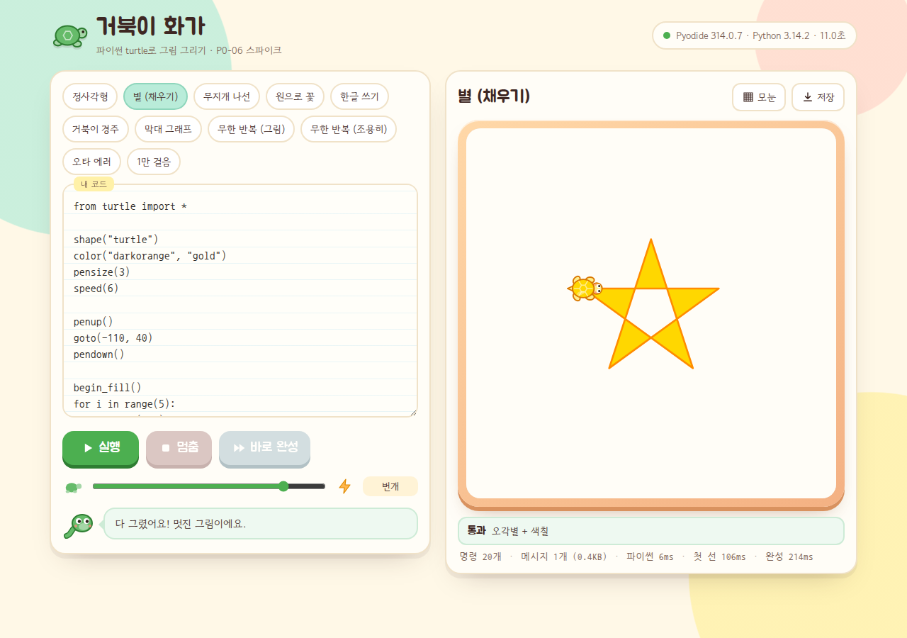

| 원으로 꽃 (채우기 12개 + 점 + 잎) | 무지개 나선 (애니메이션 중, 거북이가 걷는 중) |
|---|---|
| 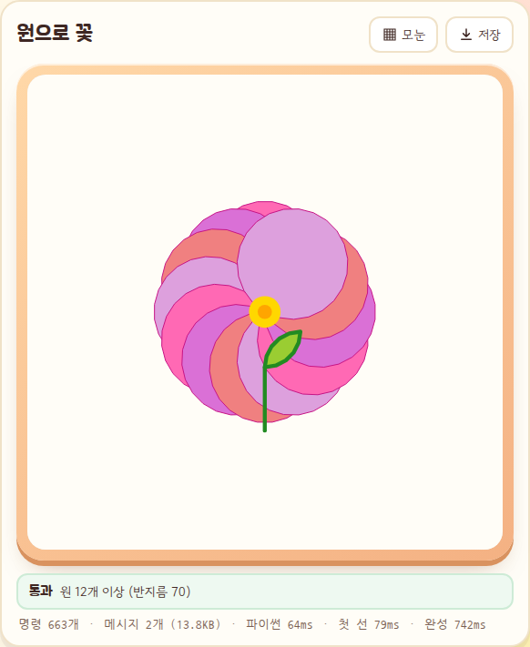 | 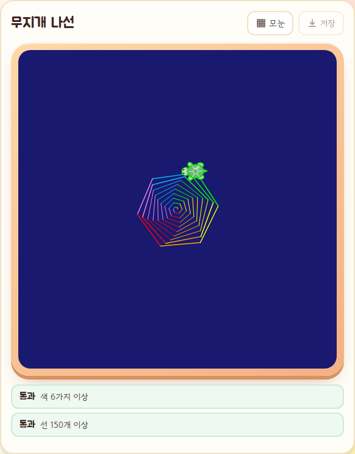 |
| **한글 쓰기 + 도장** | **거북이 경주 (거북이 3마리)** |
| 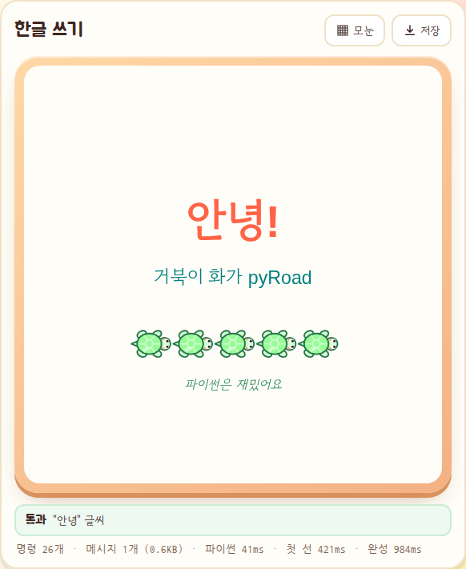 | 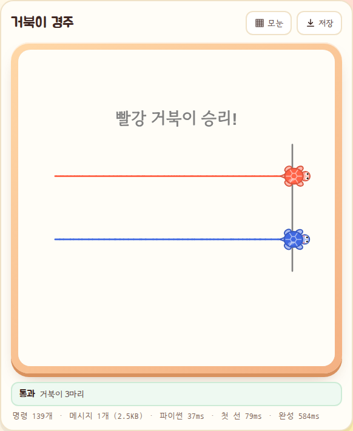 |
| **3-5 데이터 탐정: 막대 그래프** | **무지개 나선 (완성)** |
| 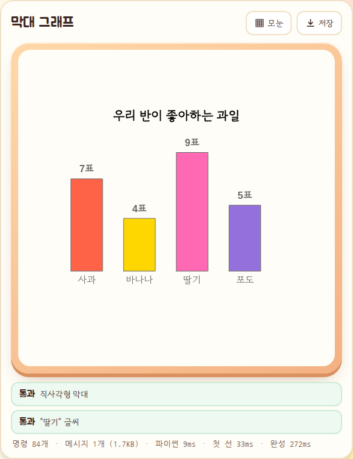 | 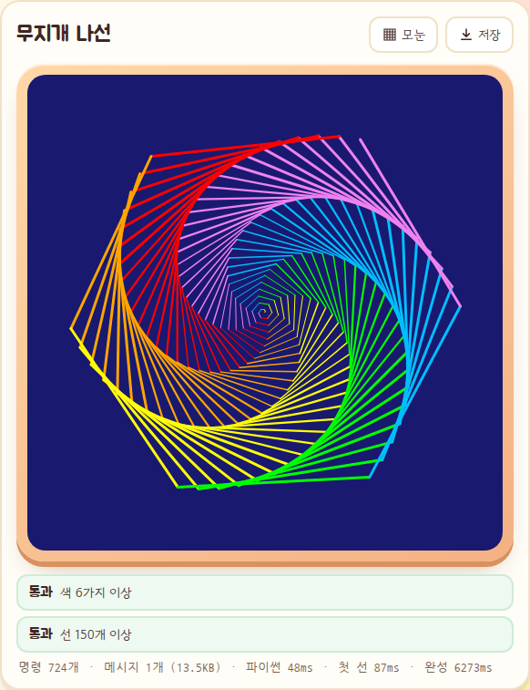 |

무한 반복: 명령 5만 개 상한에서 친절한 에러로 정지 (워커 재시작 없음, 같은 원을 계속 돌던 그림은 남음)

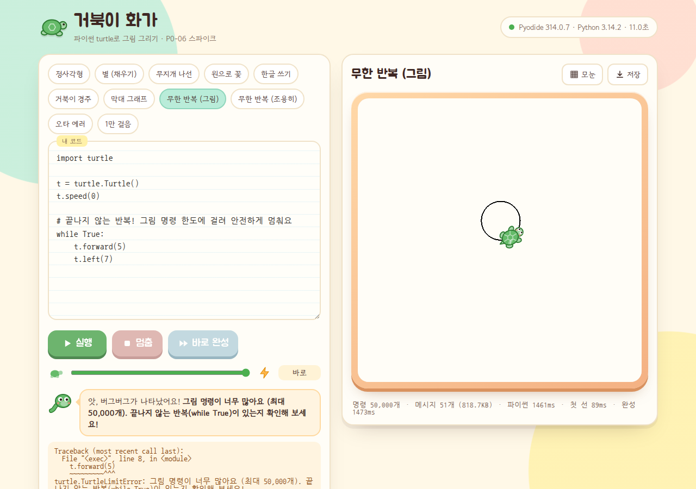

| 오타 에러 (사용자 코드 줄만, 한국어 제안) | 모바일 360px | 썸네일 내보내기 400×400 |
|---|---|---|
| 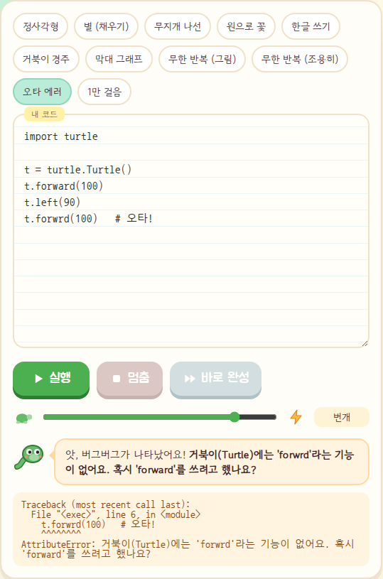 | 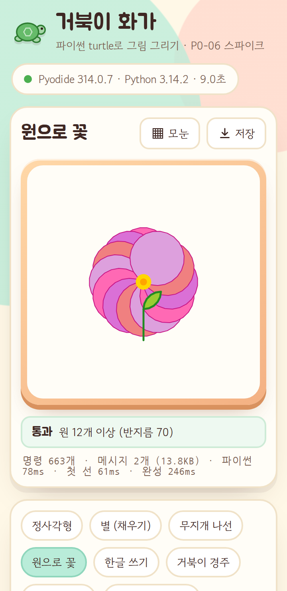 | 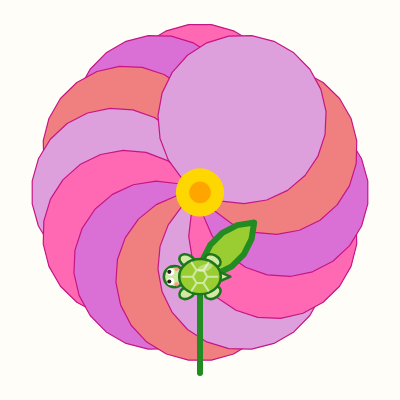 |

### 4.2 지원 API

| 분류 | 지원 | 비고 |
|---|---|---|
| 이동 | `forward/fd`, `back/bk/backward`, `left/lt`, `right/rt`, `goto/setpos/setposition`, `setx`, `sety`, `setheading/seth`, `home`, `circle(radius, extent, steps)`, `teleport`, `degrees`, `radians` | CPython과 같은 수학. 좌표계도 같음 (원점 가운데, y 위쪽, 0°=동쪽, standard 모드) |
| 조회 | `position/pos`, `xcor`, `ycor`, `heading`, `distance`, `towards`, `isdown`, `isvisible`, `filling`, `pen()` | JS 왕복 없이 Python이 바로 답함. `Vec2D` 출력 `(100.00,0.00)`도 CPython과 같음 |
| 펜·색 | `penup/pu/up`, `pendown/pd/down`, `pensize/width`, `pencolor`, `fillcolor`, `color`(인자 0~3개), `colormode(1.0/255)`, `speed(0~10, 'slow'…'fastest')` | 색: CSS 이름 148개(Tk 이름과 대부분 같음, 공백·대소문자 무시), `#rgb`/`#rrggbb`, `(r,g,b)`, `gray0~100`, **한글 색 이름(확장, 7절)**. 조회값도 CPython과 같은 형태로 돌려줌 |
| 채우기·점·도장 | `begin_fill`, `end_fill`, `dot(size, color)`, `stamp`, `clearstamp`, `clearstamps` | 채우기는 CPython처럼 그동안 그린 선 **아래**에 깔림. even-odd |
| 글씨 | `write(arg, move, align, font)` | 한글 OK. `font=("Arial", 24, "bold")` → Arial 뒤에 한글 웹폰트를 붙임. `move=True`의 글자 폭은 근사 |
| 모양 | `shape`(`classic`, `arrow`, `turtle`, `circle`, `square`, `triangle`, `blank`, `pybaem`*), `shapesize/turtlesize`, `hideturtle/ht`, `showturtle/st` | `classic`(기본)을 귀여운 거북이로 보여 주는 옵션 (7절). `pybaem`은 확장 |
| 지우기 | `clear`, `reset`, `Screen().clear/clearscreen`, `reset/resetscreen` | |
| 화면 | `Screen()`, `bgcolor`, `setup(w, h)`, `screensize`, `title`, `tracer`, `update`, `delay`, `window_width/height`, `turtles`, `getshapes`, `mode('standard')` | `title()`은 캔버스 위 제목으로 표시 (작품 이름) |
| 여러 거북이 | `Turtle()`, `clone()`, `getturtle/getpen`, `getscreen`, `RawTurtle/Pen` 별칭 | CPython처럼 명령 순서대로 번갈아 움직임 |
| 아무 일 안 함 | `done`, `mainloop`, `exitonclick`, `bye` | 교과서 코드 끝줄을 그대로 둬도 됨 |
| 미지원 → 친절한 에러 | `onkey/onkeypress/onkeyrelease/listen`, `onclick/onscreenclick/onrelease/ondrag`, `ontimer`, `textinput/numinput`, `bgpic`, `register_shape/addshape`, `setworldcoordinates`, `undo`, `begin_poly/end_poly/get_poly`, `tilt` 계열, `mode('logo'/'world')`, `getcanvas` | `turtle.TurtleNotSupportedError: 이 기능은 아직 지원하지 않아요: onkey() 키보드로 움직이기는 3-6 미니 게임에서 배울 예정이에요.` |
| 오타·잘못된 값 | 모든 거북이·화면·모듈 이름, 숫자 자리에 문자열, 모르는 색, 범위 밖 색 | `AttributeError: 거북이(Turtle)에는 'forwrd'라는 기능이 없어요. 혹시 'forward'를 쓰려고 했나요?`, `이 색 이름은 몰라요: 'rde' 혹시 'red'?`, `forward()의 거리에는 숫자를 넣어야 해요. 지금 넣은 값: '10'` |

명령 스트림 형식 (짧은 배열, 숫자는 소수 둘째 자리):

```
['n', id, {x,y,h,d,pc,fc,w,sp,v,sh,sz}]   새 거북이
['m', id, x, y]                             이동 (펜이 내려가 있으면 선)
['r', id, delta, heading, 0?]               회전 (끝의 0 = 즉시, circle 안의 회전)
['s', id, {pc:'red', w:3, ...}]             상태 변경
['bf', id] ['ef', id]  ['d', id, size, color]  ['sp', id, stampId]  ['w', id, text, align, family, size, style]
['c', id] ['C'] ['bg', color] ['tr', 0|1] ['u'] ['v', w, h] ['t', title] ['j', id, x, y, h?] ['cs', id, stampId]
```

### 4.3 성능 (Chromium, 이 PC)

| 항목 | 값 | 메모 |
|---|---|---|
| Pyodide 314.0.7 준비 (로컬 파일) | 8~16초 | Pyodide 로딩 + shim 설치. 이 PC의 Node에서도 13초 걸림. shim 설치 자체는 수십 ms |
| 첫 선까지 (실행 → 캔버스 첫 획) | 작은 그림 30~110ms | 정사각형·별·꽃·나선. 실행 시간 자체가 짧아 측정 잡음 수준 |
| 나선 1배속 애니메이션: 렌더러 프레임당 JS 작업 | p95 **1.7~4.4ms** | 같은 조건 평균 FPS는 36~55로 흔들림 (headless + CPU 경합 탓. 우리 작업 시간이 원인 아님) |
| 나선 1배속, CPU 4배 감속 | 작업 p95 13.2ms, 평균 25 FPS | 저사양 기기 흉내. 실기기 확인 필요 (7절) |
| 1만 걸음 (명령 20,004개) Python 실행 | 420~700ms (중앙값) | 스트리밍이면 메인 스레드가 동시에 그려 CPU를 나눠 써서 +200ms 정도 |
| 1만 걸음 메시지 | 21개, 357KB (gzip 80KB) | 명령 1개 평균 18바이트 |
| 1만 걸음 첫 선 / 완성 (바로 모드) | 53ms / 644ms | 한 번에 보내기: 490ms / 618ms (5.1) |
| 2만 명령 전체 다시 그리기 (크기 변경·HiDPI) | 6~14ms | 표시 목록 → 캔버스 (기록 시간) |
| 무한 반복 (그림): 명령 5만 개 상한에서 정지 | 1.37~1.47초 | 워커 재시작 없음, 그림은 남음 |
| 무한 반복 (그림 없음): 5초 제한 → 재시작 → 다시 준비 | 정지 5.2초, 다시 실행 가능까지 12~17초 | 재시작 후 정사각형 정상 실행 확인 |
| 썸네일 PNG 400×400 (꽃) | 45KB | 표시 목록에서 다시 그림 |
| 2만 명령 PNG 512×512 | 0.25~1.5초, 206KB | **한 path에 선을 무제한으로 넣으면 7.4초** → path당 64개로 끊어 해결 (4.6) |
| reduced-motion | 나선이 0.13~0.63초 만에 완성 | 1배속이면 약 6~13초 걸리는 그림 |

명령 스트림 크기 (gzip은 Node zlib 9)

| 예제 | 명령 | JSON | gzip | 코드 |
|---|---|---|---|---|
| 정사각형 | 12 | 310B | 165B | 212B |
| 별 | 20 | 448B | 211B | 196B |
| 나선 | 724 | 13.8KB | 2.3KB | 332B |
| 꽃 | 663 | 14.1KB | 2.6KB | 578B |
| 막대 그래프 | 84 | 1.8KB | 465B | 914B |
| 1만 걸음 | 20,004 | 357KB | 80KB | 179B |

### 4.4 정확도 교차 검증 (CPython 진짜 turtle 수학)

tkinter가 없으므로 가짜 `tkinter` 모듈을 `sys.modules`에 넣고 표준 라이브러리 `/usr/lib/python3.12/turtle.py`를 그대로 불러와, 진짜 `TNavigator`(이동·회전·`circle`)로 같은 프로그램을 실행했습니다. 모든 이동 지점과 마지막 `xcor, ycor, heading, towards(0,0), distance(0,0)`를 비교했습니다.

| 프로그램 | 내용 | 이동 수 | shim@CPython 3.12 | shim@Pyodide 314 (최종값) | 스트림 좌표 (소수 둘째 자리) |
|---|---|---|---|---|---|
| square_star | 정사각형, 별, `goto`, `setheading`, `back`, `home` | 14 | 오차 **0** | 오차 **0** | 최대 0.0043 |
| spiral | 나선 200회 + 소수 각도 회전 37회 | 238 | 오차 **0** | 오차 **0** | 최대 0.0050 |
| circles | `circle` 반지름 ±, `extent` ±, `steps`, `radians()`, 꽃잎 72호 | 432 | 오차 **0** | 오차 **0** | 최대 0.0050 |

- shim이 CPython과 같은 알고리즘(방향 벡터 `Vec2D.rotate`, `circle`의 `steps = 1 + int(min(11 + |r|/6, 59) × extent/360)`, 반 스텝 회전)을 써서 **부동소수점까지 같은 값**이 나옵니다. Pyodide(emscripten libm)에서도 이 세 프로그램은 차이가 0이었습니다.
- 스트림 좌표는 크기를 줄이려고 소수 둘째 자리로 반올림합니다(최대 오차 0.005). 정확한 최종 상태는 실행 결과 요약(`turtle.turtles[]`)에 전체 정밀도로 따로 실어 보냅니다.
- Pyodide 0.29.3, 0.27.5에서도 `circles` 최종값 오차 0.

### 4.5 그리기 검사기 (P11-05 프로토타입)

`checker.js`는 명령 스트림만 보고 판단합니다. `node test/checker.test.mjs` 결과 **26개 모두 통과**.

| 검사 | 통과해야 하는 예 | 걸러야 하는 예 (실제 피드백 문장) |
|---|---|---|
| 정사각형 `{shape:'regular', n:4, side:150}` | 한 변을 75+75로 나눠 그림, 오른쪽으로 돌기, 다른 위치에서 시작, 변 중간에서 시작 | 직사각형 → "변의 길이가 서로 달라요 (가장 짧은 변 90, 가장 긴 변 150)." / 3변 → "도형이 닫히지 않았어요… 변이 4개여야 하는데 지금은 3개예요." / 80° 회전 → "매번 90°씩 같은 방향으로 돌아야 해요 (지금: 80°)." |
| 채운 별 `{n:5, k:2, filled:true}` | 별 + `begin_fill/end_fill` | 채우기 없음 → "색칠(채우기)이 안 되어 있어요. begin_fill()과 end_fill()로 감싸 보세요." |
| 원 찾기 `findCircles` | `circle(50)`, `circle(-50)`, 직접 만든 원(`forward(10); left(10)` × 36 → 반지름 57.37), 꽃 12개 | (원 개수 부족 시) "원을 12개 이상 그려야 해요 (지금 n개)." |
| 정답 그림 비교 `matchDrawing` | 집 그림을 다른 순서·방향으로 그림, 평행이동(`normalize:'translate'`) | 지붕 빠짐 → "정답 그림의 선 2개가 아직 없어요." (점수 0.67) |
| 그 밖 | 색 n가지 이상, `write` 글씨 포함, 선 개수, 거북이 수 | |

원리: 같은 거북이가 이어 그린 선을 꺾은선으로 묶고 → 같은 방향의 연속 선은 한 변으로 합치고 → 변 길이·회전각·닫힘을 봅니다. 정답 비교는 같은 직선 위의 선분을 구간으로 합친 뒤 끝점을 허용 오차(기본 2)로 짝짓습니다. 순서·방향·나눠 그리기와 무관합니다.

### 4.6 브라우저·Pyodide 버전

| 환경 | 결과 |
|---|---|
| Chromium 151 (Pyodide 314.0.7) | 전부 동작. API 투어 포함 콘솔 에러·경고 0 |
| Firefox 153 (Pyodide 314.0.7) | 정사각형·별·한글 쓰기 검사 통과, 콘솔 에러 0. 준비 37.7초 (느림) |
| WebKit | **실측 못 함.** 이 PC에 WebKit 실행용 시스템 라이브러리가 없음 |
| Pyodide 0.29.3 (저장소 루트, Chromium) | 동작. Python 3.13.2. 별 검사 통과, `circles` 최종값 오차 0. 준비 21.6초 |
| Pyodide 0.27.5 (CDN, 지금 운영 버전) | 동작. Python 3.12.7. 같은 결과. 준비 23.1초 |
| Pyodide 314.0.7 (CDN) | 동작. 같은 결과. 준비 26.1초 |
| 314.0.7 + classic worker `importScripts('pyodide.js')` | **실패: `Classic web workers are not supported`** |

(버전별 준비 시간은 이 PC가 바쁠 때 연속으로 잰 값이라 버전 간 비교 근거로 쓰지 마세요.)

버전별로 알게 된 것
- Pyodide는 0.29.x 다음부터 **버전 체계가 Python 버전 기반(314.x = Python 3.14)**으로 바뀌었습니다. npm `latest`=314.0.7 (2026-09-14), `stable-0.29`=0.29.5, `stable-0.27`=0.27.8.
- 314는 `pyodide.asm.js` 대신 **`pyodide.asm.mjs`를 동적 import**하고, **classic worker를 지원하지 않습니다** (실측: `Classic web workers are not supported`). 지금 운영 워커(`public/workers/pyodide-worker.js`)는 `importScripts`를 쓰는 classic worker라서 314로 올리려면 **module worker로 바꿔야 합니다.** spike 워커는 module worker(`new Worker(url, {type:'module'})` + `import(indexURL + 'pyodide.mjs')`)로 만들어 0.27.5/0.29.3/314.0.7을 같은 코드로 띄웠습니다.
- npm 패키지 파일 합계 13.9MB (wasm 9.6MB, 표준 라이브러리 zip 2.5MB, asm.mjs 1.25MB). 자체 호스팅(B26) 시 이 파일들을 `public/`이나 정적 호스팅에 두면 됩니다.
- shim은 Python 3.12 문법까지만 써서 세 버전 모두 같은 파일로 동작합니다.
- Chromium에서 2만 개 선을 **path 하나**에 넣으면 PNG 내보내기(CPU 래스터)가 7.4초 걸렸습니다. path당 64개로 끊자 0.25~0.5초. 화면 캔버스(GPU)는 둘 다 빠르지만, 저사양 기기의 소프트웨어 래스터를 생각해 렌더러 기본값을 64로 했습니다.

## 5. 선택지 비교

### 5.1 명령 전달: 실행 중 스트리밍 vs 끝에 한 번에

같은 페이지에서 세 방식을 번갈아 5번씩 실행한 중앙값입니다 (`test/stream-vs-batch.mjs`, 바로 그리기 모드).

| 예제 (명령 수) | 방식 | Python 실행 | 첫 선 | 완성 | 메시지 |
|---|---|---|---|---|---|
| 1만 걸음 (20,004) | 즉시 스트리밍 (1→4→16…) | 699ms | **39ms** | 717ms | 26 |
| | **40ms 뒤 스트리밍 (채택)** | 622ms | **53ms** | 644ms | 21 |
| | 끝에 한 번에 | 421ms | 490ms | 618ms | 1 |
| 나선 (724) | 즉시 / 40ms 뒤 / 한 번에 | 33 / 51 / 35ms | 37 / 108 / 67ms | 84 / 122 / 82ms | 6 / 1 / 1 |
| 꽃 (663) | 즉시 / 40ms 뒤 / 한 번에 | 101 / 67 / 36ms | 102 / 111 / 78ms | 419 / 472 / 362ms | 7 / 3 / 1 |
| 정사각형 (12) | 즉시 / 40ms 뒤 / 한 번에 | 19 / 11 / 5ms | 35 / 32 / 38ms | 47 / 33 / 42ms | 4 / 1 / 1 |

해석
- **큰 프로그램**: 스트리밍이면 첫 선이 0.05초 안에 나오고, 한 번에 보내면 Python이 끝날 때까지(약 0.5초) 빈 캔버스입니다. 다 그리는 시간은 비슷합니다(실행과 그리기가 겹치므로). 1×처럼 애니메이션을 보여 줄 때는 첫 선 시간이 체감 속도를 정합니다.
- **작은 프로그램**: 세 방식 차이가 측정 잡음(수십 ms) 안입니다. 그래서 첫 청크를 40ms 기다려 작은 프로그램은 메시지 1개로 끝나게 했습니다.
- **비용**: 스트리밍하면 Python 실행이 +200ms 정도 늘었습니다 (2만 명령, 메인 스레드가 동시에 그리며 CPU를 나눠 씀). 실행 시간 제한(5초)에 비해 작고, 명령 상한 5만 개가 실행 시간의 상한도 됩니다.
- **무한 반복**: 그림을 그리는 무한 반복은 두 방식 모두 상한 에러로 정상 종료되지만, 스트리밍이면 그 사이 그림이 바로 보입니다. 그림 없는 무한 반복은 시간 제한 → 워커 재시작인데, 한 번에 보내기는 이 경우 **그때까지의 그림을 모두 잃습니다** (워커를 죽이므로).
- 시간 제한(기존 5초)은 **Python 실행에만** 적용합니다. 애니메이션은 메인 스레드에서 따로 진행되므로 "애니메이션이 길어서 시간 초과"는 생기지 않습니다.
- 명령 상한 5만 개 근거: 3월드 예제 중 큰 것도 수천 개(꽃 663, 나선 724)이고 1만 걸음도 2만 개. 5만 개는 약 0.85MB이고 이 PC에서 1.4초면 도달합니다.

### 5.2 직접 만들기 vs 가져다 쓰기

| 후보 | 라이선스 | 구조 | 판단 |
|---|---|---|---|
| [basthon-turtle](https://pypi.org/project/basthon-turtle/) 0.4.1 (2026-09) | **GPL-3.0-or-later** | CPython turtle 수정판, SVG 출력, Pyodide 워커 → postMessage | 구조는 가장 비슷하지만 GPL이라 브라우저로 배포하는 pyRoad(Apache-2.0) 코드에 섞기 어려움. 설계 참고만 |
| [CoderDojoTrento/turtle-pyscript](https://github.com/CoderDojoTrento/turtle-pyscript) | Apache-2.0 | PyScript 메인 스레드에서 SVG DOM 직접 조작 | 워커에서 돌리는 우리 구조와 맞지 않음. 2025-06 이후 업데이트 없음 |
| [pyo-js-turtle](https://pypi.org/project/pyo-js-turtle/) 0.1.1 | MIT (분류자만) | 작은 실험 패키지 | 메타데이터가 템플릿 그대로, 성숙도 낮음 |
| SimonRundell/pythonPlayground | 명시 없음 (GitHub "Other") | 앱 안의 turtle.py | 라이선스 불명확 → 사용 불가 |
| Skulpt turtle | MIT | Skulpt 인터프리터 전용 JS 구현 | Pyodide(CPython)와 런타임이 다름 |
| Brython turtle | BSD-3 | Brython `browser` 모듈 + SVG | 런타임이 다름 |
| ipyturtle 계열 | - | Jupyter 위젯 통신 | 노트북 전용 |

직접 만든 이유
- 라이선스 문제가 없고, **워커 프로토콜(스트리밍, 상한, 실행 결과 요약)을 우리 설계에 맞출 수 있습니다.**
- 한국어 에러·오타 제안, 검사기(P11-05), 썸네일(P11-06), 캐릭터 스프라이트, reduced-motion을 처음부터 넣을 수 있습니다.
- 규모가 작습니다: Python shim 약 1,000줄(주석·빈 줄 포함), JS 렌더러 약 900줄(스프라이트 그림 포함), 리듀서 180줄, 검사기 320줄. CPython 수학을 그대로 따라 해 정확도도 확인했습니다.
- CPython 소스는 복사하지 않고 같은 알고리즘으로 새로 작성했습니다.

### 5.3 출력: 캔버스 vs SVG

| | 캔버스 + 표시 목록 (채택) | SVG |
|---|---|---|
| 큰 그림 (2만 선) | 그린 만큼만 픽셀. 다시 그리기 6~14ms | DOM 요소가 많아짐. 같은 그림 SVG 문자열 130KB (렌더러 `exportSVG`로 측정) |
| 애니메이션 | 확정 그림 + 매 프레임 오버레이(진행 중인 선, 스프라이트)만 다시 그림 | 요소 추가·속성 변경, 많아지면 레이아웃 비용 |
| 채우기를 선 아래에 끼우기 | `begin_fill` 시점 스냅숏 + 그 뒤 항목만 다시 그림 | DOM 순서로 쉬움 |
| 썸네일·저장 | `toBlob` 바로 | 래스터화 단계가 필요 |
| 벡터 출력 | 표시 목록에서 SVG도 만들 수 있음 (`exportSVG`) | 기본 |

캔버스로 그리면서 표시 목록을 보관하면 SVG가 필요할 때(인쇄, 확대 보기) 언제든 만들 수 있어 둘의 장점을 함께 얻습니다.

## 6. 이후 Phase 영향

### 6.1 업그레이드 계획서 문구 제안

**P11-02** (현재: "turtle 캔버스 출력 (애니메이션 속도 조절, 결과 이미지 저장)")

> - [ ] **P11-02** turtle 캔버스 출력 (P0-06 결론: 자체 shim 채택). `turtle.py` shim을 워커 FS(`/pyroad/turtle.py`)에 설치하고, 그리기 명령을 실행 중 청크로 스트리밍(`{type:'turtle', id, chunk}`). 렌더러 `TurtleCanvas`(캔버스 3장 + 표시 목록, CPython 속도 공식)와 공유 리듀서를 `src/lib/turtle/`로 옮기고 React 래퍼 `TurtleStage` 작성. 속도 슬라이더(0.25×~8×, 바로) + 바로 완성 + reduced-motion 즉시 그리기 + HiDPI + 화면 맞춤 + 좌표 모눈 + PNG 저장. 캔버스 글씨용 한글 웹폰트 미리 로드(P0-14). 테스트: shim은 Node Pyodide(P0-09), 리듀서·검사기는 Vitest

**P11-03** (현재: "프로젝트 모드 실행 제한 조정 (시간 제한, 출력 길이, 무한 루프 시 Worker 재시작)")

> - [ ] **P11-03** 프로젝트 모드 실행 제한 조정. 시간 제한은 **Python 실행에만** 적용(애니메이션 시간 제외). turtle 명령 상한 50,000개(넘으면 `TurtleLimitError`로 정상 종료, 워커 재시작 없음). 그림 없는 무한 루프만 시간 제한 + 워커 재시작(다시 실행 가능까지 12~17초 → P0-05 결론에 따라 `pyodide.setInterruptBuffer`로 대체 검토). 실행마다 새 globals 사용, traceback은 사용자 코드 줄만 표시

**P11-05** (현재: "프로젝트 검증 방식 확장 (입력 시나리오 기반 테스트, 그리기 명령 검증)")

> - [ ] **P11-05** 프로젝트 검증 방식 확장: 입력 시나리오 기반 테스트 + **그리기 명령 검증**(픽셀 비교 없음). 퀘스트 YAML에 선언형 규칙(`shape` 정다각형·별·직사각형, `circles`, `colors`, `text`, `segments`, `turtles`)과 정답 코드 기반 선분 집합 비교(`matchDrawing`, 순서·방향·나눠 그리기 무관, 평행이동 옵션)를 적음. 실패 이유를 한국어 문장으로 돌려줘 AI 튜터 힌트에 사용. 같은 검사기를 CI(Node Pyodide)에서 `solution_code` 자기 검증에도 사용

**P11-06** (현재: "`creations` 테이블 + 작품 저장 (코드, 썸네일, 공개 범위. 기본값은 비공개)")

> - [ ] **P11-06** `creations` 테이블 + 작품 저장 (코드, 썸네일, **명령 스트림(gzip, 상한 예: 100KB)**, 공개 범위. 기본값은 비공개). 썸네일은 `exportPNG({width:400, height:400, fit:'content'})`로 표시 목록에서 다시 그려 만들고(화면 크기·HiDPI 무관, 꽃 45KB) Storage에 저장

**P11-07** (현재: "작품 갤러리 (친구 작품 실행, 스티커 리액션, 신고, 운영자 숨김)")

> - [ ] **P11-07** 작품 갤러리: 친구 작품은 **저장된 명령 스트림을 재생**해 애니메이션으로 보여 줌(Pyodide 로딩 없이 즉시, 남의 코드를 실행하지 않음). "코드 보기·내 에디터로 가져오기"는 선택. 스티커 리액션, 신고, 운영자 숨김

**§5 3월드 표**

> | 3-1 거북이 화가 | 반복·함수로 도형과 패턴 그리기 → 갤러리 출품 | turtle shim + 캔버스 렌더러 (P0-06 채택) |
> | 3-5 데이터 탐정 | 반 설문 데이터 → 통계 → 막대 그래프 | turtle로 막대 그래프 (P0-06 예제 `bars.py`로 확인. 별도 차트 런타임 불필요) |

**완료 기준 (Phase 11)** 추가 제안

> - [ ] 같은 turtle 코드의 최종 위치·방향이 CPython과 같다 (교차 검증 테스트)
> - [ ] 그림 그리는 무한 반복이 워커 재시작 없이 멈추고, 그림 없는 무한 반복은 시간 제한 후 다시 실행할 수 있다

### 6.2 3-1 거북이 화가 커리큘럼 메모

- 진행 예: 정사각형(for) → `polygon(n, size)` 함수 → 채운 별 → `circle`로 꽃 → 변수를 키우는 나선 → 색 리스트 → 나만의 작품(`title("작품 이름")`) → 갤러리 출품.
- 퀘스트마다 검사 규칙을 붙이면 "정사각형 완성!" 같은 즉시 피드백을 줄 수 있습니다. 실패 문장은 그대로 튜터 힌트로 씁니다.
- 교과서 코드(`t = turtle.Turtle()`, `from turtle import *`, 끝의 `turtle.done()`)를 그대로 붙여 넣어도 됩니다.
- 지원하지 않는 기능(키·마우스 이벤트, `textinput`, `undo`, `setworldcoordinates`)은 퀘스트에서 쓰지 않습니다. 쓰면 친절한 에러가 나옵니다.
- 좌표 모눈 토글은 `goto(x, y)`를 배울 때 특히 유용합니다.

### 6.3 3-5 데이터 탐정 메모

- dict → for → `begin_fill` 사각형 → `write`로 한글 라벨까지 turtle만으로 됩니다 (`samples/bars.py`).
- 통계 계산은 `statistics` 모듈(`mean`, `median`)이 import 됩니다 (기존 차단 목록과 충돌 없음 확인).
- 막대 그리기 함수(`draw_bar(x, height, color, label)`)를 시작 코드로 주고 아이는 데이터와 반복에 집중하게 하는 것을 권장합니다.
- 검사: `{type:'shape', shape:'rectangle'}` + `{type:'text', includes:'딸기'}` 같은 규칙으로 막대·라벨 확인.

### 6.4 Phase 2 디자인 메모 (스프라이트, 액자, 움직임)

- **스프라이트**: 기본은 귀여운 거북이(등껍질 = `fillcolor`, 몸 = 밝게 섞은 색, 테두리 = `pencolor`, 눈·볼). 채우기 색이 기본 검정이면 파스텔 초록(#66BB6A / #A5D6A7 / #2E7D32, 파이뱀 색)으로 보여 줍니다. CPython보다 1.35배 크게(최소 0.95, 최대 1.6). 걸을 때 다리를 흔듭니다.
- **파이뱀 테마**: `shape("pybaem")` 확장으로 뱀 머리(왕관, 혀) 스프라이트를 넣어 봤습니다. 시안 단계에서 정식 일러스트(SVG → `Path2D` 또는 `drawImage`)로 바꿀 자리입니다. 거북이 화가 퀘스트에서 "파이뱀이 거북이에게 그리는 법을 알려 준다" 같은 이야기 구성이 자연스럽습니다.
- **캔버스 액자**: A안은 두꺼운 둥근 클레이 액자(복숭아색 그라디언트 + 아래 그림자, 데모 방식), B안은 종이 질감 + 손그림 테두리. 안쪽은 크림색 종이(#fffdf7). 1:1 비율, 기본 세계 600×600(CPython 창과 비슷), 그림이 넘치면 50 단위로 화면을 키움.
- **움직임 느낌**: CPython 공식(이동 `1 + int(거리 / (3·1.1^speed·speed))` 프레임, 회전 `1 + int(각도 / (3·speed))` 프레임)이라 CPython 경험과 비슷합니다. 거북이가 회전하는 모습이 보이고, `circle` 안의 회전은 즉시입니다. 끝나면 말풍선 "다 그렸어요!" → P6-08 성공 연출과 연결할 수 있습니다.
- **컨트롤**: 실행(초록) / 멈춤(코랄) / 바로 완성(하늘) 3D 버튼 + 거북이↔번개 아이콘 속도 슬라이더 + 모눈·저장 도구 버튼. 에러는 빨강이 아닌 주황 말풍선(P6-07 방향).
- **reduced-motion**: 바로 그리기 + 다리 흔들기 끔. 슬라이더로 아이가 직접 바꿀 수 있음.
- **모바일**: 360px에서 캔버스를 위에, 에디터를 아래에 두었더니 실행 버튼과 그림이 한 화면에 함께 보이지 않습니다. P6-11(탭·스와이프·바텀시트)에서 "실행하면 캔버스로 자동 이동" 또는 떠 있는 실행 버튼이 필요합니다.

### 6.5 다른 Phase 참고

- **B26 (Pyodide 버전 통일)**: 314.0.7에서 shim이 동작합니다. 314는 **classic worker를 지원하지 않으므로** 워커를 module worker로 바꾸는 작업이 버전 업그레이드에 포함되어야 합니다 (`importScripts` → `import()`, `new Worker(url, {type:'module'})`). 0.27.5 → 314로 올리면 Python 3.12 → 3.14. 0.29.x를 고르면 classic worker를 유지할 수 있지만 `stable-0.29` 지원 기간을 확인해야 합니다.
- **P1 워커 개선 후보** (spike 워커에서 해 본 것): 실행마다 새 globals(지금은 이전 실행의 변수가 남음), 사용자 코드(`<exec>`) 줄만 남긴 traceback(지금은 Pyodide 내부 줄이 섞임), import 차단을 사용자 코드에만 적용(표준 모듈 내부 import는 허용), `js`·`pyodide` 모듈 차단(지금은 사용자 코드에서 `import js`로 브라우저 API에 접근 가능).
- **P0-09 (Node Pyodide CI)**: shim이 순수 Python이라 Node Pyodide에서 그대로 돌고, 검사기도 DOM이 없어 CI에서 `solution_code` → 명령 스트림 → 규칙 검사가 됩니다.
- **P0-14 (한글 웹폰트)**: 캔버스 `write()`는 CSS 웹폰트를 씁니다. 캔버스용 한글 글꼴 1종을 자체 호스팅하고 미리 로드하는 방식을 권장합니다.

## 7. 남은 리스크 & 사용자 확인 필요 사항

**사용자 확인 필요**

1. **기본 스프라이트**: CPython 기본 모양(`classic`, 작은 화살표) 대신 **귀여운 거북이**를 기본으로 보여 줄까요? (추천: 거북이. 퀘스트 이름이 "거북이 화가"이고 아이 반응이 좋음. 코드상 `shape()`는 여전히 `'classic'`을 돌려줘 CPython과 같음)
2. **한글 색 이름 확장** (`color("빨강")`, `"하늘색"` 등 26개): 8~9세에게 쉽지만 CPython에서는 에러가 납니다. (추천: 켜 두되 퀘스트 본문은 영어 색 이름으로 가르치고, 한글 이름은 "도움말"에서만 소개)
3. **`shape("pybaem")` 확장**: 파이뱀 스프라이트를 숨은 재미로 둘지 (추천: 둠. 정식 일러스트는 Phase 2)
4. **명령 상한 50,000개, Python 시간 제한 5초** 값 (추천: 그대로 시작해 3월드 콘텐츠 작성 때 조정)
5. **갤러리에서 친구 작품을 "코드 실행" 대신 "명령 스트림 재생"으로 보여 주기** (추천: 재생. 즉시 보이고 남의 코드를 실행하지 않음. P11-07 문구 변경 필요)

**남은 리스크**

- **채우기 규칙**: even-odd로 맞췄습니다(Windows·Linux CPython과 같음). macOS Tk에서는 별 가운데가 채워진다는 보고가 있어(미확인) 맥으로 만든 교재 그림과 다를 수 있습니다. 렌더러 옵션 `fillRule`로 바꿀 수 있습니다.
- **`speed(0)`이 CPython보다 빠름**: CPython은 speed 0에서도 명령마다 화면 갱신(약 10ms)을 해서 1만 걸음이 100초 넘게 걸리지만, 우리는 즉시 그립니다. 아이에게는 장점이지만 "CPython과 똑같은 속도"는 아닙니다. 숨은 거북이의 회전도 시간을 쓰지 않습니다.
- **`write(move=True)`**: 글자 폭을 Python에서 알 수 없어 근사합니다(한글 1em, 영문 0.56em). 그 뒤 위치가 몇 픽셀 다를 수 있습니다. 밑줄 스타일(`underline`)은 무시합니다.
- **한글 웹폰트 지연**: Google Fonts 한글은 unicode-range 조각으로 나뉘어, 처음 쓰는 글자 조각을 받을 때 첫 `write()`가 ~0.3초 늦습니다(렌더러가 최대 2초 기다린 뒤 그림). P0-14에서 자체 호스팅 + 캔버스용 1종 전체 preload로 해결 권장.
- **저사양 FPS**: 우리 프레임 작업은 작지만(p95 1.7~4.4ms), CPU 4배 감속에서 headless 평균 FPS가 25로 떨어졌습니다. 실제 크롬북·구형 태블릿 측정은 P0-16/P12에서 필요합니다.
- **Safari(WebKit) 미검증**: 이 PC에서 WebKit을 띄우지 못했습니다. iPad가 학교·가정에서 많이 쓰이므로 module worker + Pyodide 314 + 캔버스 렌더러를 실제 iPad Safari에서 확인해야 합니다 (P3-19, P12). 사용자 PC에서는 `sudo npx playwright install-deps webkit` 후 `node test/run-demo.mjs`로 바로 확인할 수 있습니다.
- **`time.sleep()`은 그림을 멈추지 않음**: 그림은 Python이 끝난 뒤(또는 도중에) 렌더러가 자기 속도로 재생하므로, `sleep`으로 만든 "잠깐 멈춤"은 화면에 나타나지 않습니다. 필요하면 shim이 `sleep`을 `['z', ms]` 대기 명령으로 바꾸는 확장이 쉽습니다.
- **큰 그림 래스터 비용**: 선 2만 개 PNG 내보내기에 최대 1.5초(이 PC). 썸네일 생성은 저장 버튼을 누를 때 한 번이라 허용 범위지만, 저사양 기기에서는 "저장 중…" 표시가 필요합니다.
- **워커 재시작 비용**: 그림 없는 무한 반복은 재시작 후 다시 실행할 수 있기까지 이 PC에서 12~17초. P0-05가 SharedArrayBuffer(COOP/COEP)를 채택하면 `setInterruptBuffer`로 재시작 없이 멈출 수 있습니다.
- **이벤트·프레임 루프(P11-04)**: `onkey`, `ontimer`는 이 구조(실행이 끝난 뒤 재생)에 맞지 않습니다. 3-6 미니 게임은 별도 설계가 필요합니다(메인 스레드와 양방향 통신 + 비동기 실행).
- **import 차단은 보안 경계가 아님**: Pyodide 사용자 코드는 브라우저 샌드박스 안에서만 돕니다. 차단 목록은 "실수 방지" 수준입니다.

## 8. 재현 방법

```bash
cd spikes/p0-06-turtle-canvas
npm install                       # spike 폴더에만 pyodide@314.0.7 설치 (루트 package.json 변경 없음)
node server.mjs                   # http://localhost:3106/  (?pyodide=local|root|cdn&ver=0.27.5, &stream=0, &first=40, &max=50000, &sample=star)

# CPython 교차 검증 (tkinter 불필요)
python3 -I test/crosscheck.py

# 검사기 단위 테스트 (fixture가 없으면 crosscheck.py로 먼저 만듦)
node test/checker.test.mjs

# 브라우저 자동 실행·측정·스크린샷 (서버가 없으면 직접 띄우고 끝나면 끔)
#   저장소 Playwright(1.58.2)용 브라우저가 없으면: npx playwright install chromium firefox webkit
#   또는 설치된 브라우저와 맞는 playwright-core 경로를 PW_CORE로 지정
PW_CORE=<playwright-core>/index.mjs node test/run-demo.mjs
PW_CORE=<playwright-core>/index.mjs node test/stream-vs-batch.mjs
```

결과 JSON은 `test/out/results.json`, 스크린샷은 `docs/spikes/img/P0-06-*.png`에 저장됩니다.
