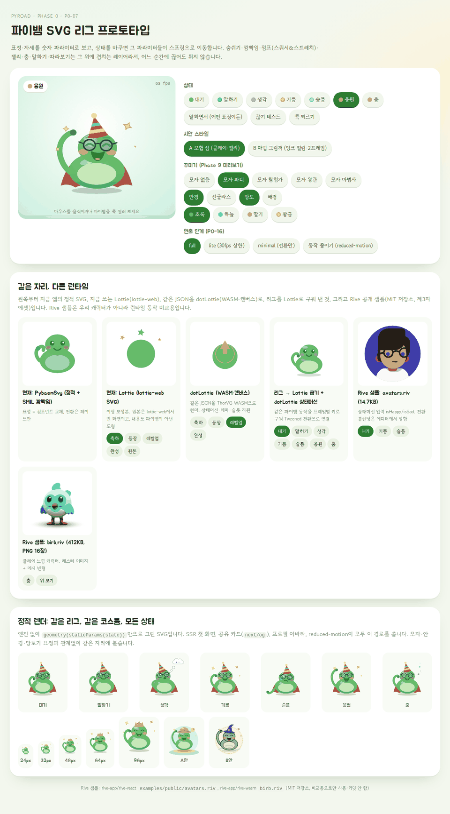
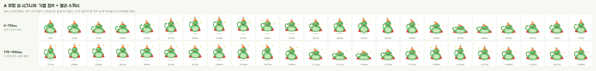
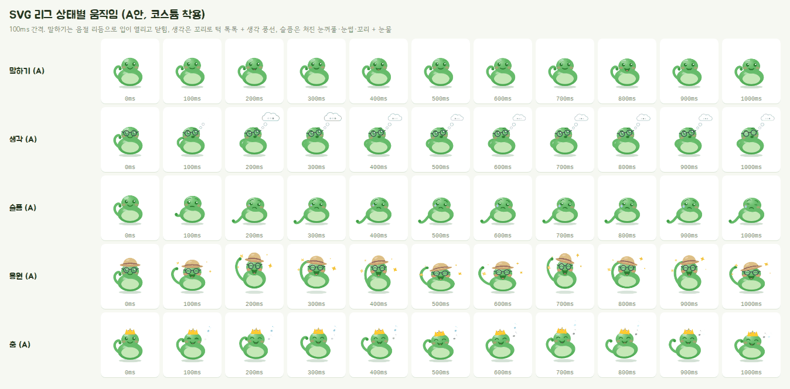
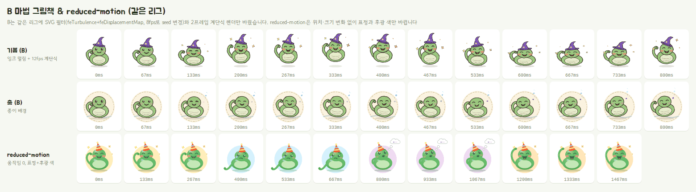
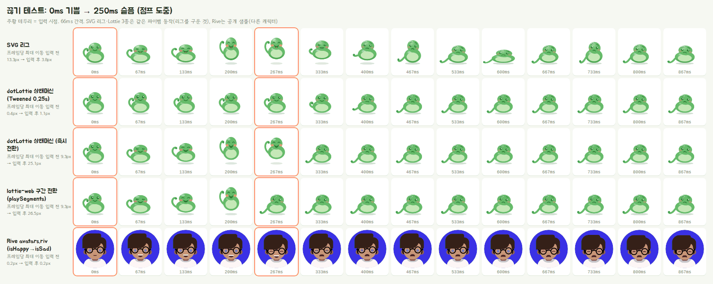
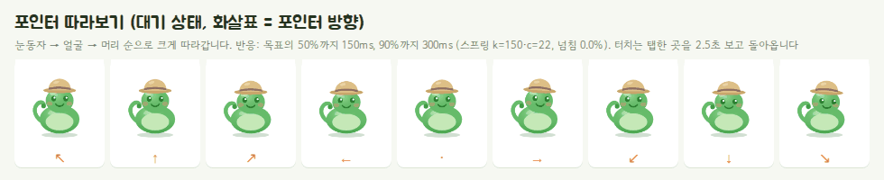
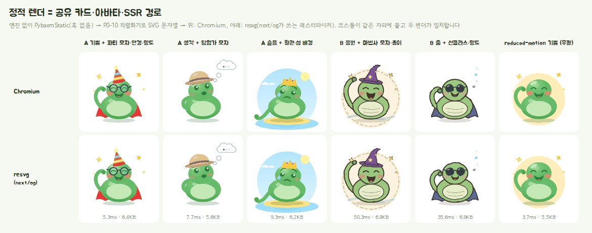

# P0-07 마스코트 애니메이션: Rive vs Lottie vs 코드 기반 SVG 리그

> - 작성일: 2026-11-03 · 브랜치 `feat/phase0`
> - 코드: [`spikes/p0-07-mascot-animation/`](../../spikes/p0-07-mascot-animation/) (데모·벤치·리그 프로토타입)
> - 관련: [업그레이드 계획서](../4.upgrade-plan.md) §2.5, §2.6, §3 F6·F9, §6(A·B 시안), §8 X12, P2-13·P2-15·P2-16, P5-09, P6-07·P6-08, P9-04·P9-05, [P0-10](P0-10-og-share-card.md)(공유 카드), [P0-16](P0-16-low-spec-detection.md)(저사양 감지)
> - 범위: 브라우저 데모와 Playwright(Chromium) 실측. 실제 태블릿·아이패드 측정과 Rive 에디터 제작은 하지 않음 (문서 확인)

## 1. 결론: **채택: 코드 기반 SVG 리그** (Rive는 **대안**, Lottie를 마스코트에 쓰는 안은 **불가**)

| 쓰임 | 결정 | 한 줄 이유 |
|---|---|---|
| **인터랙티브 마스코트** (파이뱀·버그버그·별똥이, 상태 전환·따라보기·말하기) | **SVG 리그 채택**: 기존 SVG 캐릭터를 부위로 나누고, 표정·자세를 숫자 파라미터로 표현, 상태 전환은 스프링, 숨쉬기·깜빡임·점프·젤리·춤·말하기는 겹치는 레이어. 자체 엔진 gzip **10.5KB**, 런타임 의존성 없음 | 어느 순간에 끊어도 이어지는 전환, 코스튬 레이어·재색칠·정적 렌더를 **같은 코드 하나로** 해결, 1인 개발자 + Claude가 코드로 만들고 diff로 리뷰 가능 |
| **일회성 이펙트** (코인 튀어나옴, 별 1→3, 상자 열기, 레벨업 폭죽) | **코드 우선**: Framer Motion(이미 앱에 있음) + canvas-confetti(이미 있음, Worker에서 그림). 디자이너 에셋이 꼭 필요한 2~3종(예: 보물상자 개봉)만 `lottie-web`의 `lottie_light`(gzip 48KB)를 지연 로드 | 추가 런타임 0. Lottie는 "사 오거나 받아 쓰는 에셋"용 통로로만 남김 |
| **정적 렌더** (공유 카드 `next/og`, 프로필·월드맵 아바타, SSR 첫 화면, reduced-motion) | **`PybaemStatic`** (훅 없는 순수 컴포넌트) → P0-10 직렬화기 → `data:` URI ``. resvg 결과가 브라우저와 일치 (실측) | 라이브 리그와 같은 `geometry()` 함수라 꾸민 모습이 어디서나 같음 |

- **왜 Rive가 아닌가 (대안으로 보류)**: Rive는 상태머신·블렌딩·포인터 반응이 가장 강력하고 실측 전환도 부드러웠습니다(§4.4). 하지만 ① 런타임이 **JS 90KB + WASM 918KB(gzip)**, `canvas-lite`도 **JS 60KB + WASM 344KB**로 리그(10.5KB)의 수십 배, ② `.riv`는 바이너리라 Claude가 코드로 만들거나 diff로 리뷰할 수 없고 Rive 에디터를 익힌 애니메이터가 필요, ③ 무료 플랜 내보내기는 **Rive 스플래시 화면**이 붙어 운영에는 **Cadet($9/석/월, 연간)** 이상 필요 (문서 확인), ④ 공유 카드 경로(`next/og` = satori + resvg)로 바로 그릴 수 없어 정적 SVG를 **따로** 만들어야 하므로 같은 캐릭터를 두 번 관리, ⑤ 2.49 런타임이 "상태머신 입력은 폐기 예정, 데이터 바인딩으로 옮기라"는 경고를 냅니다 (실측, API 변화 중). 나중에 전문 애니메이터가 합류하고 3D 클레이 질감 같은 래스터 표현이 꼭 필요해지면 다시 검토합니다.
- **왜 Lottie를 마스코트에 쓰지 않는가 (불가)**: Lottie는 **상태 사이를 섞을 수 없습니다**. 구간을 바꾸면 순간이동하고(점프 중 끊으면 프레임당 26px 튐, §4.4), dotLottie 상태머신의 `Tweened` 전환은 부드럽지만 전환하는 동안 동작이 멈춘 채 두 포즈 사이를 보간만 하고 **그동안 입력을 무시합니다**(문서 확인). 이 테스트(0ms 기쁨 → 250ms 슬픔)에서는 기쁨 점프가 한 번도 보이지 않았습니다(실측). 코스튬을 얹으려면 모든 상태 애니메이션에 코스튬 레이어를 미리 넣어 다시 내보내야 하고, 공유 카드 경로(`next/og`)로 정지 화면을 바로 그릴 수 없습니다 (헤드리스 브라우저 같은 별도 렌더 서버가 필요).
- **부수 발견 (버그)**: 저장소의 Lottie 4종(`public/characters/pybaem/lottie/*.json`)은 **lottie-web 5.13(앱이 쓰는 lottie-react 2.4.1의 엔진)에서 아무것도 그리지 않습니다** (실측). 레이어 `st`·`ks.a/r`와 키프레임 `i/o`(이징)가 빠져 있어 레이어가 계속 `display:none`입니다. 즉 지금 레벨업·스테이지 클리어·프로젝트 완성 축하와 랜딩 히어로의 캐릭터 자리는 로딩 중 폴백이 사라진 뒤 **빈 칸**입니다. 내용도 파이뱀이 아닌 초록 원 + 별입니다. P6-08/P6-13에서 리그로 교체하고, 그 전에 고치려면 §6.3의 B32를 봐 주세요.

**핵심 수치** (실측, 헤드리스 Chromium 151, 기기 배율 2, 3회 중앙값)

| | SVG 리그 | lottie-web SVG | dotLottie | Rive (canvas) |
|---|---:|---:|---:|---:|
| 처음 받는 런타임 (gzip, JS + WASM) | **10.5KB** | 63.6KB | 494.7KB | 1,007KB (lite 404KB) |
| 느린 4G 첫 방문 첫 프레임 | **1.2초** | 1.7초 | 3.9초 | 6.7~8.6초 |
| CPU 6×, 캐릭터 1개 fps | 49 (lite 58) | **60** | 58 | 60 (얼굴만) / 49 (래스터 메시) |
| CPU 6×, 캐릭터 3개 + 폭죽 fps | **38** (lite 45) | 33 | 26 | 59 (얼굴만) / 14 (래스터 메시) |
| 점프 도중 끊기, 입력 직후 프레임당 이동 | **3.8px** (섞임) | 26.5px (순간이동) | 25.1px 즉시 / Tweened는 전환 중 동작 멈춤·입력 무시 | 섞임 |
| 꾸미기 슬롯·재색칠·공유 카드 정적 렌더 | **같은 코드로 모두** | 상태마다 다시 내보내기 | 색 슬롯만 | 에디터 작업 + 정적 SVG 별도 |

- 리그 정적 렌더(`PybaemStatic`, 공유 카드·아바타)는 gzip 6.2KB이고, resvg 래스터화 A안 4~9ms, B안 36~50ms (실측).
- 따라보기는 목표의 90%에 300ms, 넘침 0%. 측정 중 load 중앙값: FPS 2차 10.0, 느린 4G 7.0~7.6, 1차 21.8.

## 2. 검증한 질문

| # | 질문 | 답 |
|---|---|---|
| Q1 | 런타임 비용(JS·WASM 크기, 에셋 크기, 첫 프레임 시간)은? | 리그 10.5KB(gzip) / lottie-web SVG 63.6KB / dotLottie 12.5KB + WASM 482KB / Rive 89.5KB + WASM 918KB. §4.2 |
| Q2 | 약한 기기에서 부드러운가? (CPU 1×/4×/6×, 캐릭터 1개 / 3개 + 폭죽) | §4.3 |
| Q3 | 상태 전환을 도중에 끊으면 자연스럽게 섞이나, 튀나? 따라보기 반응은? 깜빡임·숨쉬기는? | 리그는 섞임(물리적으로 착지까지 이어짐), Lottie는 튐, dotLottie Tweened는 전환 중 동작 멈춤·입력 무시, Rive는 섞임. 따라보기 90% 도달 300ms. §4.4, §4.5 |
| Q4 | Phase 9 꾸미기(모자·안경·망토·배경)를 모든 표정에 일관되게 얹고, 재색칠하고, 공유 카드에 같은 모습으로 그릴 수 있나? | 리그는 슬롯 4개 + 팔레트로 가능, 정적 렌더가 resvg와 일치. §4.6 |
| Q5 | 3캐릭터 × 약 7상태 제작 비용과 도구, 누가 만들 수 있나, 버전 관리는? | §5, §6.2 |
| Q6 | Next.js 통합(SSR·하이드레이션, `'use client'`, 지연 로드, reduced-motion·저사양, 접근성)은? | §4.7 |
| Q7 | 런타임 라이선스는? | 모두 MIT (canvas-confetti ISC). Rive 에디터 내보내기만 유료 조건. §5 |

## 3. 방법 & 환경

- **프로토타입**: 파이뱀 SVG 리그(`src/rig/`)를 새로 만들었습니다. 기존 `PybaemSvg.tsx`의 좌표·색을 그대로 가져와 부위(몸·배·꼬리·머리·볼·눈·눈썹·입·소품)로 나눴습니다. 앱의 `src/`는 수정하지 않고, 비교용으로 `PybaemSvg`만 읽기 전용으로 import했습니다.
- **공정한 비교를 위한 "굽기"**: Lottie 후보는 저장소 파일이 플레이스홀더(그리고 lottie-web에서 안 그려짐)라서, **리그의 움직임을 30fps로 기록해 Lottie JSON으로 구웠습니다** (`bench/gen-lottie.ts`, 같은 `geometry` 함수 사용, 선형 키 + 오차 0.02~0.15 이하 키 생략). 그래서 리그·lottie-web·dotLottie는 **같은 파이뱀, 같은 춤**을 그립니다 (눈꺼풀 clip과 소품만 빠짐). Rive는 `.riv`를 여기서 만들 수 없어 rive-app 공개 저장소(MIT)의 샘플 2개를 썼습니다: `avatars.riv`(14.7KB, 벡터, idle/happy/sad 상태머신)와 `birb.riv`(412KB, PNG 16장 + 메시 변형, 춤 상태머신). 커밋하지 않고 `assets/third-party/`(gitignore)에만 둡니다.
- **측정 페이지**: `demo/bench.html?c=<후보>&scene=single|busy`. React는 모든 후보에 미리 로드(앱과 같은 조건), 후보 런타임은 동적 import. `single` = 240px 캐릭터 1개, `busy` = 캐릭터 3개(240·180·180px) + canvas-confetti 150ms마다 6개. 기기 배율 2(태블릿 가정).
- **지표**: rAF 간격으로 fps·p95 프레임 간격, CDP `Performance.getMetrics`의 `TaskDuration` 증가분으로 메인 스레드 점유율, Long Tasks API 개수, `Runtime.getHeapUsage`. 내비게이션 시작부터 모든 캐릭터의 첫 프레임까지 시간. 워밍업 1.5초 뒤 5초 측정.
- **반복**: 1차 = 후보 10개 × 장면 2 × CPU 스로틀(CDP `Emulation.setCPUThrottlingRate`) 1×/4×/6× × **3회**(180회). 1차 중 부하가 올라서, 부하가 낮아진 뒤 2차 = 핵심 후보 7개 × 장면 2 × 4×/6× × 3회(84회). 후보를 안쪽 루프에서 번갈아(A B C A B C…) 실행, 매 실행 새 브라우저 컨텍스트. 표는 중앙값 [최소–최대].
- **느린 4G 첫 프레임**: CDP `Network.emulateNetworkConditions`(1.6Mbps, RTT 150ms) + 정적 서버가 JS·WASM·JSON을 gzip으로 보내게 해서(실제 CDN과 같은 조건) 측정. 캐시가 빈 첫 방문 기준.
- **전환 품질**: Playwright 가짜 시계(`clock.install` + `pauseAt` + `runFor`)로 시간을 멈춰 두고 33ms씩 진행하며 요소 스크린샷 → 프레임 스트립. 실루엣 무게중심이 한 프레임에 움직인 거리로 "순간이동"을 수치화했습니다. (주의: `install()`만 하면 호출 사이에도 시간이 흘러 결과가 약 1.9배 빨라집니다. `pauseAt`이 필요합니다.)
- **환경**: WSL2 Linux 6.6, 20 vCPU, Node 22.23.2, Chromium 151(Chrome for Testing, playwright-core 1.62.1, 헤드리스 셸). GPU 없음(소프트웨어 렌더링). 다른 에이전트가 동시에 브라우저·Next 서버를 돌려 부하가 있었고, 측정 시작 전 부하가 내려가길 기다린 뒤 각 실행의 load average를 기록했습니다 (§4.3 표 위). **WebKit은 시스템 라이브러리가 없어 실행하지 못했습니다** (iOS Safari 동작은 문서 확인으로 대신함).
- **버전**: framer-motion 12.38.0, lottie-web 5.13.0, lottie-react 2.4.1, @lottiefiles/dotlottie-web 0.82.1, @lottiefiles/dotlottie-react 0.21.1, @rive-app/canvas·canvas-lite·webgl2 2.49.1, @rive-app/react-canvas 4.38.0, canvas-confetti 1.9.4, esbuild 0.25.12, @resvg/resvg-js 2.6.2.

## 4. 결과

### 4.1 프로토타입: 파이뱀 SVG 리그



- **구조** (`src/rig/`): `params.ts`(파라미터 40여 개와 상태별 포즈 표) → `engine.ts`(스프링·레이어·공유 rAF) → `geometry.ts`(파라미터 → SVG 속성, **순수 함수**) → `PybaemRig.tsx`(라이브) / `RigSvg`·`PybaemStatic`(정적, 훅 없음) → `costumes.tsx`(모자 4종·안경 2종·망토·배경 2종).
- **상태 7종**: 대기(숨쉬기·깜빡임 2.2~5.5초 간격, 18%는 두 번·가끔 두리번·꼬리 털기), 말하기(음절 리듬으로 입 열고 닫기 + 고개 끄덕, **어떤 표정 위에도 겹치는 레이어**), 생각(고개 갸웃 + 꼬리로 턱 톡톡 + 생각 풍선이 작은 방울부터 차례로 톡톡), 기쁨(**점프 2번 + 젤리 스퀴시**, 반짝이), 슬픔(처진 눈꺼풀·눈썹·꼬리, 축 늘어짐, 눈물), 응원(꼬리를 번쩍 들어 흔들며 연속 점프), 춤(120bpm 좌우 흔들기 + 박자마다 통통, 음표).
- **상호작용**: 포인터 따라보기(눈동자 → 얼굴 → 머리 순으로 크게, 터치는 탭한 곳을 2.5초 보고 복귀), 콕 찌르기(간지럼: 눈웃음 + 볼 빨개짐 + 부르르 + 젤리).
- **오버래핑 액션**: 머리가 몸을 한 박자 늦게 따라가고, 모자·망토가 출렁입니다. 착지 찌그러짐은 감쇠비 0.22 스프링을 거쳐 젤리처럼 출렁입니다 (A안 시그니처).





- **B안(마법 그림책)도 같은 리그**: 팔레트(세이지·크림·잉크 갈색)와 외곽선, SVG 필터(`feTurbulence`+`feDisplacementMap`, seed를 8fps로 바꿔 손그림 "선 떨림"), **12fps 계단식 렌더**(애니메이션 "2프레임마다" 느낌), 덜 출렁이는 스프링만 바꿨습니다. 코드 변경은 스타일 분기 몇 줄입니다.
- **reduced-motion**: 위치·크기 변화 0, 루프 0. 표정은 즉시 바뀌고 상태마다 후광 색(기쁨 노랑, 슬픔 하늘, 생각 보라)이 단서가 됩니다. 소품은 정지 상태로 보입니다.



### 4.2 번들·에셋 크기 (실측, esbuild minify, React 제외)

| JS (React 제외) | min KB | gzip KB | brotli KB |
|---|---:|---:|---:|
| SVG 리그 (engine+geometry+PybaemRig+코스튬) | 28 | **10.5** | 9.5 |
| SVG 리그 정적 렌더만 (PybaemStatic: 마크업+코스튬+geometry, 공유 카드·아바타) | 16.4 | **6.2** | 5.5 |
| 참고: framer-motion LazyMotion+domAnimation+m (앱에 이미 있음) | 75 | **26.7** | 24.3 |
| lottie-web 전체 (lottie.js, svg+canvas+html) | 301.7 | **77.1** | 64.4 |
| lottie-web lottie_svg (SVG 렌더러만) | 239.8 | **63.6** | 54.2 |
| lottie-web lottie_light (SVG, 표현식 없음) | 168.2 | **48** | 41.5 |
| lottie-web lottie_canvas | 263 | **68.8** | 58.1 |
| lottie-react 2.4.1 (lottie-web 전체 포함) | 311.2 | **80.6** | 67.1 |
| @lottiefiles/dotlottie-web 0.82.1 (JS만) | 56.8 | **12.5** | 11.1 |
| @lottiefiles/dotlottie-react 0.21.1 (JS만) | 59.7 | **13.4** | 12 |
| @rive-app/canvas 2.49.1 (JS만) | 348 | **89.5** | 77.2 |
| @rive-app/canvas-lite 2.49.1 (JS만) | 213 | **60.2** | 52.3 |
| @rive-app/webgl2 2.49.1 (JS만) | 336.3 | **84.9** | 73.2 |
| @rive-app/react-canvas 4.38.0 (JS만) | 350.9 | **90** | 77.3 |
| canvas-confetti 1.9.4 (참고: 앱에 이미 있음) | 10.4 | **4.2** | 3.8 |

| WASM (별도 요청) | min KB | gzip KB | brotli KB |
|---|---:|---:|---:|
| dotlottie-player.wasm | 1197.3 | **482.2** | 375.5 |
| rive.wasm (@rive-app/canvas) | 2183.5 | **917.7** | 722.1 |
| rive.wasm (@rive-app/canvas-lite) | 826.8 | **343.8** | 268.8 |
| rive.wasm (@rive-app/webgl2) | 2324.4 | **980.4** | 768.8 |

| 에셋 | 원본 KB | gzip KB | brotli KB |
|---|---:|---:|---:|
| 저장소 Lottie 4종 합계 (도형 플레이스홀더) | 20.8 | **1.6** | 1.3 |
| 리그→Lottie 굽기: 7상태 전체 (466프레임) | 197.1 | **22.3** | 15.1 |
| 리그→Lottie 굽기: 춤 구간만 (60프레임) | 54.6 | **7.1** | 5.2 |
| 리그→Lottie 굽기: 대기 구간만 (96프레임) | 15.4 | **1.5** | 1.3 |
| Rive avatars.riv (아바타 4종, 벡터) | 14.4 | **5.6** | 4.8 |
| Rive birb.riv (PNG 16장 포함) | 402.3 | **396** | 387.7 |
| 현재 PybaemSvg.tsx 소스 (참고) | 11.1 | **2.7** | 2.2 |

**처음 캐릭터를 띄울 때 받는 양 (gzip, JS + WASM, React 제외)**: SVG 리그 **10.5KB** · lottie-web `lottie_light` 48KB · `lottie_svg` 63.6KB · lottie-react 80.6KB · dotLottie 12.5 + 482.2 = **494.7KB** · Rive canvas-lite 60.2 + 343.8 = **404.0KB** · Rive canvas 89.5 + 917.7 = **1,007.2KB** · Rive webgl2 84.9 + 980.4 = **1,065.3KB**. (Lottie·Rive는 여기에 애니메이션 파일이 더해짐)

- **리그는 앱에 이미 있는 것(React) 외에 10.5KB만 추가**합니다. 공유 카드·아바타용 정적 렌더(`PybaemStatic`, 마크업·코스튬 포함, 엔진 없음)만 쓰면 6.2KB입니다. Framer Motion(이미 있음)은 리그에 쓰지 않았습니다(자체 스프링 엔진이 더 작고 시간 제어가 결정적이라 테스트·굽기에 유리). UI 전환은 계속 Framer Motion을 씁니다.
- **WASM 런타임은 기본값이 공용 CDN**입니다: dotLottie는 jsDelivr, Rive는 unpkg(실패 시 jsDelivr)에서 WASM을 받습니다 (코드 확인). 쓰게 된다면 CSP·아동 서비스 개인정보·PWA 오프라인 때문에 `setWasmUrl`로 자체 호스팅해야 합니다.
- Rive 공식 크기표(문서 확인, brotli -9): canvas 567KB, canvas-lite 222KB, webgl2 648KB. canvas-lite는 Rive Text·오디오·레이아웃·스크립팅을 뺀 판입니다.
- 구운 Lottie는 7상태 전체 22.3KB(gzip), 대기만 1.5KB, 춤 7.1KB입니다. 프레임별 키를 구운 것이라 손으로 키를 잡은 AE 파일보다 큽니다.

### 4.3 부드러움: CPU 스로틀별 프레임 (실측, 헤드리스 Chromium, 60Hz)

측정을 두 번 했습니다. 1차(전체 180회)는 시작할 때 load 7.7이었지만 실행 중 다른 에이전트 작업으로 load가 6.6~63.7(중앙값 21.8)까지 올라 범위가 넓었습니다. 그래서 **부하가 낮아진 뒤 핵심 후보 7개를 4×·6×로 다시 쟀고(2차, 84회, load 중앙값 10.0 [4.7–21.5]), 2차를 기본 근거로 씁니다.** 두 번 모두 후보를 교차 실행(A B C A B C…), 3회 반복, 중앙값 [최소–최대]. 메인 스레드 % = CDP `TaskDuration` 증가분 / 경과 시간, 긴 작업 = Long Tasks API(50ms 초과) 개수.

**2차 (부하 낮을 때, 기본 근거)**

**캐릭터 1개 (240px)**

| 후보 | 4× fps | 6× fps | 6× p95 프레임(ms) | 4× 메인 스레드 % | 6× 긴 작업(5초) |
|---|---:|---:|---:|---:|---:|
| **SVG 리그** (A, 소품 끔) | 59.8 [45.5–60.0] | 49.2 [37.1–53.2] | 33 [33–50] | 52 [50–73] | 1 [0–2] |
| SVG 리그 lite (30fps 상한) | 55.0 [33.1–60.0] | 58.4 [47.7–59.8] | 17 [17–50] | 67 [50–87] | 0 [0–9] |
| SVG 리그 (B, 필터·12fps) | 60.0 [55.4–60.0] | 59.8 [52.2–60.0] | 17 [17–33] | 36 [22–51] | 0 [0–2] |
| lottie-web SVG (같은 춤) | 60.0 [35.2–60.0] | 60.0 [57.6–60.0] | 17 [17–17] | 70 [54–90] | 0 [0–0] |
| dotLottie (같은 춤) | 59.6 [37.1–60.0] | 58.4 [49.3–59.8] | 17 [17–33] | 75 [45–91] | 0 [0–0] |
| Rive avatars.riv (얼굴만, 다른 캐릭터) | 60.0 [58.8–60.0] | 60.0 [59.8–60.0] | 17 [17–17] | 26 [21–44] | 0 [0–0] |
| Rive birb.riv (래스터 메시, 다른 캐릭터) | 50.0 [46.6–54.6] | 49.0 [20.1–51.4] | 33 [33–100] | 95 [91–98] | 1 [0–29] |

**바쁜 장면: 캐릭터 3개 + confetti**

| 후보 | 4× fps | 6× fps | 6× p95 프레임(ms) | 4× 메인 스레드 % | 6× 긴 작업(5초) |
|---|---:|---:|---:|---:|---:|
| **SVG 리그** (A, 소품 끔) | 58.6 [48.9–59.6] | 38.1 [30.0–59.0] | 50 [17–83] | 71 [63–94] | 4 [0–22] |
| SVG 리그 lite (30fps 상한) | 59.0 [57.6–59.8] | 45.0 [40.1–45.6] | 50 [33–50] | 57 [51–60] | 2 [2–5] |
| SVG 리그 (B, 필터·12fps) | 58.0 [57.4–58.6] | 42.9 [31.9–46.2] | 50 [50–67] | 43 [42–52] | 19 [12–32] |
| lottie-web SVG (같은 춤) | 52.0 [47.6–59.0] | 32.8 [31.8–39.7] | 50 [50–50] | 92 [69–96] | 3 [3–11] |
| dotLottie (같은 춤) | 44.2 [32.7–47.8] | 25.5 [16.4–26.2] | 67 [50–133] | 98 [97–99] | 12 [7–37] |
| Rive avatars.riv (얼굴만, 다른 캐릭터) | 60.0 [60.0–60.0] | 58.8 [50.2–60.0] | 17 [17–33] | 30 [25–34] | 0 [0–5] |
| Rive birb.riv (래스터 메시, 다른 캐릭터) | 20.3 [12.2–24.6] | 14.0 [11.6–18.3] | 117 [83–133] | 99 [97–99] | 56 [46–57] |

실행 84회, 측정 중 load(1분) 중앙값 10.0 [4.7–21.5]

<details><summary>1차 전체 측정 (후보 10개, 1×·4×·6×, 첫 프레임 포함, 부하 높음)</summary>

**캐릭터 1개 (240px)**

| 후보 | 1× fps | 4× fps | 6× fps | 6× p95 프레임(ms) | 4× 메인 스레드 % | 6× 긴 작업(5초) | 첫 프레임 1× (ms) |
|---|---:|---:|---:|---:|---:|---:|---:|
| 기준선 (애니메이션 없음) | 60.0 [60.0–60.0] | 60.0 [59.8–60.0] | 60.0 [59.2–60.0] | 17 [17–17] | 16 [12–20] | 0 [0–0] | 110 [82–137] |
| **SVG 리그** (A, 소품 끔) | 60.0 [60.0–60.0] | 58.6 [58.0–59.6] | 54.4 [35.4–59.8] | 33 [17–50] | 82 [61–84] | 0 [0–4] | 121 [120–166] |
| SVG 리그 (A, 소품+모자+망토) | 60.0 [60.0–60.0] | 58.8 [53.6–60.0] | 35.4 [34.8–59.8] | 50 [17–50] | 86 [54–88] | 8 [0–10] | 106 [91–118] |
| SVG 리그 (B, 필터·12fps) | 60.0 [59.8–60.0] | 60.0 [59.2–60.0] | 52.5 [51.6–60.0] | 33 [17–33] | 45 [24–48] | 3 [0–8] | 111 [94–209] |
| SVG 리그 lite (30fps 상한) | 60.0 [60.0–60.0] | 60.0 [58.0–60.0] | 42.7 [14.7–60.0] | 33 [17–167] | 55 [40–64] | 2 [0–23] | 127 [92–156] |
| lottie-web SVG (같은 춤) | 60.0 [60.0–60.0] | 57.8 [51.2–60.0] | 23.2 [16.7–60.0] | 100 [17–167] | 82 [42–87] | 28 [0–29] | 150 [125–255] |
| lottie-web canvas (같은 춤) | 60.0 [60.0–60.0] | 57.2 [18.8–60.0] | 21.9 [13.4–59.8] | 100 [17–200] | 90 [35–93] | 28 [0–30] | 159 [107–216] |
| dotLottie (같은 춤) | 60.0 [59.6–60.0] | 56.8 [34.0–60.0] | 34.7 [6.2–59.8] | 50 [17–317] | 92 [45–92] | 5 [0–25] | 186 [143–594] |
| Rive avatars.riv (얼굴만, 다른 캐릭터) | 60.0 [58.8–60.0] | 60.0 [58.2–60.0] | 59.4 [22.3–60.0] | 17 [17–117] | 35 [13–48] | 0 [0–23] | 302 [218–658] |
| Rive birb.riv (래스터 메시, 다른 캐릭터) | 57.8 [52.1–60.0] | 30.7 [29.4–56.8] | 20.7 [19.4–51.4] | 67 [33–100] | 96 [87–96] | 36 [0–47] | 375 [274–1155] |

**바쁜 장면: 캐릭터 3개 + confetti**

| 후보 | 1× fps | 4× fps | 6× fps | 6× p95 프레임(ms) | 4× 메인 스레드 % | 6× 긴 작업(5초) | 첫 프레임 1× (ms) |
|---|---:|---:|---:|---:|---:|---:|---:|
| 기준선 (애니메이션 없음) | 58.8 [58.2–60.0] | 60.0 [59.4–60.0] | 59.6 [56.0–60.0] | 17 [17–33] | 23 [10–24] | 0 [0–0] | 117 [103–330] |
| **SVG 리그** (A, 소품 끔) | 59.0 [58.0–59.0] | 39.3 [26.0–59.2] | 28.3 [22.5–56.6] | 83 [33–83] | 91 [76–96] | 19 [0–32] | 242 [104–370] |
| SVG 리그 (A, 소품+모자+망토) | 60.0 [54.6–60.0] | 29.0 [14.3–57.4] | 23.0 [21.3–52.0] | 83 [33–83] | 91 [79–96] | 28 [0–42] | 226 [172–315] |
| SVG 리그 (B, 필터·12fps) | 60.0 [55.0–60.0] | 54.4 [26.8–59.4] | 47.6 [35.5–58.4] | 50 [17–67] | 58 [39–82] | 7 [0–32] | 149 [147–289] |
| SVG 리그 lite (30fps 상한) | 60.0 [58.4–60.0] | 36.4 [20.9–59.6] | 46.4 [25.7–57.4] | 33 [17–67] | 87 [55–92] | 4 [0–22] | 144 [115–305] |
| lottie-web SVG (같은 춤) | 60.0 [57.6–60.0] | 35.3 [16.0–55.8] | 22.7 [16.6–23.4] | 100 [67–150] | 93 [83–93] | 29 [19–36] | 291 [177–377] |
| lottie-web canvas (같은 춤) | 60.0 [56.2–60.0] | 28.0 [14.1–50.4] | 26.2 [16.8–26.6] | 83 [67–100] | 94 [94–95] | 24 [16–50] | 197 [156–617] |
| dotLottie (같은 춤) | 60.0 [38.5–60.0] | 26.4 [20.8–50.5] | 22.2 [16.8–28.2] | 83 [67–100] | 96 [94–97] | 22 [11–48] | 291 [156–388] |
| Rive avatars.riv (얼굴만, 다른 캐릭터) | 60.0 [55.8–60.0] | 59.6 [48.5–59.8] | 59.0 [58.2–60.0] | 17 [17–17] | 45 [28–61] | 0 [0–1] | 802 [433–2151] |
| Rive birb.riv (래스터 메시, 다른 캐릭터) | 60.0 [45.1–60.0] | 16.2 [13.9–27.2] | 18.6 [9.4–21.3] | 83 [83–150] | 98 [97–99] | 46 [40–46] | 652 [427–2535] |

실행 180회, 측정 중 load(1분) 중앙값 21.8 [6.6–63.7]

</details>

**느린 4G에서 첫 프레임** (CDP 네트워크 1.6Mbps·RTT 150ms, Lighthouse 모바일 기준과 같은 값, gzip 전송, 내비게이션 시작부터 캐릭터 첫 프레임까지, 캐릭터 1개, 3회 중앙값, load 6.8~7.6)

| 후보 | CPU 1× | CPU 4× | 런타임 로드 끝 (1×) | 에셋·WASM 준비 끝 (1×) |
|---|---:|---:|---:|---:|
| **SVG 리그** | **1,222ms** | **1,361ms** | 1,194ms | 1,206ms |
| lottie-web SVG | 1,664ms | 2,054ms | 1,437ms | 1,625ms |
| dotLottie | 3,932ms | 4,186ms | 1,300ms | 3,918ms |
| Rive avatars.riv | 6,741ms | 7,658ms | 1,760ms | 6,717ms |
| Rive birb.riv | 8,602ms | 9,758ms | 1,749ms | 8,566ms |

(약 1.1초는 React와 페이지 셸 자체. 캐시가 비어 있는 첫 방문 기준이며, 두 번째 방문부터는 WASM이 캐시됩니다.)

- **1×에서는 모두 60fps**입니다 (1차). 차이는 스로틀(약한 기기 흉내)에서 나타납니다.
- **같은 내용(같은 파이뱀 춤)끼리, 캐릭터 1개 6×**: lottie-web SVG 60fps, dotLottie 58.4, **리그(A) 49.2 (p95 33ms)**, 리그 lite 58.4, 리그 B 59.8. 즉 단일 캐릭터에서는 **구운 Lottie가 A안 리그보다 조금 나았습니다.** 메인 스레드는 오히려 리그가 적게 씁니다(4× 52% vs lottie-web 70%, dotLottie 75%). 차이는 A안 리그의 그라디언트 3개·clipPath 래스터 비용과 매 프레임 속성 문자열 생성으로 추정합니다(구운 Lottie에는 그라디언트·clip이 없음). **P2-13에서 최적화 과제**(그라디언트를 단색 + 하이라이트 도형으로, 문자열 대신 숫자 비교 후 쓰기)로 넘깁니다.
- **바쁜 장면(캐릭터 3개 + 폭죽) 6×**: 리그 38.1fps, 리그 lite 45.0, 리그 B 42.9, lottie-web SVG 32.8, dotLottie 25.5. 여러 캐릭터가 함께 있으면 **리그가 가장 잘 버팁니다**(긴 작업도 리그 4개 vs dotLottie 12개). 그래도 모든 후보가 60fps를 못 지키므로 약한 기기에서는 P0-16의 단계 하향이 필요하고, 리그는 단계를 코드 한 줄로 바꿉니다.
- 결론적으로 **성능은 결정 요인이 아닙니다.** 같은 내용이면 리그와 Lottie는 조건에 따라 엎치락뒤치락하는 수준이고, 결정은 전환 품질·꾸미기·정적 렌더·제작 방식·크기로 했습니다.
- **Rive는 내용에 따라 갈립니다**: 얼굴만 움직이는 `avatars.riv`는 가장 가볍고(바쁜 장면 6×에서도 58.8fps), 클레이 느낌의 래스터 메시 캐릭터 `birb.riv`는 모든 조건에서 가장 무겁습니다(캐릭터 1개 6× 49.0fps, 바쁜 장면 4× 20.3·6× 14.0fps, 긴 작업 최다 56개). A안의 "진짜 클레이" 질감을 Rive 메시로 내면 저사양에서 가장 비싸다는 뜻입니다.
- **첫 프레임**: 로컬(1차, 1×)에서 리그 121ms < lottie-web 150 < dotLottie 186 < Rive 302~375ms, 6×에서는 리그 745ms vs lottie-web 2,019 · dotLottie 2,209 · Rive 3,885~4,120ms(WASM 컴파일·초기화가 CPU에 비례). **느린 4G 첫 방문에서는 리그 1.2초, lottie-web 1.7초, dotLottie 3.9초, Rive 6.7~8.6초**로 WASM 다운로드가 가장 큰 차이입니다.
- **JS 힙**: 리그 3.7MB, lottie-web 4.6, dotLottie 2.7, Rive 5.0MB(캐릭터 1개, 1차). dotLottie·Rive는 WASM 메모리가 JS 힙에 잡히지 않아 직접 비교할 수 없습니다.
- 헤드리스는 GPU가 없어 캔버스(dotLottie·Rive·lottie canvas)도 소프트웨어로 그립니다. 실기기 GPU에서는 캔버스 쪽이 상대적으로 유리할 수 있습니다 (P12-04에서 확인).

### 4.4 상태 전환을 도중에 끊으면 (실측)



대기 → 0ms 기쁨 → **250ms 슬픔**(점프 도중). 리그와 Lottie 3종은 같은 파이뱀(리그를 구운 것)이고, Rive는 공개 샘플입니다. "프레임당 최대 이동"은 실루엣 무게중심이 33ms 동안 움직인 거리(px, 170px 캐릭터)입니다.

| 런타임 | 프레임당 최대 이동: 입력 전 0~250ms | **입력 후 250~450ms** | 프레임 간 픽셀 변화 최대 (전 → 후, 0~255) | 판정 |
|---|---:|---:|---:|---|
| SVG 리그 | 13.3px (점프 도약) | **3.8px** | 12.9 → 5.5 | 섞임, 점프는 끝까지 이어진 뒤 착지 |
| lottie-web `playSegments` | 9.3px | **26.5px** | 9.8 → 16.6 | 순간이동 |
| dotLottie 상태머신 (즉시) | 9.3px | **25.1px** | 9.6 → 16.0 | 순간이동 (한 프레임 늦게) |
| dotLottie 상태머신 (`Tweened` 0.25s) | 0.4px | 1.1px | 0.6 → 2.4 | 튀지 않지만 전환 중 동작이 멈춰 기쁨 점프가 보이지 않음 |
| Rive `avatars.riv` | 0.2px | 0.2px | 2.9 → 4.2 | 섞임 (얼굴만 움직이는 샘플) |

- **SVG 리그**: 얼굴(눈썹·입·눈꺼풀)은 즉시 슬퍼지고, 몸은 **공중에 있던 점프를 끝까지 마친 뒤 "털썩" 착지하며 축 늘어집니다**. 입력 직후 최대 이동 3.8px로 순간이동이 없습니다 (입력 전 13.3px는 점프 도약 순간의 정상 움직임). 모든 파라미터가 현재 값·속도에서 스프링으로 이어지고, 점프 같은 이동 레이어는 "이번 동작은 끝까지"가 기본이라 게임 애니메이션처럼 자연스럽습니다.
- **lottie-web 구간 전환**(`playSegments(..., true)`): 공중에서 바닥의 슬픔 첫 프레임으로 **순간이동** (프레임당 26.5px). 피하려면 상태 쌍마다 전환 구간을 만들어야 합니다 (7상태면 42개).
- **dotLottie 상태머신, 즉시 전환**: 같은 순간이동 (25.1px), 한 프레임 늦게 반영.
- **dotLottie 상태머신, `Tweened` 0.25초**: 튀지는 않지만 전환하는 0.25초 동안은 동작이 멈추고 대기 포즈 → 기쁨 첫 프레임 사이를 보간만 합니다. 그 보간이 끝나는 250ms에 슬픔이 들어와 다시 보간했기 때문에 **이 테스트에서는 기쁨 점프가 한 번도 보이지 않았습니다.** 스펙상 tween 중 입력은 무시되므로(문서 확인) 빠른 연타(예: 정답 → 바로 다음 문제)는 사라질 수 있습니다.
- **Rive `avatars.riv`**: 입력이 바뀌면 에디터에서 정한 혼합 시간으로 섞입니다 (최대 이동 0.2px). 단 이 샘플은 얼굴만 움직이는 작은 캐릭터라 점프 중 끊기는 비교하지 못했습니다. Rive는 상태머신 레이어·블렌드 상태로 리그와 같은 겹침을 만들 수 있지만 그 설계는 에디터 작업입니다 (문서 확인).

### 4.5 따라보기·대기 루프 (실측)



- 포인터를 순간 이동했을 때 시선이 목표의 **50%에 150ms, 90%에 300ms**, 넘침 0% (가짜 시계, 결정적). 포인터 이벤트는 rAF로 묶어 프레임당 한 번만 `getBoundingClientRect`를 읽습니다.
- 숨쉬기 3.2초(슬픔 4.4초), 깜빡임 0.16초(2.2~5.5초 간격, 18%는 두 번), 대기 중 5~9초마다 두리번 또는 꼬리 털기 (포인터를 2초 이상 안 움직였을 때만). 모두 시드가 있는 난수라 테스트에서 재현됩니다.
- 화면 밖(`IntersectionObserver`)이나 숨긴 탭에서는 엔진이 멈춥니다. 모든 리그가 rAF 하나를 공유합니다.

### 4.6 꾸미기 (Phase 9)·정적 렌더 (실측)



- **슬롯 4개**: 모자는 머리 그룹 안(머리 회전·끄덕임을 받고 자체 출렁임 추가), 안경은 얼굴 그룹 안(시선 시차를 받고 눈동자는 안경 안에서 움직임), 망토는 몸 뒤(자락이 몸의 기울기·속도를 따라 흔들림), 배경은 리그 밖. 7상태 모두에서 같은 자리에 붙습니다 (위 그림, §4.1 스트립).
- **재색칠**: 팔레트 객체(몸·진한 몸·하이라이트·배·잉크·볼·혀·외곽선) 교체. 쇼케이스의 초록·하늘·딸기·황금 스킨. CSS 변수 대신 리터럴 색을 쓴 이유는 resvg가 CSS 변수를 해석하지 못하기 때문입니다.
- **정적 렌더**: `PybaemStatic`은 훅이 없어 P0-10의 직렬화기(함수 컴포넌트를 직접 호출)로 SVG 문자열이 됩니다. A안 4~9ms, B안(필터 포함) 36~50ms에 resvg로 래스터화되고, 브라우저 렌더와 일치했습니다. SVG 문자열은 5.5~7KB.
- P0-10이 지적한 "표정 소품(왕관)과 코스튬이 겹치는 문제"는 리그에서 **표정 소품을 코스튬 슬롯과 분리**해서 해결했습니다 (기존 `ProudAccessory` 왕관은 `crown` 모자 코스튬으로 옮김).
- Lottie로 같은 일을 하려면: 모든 상태 애니메이션에 코스튬 레이어를 넣어 두고 레이어를 켜고 끄거나(새 모자마다 전부 다시 내보내기), 오버레이 플레이어를 동기화해야 합니다. 색은 dotLottie 색 슬롯·테마로 바꿀 수 있습니다 (문서 확인). Rive는 중첩 아트보드·솔로·데이터 바인딩으로 가능하지만(문서 확인) 정지 화면은 따로 그려야 합니다.

### 4.7 Next.js 통합

| 항목 | SVG 리그 | lottie-web / lottie-react | dotLottie | Rive |
|---|---|---|---|---|
| SSR 첫 화면 | **정적 포즈를 서버에서 그림** (geometry가 순수 함수, 첫 렌더 = `staticParams`라 하이드레이션 일치) | 없음 (`ssr:false`, 로딩 중 폴백) | 없음 (캔버스) | 없음 (캔버스) |
| `'use client'` 경계 | `PybaemRig`만 클라이언트, `PybaemStatic`은 서버 컴포넌트에서도 사용 가능 | 클라이언트 | 클라이언트 | 클라이언트 |
| 지연 로드 | 필요 없음 (10.5KB) | `next/dynamic` + JSON fetch | JS + WASM 482KB | JS + WASM 918KB (lite 344KB) |
| reduced-motion | 내장: 움직임 0 + 표정·후광 색 | 정적 SVG로 대체 (지금 구현) | 정적 이미지로 대체 | 정지 상태 또는 정적 이미지 |
| 저사양 단계 | 내장: lite = 30fps 상한·선 떨림 정지(운영에서는 필터 자체를 빼기 권장), minimal = 전환만(대기 비용 0) | 재생 끄고 정적 | 같음 | 같음 |
| 접근성 | `role="img"` + 상태 이름 `aria-label`, 반짝임 3Hz 미만 | 같은 수준 가능 | 캔버스라 대체 텍스트 별도 | 캔버스라 대체 텍스트 별도 (Rive semantics 모듈 있음) |
| 화면 밖·숨긴 탭 | 정지 (IntersectionObserver, visibilitychange) | 수동 (`pause()`) | `renderConfig.freezeOnOffscreen` | 수동 (`stopRendering()`, 코드 확인) |

- 프로토타입의 `usePrefersReducedMotion`은 렌더 중에 `matchMedia`를 읽습니다. 라이브 모드에서는 마크업에 영향이 없지만, 이식할 때는 `useSyncExternalStore`(서버 스냅샷 `false`)로 바꿔야 합니다.

## 5. 선택지 비교

| 기준 | **SVG 리그 (채택)** | Lottie (lottie-web) | dotLottie | Rive |
|---|---|---|---|---|
| 런타임 (gzip) | **10.5KB** JS | 48~64KB JS (light~svg) | 12.5KB JS + **482KB** WASM | 89.5KB JS + **918KB** WASM (lite 60 + 344KB) |
| 캐릭터 1개 7상태 에셋 | 코드에 포함 (geometry 상수) | 22.3KB (구운 것, 손 키는 더 작음) | 같은 JSON 또는 .lottie | 벡터 캐릭터 수~수십KB, 래스터 메시는 수백KB |
| 느린 4G 첫 방문, 첫 프레임 (CPU 1×) | **1.2초** | 1.7초 | 3.9초 | 6.7~8.6초 |
| CPU 6×, 캐릭터 1개 / 3개 + 폭죽 (fps) | 49 / **38** (lite 58 / 45) | SVG 60 / 33 | 58 / 26 | 얼굴만 60 / 59, 래스터 메시 49 / 14 |
| 상태 전환 도중 끊기 | **섞임**, 동작은 끝까지 → 착지 | 순간이동 (상태 쌍마다 전환 구간 필요) | 즉시 = 순간이동, Tweened = 전환 중 동작 멈춤·입력 무시 | 섞임 (에디터에서 혼합 시간 설정) |
| 겹치기 (슬픈 얼굴 + 말하기) | **레이어로 바로** | 조합마다 애니메이션 | 조합마다 애니메이션 | 상태머신 레이어로 가능 (에디터) |
| 따라보기·콕 찌르기 | 코드 (90% 도달 300ms) | 직접 구현 어려움 (프레임 고정) | 포인터 이벤트로 상태 전환만 | 리스너·제약으로 강력 |
| 꾸미기 레이어 (모자·안경·망토·배경) | **슬롯 4개, 모든 상태 공통** | 모든 애니메이션에 레이어를 넣어 다시 내보내기 | 같음 (+ 이미지 슬롯) | 중첩 아트보드·솔로·데이터 바인딩 |
| 재색칠 (스킨) | 팔레트 객체 | 레이어 색 직접 수정 | 색 슬롯·테마 | 데이터 바인딩 색 |
| 공유 카드·서버 정지 화면 | **같은 코드** (`PybaemStatic` → resvg, 실측 일치) | `next/og`로는 불가 (DOM 필요) → 별도 SVG | `next/og`로는 불가 (WASM·캔버스) → 별도 SVG | 같음 → 별도 SVG |
| SSR 첫 화면 | 정적 포즈 | 폴백 | 폴백 | 폴백 |
| reduced-motion·저사양 | 내장 (색 단서, lite 30fps, minimal 대기 비용 0) | 정적 대체 | 정적 대체, 화면 밖 정지 | 정적 대체 |
| A안 (클레이·젤리) 표현 | 그라디언트·하이라이트·그림자 + 진짜 스프링 젤리 | 손 키로 가능 | 같음 | 메시 변형·래스터로 가장 강함 (birb 샘플) |
| B안 (종이·잉크) 표현 | 외곽선 + 필터 선 떨림 + 12fps 계단 (프로토타입 완료) | 가능 (필터 없음, 프레임 교체) | 같음 | 가능 |
| 제작 도구 | 코드 편집기 + 브라우저 (부위 그림은 Figma/Inkscape) | After Effects + Bodymovin, 또는 LottieFiles Creator | 같음 + 상태머신은 Creator | Rive 에디터 |
| 만들 사람 | **1인 개발자 + Claude** (이번 스파이크에서 7상태·코스튬·B안까지 구현) | 모션 디자이너 | 모션 디자이너 | Rive를 익힌 애니메이터 |
| 반복 속도 | 숫자 바꾸고 새로고침, 시간 결정적이라 스트립 자동 캡처 | 내보내기 → 확인 | 같음 | 에디터 안에서는 빠름 |
| 버전 관리·리뷰 | TS 코드 diff, 파라미터 스냅샷 테스트 | 수백KB JSON (사람이 못 읽음) | zip | **바이너리**, 원본은 Rive 클라우드 |
| 비용 | 0원 | AE 구독 또는 LottieFiles Individual $19.99/월(연간) | 같음 | 무료는 스플래시 화면, 운영은 Cadet $9/석/월(연간)·$17(월간) |
| 런타임 라이선스 | 자체 코드 | MIT | MIT | MIT (에디터 내보내기는 플랜 조건, 내보낸 파일은 구독 끝나도 동작: 문서 확인) |
| 주요 위험 | 자체 코드 유지보수(주석 포함 약 1,500줄), 진짜 3D 클레이 질감은 어려움 | 상태 섞기 불가, 현재 파일 고장 | WASM 크기, Tweened 제약 | 크기, 제작 인력·비용, API 변화(입력 → 데이터 바인딩) |

## 6. 이후 Phase 영향

### 6.1 계획서 문구 제안 (docs/4.upgrade-plan.md, 반영은 P0-11)

**§2.5 프런트엔드 구조**, 애니메이션 줄을 다음으로 교체:

> - 애니메이션: Framer Motion(UI 전환) + **코드 기반 SVG 리그**(마스코트, P0-07: 표정·자세를 숫자 파라미터로 두고 상태 전환은 스프링, 숨쉬기·깜빡임·점프·말하기·따라보기는 겹치는 레이어, 자체 엔진 약 10KB) + canvas-confetti(축하). 일회성 이펙트는 코드(Framer Motion) 우선, 사 오거나 받은 에셋이 필요한 2~3종만 `lottie-web`의 `lottie_light`를 지연 로드. Rive는 쓰지 않음(P0-07 대안으로 보류). 캐릭터 정지 화면(공유 카드·아바타·SSR)은 리그와 같은 `geometry`로 그리는 `PybaemStatic`. 모든 연출은 `prefers-reduced-motion`과 연출 단계(full / lite / minimal, P0-16)를 따릅니다.

**§7 도구 표**, Rive 행 비고를 다음으로 교체:

> P0-07에서 비교 후 **미채택**(런타임 JS 90KB + WASM 918KB, 바이너리 에셋, 운영 내보내기 유료). 전문 애니메이터 합류 시 재검토

**P2-13** 교체:

> - [ ] **P2-13** 마스코트 SVG 리그 세트 (P0-07 채택안): 스파이크 리그를 `src/components/characters/rig/`(엔진·geometry·`RigSvg`·`PybaemStatic`·코스튬 슬롯)로 이식하고 공통 엔진과 캐릭터별 정의(파라미터·포즈 표·geometry)로 나눔. 파이뱀 idle·talk·think·happy·sad·dance·cheer + 말하기 레이어 + 따라보기·콕 찌르기, 기존 표정 10종을 포즈 표로 옮김. 버그버그 등장·탐색·발견·공격·피격·패배·화해, 별똥이 날아오기·착지·반짝·보상 건네기. 파라미터 스냅샷 단위 테스트 + 가짜 시계 프레임 스트립(디자인 리뷰용). A안 렌더 비용 최적화(그라디언트 → 단색 + 하이라이트 도형, 속성 문자열 생성 줄이기: P0-07 §4.3에서 캐릭터 1개 6×가 49fps). 🔶 모션 느낌 리뷰 (점프 높이, 젤리 정도, 말하기 속도, 따라보기 세기)

**P2-15** 교체 (P0-16과 함께):

> - [ ] **P2-15** 모션 가이드라인 + 연출 단계: `MotionTierProvider`·`useMotionTier`(P0-16) 이식, 단계표(full / lite / minimal) 적용, reduced-motion 대체 연출(움직임 0, 표정·색·텍스트로 피드백). 모션 토큰(스프링 k·c, duration, easing)은 P2-09 디자인 토큰과 공유. 마스코트 리그는 lite에서 30fps 상한·필터 끔, minimal에서 전환만

**P2-16** 교체:

> - [ ] **P2-16** 에셋 파이프라인: 캐릭터는 리그 코드로 관리 (일러스트 생성·수작업 → 부위별 단순 벡터(Figma/Inkscape) → SVGO → geometry 상수, 캐릭터당 요소 40개 안팎). 일회성 Lottie 에셋은 `public/animations/` + 검증 스크립트(레이어 `st`·키프레임 `i/o`·lottie_light 호환, B32 재발 방지), `public/sounds/`

**P5-09** 교체:

> - [ ] **P5-09** 앰비언트 애니메이션: 구름·물결·반짝임·날씨는 CSS transform·opacity만 사용(컴포지터에서 처리), `data-motion="full"`에서만 재생. lite·minimal은 정지 배경, `filter: blur`·`backdrop-filter` 금지

**P6-07** 교체:

> - [ ] **P6-07** 에러 연출: 버그버그 리그가 통통 뛰어 등장(빨간 경고 없음) → 파이뱀 `think` → 말하기 레이어로 쉬운 설명. reduced-motion은 등장 없이 표정·색만

**P6-08** 교체:

> - [ ] **P6-08** 성공 연출: 파이뱀 `happy`(점프 + 젤리) → `cheer`, 별 1→3과 코인은 Framer Motion 스프링 팝, XP·코인 카운트업, canvas-confetti(파티클 수: full 100% / lite 30% / minimal 0). 축하 오버레이의 `LottieCharacter`(현재 빈 화면, B32)는 리그로 교체

**P9-04** 교체:

> - [ ] **P9-04** 캐릭터 꾸미기 렌더러: SVG 리그 코스튬 슬롯(모자 = 머리 그룹, 안경 = 얼굴 그룹, 망토 = 몸 뒤, 배경 = 리그 밖) + 팔레트 재색칠(스킨). 표정 소품과 코스튬 슬롯 분리(P0-10). 아이템 1개 = 슬롯 + SVG 조각 + 미리보기, 모든 표정에서 자동으로 맞음

**P9-05** 교체:

> - [ ] **P9-05** 꾸민 캐릭터 반영: 라이브 화면(대화 패널·월드맵·축하)은 `PybaemRig`, 정지 화면(프로필·HUD 32px 아바타·공유 카드 `next/og`)은 `PybaemStatic`. 둘 다 `users.avatar_config jsonb`(`{hat, glasses, cape, bg, skin}`) 하나로 그림

### 6.2 캐릭터 3종 에셋 제작 계획

공통 원칙: **캐릭터 = 파라미터 정의 + 포즈 표 + geometry 함수 + 부위 SVG**. 엔진(스프링·레이어·공유 rAF·reduced-motion·단계)은 하나를 함께 씁니다. 얼굴(눈·눈썹·입·볼) 파라미터는 세 캐릭터가 공유해 표정 규칙이 같게 보이게 합니다.

| 캐릭터 | 부위 (리그) | 상태 (P2-13) | 리그 특징 | 예상 작업 (개발자 + Claude) |
|---|---|---|---|---|
| **파이뱀** (튜터) | 몸 또아리·배·꼬리(블렌드 셰이프 4종 + 회전)·머리·얼굴 | idle·talk(레이어)·think·happy·sad·cheer·dance + 기존 표정 10종 매핑(아래) | 꼬리가 손 역할(턱 톡톡, 번쩍, 흔들기), 점프 + 젤리 | 프로토타입 완료. 이식·정리 1~2일 + 리뷰 반영 0.5일 |
| **버그버그** (에러·보스, 악당 겸 친구) | 등딱지 좌우 반쪽(열고 닫기), 머리, 더듬이 2개(늦게 따라오는 스프링), 다리 6개(절차적 종종걸음), 공유 얼굴 | 등장(옆에서 통통)·탐색(두리번)·발견(!)·공격(보스: 찌그러졌다 돌진)·피격(찌그러짐 + 흔들림 + 별 어지러움, 빨간 깜빡임 없음)·패배(뒤집혀 다리 버둥)·화해(fixed, 손 흔들기) | 더듬이·등딱지의 2차 움직임, HP 바와 동기화(P9-12) | 2~3일 |
| **별똥이** (보상 요정) | 둥근 별 몸, 얼굴, 꼬리 빛(그라디언트 경로 + 반짝이), 작은 팔 | 날아오기(호를 그리며 속도 방향으로 늘어남)·착지(찌그러짐)·반짝(회전 + 반짝임)·보상 건네기(코인 팝과 동기화)·떠 있기 | 경로 이동 레이어, 꼬리 빛은 저사양에서 짧게 | 1.5~2일 |
| 공통 | 엔진 분리, 얼굴 모듈, 파라미터 스냅샷 테스트, 가짜 시계 스트립 캡처 스크립트(디자인 리뷰 자료 자동 생성) | | | 1~1.5일 |

- **합계 약 1.5주** (3캐릭터 × 7상태 안팎, 코스튬 슬롯·정적 렌더·reduced-motion·저사양 포함). 같은 범위를 Lottie로 하면 21개 이상의 애니메이션 + 전환 구간, Rive로 하면 에디터 학습 + 캐릭터당 1~2주와 유료 플랜이 필요합니다 (추정).
- **기존 표정 10종 → 리그 포즈**: happy→idle, thinking→think, celebrating→happy/cheer, encouraging→talk(부드러운 미소), teaching→talk + 윙크 + 꼬리 가리키기, waving→꼬리 흔들기(점프 없음), surprised→눈 크게(`eyeScale`)·o 입, sleeping→눈 감기 + 느린 숨 + Zzz(경로로 그림, SVG `<text>` 안 씀: P0-10), confused→짝눈 + ? 소품, proud→별 눈 + 왕관 코스튬 대신 반짝이. `useCharacterExpression`의 키워드 → 표정 규칙은 그대로 쓰고 결과만 리그 상태로 넘깁니다.
- **그림 공급**: A·B 시안이 정해지면(P2-08) 팔레트·외곽선·필터만 바꾸면 됩니다(이번 프로토타입이 A·B를 같은 리그로 보여 줌). 이미지 생성 도구는 무드보드·참고용으로 쓰고, 리그용 부위는 단순한 벡터로 다시 그립니다(래스터를 쓰면 공유 카드 경로가 깨짐: P0-10).

### 6.3 버그 목록에 추가 제안

- **B32 (신규)**: `public/characters/pybaem/lottie/*.json` 4종이 lottie-web 5.13에서 빈 화면 (레이어 `st`·`ks.a`·`ks.r` 누락 + 키프레임 `i`/`o` 누락, 실측). 영향: `LevelUpCelebration`, `StageCompleteCelebration`, `ProjectCompleteCelebration`, `HeroSection`의 `LottieCharacter`가 로딩 뒤 빈 칸. 내용도 파이뱀이 아닌 도형. 조치: Phase 6 전까지는 `LottieCharacter`가 정적 `CharacterAvatar`를 보여 주도록 바꾸고(한 줄), P6-08/P6-13에서 리그로 교체. 스파이크의 `patchEasing()`(`demo/runtimes.tsx`)이 원인 확인용 보정 코드입니다.

## 7. 남은 리스크 & 사용자 확인 필요 사항

**🔶 사용자 확인 (디자인 리뷰): 움직임 느낌**. 아래 이미지와 데모(`npm run serve` → http://127.0.0.1:3107/)로 판단해 주세요. 모두 숫자 하나로 바뀝니다.

| 항목 | 지금 값 | 질문 |
|---|---|---|
| 기쁨 점프 높이·횟수 | 16(128 기준), 2번, 1번에 0.62초 | 더 높게/낮게? 한 번만? |
| 젤리 출렁임 | 감쇠비 0.22 (약 3번 출렁) | A안다운가, 과한가? |
| 슬픔 착지 | 점프 중 슬퍼지면 "털썩" 크게 찌그러짐 | 귀여운가, 과한가? |
| 말하기 속도 | 음절 0.09~0.21초, 단어 사이 0.12~0.38초 | 실제 튜터 문장 길이에 맞나? (P6-01 타이핑 효과와 맞출 예정) |
| 따라보기 세기 | 눈 ±2.2, 얼굴 ±1.6, 머리 ±4° | 더 크게? (아이들은 큰 반응을 좋아함) |
| B안 선 떨림 | 8fps, 변위 2.6 + 12fps 계단 렌더 | 손그림답나, 산만한가? |
| reduced-motion 후광 색 | 기쁨 노랑·슬픔 하늘·생각 보라 | 충분한 단서인가? |

**남은 리스크**

- **실기기 미측정**: 헤드리스 소프트웨어 렌더링의 절대 fps는 실기기와 다릅니다. 특히 SVG는 기기 배율·요소 수에 비례해 그리는 비용이 커서, 구형 iPad·학교 크롬북에서 캐릭터 3개 장면은 P0-16 감지로 lite(30fps 상한)가 되는 것이 정상입니다. P12-04에서 확인합니다.
- **진짜 3D 클레이 질감**: 이번 A안은 그라디언트·하이라이트·그림자로 클레이 "느낌"을 냈습니다. 렌더링한 듯한 클레이 질감을 원하면 리그 부위를 래스터(WebP)로 바꿀 수 있지만, 그러면 공유 카드는 미리 래스터화한 PNG 합성이 필요하고(satori가 SVG 안 래스터를 못 그림: P0-10), 그 수준이 목표라면 Rive(메시 변형)가 다시 유리해집니다. 시안 리뷰(P2-06)에서 결정이 필요합니다.
- **자체 엔진 유지보수**: 주석 포함 약 1,500줄(엔진 570, geometry 250, 파라미터 120, 컴포넌트 450, 코스튬 120)입니다. 라이브러리 대신 파라미터 스냅샷 테스트와 스트립 캡처로 회귀를 막습니다.
- **B안 필터 비용**: 캐릭터 전체에 `feTurbulence` 필터를 걸어 저사양에서 비쌉니다. 프로토타입은 lite에서 선 떨림(seed 변경)만 멈추고 필터는 남겨 두었습니다. 운영에서는 lite 이하에서 필터를 빼고 외곽선만 남기는 것을 권장합니다 (§4.3 `rig-b`).
- **Lottie 이펙트 통로**: 받은 Lottie를 쓸 때는 LottieFiles 무료 에셋 라이선스(상업 이용·수정 가능, 표기 권장, 파일 단독 재배포 금지: 문서 확인)를 `docs/assets-license.md`(P2-17)에 기록하고, lottie-web에서 실제로 그려지는지 검증 스크립트로 확인해야 합니다(B32).

## 8. 재현 방법

```bash
cd spikes/p0-07-mascot-animation
npm install                     # 스파이크 전용 의존성 (루트 package.json 안 건드림)
# Rive 공개 샘플 (MIT 저장소, 커밋 안 함, assets/third-party/는 gitignore)
mkdir -p assets/third-party/rive && cd assets/third-party/rive
curl -LO https://raw.githubusercontent.com/rive-app/rive-react/main/examples/public/avatars.riv   # d3305f8afe
curl -LO https://raw.githubusercontent.com/rive-app/rive-wasm/master/wasm/examples/parcel_example/birb.riv  # 7ad2b415e6
cd ../../..
npm run build && npm run serve   # http://127.0.0.1:3107/  (쇼케이스) · /bench.html?c=rig&scene=busy&hold=1
npx tsc --noEmit -p .            # 타입 검사

# 리그 → Lottie 굽기 (같은 동작을 Lottie 런타임으로 비교하기 위함)
node bench/record.mjs && node bench/run-ts.mjs bench/gen-lottie.ts
for s in idle dance happy; do SEG=$s node bench/run-ts.mjs bench/gen-lottie.ts; done

# 측정 (부하가 낮을 때: uptime의 1분 load ≤ 8 권장)
node bench/bundle-size.mjs results/bundle-size.json
node bench/measure.mjs --reps 3 --rates 1,4,6 --scenes single,busy \
  --cands none,rig,rig-full,rig-b,rig-lite,lottie-svg,lottie-canvas,dotlottie,rive-avatar,rive-birb \
  --dur 5000 --warm 1500 --out results/raw/measure.json
node bench/analyze.mjs results/raw/measure.json results/measure-summary.md
node bench/measure.mjs --reps 3 --rates 1,4 --scenes single --cands rig,lottie-svg,dotlottie,rive-avatar,rive-birb \
  --dur 1000 --warm 300 --net slow4g --out results/raw/measure-slow4g.json

# 이미지 (가짜 시계, 결정적) → docs/spikes/img/P0-07-*.png
node bench/strips.mjs all          # 끊기·상태·A/B·reduced 스트립 + 픽셀 지표(results/strips/)
node bench/lookat.mjs              # 따라보기 반응 시간 + 9방향
node bench/run-ts.mjs bench/static-svg.tsx && node bench/static-compose.mjs   # 정적 렌더 (P0-10 직렬화기 + resvg)
node bench/showcase-shot.mjs
```

- 결과 원본: `results/raw/*.json`(gitignore), 요약: `results/measure-summary.md`, `results/bundle-size.json`, `results/strips/*.json`, `results/lookat.json`, `results/static-svg.json`.
- Playwright 1.58.2(저장소)가 기대하는 브라우저가 설치되어 있지 않아 스파이크는 `playwright-core@1.62.1`(chromium-1234)을 씁니다 (B29).
