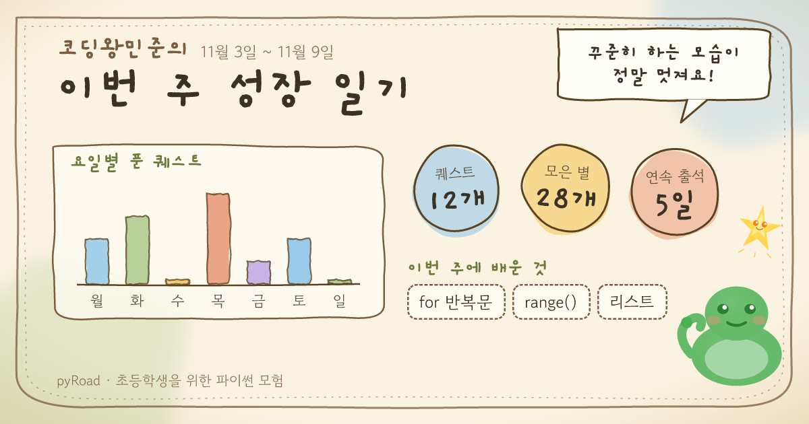
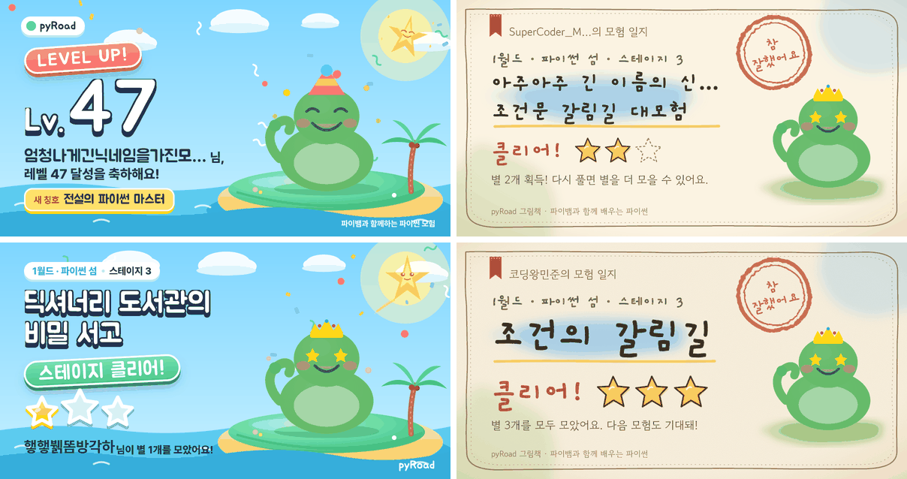
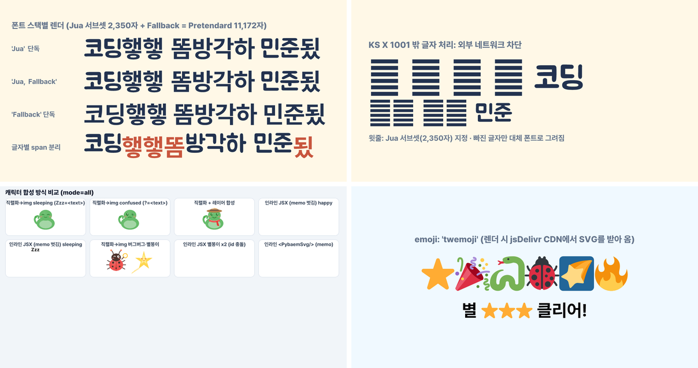

# P0-10 공유 카드 이미지 생성 (`next/og`)

> - 작성일: 2026-11-03 · 브랜치 `feat/phase0`
> - 코드: [`spikes/p0-10-og-share-card/`](../../spikes/p0-10-og-share-card/)
> - 관련: [업그레이드 계획서](../4.upgrade-plan.md) §2.2 `share_cards`, §2.6, §3 F8, §6, P4-10, P9-04·05, P9-07~P9-11, X1, X14, P0-14(웹폰트)
> - 범위: 저장소와 같은 Next 15.5.14 / React 19.2.4로 만든 스크래치 앱에서 프로토타입 + 실측. 실제 Vercel 배포, 실제 카카오 공유는 하지 않음(문서 확인)

## 1. 결론: **채택** (Node.js 런타임 + 번들 서브셋 폰트 + 대체 폰트 + CDN 캐시·태그 삭제)

- `next/og`(satori + resvg)로 **한글 공유 카드를 충분히 예쁘게** 만들 수 있습니다. A안(모험 섬)·B안(마법 그림책) 스타일로 레벨업, 스테이지 클리어, 업적, 주간 성장 카드 4종을 만들었고, 실제 마스코트 SVG 컴포넌트(파이뱀·버그버그·별똥이)와 코스튬 레이어 합성까지 그대로 됩니다 (§4.1).
- **런타임: Node.js.** Edge는 폰트 3개만 넣어도 함수가 gzip 1.55MB라 Hobby 한도(1MB)를 넘고, Vercel이 Edge→Node 이전을 권장하며 Next 16.3부터 `runtime = 'edge'`가 없어집니다 (문서 확인). Node 함수 한도는 250MB이고 우리 카드 함수는 약 10MB입니다.
- **폰트: KS X 1001 완성형 2,350자 서브셋 TTF/OTF를 함수에 번들 + Pretendard 전체(11,172자)를 대체 폰트로 함께 등록.** satori가 빠진 글자만 글자 단위로 대체 폰트에서 가져와 그립니다 (실측). 외부 네트워크(Google Fonts)에 의존하지 않습니다. 단, **Jua와 Gaegu는 원본 자체가 2,350자뿐**이라 어떤 전략을 써도 "햏·똠·됬" 같은 글자는 제목 폰트로 그릴 수 없습니다. 닉네임 규칙(완성형 2,350자 + 영문·숫자)을 함께 두는 것을 권장합니다 (§7 확인 필요).
- **캐릭터 합성: 기존 React SVG 컴포넌트를 자체 직렬화기로 SVG 문자열로 만든 뒤 ``로 넣습니다.** 인라인 `<svg>`로 그대로 넣으면 빈칸이 되고(satori가 SVG 안의 함수 컴포넌트를 펼치지 않음), Route Handler에서는 `react-dom/server`를 import할 수 없습니다 (실측).
- **비용: 카드 1장 렌더에 약 0.8~1.3초 CPU** (대부분 resvg-wasm 래스터화). 그래서 **CDN 캐시가 필수**입니다. 이미지 라우트에 `Vercel-CDN-Cache-Control: max-age=31536000` + `Vercel-Cache-Tag: share-card-{id}`를 달고, 비공개 전환·삭제(P9-11) 때 태그로 즉시 지웁니다. 카드가 바뀌면 `?v={version}`으로 URL을 바꿔 카카오 썸네일 캐시를 우회합니다.
- 미리 렌더해 Supabase Storage에 저장하는 방식은 **대안**으로 남깁니다 (저장 용량·재생성 작업·버킷 정책이 늘어남, §5.3).

## 2. 검증한 질문

| # | 질문 | 답 |
|---|---|---|
| Q1 | `next/og`로 보기 좋은 한글 카드가 되나? 폰트 임베딩 방식별 비용은? | 됨. 번들 서브셋 권장. 방식별 크기·지연은 §4.3, §5.1 |
| Q1-a | satori가 읽는 폰트 형식은? | TTF·OTF·WOFF. **WOFF2는 불가** (문서 확인, Vercel·Next 문서 모두 명시). WOFF도 실측 동작 |
| Q1-b | 서브셋 밖 글자(닉네임)는 얼마나 빠지고, 어떻게 그려지나? | 일반 한국어 문장은 0%, 아이들 은어·의성어 닉네임은 일부 빠짐. 대체 폰트가 있으면 그 글자만 대체, 없고 네트워크도 없으면 두부(□) (§4.4) |
| Q2 | 마스코트 SVG를 합성할 수 있나? 어떤 SVG 기능이 깨지나? 표정·코스튬은? | data URI ``로 가능. SVG `<text>`, `<foreignObject>`, SVG 안 래스터 `<image>`는 안 그려짐 (§4.5). 레이어 합성 데모 성공 (§4.1) |
| Q2-a | 이모지는? | `emoji` 옵션(기본 Twemoji)이 렌더 때마다 jsDelivr에서 SVG를 받아 옴. 카드 템플릿에는 이모지를 쓰지 않고 자체 SVG 아이콘 사용 권장 (§4.5) |
| Q3 | Node vs Edge, 함수 크기 한도, cold/warm 시간, 메모리, 캐시 전략, 카카오 OG 미리보기 | §4.2, §4.6, §4.7, §5.2, §5.3 |
| Q4 | 개인정보: 닉네임+캐릭터만, 카드 ID 추측 불가 | 카드는 `share_cards` 행 스냅샷으로만 그림, id는 128비트 난수, 공개 페이지 noindex (§4.8) |

## 3. 방법 & 환경

- **실측**: `/tmp` 스크래치 디렉토리에 Next 15.5.14 + React 19.2.4 앱(저장소와 같은 버전)을 만들고, 스파이크 소스와 `src/components/characters/*Svg.tsx`, `expressions.ts`를 **수정 없이 복사**해 사용했습니다 (`scripts/setup.sh`). 포트 3110, `next dev --turbopack`으로 디자인을 다듬고, `next build --turbopack` + `next start`로 측정했습니다. `@vercel/og` 0.7.2(satori 0.15.2, resvg-wasm 2.4.0, Next 내장).
- **장비**: WSL2 Linux 6.6, 20 vCPU, Node 22.23.2. **다른 에이전트들이 브라우저·서버를 동시에 돌려 load average가 6~38**이었습니다. 시간 값은 절대값보다 상대 비교로 봐 주세요. 부하가 낮을 때(6~7) 다시 잰 값을 표에 씁니다.
- **문서 확인**: Vercel Functions·Edge·CDN 캐시·퍼지 문서(2026-06~09 갱신본), Next `ImageResponse` 문서, Kakao Developers 메시지 템플릿 문서, Kakao DevTalk 스크랩 FAQ/답변.
- 폰트 서브셋은 `fontTools`(pyftsubset API, 힌팅 제거, OFL 라이선스 name 레코드 유지)로 만들었습니다. 닉네임 커버리지는 한국어 위키백과 문서 19건(한글 음절 86,922개)과 `supabase/seed.sql`, 직접 만든 아이 닉네임 예시 84개로 쟀습니다.

## 4. 결과

### 4.1 카드 이미지 (1200×630, 프로덕션 빌드에서 렌더)

**레벨업: A안(모험 섬).** 비비드 파스텔 하늘·섬, 통통한 클레이 버튼(단색 오프셋 그림자), 흰 글자 + 남색 외곽선 + 아래 그림자. 제목 Jua, 본문 Pretendard. 파이뱀 `celebrating` + 꼬깔모자 코스튬 레이어, 별똥이 `sparkling`.


**스테이지 클리어: B안(마법 그림책).** 크림 종이, 손그림 테두리(흔들리는 선), 수채 번짐(가우시안 블러), 손그림 별 ⭐(칠한 별/점선 빈 별), "참 잘했어요" 도장(feDisplacementMap으로 잉크 번짐). 제목 Gaegu, 본문 Gowun Dodum. 파이뱀 `proud`.


**스테이지 클리어: A안 (같은 내용, 시안 비교용).** 통통한 금색 별 3개(빈 별은 하늘색).


**업적 획득: A안 계열(노을 팔레트).** 햇살 + 티어 메달(골드, Lucide `bug` 아이콘), 성장 마인드셋 업적 "에러 극복왕"에 버그버그 `fixed` + 말풍선.


**주간 성장 카드 "부모님께 자랑하기": B안.** 요일별 퀘스트 수(손그림 막대), 스티커형 통계 3개, 이번 주 배운 개념, 파이뱀 말풍선. 집계 숫자만 넣고 학습 시각·학교·학년은 넣지 않습니다.



**코스튬 레이어 합성 (Phase 9 미리보기).** 파이뱀 `proud` 위에 탐험가 모자 + 스카프 레이어를 같은 viewBox(128×128)로 쌓았습니다. 표정 컴포넌트의 소품(왕관)이 모자 밑에 깔리는 것이 보입니다. P9-04에서 **표정(얼굴)과 표정 소품, 코스튬 슬롯을 별도 레이어로 나눠야** 합니다.


**긴 텍스트 처리.** 왼쪽 위: 닉네임 17자 → 12자에서 자르고 `…`, 글자 크기 자동 축소. 오른쪽 위: 영문 닉네임 자르기 + 긴 스테이지 이름 2줄(그래도 넘치면 자름). 왼쪽 아래: 2줄 제목 + 서브셋 밖 닉네임 "햏햏뷁똠방각하"(빠진 글자는 Pretendard로 대체). 오른쪽 아래: B안에 종이 결(feTurbulence)을 켠 버전 (원본 PNG 1,074KB라 쓰지 않음).



> 긴 텍스트 규칙(구현: `lib/text.ts`): ① 닉네임은 grapheme 단위로 최대 12자(이모지·자모 안 깨짐), ② 폰트별 실측 평균 글자 폭(fontTools hmtx)으로 상자에 맞는 크기 선택(최소 크기 아래로는 안 줄이고 `…`), ③ 제목은 공백 기준 2줄까지, ④ 마지막 안전장치로 CSS `textOverflow: ellipsis`.

### 4.2 렌더 시간 (실측)

**HTTP, `next start`, 카드마다 서버를 새로 띄움** (load ≈ 6~7). cold = 프로세스 시작 직후 첫 요청(모듈 로드 + wasm 초기화 + 폰트 읽기·파싱 포함, Vercel 컨테이너 부팅은 제외). warm = 이후 8회.

| 카드 | 런타임 | cold (ms) | warm 중앙값 | warm 최소 | PNG |
|---|---|---|---|---|---|
| 레벨업 A | Node | 1,499 | 1,092 | 985 | 146KB |
| 스테이지 클리어 B | Node | 1,570 | 987 | 877 | 256KB |
| 스테이지 클리어 A | Node | 1,379 | 957 | 820 | 153KB |
| 업적 A | Node | 1,182 | 1,018 | 877 | 310KB |
| 주간 성장 B | Node | 1,519 | 1,274 | 927 | 188KB |
| 레벨업 A | Edge(로컬 edge-runtime) | 1,325 | 992 | 936 | 146KB |
| 업적 A | Edge(로컬 edge-runtime) | 1,784 | 990 | 895 | 310KB |
| 권장 라우트 `/api/share-cards/{id}/image` (업적) | Node | 1,379 | 1,035 | 947 | 310KB |

- 부하가 높을 때(load 30+) 같은 측정은 warm 1.1~1.7초, cold 1.5~4.4초였습니다.
- 서버 RSS 230~285MB (Next 서버 전체). Vercel 기본 2GB로 충분합니다.
- 폰트 읽기(번들 파일)는 cold 3~7ms, warm 0ms입니다. 폰트 전략은 렌더 시간에 거의 영향이 없습니다 (§4.3).

**단계별 분해 (프로세스 안 반복, `scripts/microbench.tsx`, min/중앙값 ms, load ≈ 10)**

| 카드 | satori (JSX→SVG) | resvg-**wasm** (next/og 내장) | resvg-js **네이티브** | `ImageResponse` 전체 |
|---|---|---|---|---|
| 레벨업 A | 31 / 41 | 1,306 / 1,464 | 184 / 208 | 1,341 / 1,543 |
| 스테이지 B | 40 / 64 | 1,536 / 1,646 | 268 / 317 | 1,447 / 1,578 |
| 스테이지 A | 13 / 19 | 896 / 980 | 131 / 143 | 818 / 910 |
| 업적 A | 15 / 23 | 859 / 913 | 112 / 132 | 834 / 933 |
| 주간 B | 29 / 35 | 762 / 808 | 137 / 163 | 767 / 811 |

- **시간의 대부분은 래스터화(resvg-wasm)** 입니다. satori 레이아웃은 수십 ms입니다. 첫 호출의 satori는 yoga 초기화·폰트 파싱 때문에 최대 400ms까지 걸립니다.
- 같은 SVG를 네이티브 `@resvg/resvg-js`로 그리면 **5~8배 빠릅니다**. 단, 생성자 옵션 `font: { loadSystemFonts: false }`를 꼭 줘야 합니다(기본값은 매번 시스템 폰트를 훑어 이 장비에서 0.5초씩 걸림). 렌더 비용이 문제가 되면 쓸 수 있는 최적화 카드입니다 (§5.2).

**무엇이 비싼가 (resvg-wasm, satori 출력 SVG에서 요소를 빼고 다시 래스터화, `scripts/profile_svg.tsx`)**

| 카드 | 전체 | satori 필터(box-shadow·text-shadow) 제거 | 장식 SVG 내부 필터 제거 | 배경 이미지 제거 | 모든 `<image>` 제거 | 장식 SVG를 PNG로 미리 래스터화 |
|---|---|---|---|---|---|---|
| 레벨업 A | 887 | **407** | 801 | 649 | 582 | 776 |
| 스테이지 B | 867 | 872 | 618 | 517 | **34** | **297** |

- A안 비용의 절반은 **흐림이 있는 box-shadow·text-shadow**(satori가 SVG 필터로 그림)입니다. 단색 오프셋 그림자는 도형을 하나 더 깔아서 그리면 필터 없이 같은 모양이 나옵니다.
- B안 비용은 거의 전부 **장식 SVG 안의 블러·변위 필터**(수채 번짐, 종이, 도장)입니다. 장식을 빌드 때 PNG로 미리 래스터화해 넣으면 867→297ms입니다.
- 텍스트만 있는 카드(실험 시트)는 약 100ms였습니다. 한글 글리프 path 자체는 싸다는 뜻입니다.

### 4.3 폰트: 크기·커버리지·전략 (실측)

| 폰트 (용도) | 원본 한글 음절 | 원본 | KS 2,350 서브셋 TTF/OTF | 같은 범위 WOFF | 전체 11,172 서브셋 | 고정 문구만(ui) | Google `&text=` (카드 1장) |
|---|---|---|---|---|---|---|---|
| Jua (A 제목) | **2,367** | 2,070KB | 1,299KB | 361KB | 원본에 없음 | 86KB | 20.9KB (50자) |
| Gaegu Bold (B 제목) | **2,350** | 2,893KB | 1,533KB | 454KB | 원본에 없음 | 89KB | 13.1KB (27자) |
| Gowun Dodum (B 본문) | 11,172 | 7,060KB | 1,180KB | 313KB | 6,766KB | 68KB | 16.6KB (47자) |
| Pretendard Bold (A 본문·대체 폰트) | 11,172 | 1,540KB | 316KB | 221KB | 1,211KB | 33KB | **Google Fonts에 없음** (HTTP 400) |
| Pretendard ExtraBold (A 본문) | 11,172 | 1,532KB | 315KB | 222KB | 1,204KB | 33KB | 없음 |
| Cafe24 써라운드 (A 제목 후보) | 11,122 | 398KB(WOFF) | 801KB | 213KB | 921KB (WOFF 240KB) | 62KB | 없음 |

- 서브셋 = 2,350자 + 호환 자모(ㄱ~ㅎ, ㅏ~ㅣ) + ASCII + 카드 기호(★☆·…→ 등). 힌팅 제거. CFF(Pretendard)는 서브루틴을 풀면 오히려 커져서 유지했습니다.
- **운영에 필요한 폰트 묶음**(A+B 제목·본문 + 대체 폰트): TTF/OTF 5,855KB(gzip 2,435KB). 시안이 하나로 정해지면 절반 정도로 줄어듭니다.
- 전략별 렌더 시간(레벨업, 부하 낮을 때 warm 중앙값): 번들 서브셋 982ms, WOFF 946ms, 원본 전체 926ms, Google 동적 876ms. **차이는 측정 오차 수준**입니다. satori가 폰트를 지연 파싱(`lowMemory`)하고 `fonts` 배열 객체 단위로 캐시하기 때문입니다 (코드 확인: `WeakMap`에 `fonts` 배열을 키로 저장 → 같은 배열 객체를 재사용해야 캐시가 맞음, `lib/fonts.ts`에서 처리).
- Google 동적(`&text=`)은 cold에서 CSS 요청 + 폰트 요청으로 **약 0.4초**가 더 걸리고, 닉네임마다 글자 조합이 달라 카드마다 새로 받습니다. Pretendard·Cafe24는 Google Fonts에 없어 이 방식이 불가능합니다. 원본 폰트에 없는 글자(Jua의 "햏")는 이 방식으로도 받을 수 없습니다 (실측: 응답 폰트에 해당 글자 없음).

### 4.4 서브셋 밖 글자 (닉네임)

| 대상 | 결과 (실측) |
|---|---|
| 한국어 위키백과 19개 문서, 한글 음절 86,922개(985종) | KS 2,350 밖 **0개** |
| `supabase/seed.sql` 콘텐츠, 12,261개(430종) | 0개 |
| 아이 닉네임 예시 84개 (은어·의성어를 일부러 많이 넣음) | **13개(15%)**에 밖 글자: 햏햏, 뷁, 똠방각하, 됬다, 읭, 뭥미, 똽, 뙇, 쀍, 쉩, 샾, 펲, 믜 |
| 균등 무작위 11,172자 중 2음절 (최악 가정) | 95.6% |

- 표준어 닉네임은 사실상 빠지지 않습니다. 빠지는 경우는 인터넷 은어(햏·뷁·똠), 맞춤법 실수(됬), 의성어(뙇·쀍)입니다.
- **satori의 대체 동작 (실측, 아래 그림 왼쪽 위)**: `fonts`에 넣은 다른 폰트에서 **빠진 글자만 글자 단위로** 가져옵니다. `fontFamily: 'Jua'`만 지정해도, `'Jua, Fallback'`으로 지정해도, 글자별로 `<span>`을 나눠도 결과가 같습니다. 단어 전체가 바뀌지 않습니다.
- 대체 폰트를 넣지 않으면 `@vercel/og`가 빠진 글자를 Google Fonts의 **Noto Sans KR Regular**로 자동으로 받아 옵니다 (코드 확인 + 실측). 굵기가 달라 어색하고, **네트워크가 막히면 두부(□)가 됩니다** (아래 그림 오른쪽 위).
- 이모지·자모만 있는 닉네임 등은 닉네임 규칙(P3-11)에서 걸러 내는 것이 가장 단순합니다.



> 왼쪽 위: 폰트 스택별 렌더 (빨간 글자 = 대체 폰트로 그려진 글자). 오른쪽 위: 대체 폰트 없음 + 외부 네트워크 차단 → 두부. 왼쪽 아래: 캐릭터 합성 방식 비교. 오른쪽 아래: Twemoji(런타임 CDN).

### 4.5 SVG·CSS 기능 호환성 (실측)

**캐릭터 합성 방식**

| 방식 | 결과 |
|---|---|
| 기존 컴포넌트를 자체 직렬화기(`lib/svg.ts`)로 문자열 → `` | **동작.** 그라디언트·볼터치·표정 모두 정상. 여러 캐릭터를 한 카드에 넣어도 gradient id 충돌 없음(이미지마다 분리 + 직렬화 때 id 접두사) |
| `<PybaemSvg/>`를 satori 트리에 그대로 (memo 컴포넌트) | **빈칸** |
| memo를 벗긴 내부 함수를 호출해 `<svg>` 엘리먼트 트리를 그대로 | **빈칸** (satori가 `<svg>` 안의 함수 컴포넌트 `HappyFace` 등을 펼치지 않음, `<text>`만 엉뚱한 위치에 찍힘) |
| Route Handler에서 `react-dom/server`의 `renderToStaticMarkup` | **빌드 에러**: "You're importing a component that imports react-dom/server" (App Router는 react-server 조건으로 번들) |
| framer-motion·hooks | 캐릭터 SVG 컴포넌트(`*Svg.tsx`)는 hooks·framer-motion을 쓰지 않아 문제없음. `CharacterAvatar.tsx`는 `'use client'` + framer-motion이라 카드에 쓰면 안 됨 |

**SVG 기능 (data URI 이미지 안, resvg가 직접 렌더)**

| 기능 | 결과 | 비고 |
|---|---|---|
| linearGradient, radialGradient, pattern, clipPath, mask | ✅ | |
| feGaussianBlur, feDropShadow, feTurbulence, feDisplacementMap | ✅ | 비쌈 (§4.2). feTurbulence 종이 결은 PNG를 1MB로 키움 |
| `<use href>`, stroke-dasharray, mix-blend-mode | ✅ | |
| `<animate>` (SMIL) | ✅ 무시됨 (기본값으로 정지 프레임) | 직렬화 때 제거 |
| **`<text>`** | ❌ 안 그려짐 | resvg-wasm에 폰트가 없음. 파이뱀 `sleeping`의 "Zzz", `confused`의 "?"가 사라짐 → **path로 바꿔야 함** |
| `<foreignObject>` | ❌ | |
| SVG 안의 래스터 `<image>` (PNG data URI) | ❌ | 래스터 레이어는 satori ``로 따로 쌓기 |

**satori CSS 기능** (실험 시트: [`P0-10-lab-css.png`](img/P0-10-lab-css.png), SVG 시트: [`P0-10-lab-svg.png`](img/P0-10-lab-svg.png))

| 기능 | 결과 |
|---|---|
| box-shadow 여러 겹, inset box-shadow, text-shadow, `WebkitTextStroke` | ✅ (흐림 있는 그림자는 비쌈) |
| linear/radial/repeating-linear-gradient 배경, `backgroundClip: 'text'` | ✅ |
| dashed border, `transform: rotate`, `filter: blur`, opacity, `maskImage` | ✅ |
| `textOverflow: 'ellipsis'`, `lineClamp`, `textWrap: 'balance'` | ✅ (한글 줄바꿈 정상) |
| position absolute | ✅ |
| **zIndex** | ❌ 무시 ("Expected style zIndex to be unitless" 경고). 겹침 순서는 DOM 순서로만 |
| CSS `clipPath: polygon(%)` | ⚠️ 모양이 틀어짐. SVG clipPath로 대체 |
| `display: grid` | ❌ (문서 확인, flex만) |
| 자식이 2개 이상인 div | `display: flex` 필수 (아니면 에러) |

**이모지**: `ImageResponse({ emoji })`의 기본값 Twemoji는 렌더할 때마다 `cdn.jsdelivr.net/gh/twitter/twemoji@14.0.2`에서 SVG를 받아 옵니다 (코드 확인, 실측으로 정상 표시). 외부 CDN 의존이고, Twemoji 그래픽은 **CC-BY 4.0(출처 표기 필요)** 입니다. 카드 템플릿에는 이모지를 쓰지 않고(별·불꽃·메달은 자체 SVG), 닉네임에서는 이모지를 받지 않는 것을 권장합니다.

### 4.6 함수 크기 (빌드 실측 + 문서)

| 항목 | 값 |
|---|---|
| Node 함수: 라우트가 추적한 파일 | `@vercel/og` 2.83MB + 라우트 청크·Next 라우트 런타임 1.06MB + 운영 폰트 5.7MB ≈ **9.6MB** (+ Next 서버 본체 24.1MB, 모든 라우트 공용) |
| Node 함수 한도 (Vercel 문서) | 압축 전 **250MB** (Large functions 베타 5GB). 메모리 Hobby 2GB / Pro 최대 4GB |
| Edge 함수: 레벨업 라우트 (Jua·Pretendard 2종 ks 서브셋) | raw 4.03MB, **gzip 1.55MB** (resvg.wasm 515KB, Jua 361KB, Pretendard 221+222KB, og JS 120KB, 라우트 98KB, yoga 28KB, Noto Latin 16KB) |
| Edge 함수에서 폰트 뺀 기본 크기 | gzip ≈ 0.78MB |
| Edge 한도 (Vercel 문서) | gzip 후 Hobby **1MB** / Pro 2MB / Enterprise 4MB |
| `ImageResponse` 문서의 "번들 500KB" 문구 | Edge 시절 문구가 Next·Vercel 문서에 그대로 남아 있음. Node 함수에는 위 250MB 한도가 적용 |

- **Turbopack 빌드 주의 (실측)**: `readFile(join(process.cwd(), 'assets', 'fonts', name))`처럼 경로가 동적이면 파일 추적(nft)이 **`assets/fonts` 디렉토리 전체(39MB)**를 함수에 넣었고, `outputFileTracingExcludes`로도 빠지지 않았습니다. **운영 폰트만 들어 있는 전용 디렉토리**를 쓰고, 빌드 후 `.next/server/app/**/route.js.nft.json`을 확인해야 합니다.

### 4.7 공유 페이지 OG 메타·캐시 헤더 (실측 + 문서)

`/share/[cardId]` (`page.tsx` + `opengraph-image.tsx`)에서 Next가 만든 메타:

```html
<meta name="robots" content="noindex, nofollow"/>
<meta property="og:title" content="코딩왕민준님이 레벨 12에 올랐어요!"/>
<meta property="og:url" content="https://…/share/hzEbwb74Pa6krPzNTNoMbQ"/>
<meta property="og:image" content="https://…/share/hzEbwb74Pa6krPzNTNoMbQ/opengraph-image?909a14110fe9be1d"/>
<meta property="og:image:width" content="1200"/><meta property="og:image:height" content="630"/>
<meta name="twitter:card" content="summary_large_image"/>
```

- 카카오 스크랩 봇 User-Agent(`facebookexternalhit/1.1; kakaotalk-scrap/1.0; …`)로 요청해도 200 `text/html`이 옵니다. 비공개 카드·형식이 틀린 id는 페이지·이미지 모두 404입니다.
- **Next 기본 헤더 함정**: 동적 `opengraph-image`도 기본으로 `Cache-Control: public, immutable, no-transform, max-age=31536000`을 보냅니다. `?909a…` 해시는 **라우트 소스 기준**이라 카드 데이터가 바뀌어도 그대로입니다. 이대로면 비공개 전환·삭제 후에도 브라우저·하위 캐시에 1년 남습니다.
- `ImageResponse({ headers })`로 넘긴 `Cache-Control`은 **Next 기본값을 덮어씁니다** (실측). 권장 라우트 헤더:

```
Cache-Control: public, max-age=3600                 ← 브라우저·하위 캐시 1시간
Vercel-CDN-Cache-Control: public, max-age=31536000  ← Vercel CDN 1년 (태그로 즉시 삭제)
Vercel-Cache-Tag: share-card-{cardId}
Content-Disposition: inline; filename="pyroad-levelup.png"   ← "이미지 저장" 파일명
X-Robots-Tag: noindex
(404일 때) Cache-Control: public, max-age=60 / Vercel-CDN-Cache-Control: public, max-age=300
```

- Vercel CDN은 함수 응답에 `s-maxage` 또는 `CDN-Cache-Control`·`Vercel-CDN-Cache-Control`이 있어야 캐시합니다. 캐시 키에 배포 URL이 들어가 새 배포마다 다시 렌더됩니다. CDN 캐시는 리전별입니다. 태그 퍼지는 `@vercel/functions`의 `invalidateByTag`(오래된 값 먼저 응답) / `dangerouslyDeleteByTag`(즉시 삭제, 다음 요청은 원본), 모든 플랜에서 가능, 호출 한도 Hobby 50회/초 (문서 확인).

**카카오톡 미리보기 (문서 확인 + DevTalk 답변)**

| 항목 | 내용 |
|---|---|
| 읽는 태그 | `og:title`, `og:description`, `og:image`(+width/height), `og:site_name`. `og:url`이 요청 주소와 다르면 `og:url` 주소를 다시 긁음 |
| 이미지 | JPG·PNG, 최대 5MB, 기본 템플릿 최소 200×200. 스크랩 이미지는 **800×400(2:1)에 최적화, 내부 스마트 크롭** → 1200×630은 위아래 약 15px씩 잘림 |
| 도메인 | 앱 설정에 등록한 도메인만 스크랩·전송 가능 |
| 캐시 | 수집 정보는 1시간 이상 캐시(정확한 주기 비공개). **공유 디버거는 메타데이터 캐시만 초기화**하고 이미지 썸네일은 이미지 URL 기준으로 따로 캐시 → 이미지를 바꾸려면 URL을 바꿔야 함(`?v=2`). URL 끝 `/` 유무도 다른 캐시 키 |
| JS SDK 피드 템플릿 | `Kakao.Share.sendDefault({ objectType: 'feed', content: { imageUrl, imageWidth, imageHeight, link }, buttons })`로 이미지 URL을 직접 넘김 (스크랩 불필요) |

### 4.8 개인정보 (Q4)

- 카드는 **`share_cards` 행의 payload 스냅샷**(닉네임, 아바타 설정, 레벨·별·업적 같은 숫자)으로만 그립니다. 스파이크의 `/api/og/[kind]?nick=` 측정 라우트처럼 **쿼리 문자열을 그대로 그리는 라우트는 운영에 두지 않습니다** (우리 도메인에서 아무 문구나 이미지로 찍어 내는 악용 경로가 됨).
- 카드 id는 **128비트 난수 base64url 22자**(`crypto.randomBytes(16).toString('base64url')`, 또는 `gen_random_uuid()`)로, 순번·user_id·날짜를 담지 않습니다. 라우트는 형식이 틀린 id를 DB 조회 전에 404로 막습니다 (`lib/demoCards.ts`).
- 공개 조회는 `is_public AND deleted_at IS NULL`인 행만, user_id 없이 돌려주는 뷰/함수로 합니다. 공개 페이지는 `noindex`(검색엔진에 닉네임이 쌓이지 않게)로 두되, 스크랩 봇이 읽을 수 있게 robots.txt로 막지는 않습니다.
- 주간 카드에는 학습 시각(몇 시에 했는지), 학교·학년, 실명을 넣지 않습니다. 실측한 카드 5종 모두 닉네임 + 캐릭터 + 집계 숫자만 담습니다.
- **카카오톡으로 이미 보낸 메시지의 썸네일은 카카오 서버에 남아 우리가 지울 수 없습니다.** 공유 버튼에 "보낸 메시지는 지울 수 없어요" 안내가 필요합니다.

## 5. 선택지 비교

### 5.1 폰트 전략

| | (a) 번들 서브셋 (권장) | (b) Google `&text=` 동적 | (c) 원본 전체 | (d) 제목은 고정 문구만 + 동적 문자열은 본문 전체 |
|---|---|---|---|---|
| 함수 크기 | A+B+대체 5.7MB | 0 (대체 폰트 제외) | 15MB | 약 1.6MB |
| 렌더 지연 | 없음 | cold +0.4초, 닉네임마다 다시 받음 | 없음 | 없음 |
| 외부 의존 | 없음 | Google 장애 시 기본 폰트/두부 | 없음 | 없음 |
| 지원 폰트 | 모두 | Jua·Gaegu·Gowun Dodum만 (Pretendard·Cafe24 불가) | 모두 | 모두 |
| 닉네임 표현 | 제목 폰트 + 빠진 글자만 대체 | 원본에 없는 글자는 똑같이 못 받음 | (a)와 같음 | 닉네임이 항상 본문 폰트 (디자인 제약) |
| 라이선스 | OFL. Pretendard는 RFN이라 서브셋을 저장소에 넣으면 이름 변경 필요 | 해당 없음 | 원본 그대로라 문제없음 | (a)와 같음 |

### 5.2 Node vs Edge

| | Node.js (권장) | Edge |
|---|---|---|
| 크기 한도 | 250MB | gzip 1MB(Hobby) / 2MB(Pro). 폰트 3개로 1.55MB → Hobby 불가 |
| 렌더 시간 | warm ≈ 1초 | 같은 수준 (같은 resvg-wasm) |
| 폰트 읽기 | `fs.readFile` | `fetch(new URL(..., import.meta.url))` |
| 미래 | 권장 런타임 | Vercel이 Node 이전 권장, Next 16.3부터 `runtime='edge'` 미지원 (문서 확인) |
| 추가 최적화 | `satori` + `@resvg/resvg-js`(네이티브)로 교체하면 래스터화 5~8배 빠름 (의존성 2개 + `serverExternalPackages`) | 네이티브 불가 |

### 5.3 요청 시 생성(on-demand) vs 미리 렌더해 저장

| | on-demand + CDN 캐시 (권장) | 생성 시 1회 렌더 → Supabase Storage |
|---|---|---|
| 렌더 횟수 | 카드 버전 × CDN 리전마다 1회, 새 배포 후 다시 1회 | 카드 버전마다 1회 |
| 첫 조회 지연 | cold 1.2~1.6초 (카카오 스크랩 첫 요청) | 없음 |
| 저장 | 없음 | 장당 130~310KB (resvg PNG를 무손실 재압축하면 2~4할 줄어듦). 플랜 저장 용량·전송량 한도 확인 필요 |
| 비공개·삭제 | `dangerouslyDeleteByTag` 1회 | 객체 삭제 + Storage CDN 캐시 만료 대기 |
| 템플릿 개편 | 자동 반영 (`version`만 올리면 카카오 썸네일도 갱신) | 전체 재렌더 작업 필요 |
| 추가 인프라 | `@vercel/functions` | 버킷·정책·렌더 작업 |

> 보완책: 카드를 만들 때 서버에서 이미지 URL을 한 번 요청해 CDN을 데워 둡니다(같은 리전). 함수 리전을 Supabase DB 리전·카카오 사용자(서울)와 가깝게 둡니다 (기본 `iad1`).

## 6. 이후 Phase 영향 (계획서 교체 문안 제안)

**P9-07** (교체)
> - [ ] **P9-07** 공유 카드 이미지 생성 (`next/og`, **Node.js 런타임**): 레벨업, 스테이지 클리어, 업적, 주간 성장 4종. `share_cards` 행 스냅샷(닉네임·아바타 설정·성과 숫자)만으로 그리고 쿼리 문자열 텍스트는 그리지 않음. 폰트는 OFL 서브셋(KS X 1001 2,350자) TTF/OTF를 운영 전용 폰트 디렉토리에 두고 함수에 번들 + Pretendard 전체(11,172자)를 대체 폰트로 등록 (외부 네트워크 의존 없음, WOFF2 불가). 캐릭터는 기존 SVG 컴포넌트를 문자열로 직렬화해 ``로 합성. 이모지 미사용. 긴 닉네임·제목은 grapheme 단위 자르기 + 자동 크기. 렌더 1회 ≈ 1초 CPU이므로 CDN 캐시 필수 (P0-10)

**P9-08** (교체)
> - [ ] **P9-08** 공유 페이지 `/share/[cardId]` (비로그인 열람, `robots: noindex`, "나도 해보기" CTA). og:image는 `/api/share-cards/{id}/image?v={version}` (1200×630, alt 포함), og:url은 페이지 자신. 이미지 응답 헤더: `Cache-Control: public, max-age=3600`, `Vercel-CDN-Cache-Control: public, max-age=31536000`, `Vercel-Cache-Tag: share-card-{id}`. cardId는 128비트 난수(base64url 22자), 공개 조회는 user_id 없는 공개 뷰/함수로. middleware matcher에서 `/share`·`/api/share-cards` 제외. 함수 리전을 Supabase 리전에 맞춤 (P0-10)

**P9-09** (교체)
> - [ ] **P9-09** 카카오톡 공유: Kakao JS SDK `Kakao.Share.sendDefault` 피드 템플릿(imageUrl = 위 이미지 URL, imageWidth 1200, imageHeight 630, 버튼 "나도 해보기"), 카카오 앱에 사이트 도메인 등록. 카카오는 800×400(2:1)로 스마트 크롭하므로 카드 핵심 요소는 위아래 20px 안쪽. 썸네일 캐시는 이미지 URL 기준이라 카드가 바뀌면 `version` 증가 (공유 디버거는 메타 캐시만 지움). + Web Share API(`navigator.share({ files })`, 미지원 시 링크) + 이미지 저장(`Content-Disposition` 파일명) + 링크 복사

**P9-11** (교체)
> - [ ] **P9-11** 공유 카드 비공개 전환과 삭제: 행을 비공개/삭제한 뒤 `@vercel/functions`의 `dangerouslyDeleteByTag('share-card-{id}')`로 CDN 사본을 즉시 지움 (이후 404). 닉네임·아바타를 바꾸면 본인 카드 `version` 증가 + 태그 삭제. 이미 보낸 카카오톡 메시지의 썸네일은 지울 수 없음을 공유 전에 안내

**P4-10** (교체)
> - [ ] **P4-10** SEO: 메타데이터, OG 이미지(`app/opengraph-image.tsx`로 빌드 시 정적 생성, 공유 카드와 같은 템플릿·폰트 파이프라인 사용, P0-10), 구조화 데이터

**P9-04** (보충 문구 추가)
> 레이어 구조: 몸통 / 얼굴(표정) / 표정 소품 / 코스튬 슬롯(모자·안경·목·등) / 배경을 같은 viewBox(128×128)로 분리. 공유 카드(satori+resvg)에서도 그려지도록 SVG `<text>`·`<foreignObject>`·SVG 안 래스터 `<image>` 금지(글자는 path로), SMIL 애니메이션은 정지 이미지에서 무시됨 (P0-10)

**Phase 2: 공유 카드 템플릿을 디자인 산출물로** (신규 항목 제안)
> - [ ] **P2-19** (추가) 공유 카드 템플릿 디자인: 레벨업·스테이지 클리어·업적·주간 성장 4종을 확정 시안 스타일로. 1200×630 마스터 + 카카오 2:1 안전 영역(위아래 20px), 긴 닉네임(12자)·긴 제목(2줄) 규칙, 빈 별·티어(브론즈·실버·골드) 상태 포함. satori 제약 안에서 제작: flex 레이아웃만, zIndex 없음(DOM 순서), 흐림 그림자·전면 필터 최소화(단색 오프셋 그림자는 도형으로), 종이·수채 텍스처는 PNG로 미리 래스터화(장당 100KB 이하), 이모지 대신 자체 아이콘 (P0-10 프로토타입 참고)

**P3-11** (닉네임 검증에 추가, §7 확인 후)
> 닉네임: 2~10자, 완성형 한글(KS X 1001 2,350자)·영문·숫자만. 이모지·조합형 옛한글·제어문자 불가

**§11 리스크 표** (행 추가)
> | 공유 카드 렌더 CPU 비용(장당 ≈1초)과 첫 조회 지연 | 비용·카카오 미리보기 실패 | CDN 캐시 + 태그 삭제, 생성 시 예열, 템플릿 필터 최소화, 필요하면 resvg-js 네이티브로 교체 |

**X14 `docs/assets-license.md`에 넣을 항목** (§7 끝 표 참고)

## 7. 남은 리스크 & 사용자 확인 필요 사항

**사용자 확인 필요**

1. **닉네임 글자 규칙**: 완성형 2,350자 + 영문·숫자로 제한할지(권장, 제목 폰트로 늘 예쁘게 그려짐), 11,172자 전부 허용하고 드문 글자는 Pretendard로 섞어 그릴지.
2. **공개 기간**: 공유 카드를 무기한 공개할지, 예를 들어 90일 뒤 자동 비공개할지.
3. **주간 성장 카드 내용**: 요일별 푼 퀘스트 수(활동한 요일이 드러남)를 공개 카드에 넣어도 될지, 부모 전용(비공개 링크)으로 둘지.
4. **폰트 파일을 저장소에 커밋**해도 될지: 운영용 서브셋 약 3~6MB(시안 확정 후 축소). 저장소가 공개라면 Pretendard 서브셋은 이름을 바꾸거나(OFL RFN) 원본을 그대로 넣어야 합니다.
5. **Cafe24 써라운드**를 공유 카드에 쓸지: 라이선스에 "이 폰트를 쓴 이미지를 카페24 프로모션에 활용할 수 있음" 조항이 있어 아이 닉네임이 들어가는 카드에는 Jua를 권장합니다.

**남은 리스크**

- 렌더 시간은 부하가 큰 로컬 장비 기준입니다. Vercel 1 vCPU에서의 실제 시간·카카오 스크랩 타임아웃은 Phase 9 프리뷰 배포에서 확인해야 합니다.
- satori·resvg 버전이 Next 업그레이드와 함께 바뀌면 카드 모양이 달라질 수 있습니다. 카드 PNG 스냅샷 비교 테스트(Playwright 또는 vitest 이미지 비교)를 P9-07에 넣는 것이 좋습니다.
- Jua·Gaegu 원본이 2,350자뿐이라 규칙 1을 택하지 않으면 드문 글자가 다른 글꼴로 섞여 보입니다.
- Turbopack 파일 추적이 폰트 디렉토리 전체를 넣습니다. 운영 폰트 외 파일을 그 디렉토리에 두지 않아야 합니다.
- CDN 캐시는 리전별이고 배포마다 새로 채워집니다. 배포 직후 첫 카카오 스크랩은 cold 렌더를 탑니다.

**저장소 밖 변경이 필요한 곳 (이번 스파이크에서는 고치지 않음)**

- `src/middleware.ts` matcher: `/share`, `/api/share-cards` 제외 (비로그인 스크랩 봇 요청에서 세션 갱신을 건너뜀).
- `next.config.ts`: 폰트 디렉토리를 `outputFileTracingIncludes`에 명시. resvg-js로 바꿀 경우 `serverExternalPackages`에 `@resvg/resvg-js` 추가.
- `package.json`: 태그 퍼지용 `@vercel/functions` (P9-11). 렌더 최적화 시 `satori`, `@resvg/resvg-js`.
- `src/components/characters/PybaemSvg.tsx`: `SleepingAccessory`의 "Zzz", `ConfusedAccessory`의 "?"를 `<text>`에서 path로 (P9-04 또는 P2-13).

**에셋 라이선스 (X14 입력)**

| 자산 | 출처 | 라이선스 | 비고 |
|---|---|---|---|
| Jua | google/fonts `ofl/jua` (Copyright 2018 The BM JUA Project Authors) | SIL OFL 1.1, RFN 없음 | 서브셋·재배포 가능, OFL.txt 동봉 |
| Gaegu | google/fonts `ofl/gaegu` (Copyright 2018 The Gaegu Project Authors) | SIL OFL 1.1, RFN 없음 | 원본 2,350자 |
| Gowun Dodum | google/fonts `ofl/gowundodum` (Copyright 2021 The Gowun Dodum Project Authors) | SIL OFL 1.1, RFN 없음 | |
| Pretendard 1.3.9 | npm `pretendard` / github orioncactus/pretendard (Kil Hyung-jin) | SIL OFL 1.1, **RFN "Pretendard"** | 수정본(서브셋)을 배포하면 이름 변경 필요 |
| Cafe24 써라운드 | fonts.cafe24.com (스파이크에서는 noonnu CDN WOFF) | SIL OFL 1.1 (폰트 name 레코드에 전문) + 이미지 프로모션 활용 조항 | 공유 카드엔 비권장 |
| Twemoji 14.0.2 | jsDelivr `twitter/twemoji` (`next/og` 기본 이모지) | 그래픽 CC-BY 4.0 | 사용 안 함 권장 |
| Lucide `bug` 아이콘 path | lucide.dev | ISC | 업적 메달 아이콘 |
| `@vercel/og`(satori, resvg-wasm, yoga) | Next 내장 | MPL-2.0 | 내장 Noto Sans Latin은 OFL |
| 마스코트 SVG | 자체 제작 (`src/components/characters`) | - | |
| 스파이크 코스튬·장식 SVG | 이번 스파이크에서 코드로 생성 | - | 실제 에셋 아님 |

## 8. 재현 방법

```bash
# 작업 디렉토리 (저장소 밖)
WORK=/tmp/p0-10   # 예시
cd <repo>

# 1) 폰트 다운로드(OFL) → 서브셋 생성(python3 + fonttools, 약 2분) → 스크래치 앱 생성(npm i) → 소스 복사
bash spikes/p0-10-og-share-card/scripts/setup.sh $WORK all
#    이후 소스를 고칠 때마다: bash spikes/p0-10-og-share-card/scripts/setup.sh $WORK sync

# 2) 개발 서버 (디자인 확인)
cd $WORK/next-app && npx next dev --turbopack -p 3110
#    http://localhost:3110/api/og/levelup            (A안 레벨업)
#    http://localhost:3110/api/og/stage?style=b      (B안 스테이지 클리어, style=a 도 가능)
#    http://localhost:3110/api/og/achievement · /api/og/weekly
#    ?nick=…&lv=…&stage=…&stars=…&costumes=explorer-hat,scarf&fonts=ks|woff|full|ui|google&fallback=0&grain=1
#    http://localhost:3110/api/og-lab/{svg|inline|css|stack|fallback?mode=bundled|google|offline|emoji}
#    http://localhost:3110/share/hzEbwb74Pa6krPzNTNoMbQ  (공유 페이지, OG 메타)
#    http://localhost:3110/api/share-cards/hzEbwb74Pa6krPzNTNoMbQ/image?v=1  (권장 라우트)

# 3) 빌드·측정
cd $WORK/next-app && npx next build --turbopack
bash <repo>/spikes/p0-10-og-share-card/scripts/bench.sh $WORK/next-app $WORK/bench.tsv 8      # cold/warm (서버를 케이스마다 재시작)
bash <repo>/spikes/p0-10-og-share-card/scripts/render_samples.sh $WORK/next-app $WORK/final  # 보고서 이미지 + 헤더 확인

# 4) 단계별 분해 (satori / resvg-wasm / resvg-js)
cd $WORK/next-app && npm i --no-save satori@0.15.2 @resvg/resvg-js@2.6.2 @resvg/resvg-wasm@2.4.0 esbuild
cp <repo>/spikes/p0-10-og-share-card/scripts/{microbench,profile_svg}.tsx .
npx esbuild microbench.tsx --bundle --platform=node --format=esm --jsx=automatic --external:satori '--external:@resvg/*' --external:next --outfile=mb.mjs && node mb.mjs
npx esbuild profile_svg.tsx --bundle --platform=node --format=esm --jsx=automatic --external:satori '--external:@resvg/*' --external:next --outfile=mb-profile.mjs && node mb-profile.mjs

# 5) 폰트·닉네임 분석
python3 spikes/p0-10-og-share-card/scripts/font_report.py $WORK/fonts/*/*.{ttf,otf,woff}
python3 spikes/p0-10-og-share-card/scripts/nickname_coverage.py <위키 API JSON 디렉토리> supabase/seed.sql $WORK/fonts/jua/Jua-Regular.ttf
```

- 폰트 파일과 스크래치 앱은 저장소에 커밋하지 않았습니다 (다운로드·서브셋 스크립트만 커밋).
- `experiments/rds-route.tsx`는 `react-dom/server` 불가 확인용입니다. 앱의 `app/api/og-rds/route.tsx`로 복사하면 빌드 에러를 재현합니다.
- 2026-11-03 실측. 측정 중 다른 에이전트 작업으로 장비 부하가 컸습니다(load 6~38).
