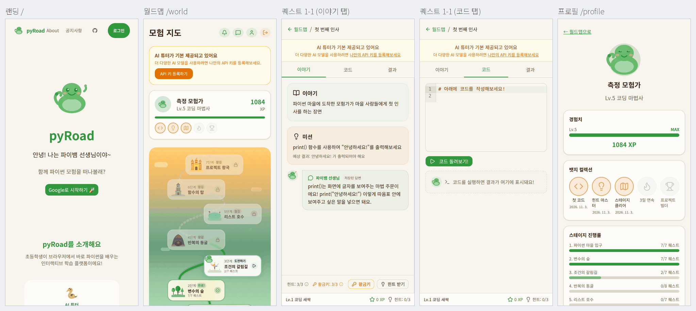
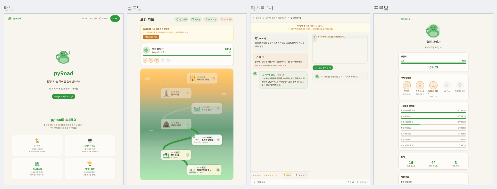
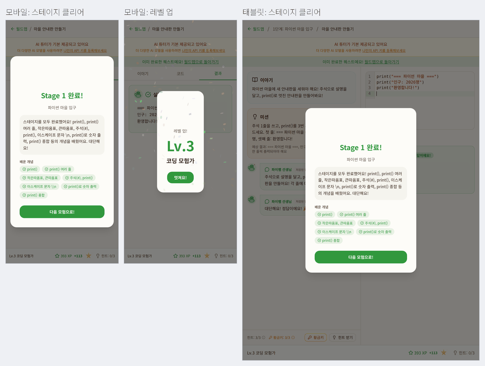

# P0-13 성능 기준선 (v0.3 현재 앱)

> - 작성일: 2026-11-03 · 브랜치 `feat/phase0` · 측정한 앱 코드 = `159fa6f` (측정 중 HEAD가 `96e8539`까지 올라갔지만 src·public·설정 변경 없음)
> - 관련: [업그레이드 계획서](../4.upgrade-plan.md) §1(모바일 Lighthouse Performance ≥ 80 / Accessibility ≥ 90), X12, P4-12, Phase 5 완료 기준(지도 스크롤 50fps), P5-14, P6-16, P12-02~04 · 폰트 수치는 [P0-14](P0-14-korean-fonts.md), 로컬 Supabase 재현은 [P0-08](P0-08-answer-keys.md), 연출 단계는 [P0-16](P0-16-low-spec-detection.md), Lottie 버그는 [P0-07](P0-07-mascot-animation.md)
> - 코드: [`spikes/p0-13-perf-baseline/`](../../spikes/p0-13-perf-baseline/) · 요약 원자료: `results/*.json`, [`results/summary.md`](../../spikes/p0-13-perf-baseline/results/summary.md) (전체 Lighthouse HTML/JSON·trace는 스크래치에만 둠)
> - 표기: **실측** = 이 스파이크에서 직접 잰 값 · **추정** = 실측값에서 계산한 값 · **코드 확인** = 소스를 읽어 확인 · **미확인** = 실기기 확인 필요

## 1. 결론

**현재 수준 한 줄 요약**: 로그인 전후의 가벼운 화면(월드맵·프로필)은 모바일 Lighthouse 목표(80)에 겨우 닿지만, **랜딩(64)과 퀘스트 화면(45~46)은 목표에 크게 못 미칩니다**. 퀘스트 화면은 첫 방문마다 jsDelivr에서 **Pyodide 5.3MB**를 받아 총 전송량이 6.3MB이고, 랜딩은 **히어로 글자를 `opacity:0`으로 서버 렌더링**해서 JS가 돌기 전까지 아무것도 보이지 않아 LCP가 5.5초입니다. 접근성은 4화면이 90을 넘지만 **브랜드 초록 `#31983d`의 명도 대비(3.4~3.6:1)** 가 모든 화면에서 실패하고, 퀘스트 화면은 88입니다. 연출은 CPU 1배에서는 모두 58~60fps지만, CPU 4배(중급 태블릿 가정)에서는 **월드맵이 가만히 있어도 무한 반복 애니메이션 때문에 메인 스레드가 83% 바쁘고**(reduced-motion이면 27%), **축하 오버레이는 rAF p95 117~167ms, 7초 동안 롱태스크 1.9~3.0초**로 가장 무겁습니다.

> ⚠ **장비 부하**: 측정 내내 다른 프로젝트 작업 때문에 1분 부하가 5~26이었습니다(20코어, 목표 < 6). 배치마다 부하를 적었고(§3, §4), **절대값(특히 TBT·프레임)은 실제보다 나쁘게 나왔다고 보고 화면 간·조건 간 상대 비교로 읽어 주세요.** 바이트·요청 수·Accessibility는 부하와 무관합니다.

| 화면 (모바일, 3회 중앙값) | Performance | Accessibility | LCP | TBT | 전송량 (JS) |
|---|---|---|---|---|---|
| 랜딩 `/` | **64** | 92 | **5.5초** | 602ms | 695KB (324KB) |
| 월드맵 `/world` | 80 | 92 | 1.5초 | 685ms | 572KB (254KB) |
| 첫 퀘스트 1-1 | **46** | **88** | **7.3초** | **2,437ms** | **6,305KB** (503KB + Pyodide 5.3MB) |
| 프로젝트 퀘스트 7-1 | **45** | **88** | **7.9초** | **2,540ms** | **6,325KB** (503KB + Pyodide) |
| 프로필 `/profile` | 85 | 94 | 1.4초 | 584ms | 620KB (269KB) |

**측정 방법(이 하네스) 결론**

| 용도 | 결론 | 이유 |
|---|---|---|
| **P12-03 Lighthouse CI** (로컬 Supabase + 시드 사용자 + `@supabase/ssr` 쿠키 주입 + `next start` + Lighthouse 노드 API) | **채택** | 로그인 화면 4개를 운영 DB 없이 그대로 측정 가능(쿠키 주입·시드 상태 재현 확인). Accessibility·바이트·요청 수는 회차 간 같음. Performance는 퀘스트 화면이 3회 범위 ±1점, 랜딩·월드맵·프로필은 한 회차씩 튀어 범위가 8~15점(§4.1) → **중앙값 필수**. Performance·TBT는 러너 부하에 민감(§4.6)하므로 **Accessibility·바이트 예산은 차단, Performance·LCP·TBT는 3회 중앙값 + 여유폭으로 경고**부터 시작 |
| **성능 회귀(바이트·요청 수·Pyodide 준비 시간)** | **채택** | 전송량·요청 수는 부하와 무관하게 회차 간 같음. Pyodide 준비 시간은 부하에 따라 흔들리므로(1배 3.6~7.6초) 3회 중앙값 + 같은 러너에서 비교 |
| **FPS·프레임 시간** (rAF + LoAF + Chrome trace) | **대안**: 같은 장비에서 **전후 상대 비교용**으로만 사용, 절대값 판정은 실기기(P12-04) | 이 장비는 GPU가 없어 소프트웨어 합성(trace의 `SoftwareRenderer`)이고, CDP CPU 스로틀은 메인 스레드에만 걸리며 Worker·래스터 스레드에는 걸리지 않음(실측). 같은 배치(월드맵 대기, CPU 4배)가 부하 6.6에서 57fps, 부하 16.6에서 25fps로 2배 넘게 달라짐(§4.6). 컴포지터 프레임 집계(`PipelineReporter`)는 소프트웨어 합성에서 1배에도 드롭이 45~66%로 나와 참고용 |
| P12-02 시각 회귀 | **채택**(흐름 재사용) | 시드 사용자 3명으로 화면 상태(진행 중 스테이지, 첫 방문, 축하 연출)를 매번 같게 만들고 360·390·820px 스크린샷을 찍는 흐름이 그대로 쓰임 |

## 2. 검증한 질문

| # | 질문 | 답 |
|---|---|---|
| Q1 | 현재 v0.3의 모바일·데스크톱 Lighthouse 점수와 핵심 지표(LCP·TBT·CLS·FCP·SI)는? | §4.1. 모바일 Performance 45~85, Accessibility 88~94 |
| Q2 | 라우트별 전송량·JS·요청 수, 가장 큰 리소스는? Pyodide는 얼마나, 어디서? | §4.2. JS 254~503KB(gzip 전송), Pyodide는 jsDelivr `v0.27.5`에서 5,468KB 전송(풀면 약 13MB) |
| Q3 | 퀘스트 화면이 쓸 수 있게 되기까지(실행 버튼 활성) 얼마나? Pyodide 준비·실행 지연·Worker 재시작 비용은? | §4.3. 1배 4.0초, 4배 6.6초, Slow 4G 첫 방문 34.4초. 실행→출력 44~56ms(1배), Worker 재시작 2.4초 |
| Q4 | CPU 1·4·6배에서 랜딩·월드맵 스크롤·퀘스트 대기·축하 오버레이의 프레임 시간은? | §4.4 |
| Q5 | 모바일·태블릿 "개편 전" 화면은? | §4.5 |
| Q6 | 이 측정 방식을 Lighthouse CI·성능 회귀 장치로 그대로 쓸 수 있나? | §1 표, §4.6 (부하 민감도) |

## 3. 방법 & 환경

**앱·데이터 (운영 DB 미사용)**

| 항목 | 내용 |
|---|---|
| 로컬 Supabase | CLI 2.115.0, `project_id = p013perf`, 포트 **5472x**(api 54721, db 54722). P0-08 `verify.sh` 방식 그대로: `00001` + `00002` → `seed.sql` → 00001 Section 6(`solution_code`) 재실행, `auto_expose_new_tables = true`(운영과 같은 권한). realtime·storage·studio 등은 끔 (앱이 쓰지 않음, 코드 확인) |
| 테스트 사용자 | `perf`: 1·2스테이지 완료 + 3스테이지 2/7, 1,084XP·Lv.5, 뱃지 3개 (월드맵·프로필·프로젝트 퀘스트) · `newbie`: 진행 없음 (첫 퀘스트 첫 방문) · `celeb`: 1스테이지 6/7, 280XP·Lv.2 → 1-7 정답 시 **스테이지 클리어 + 레벨업 + 뱃지** 연출 (매 회 DB 되돌림) |
| 빌드 | 저장소 루트에서 `next build --turbopack` (Next 15.5.14, 116초), 로컬 Supabase 값을 빌드 시점에 주입, LLM 키는 빈 문자열(튜터는 정적 폴백 문구) → `next start -p 3113` |
| 서버 차이 | 로컬은 HTTP/1.1 + gzip, Supabase 왕복 1~5ms(TTFB 16~200ms). 운영(Vercel)은 HTTP/2 + brotli, Supabase 왕복이 더 길어 **TTFB는 운영이 더 길고 JS 전송량은 운영이 약 10~15% 작을 것**(추정) |
| 폰트 | 이 리눅스에는 한글·이모지 시스템 폰트가 없어, 스크래치 fontconfig에 Noto Sans KR + Noto Color Emoji를 넣어 안드로이드·크롬북을 흉내 냄 (시스템 설정은 그대로) |

**측정 도구**

| 항목 | 내용 |
|---|---|
| 브라우저 | Chrome for Testing **156.0.8078.4** (`chromium-1248`, `--headless=new`). 저장소의 Playwright 1.58.2는 `chromium-1208`을 찾으므로, 이 빌드와 짝인 **playwright-core 1.64.1**을 스크래치에 설치해 사용 |
| Lighthouse | **13.6.0** 노드 API + puppeteer-core 25.16 + chrome-launcher. 매 회 새 Chrome 프로필 → CDP로 세션 쿠키 넣기 → `lighthouse(url, flags, config, page)`. Lighthouse의 저장소 초기화는 쿠키를 지우지 않음(기본 `clearStorageTypes`에 cookies 없음, 코드 확인) |
| 모바일 설정 | 기본 설정: **시뮬레이션 스로틀** RTT 150ms·1.6Mbps·CPU 4배, 412×823 DPR 1.75, moto g power UA, 로케일 ko |
| 데스크톱 설정 | `desktop-config`: RTT 40ms·10Mbps·CPU 1배, 1350×940 |
| 세션 쿠키 | e2e `auth.setup.ts`처럼 직접 JSON을 만들지 않고 **`@supabase/ssr` 0.10.0의 `createServerClient`로 로그인해서 `setAll`로 받은 쿠키**(`sb-127-auth-token`, 앱 미들웨어가 읽는 것과 같은 이름·인코딩)를 넣음 |
| 런타임 측정 | playwright-core + CDP. 태블릿 **820×1180 DPR 2**(터치, 안드로이드 태블릿 UA), 매 회 새 컨텍스트(HTTP 캐시 없음). CPU 스로틀 = `Emulation.setCPUThrottlingRate` (**페이지 메인 스레드에만** 적용. Worker에 걸면 "Operation is only supported for pages, not workers", 실측). 네트워크 = 실제 회선(jsDelivr) + Slow 4G 프로필(`Network.emulateNetworkConditions` 150ms·1.6Mbps, **Worker 요청에도 적용됨** 실측) |
| 프레임 지표 | ① 페이지 rAF 간격(메인 스레드 기준 fps·p50·p95·p99, "끊김" = 20ms 넘는 간격 비율) ② Long Animation Frames·Long Tasks ③ CDP `Performance.getMetrics`(메인 스레드 바쁨%, 레이아웃+스타일 시간, JS 힙) ④ 스크롤·축하 장면은 Chrome trace의 `PipelineReporter`로 **컴포지터가 실제로 낸 프레임**과 드롭 비율 |
| 장면 | 랜딩: 로드 후 4초 대기 + 끝까지 터치 스와이프 왕복 2회(800px/s) · 월드맵: 세로 4초 대기 + **가로(1180×820)에서** 스와이프 왕복 2회 (세로 820×1180에서는 지도가 한 화면에 다 들어가 스크롤이 없음, 실측) · 퀘스트 1-1: 실행 버튼 활성 후 5초 대기 · 축하: 1-7 정답 실행 클릭부터 7초(컨페티 → 스테이지 클리어 오버레이) + "다음 모험으로!" 클릭부터 5초(레벨업 오버레이) |
| 반복·통계 | 모든 배치 **3회**, 중앙값과 범위. 배치마다 1분 부하·3107 포트 상태를 JSON에 기록 |

**장비 부하 (중요)**: i7-12700K 20스레드·62GB, WSL2, GPU 없음. 지시대로 "3107 포트가 비고 1분 부하 < 6"을 1분마다 확인하며 **40분 기다렸지만 끝내 만족하지 않았습니다**(3107은 다른 에이전트의 서버가 계속 점유, 부하 6~21, 다른 프로젝트의 e2e·Lighthouse도 동시에 실행). 그래서 이후 배치는 1분만 다시 확인하고 측정했습니다.

| 측정 | 1분 부하 (배치별) |
|---|---|
| Lighthouse 모바일·데스크톱 (21:50~22:11) | 6.1~13.5 (퀘스트 화면 배치가 9~13으로 가장 높음) |
| Pyodide (22:11~22:18) | 6.0~14.2 |
| 프레임 1차 (22:18~22:56) | **5~26** (대부분 11~24) |
| 프레임 재측정 (22:58~23:46, 3107은 비었지만 부하가 다시 올라감) | 6.5~23 (배치별 값은 §4.4·§4.6) |

또한 첫 Lighthouse 드라이버를 재시작할 때(21:58) 이 스파이크의 Chrome 1개가 남아 23:48까지 떠 있었습니다(랜딩 페이지를 연 채 대기). 이후 배치의 배경 부하에 조금 더해졌을 수 있습니다. 측정 종료 후 정리했습니다.

Lighthouse의 `benchmarkIndex`는 1,228~1,743(중앙값 약 1,500)으로 "느린 CPU" 경고 기준(1,000)보다 높아, CPU 4배 시뮬레이션이 의도한 범위였습니다.

## 4. 결과

### 4.1 Lighthouse (실측, 3회 중앙값)

**모바일** (시뮬레이션: RTT 150ms·1.6Mbps·CPU 4배). 시간은 초, TBT는 ms

| 화면 | Perf | A11y | BP | SEO | FCP | LCP | TBT | CLS | SI | TTI | 요청 | Perf 범위 | LCP 범위 | 부하 |
|---|---|---|---|---|---|---|---|---|---|---|---|---|---|---|
| 랜딩 `/` (비로그인) | **64** | 92 | 100 | 100 | 1.37 | **5.49** | 602 | 0 (최대 0.139) | 3.28 | 5.52 | 40 | 52~66 | 5.42~5.58 | 7.8 |
| 월드맵 `/world` | 80 | 92 | 100 | 90 | 1.52 | 1.52 | 685 | 0 | 2.62 | 4.55 | 35 | 67~82 | 1.52~4.40 | 6.1 |
| 첫 퀘스트 1-1 (`newbie`) | **46** | **88** | 100 | 90 | 1.37 | **7.32** | **2,437** | 0.070 | 2.29 | 7.58 | 48 | 46~47 | 7.01~7.84 | 10.1 |
| 프로젝트 퀘스트 7-1 | **45** | **88** | 100 | 90 | 1.37 | **7.88** | **2,540** | 0.063 | 3.47 | 7.98 | 48 | 44~46 | 7.62~8.04 | 9.5 |
| 프로필 `/profile` | 85 | 94 | 100 | 90 | 1.37 | 1.37 | 584 | 0 | 1.98 | 4.22 | 35 | 78~86 | 1.36~1.37 | 6.4 |

**데스크톱** (RTT 40ms·10Mbps·CPU 1배)

| 화면 | Perf | A11y | FCP | LCP | TBT | CLS | 부하 |
|---|---|---|---|---|---|---|---|
| 랜딩 | 95 | 96 | 0.37 | 1.19 | 29 | **0.103** | 8.0 |
| 월드맵 | 99 | 92 | 0.38 | 0.38 | 61 | 0 | 6.2 |
| 첫 퀘스트 1-1 | 77 | **84** | 0.35 | 1.59 | 381 | 0.061 | 7.9 |
| 프로젝트 퀘스트 7-1 | 83 | **84** | 0.34 | 1.57 | 273 | 0.057 | 9.2 |
| 프로필 | 100 | 94 | 0.34 | 0.34 | 77 | 0 | 6.3 |

Best Practices는 모두 100. SEO 90은 로그인 화면에 `meta description`이 없어서입니다(로그인 화면은 색인 대상이 아니므로 `noindex`가 맞음).

**LCP 요소** (Lighthouse `lcp-breakdown` 실측)

| 화면 | LCP 요소 | 왜 늦나 |
|---|---|---|
| 랜딩 | 소개 섹션 문단 "초등학생이 브라우저에서 바로 파이썬을 배우는…" | 히어로·소개 문구 **15개 요소가 `style="opacity:0;transform:translateY(20px)"`로 서버 렌더링**(Framer Motion `initial="hidden"`, 코드·HTML 확인)되어, JS 다운로드 → 하이드레이션 → 애니메이션이 끝나야 보임. 관측 LCP 1.9초가 시뮬레이션에서 5.5초로 늘어남 |
| 월드맵 | API 키 안내 문단 (`ApiKeyAlert`) | 텍스트라 FCP와 같음 |
| 퀘스트 1-1·7-1 | **튜터 말풍선** "print()는 화면에 글자를 보여주는 마법 주문이에요!…" | 하이드레이션 후 `/api/tutor/stream`을 불러 실패/폴백을 받은 다음에야 그려짐. 실제 LLM을 쓰면 더 늦어짐 |
| 프로필 | 닉네임 텍스트 | FCP와 같음 |

**모바일 Performance 실패 감사** (중앙값 회차, 모든 화면 공통이 위)

| 감사 | 화면 | 값 |
|---|---|---|
| `render-blocking` 렌더 차단 CSS | 5개 모두 | 예상 절감 0.7초. 원인은 `c373895b….css`(52KB 전송 / 150KB 원본: Noto Sans KR·JetBrains Mono `@font-face` 249개, [P0-14](P0-14-korean-fonts.md) §4.2) + 앱 CSS 17KB |
| `unused-javascript` | 5개 모두 | 랜딩 113KB, 월드맵·프로필 60KB, **퀘스트 182KB** |
| `unused-css-rules` | 5개 모두 | 51KB |
| `bootup-time` / `mainthread-work-breakdown` | 5개 모두 | 랜딩 2.1 / 5.6초, 월드맵 1.6 / 6.1초, **퀘스트 5.1 / 9.8초**, 프로필 1.6 / 4.0초 |
| `legacy-javascript` | 5개 모두 | 14KB (폴리필) |
| `total-byte-weight` | 퀘스트 2개 | **6,305KB / 6,325KB** |
| `forced-reflow` | 랜딩·퀘스트 | |
| `layout-shifts` / CLS | 랜딩(소개 섹션 `#about`, 0.07×2), 퀘스트(본문 `div.flex-1`, 0.06~0.07) | 데스크톱 랜딩 CLS 0.103 |
| `bf-cache` | 월드맵·프로필 | `Cache-Control: no-store` 문서·fetch 때문에 뒤로 가기 캐시 불가 |

**Accessibility 실패 감사** (모바일·데스크톱 공통)

| 감사 | 화면 | 내용 |
|---|---|---|
| `color-contrast` | **5개 모두** | 브랜드 초록 `#31983d` 글자(배경 `#f8f5ee`·`#fdfcf8`): **3.39~3.59:1**, 초록 버튼 위 흰 글자 3.59:1 (로그인·CTA 버튼, 퀘스트 탭) · API 키 안내 `amber-600` on `amber-50`: **3.08:1**, `amber-600` 버튼 위 흰 글자 3.19:1 · 프로필 `destructive` 3.43:1. 기준 4.5:1 (큰 글자 3:1) |
| `landmark-one-main` | 월드맵·퀘스트·프로필 | `<main>` 없음 |
| `button-name` | 퀘스트 2개 | 힌트·황금키 옆 툴팁 아이콘 버튼(`data-slot="tooltip-trigger"`) 2개에 이름 없음 |
| `link-name` | 랜딩 | 헤더 GitHub 아이콘 링크 |
| `heading-order` | 월드맵 | 스테이지 카드 `h3`가 `h2` 없이 나옴 |

### 4.2 전송량·요청 수 (실측, 모바일 중앙값 회차, 전송 기준)

| 화면 | 요청 | 전체 | JS (개수) | CSS | 폰트 (개수) | 이미지 | 문서 | 외부 CDN |
|---|---|---|---|---|---|---|---|---|
| 랜딩 | 40 | 695KB | 324KB (15) | 68KB | 263KB (14) | 30KB | 8KB | 0 |
| 월드맵 | 35 | 572KB | 254KB (14) | 68KB | 229KB (12) | 0 | 16KB | 0 |
| 첫 퀘스트 1-1 | 48 | **6,305KB** | 503KB (19) | 68KB | 264KB (14) | 0 | 11KB | **jsDelivr 5,454KB** |
| 프로젝트 퀘스트 7-1 | 48 | **6,325KB** | 503KB (19) | 68KB | 269KB (14) | 0 | 12KB | jsDelivr (5.3MB) |
| 프로필 | 35 | 620KB | 269KB (15) | 68KB | 269KB (14) | 0 | 13KB | 0 |

폰트 12~14개·230~270KB는 P0-14가 측정 랜딩에서 잰 값(16개·305KB)과 같은 구성입니다 (다시 재지 않음).

**큰 리소스** (gzip 전송 / 원본, 청크 내용은 빌드 산출물에서 문자열로 확인)

| 리소스 | 전송 / 원본 | 내용 | 어느 화면 |
|---|---|---|---|
| `pyodide.asm.wasm` (jsDelivr) | **2,927KB** / 9.4MB | Pyodide 0.27.5 런타임 | 퀘스트 |
| `python_stdlib.zip` (jsDelivr) | **2,270KB** / 2.3MB (이미 압축된 zip) | 파이썬 표준 라이브러리 | 퀘스트 |
| `pyodide.asm.js` (jsDelivr) | 240KB / 1.2MB | | 퀘스트 |
| `632383b0….js` | **230KB** / 738KB | CodeMirror + react-markdown + canvas-confetti + 퀘스트 셸 (한 청크) | 퀘스트 |
| `13ca74a2….js` | **79KB** / 307KB | **lottie-web** (`bodymovin`) | **랜딩** (히어로 등장 애니메이션 1개 때문) |
| `c005939b….js` / `a70ac239….js` | 66KB / 255KB | `@supabase/supabase-js`·`auth-js`·`ssr` + Framer Motion 일부. **같은 내용이 해시만 다른 두 청크로 나옴**(월드맵은 `a70ac…`, 나머지는 `c0059…`) → 화면을 오갈 때 캐시를 못 씀 | 전부 |
| `d41beca6….js` | 58KB / 184KB | React DOM 런타임 | 전부 |
| `c373895b….css` | 51KB / 150KB | 폰트 `@font-face` 249개 + 일부 스타일 (렌더 차단) | 전부 |

- **Pyodide** (`public/workers/pyodide-worker.js`, 코드 확인): `https://cdn.jsdelivr.net/pyodide/v0.27.5/full/`에서 `importScripts`로 받습니다. 첫 방문 전송 **5,468KB**(`pyodide.js` 7 + `pyodide.asm.js` 240 + `pyodide-lock.json` 24 + `python_stdlib.zip` 2,270 + `pyodide.asm.wasm` 2,927), 풀면 약 13MB(`pyodide.asm.wasm` 9.4MB · `python_stdlib.zip` 2.3MB · `pyodide.asm.js` 1.2MB · lock 0.1MB). jsDelivr는 `Cache-Control: public, max-age=31536000`이라 재방문은 HTTP 캐시(디스크)에서 읽지만 그래도 200~400ms. 같은 출처가 아니라 jsDelivr DNS·TLS 연결이 하나 더 생깁니다. P0-05가 권한 **Pyodide 314 자가 호스팅**(B26)으로 바꾸면 출처·버전·크기가 함께 바뀌므로 그때 이 표를 다시 잽니다.
- **빌드 출력** (`results/build-routes.json`): "First Load JS shared by all" 214KB, `/quest/[questId]` **487KB**(라우트 몫 267KB), `/world` 239KB, `/` 245KB, `/profile` 269KB, 미들웨어 88.8KB. Turbopack 빌드 표는 라우트 값이 공유 청크 합과 맞지 않아(예: `/world` 239 < 공유 214 + 라우트 85) **실제 전송량(위 표)을 기준으로 씁니다**. 빌드 경고는 ESLint 미사용 변수 8건뿐입니다.

### 4.3 퀘스트 화면 첫 사용·Pyodide (실측, 태블릿 820×1180, 3회 중앙값, ms)

시각은 내비게이션 시작 기준. "실행 버튼 활성" = "코드 돌려보기!"가 눌리는 시각(아이에게 실제로 "쓸 수 있는" 시점)

| 조건 | FCP | LCP | 에디터 표시 | Worker 생성 | Pyodide 마지막 바이트 | Worker init→ready | 다운로드 후 CPU | **실행 버튼 활성** | 첫 실행→출력 | 이후 실행→출력 | 롱태스크 (활성 전) | 부하 |
|---|---|---|---|---|---|---|---|---|---|---|---|---|
| CPU 1배, 실제 회선 | 672 | 1,340 | 965 | 936 | 1,527 | 3,045 | 2,463 | **4,029** (3,566~7,593) | 56 | 44 | 3개 361ms | 6.3~14.2 |
| CPU 4배, 실제 회선 | 1,428 | 4,040 | 3,669 | 3,347 | 4,075 | 3,215 | 2,534 | **6,646** (6,445~6,731) | 425 | 181 | 13개 2,624ms | 8.1~9.4 |
| CPU 1배, **Slow 4G** (150ms·1.6Mbps) | 1,864 | 4,880 | 4,508 | 4,479 | **31,976** | **29,912** | 2,460 | **34,385** (34,382~34,847) | - | - | 1개 176ms | 6.0~6.6 |

| 다시 열 때 | 값 |
|---|---|
| 같은 브라우저로 다시 방문 (HTTP 캐시 있음) Worker init→ready | **3.0~3.6초** (1배·4배 모두). 다운로드가 아니라 **WASM 컴파일 + 표준 라이브러리 풀기 + 파이썬 초기화(CPU)** 가 대부분 |
| Worker 재시작 (시간 초과·"다시 불러오기" 경로와 같은 방식, 캐시 있음) | **2.4초** (2.2~2.5) |
| JS 힙 (메인 스레드, 준비 후) | 약 10MB. Pyodide 메모리는 Worker 쪽이라 이 값에 안 들어감 |

읽는 법
- **Worker는 하이드레이션이 끝난 뒤에야 만들어집니다**(1배 0.9초, 4배 3.3초). CPU가 느릴수록 Pyodide 다운로드 시작 자체가 늦어집니다.
- **다운로드 후 CPU 2.5초는 CPU 스로틀이 걸리지 않은 값입니다**(Worker에는 스로틀 불가, 실측). 이 데스크톱 CPU에서 2.5초이므로 실제 중급 태블릿·크롬북(대략 3~5배 느림)에서는 **8~12초**(추정)가 걸립니다. 4배 행의 "실행 버튼 6.6초"는 그래서 실제 저사양 기기보다 낙관적입니다.
- **Slow 4G 첫 방문은 34초 동안 실행할 수 없습니다.** 이 동안 화면에는 "준비 중..." 버튼과 코딩 팁만 있습니다. Lighthouse 모바일의 TBT 2.4초·LCP 7.3초에도 Pyodide 다운로드가 대역폭을 나눠 쓰는 영향이 들어 있습니다.
- 실행→출력은 파이썬 실행이 아니라 **React 다시 그리기**가 대부분입니다(1배 44~56ms → 4배 181~425ms. Worker 쪽은 스로틀되지 않았는데 4~8배 늘어남).

### 4.4 프레임 (태블릿 820×1180 DPR 2, 3회 중앙값)

같은 배치를 두 번(1차 22:18~22:56, 재측정 22:58~23:46) 쟀고, **부하가 낮았던 쪽을 표에 올렸습니다**(다른 쪽은 §4.6, 둘 다 `results/runtime-frames*.json`). fps·p50·p95는 rAF(메인 스레드) 기준, "끊김" = 20ms 넘는 프레임 간격 비율, "바쁨" = CDP 메인 스레드 작업 시간 / 측정 시간, "레이아웃+스타일"은 측정 창 전체 합. 컴포지터 fps는 trace `PipelineReporter`에서 화면에 낸 프레임 수(소프트웨어 합성이라 참고용).

| 장면 | CPU | rAF fps | p50 | **p95** | 끊김 | 롱태스크 (개 / 합) | 메인 바쁨 | 레이아웃+스타일 | 컴포지터 fps (드롭) | JS 힙 | 부하 |
|---|---|---|---|---|---|---|---|---|---|---|---|
| 랜딩 대기 4초 | 1× | 59.6 | 16.7 | 16.7 | 0% | 0 | 13% | 72ms | - | 6.6MB | 5.4 |
| 랜딩 스와이프 | 1× | 59.7 | 16.7 | 16.8 | 0% | 0 | 22% | 89ms | 53 (0.4%) | 6.3MB | 5.4 |
| 랜딩 대기 | 4× | 46.3 | 16.7 | **50.0** | 12% | 5 / 431ms | 73% | 579ms | - | 6.0MB | 13.1 |
| 랜딩 스와이프 | 4× | 54.4 | 16.7 | 33.3 | 8% | 1 / 57ms | 86% | 333ms | 49 (7%) | 6.7MB | 13.1 |
| 랜딩 대기 | 6× | 19.6 | 16.7 | **250** | 32% | 15 / 2,158ms | 91% | 264ms | - | 5.6MB | 22.8 |
| 랜딩 스와이프 | 6× | 34.7 | 16.8 | 50.1 | 49% | 7 / 495ms | 94% | 285ms | 32 (35%) | 6.4MB | 22.8 |
| 월드맵 대기 4초 | 1× | 58.9 | 16.7 | 16.8 | 2% | 0 | **31%** | 291ms | - | 6.2MB | 19.3 |
| 월드맵 스와이프 (가로) | 1× | 59.6 | 16.7 | 16.7 | 0% | 0 | 44% | 286ms | 61 (0.9%) | 6.2MB | 19.3 |
| 월드맵 대기 | 4× | 56.9 | 16.7 | 16.8 | 5% | 0 | **83%** | 833ms | - | 5.3MB | 6.6 |
| 월드맵 스와이프 (가로) | 4× | 56.5 | 16.7 | 33.3 | 6% | 0 | 89% | 653ms | **63 (0.9%)** | 5.5MB | 6.6 |
| 월드맵 대기 | 6× | 19.2 | 33.3 | **167** | 72% | 12 / 1,464ms | 102% | 459ms | - | 5.2MB | 6.5 |
| 월드맵 스와이프 (가로) | 6× | 16.3 | 33.3 | **150** | 82% | 25 / 2,281ms | 101% | 680ms | **50 (13%)** | 5.3MB | 6.5 |
| 퀘스트 1-1 대기 5초 (마스코트, 준비 후) | 1× | 59.9 | 16.7 | 16.7 | 0% | 0 | 5% | 11ms | - | 10.2MB | 14.5 |
| 퀘스트 1-1 대기 | 4× | 59.2 | 16.7 | 16.8 | 1% | 0 | 24% | 65ms | - | 9.9MB | 13.6 |
| 퀘스트 1-1 대기 | 6× | 58.4 | 16.7 | 16.8 | 2% | 1 / 64ms | 35% | 60ms | - | 9.7MB | 14.4 |
| **축하 A**: 실행→정답→컨페티→스테이지 클리어 (7초) | 1× | 55.4 | 16.7 | 33.3 | 5% | 0 | 36% | 610ms | 31 (47%) | 12.8MB | 16.6 |
| **축하 B**: 레벨업 오버레이 (5초) | 1× | 56.8 | 16.7 | 16.8 | 4% | 0 | 30% | 364ms | 23 (62%) | 14.1MB | 16.6 |
| 축하 A | 4× | 33.7 | 16.7 | **117** | 22% | 20 / **1,858ms** | 92% | **1,664ms** | 27 (54%) | 13.5MB | 8.5 |
| 축하 B | 4× | 48.6 | 16.7 | 33.4 | 14% | 3 / 244ms | 82% | 1,184ms | 19 (69%) | 12.9MB | 8.5 |
| 축하 A | 6× | 6.6 | 83.3 | **500** | 93% | 37 / **5,591ms** | 99% | 1,592ms | 23 (61%) | 12.6MB | 7.7 |
| 축하 B | 6× | 20.9 | 33.4 | 133 | 83% | 17 / 1,767ms | 99% | 1,453ms | 16 (74%) | 13.5MB | 7.7 |

**퀘스트 화면 로딩 중** (내비게이션 → 실행 버튼 활성, 프레임 배치에서 함께 기록): 1× 5.2초·롱태스크 487ms, 4× 10.7초·롱태스크 4.6초(최대 1.5초 한 덩어리), 6× 14.2초·롱태스크 8.2초(최대 2.5초). 부하 13.6~14.5라 §4.3(부하 6~9, 4× 6.6초)보다 늦습니다. **4배에서 롱태스크가 1초 넘게 이어지는 구간이 있어 이 동안 탭·입력이 먹지 않습니다.**

**reduced-motion** (`prefers-reduced-motion: reduce` 에뮬레이션, 앱에 이미 있는 감속 경로 = 저사양 minimal 단계의 하한 참고값)

| 장면 | CPU | rAF fps | p95 | 메인 바쁨 | 레이아웃+스타일 | 비교 (일반 모드) | 부하 |
|---|---|---|---|---|---|---|---|
| 월드맵 대기 | 4× | **59.9** | 16.7 | **27%** | 125ms | 56.9fps · 바쁨 **83%** · 833ms (부하 6.6) | 7.5 |
| 월드맵 스와이프 | 4× | 56.2 | 16.8 | 50% | 186ms | 56.5fps · 89% (6.6) | 7.5 |
| 월드맵 대기 | 6× | 41.2 | 66.6 | 71% | 399ms | 19.2fps · 102% (6.5) | 12.1 |
| 퀘스트 1-1 대기 | 4× | 59.0 | 16.8 | 25% | 81ms | 59.2fps · 24% | 12.3 |
| 축하 A | 4× | 26.2 | 117 | 96% | 1,764ms | 22.0fps · 96% · 1,648ms (**같은 부하대 19.5**) | 20.7 |
| 축하 B | 4× | 39.7 | 49.9 | 96% | 1,374ms | 50.3fps · 87% · 1,218ms (19.5) | 20.7 |

읽는 법
- **월드맵의 대기 비용은 거의 전부 무한 반복 애니메이션입니다.** 같은 부하대(6.6 vs 7.5)에서 reduced-motion으로 끄면 CPU 4배 메인 스레드가 83% → 27%, 레이아웃+스타일이 833 → 125ms. 원인 후보(코드 확인): 현재 위치 노드의 Framer Motion `y: [0,-6,0]` `repeat: Infinity`(`WorldMap.tsx`), `StageNode`의 무한 반복, 마스코트 SVG의 SMIL `<animate>`(눈 깜빡임, 메인 스레드에서 다시 그림), `CharacterAvatar`의 숨쉬기 `repeat: Infinity`. 모두 JS나 SVG 속성으로 돌아 컴포지터만으로 처리되지 않습니다.
- **스크롤 자체는 아직 견딥니다.** CPU 4배에서도 컴포지터가 63fps를 냈습니다(메인 스레드가 바빠도 스크롤은 컴포지터 스레드). 6배에서는 컴포지터 50fps·드롭 13%, rAF p95 150ms로 Phase 5 기준(50fps)의 경계입니다. 단, **지금 지도는 짧아서(가로 350~460px) Phase 5의 긴 세로 지도와 조건이 다릅니다.**
- **축하 오버레이가 가장 무겁습니다.** CPU 4배에서 7초 동안 레이아웃+스타일 1.7초(월드맵 대기의 2배), 롱태스크 1.9~3.0초. **reduced-motion으로 컨페티·Lottie·스프링을 꺼도 거의 그대로**(같은 부하대 22.0 → 26.2fps, 레이아웃 1,648 → 1,764ms)라, 비용은 파티클이 아니라 **정답 처리 중 `QuestShell`(652줄) 전체 재렌더·레이아웃**에 있습니다(LoAF 상위가 React 런타임 `d41beca…`의 스케줄러, 실측). 또 `QuestShell`이 정답 때 직접 쏘는 컨페티는 reduced-motion을 확인하지 않습니다(`disableForReducedMotion` 없음, 코드 확인).
- **퀘스트 대기(마스코트 포함)는 6배에서도 58fps**로 가볍습니다. 퀘스트 화면의 무게는 로딩(하이드레이션·CodeMirror·Pyodide 다운로드 경쟁)과 정답 처리 순간에 몰려 있습니다.
- 랜딩 대기 4배의 p95 50ms는 등장 애니메이션(stagger)과 히어로 마스코트 숨쉬기가 늦은 하이드레이션 뒤에 겹친 결과입니다.
- JS 힙은 5~14MB로 작습니다. 메모리는 현재 병목이 아닙니다(Pyodide 메모리는 Worker 쪽이라 미포함).

### 4.5 개편 전 화면 (모바일 390×844 · 태블릿 820×1180)

시드 사용자 상태 그대로 찍었습니다(월드맵·프로필 = `perf`, 퀘스트 = `newbie` 첫 방문, 축하 = `celeb`).

**모바일 390px**: 랜딩 · 월드맵 · 퀘스트(이야기 탭) · 퀘스트(코드 탭) · 프로필



**태블릿 820px**: 랜딩 · 월드맵 · 퀘스트 · 프로필



**축하 연출**: 스테이지 클리어(모바일·태블릿), 레벨 업(모바일)



랜딩 전체 길이(모바일): [P0-13-landing-mobile-full.png](img/P0-13-landing-mobile-full.png)

관찰
- 스테이지 클리어 카드 위쪽이 비어 있습니다. 여기에 들어갈 Lottie(`level-up.json`)는 lottie-web에서 아무것도 그리지 않습니다([P0-07](P0-07-mascot-animation.md) 부수 발견과 같은 현상). 그런데도 랜딩과 축하 화면은 lottie-web 79KB를 받습니다.
- 태블릿 세로(820×1180)에서 월드맵 전체가 한 화면에 들어가 스크롤이 없습니다. 모바일에서도 스크롤은 98px뿐입니다. 그래서 지도 스크롤 측정은 태블릿 가로(1180×820, 스크롤 약 350~460px)에서 했습니다. **Phase 5의 세로로 긴 지도와는 조건이 다릅니다.**
- 모바일 퀘스트 화면은 상단 API 키 배너·탭이 세로 공간의 약 25%를 씁니다.

### 4.6 부하 민감도 (같은 배치를 다른 부하에서, 실측)

| 배치 | 부하 낮을 때 | 부하 높을 때 | 차이 |
|---|---|---|---|
| 월드맵 대기 CPU 4× (rAF fps / p95 / 메인 바쁨) | 56.9 / 16.8ms / 83% (부하 6.6) | 24.8 / 100ms / 98% (16.6) | fps 2.3배, p95 6배 |
| 월드맵 스와이프 CPU 4× (rAF / 컴포지터 fps) | 56.5 / 63 (6.6) | 22.8 / 47 (16.6) | |
| 월드맵 대기 reduced-motion CPU 4× | 59.9 / 바쁨 27% (7.5) | 38.0 / 82% (14.0) | 감속 경로도 흔들림 |
| 축하 A CPU 4× (rAF / p95 / 롱태스크 합) | 33.7 / 117ms / 1.9초 (8.5) | 22.0 / 167ms / 3.0초 (19.5) | |
| 퀘스트 실행 버튼 활성 CPU 4× | 6.6초 (8~9, §4.3) | 10.7초 (13.6, 프레임 배치) | 1.6배 |
| 퀘스트 실행 버튼 활성 CPU 1× (같은 배치 안) | 3.6초 | 7.6초 | 한 배치 안에서도 2배 |
| Lighthouse 모바일 Performance (같은 배치 안 3회) | 랜딩 66 · 월드맵 82 · 프로필 86 | 랜딩 52 · 월드맵 67 · 프로필 78 | 8~15점 |
| **부하와 무관** | 전송량·요청 수·Accessibility·Best Practices·SEO는 3회 모두 같음. 퀘스트 대기 fps는 부하 13~24에서도 58~60 | | |

→ **CI에서는** 바이트·요청 수·Accessibility를 차단 기준으로, Performance·LCP·TBT·FPS는 3회 이상 중앙값을 같은 러너에서 직전 기준과 비교하는 경고로 두는 것이 맞습니다. GitHub 호스티드 러너(4 vCPU, 이웃 부하 있음)도 이 장비처럼 흔들릴 것으로 봅니다(추정).

## 5. 목표 대비 차이 & 가장 큰 원인

| 목표 | 현재 (모바일, 중앙값) | 차이 |
|---|---|---|
| §1 모바일 Lighthouse Performance ≥ 80 | 랜딩 64 · 월드맵 80(범위 67~82) · 퀘스트 46 / 45 · 프로필 85 | 랜딩 **−16**, 퀘스트 **−34~−35**, 월드맵 경계 |
| §1 모바일 Accessibility ≥ 90 | 92 · 92 · **88** · **88** · 94 (데스크톱 퀘스트 **84**) | 퀘스트 −2 (데스크톱 −6). 모든 화면에 대비 실패가 남아 있어 개편 디자인이 그대로 물려받으면 위험 |
| P4-12 랜딩 LCP < 2.5초 | **5.5초** (FCP 1.4초, 데스크톱 1.2초) | **+3.0초**. 폰트를 고쳐도(P0-14) `opacity:0` 서버 렌더링이 남으면 못 맞춤 |
| Phase 5 "중급 안드로이드 태블릿에서 지도 스크롤 50fps 이상" | 현재 지도는 태블릿 세로에서 스크롤 없음. 가로 스와이프: CPU 4× 컴포지터 63fps·rAF p95 33ms(통과), 6× 컴포지터 50fps·드롭 13%·rAF p95 150ms(경계) | 기준선으로는 약함(지도가 짧고 단순). 대신 **가만히 있어도 4×에서 메인 스레드 83%** 라는 출발점이 위험 신호 |
| (참고) 퀘스트 실행 가능 시점 | 1× 4.0초 · 4× 6.6초 · Slow 4G 첫 방문 **34.4초** · 재방문 3.0~3.6초 | 계획서에 목표 없음 → §6에서 제안 |

**가장 큰 원인** (상대 비교 순, 각 줄의 근거는 같은 배치 안 비교)

1. **Pyodide를 퀘스트 화면마다 jsDelivr에서 받음** (퀘스트 전송량 6.3MB 중 5.47MB = 87%). 다운로드 뒤에도 WASM 컴파일·초기화 CPU가 2.5초(데스크톱, 스로틀 불가)라 재방문도 3초. 퀘스트 화면 TBT가 월드맵의 3.6배(2,437 vs 685ms), LCP 4.8배(7.3 vs 1.5초).
2. **퀘스트 화면 JS 503KB** (월드맵 254KB의 2배): CodeMirror·react-markdown·canvas-confetti·퀘스트 셸이 230KB 한 청크로 첫 로드에 다 들어옴, `unused-javascript` 182KB, JS 부팅 5.1초(월드맵 1.6초). **LCP 요소가 튜터 API 응답 뒤에 그려지는 말풍선**이라 하이드레이션 + API 왕복을 기다림.
3. **랜딩 첫 화면을 `opacity:0`으로 서버 렌더링** (15개 요소) → LCP − FCP = 4.1초. 게다가 **그림이 그려지지 않는 Lottie**(P0-07) 때문에 lottie-web 79KB를 받음. 데스크톱 CLS 0.103(소개 섹션).
4. **축하 오버레이 = 정답 처리 중 `QuestShell` 전체 재렌더·레이아웃**: CPU 4×에서 모든 장면 중 가장 무거움(레이아웃+스타일 1.7초/7초, 롱태스크 1.9~3.0초). reduced-motion으로도 거의 줄지 않음 → 연출 단계만으로는 해결 안 됨.
5. **월드맵 무한 반복 애니메이션** (Framer Motion `repeat: Infinity`, SVG SMIL): 4×에서 대기 메인 스레드 83% vs reduced-motion 27%. 개편 지도에 앰비언트·패럴랙스를 더하기 전에 이 비용을 먼저 없애야 함.
6. **모든 화면 공통**: 렌더 차단 폰트 CSS 52KB(약 0.7초, P0-14에서 해결안 확정), Supabase 클라이언트 청크 66KB가 해시만 다른 두 벌(화면 이동 시 다시 받음), `unused-javascript` 60~182KB, 레거시 폴리필 14KB.
7. **접근성**: 브랜드 초록 `#31983d` 대비 3.4~3.6:1(모든 화면, 버튼 흰 글자 포함), API 키 안내 `amber-600` 3.1:1, `<main>` 없음, 퀘스트 툴팁 아이콘 버튼·GitHub 링크 이름 없음.

## 6. 이후 Phase 영향 (계획서 반영 제안 문구)

**P0-13 항목** (Phase 0 목록)
> - [x] **P0-13** ✅ **채택**(Lighthouse CI·바이트·Pyodide 회귀) / **대안**(FPS는 같은 장비 상대 비교만, 절대값은 실기기): (추가) 성능 기준선 측정 …
>   - 결과 (모바일 Lighthouse 3회 중앙값, 장비 부하 5~26이라 절대값은 보수적): 랜딩 Perf 64·LCP 5.5초, 월드맵 80, 퀘스트 46/45·TBT 2.4초·전송 6.3MB(Pyodide 5.3MB, jsDelivr), 프로필 85. Accessibility 88~94(브랜드 초록 대비 3.4~3.6:1 전 화면 실패). 퀘스트 실행 가능 시점 1배 4.0초·4배 6.6초·Slow 4G 34초. CPU 4배에서 월드맵 대기 메인 스레드 83%(reduced-motion 27%), 축하 오버레이 rAF p95 117ms·롱태스크 1.9초. 상세: [P0-13-perf-baseline.md](spikes/P0-13-perf-baseline.md), 재현 `spikes/p0-13-perf-baseline/scripts/run-all.sh`

**P4-12** (현재: "성능 예산: LCP 2.5초 미만, 히어로 에셋 우선 로딩, 아래쪽 애니메이션 지연 로딩")
> **P4-12** 성능 예산 (기준선 P0-13: 모바일 Perf 64·LCP 5.5초·JS 324KB): 모바일 LCP 2.5초 미만, 랜딩 JS 250KB(gzip) 이하, 렌더 차단 CSS 15KB 이하(P0-14 랜딩 서브셋). **첫 화면 글자는 `opacity:0`으로 서버 렌더링하지 않음**(등장 연출은 보이는 상태에서 transform만), 랜딩에서 lottie-web 제거(P0-07), 히어로 에셋 preload, 아래쪽 애니메이션은 화면에 들어올 때 로드. P0-13 하네스로 전후 비교

**P5-14** (현재: "반응형 + reduced-motion + 저사양 검수")
> **P5-14** 반응형 + reduced-motion + 저사양 검수: 태블릿·CPU 4배(P0-13 하네스)에서 지도 대기 메인 스레드 50% 이하(v0.3 83%), 스크롤 rAF p95 33ms 이하·컴포지터 50fps 이상. 반복 연출은 CSS transform/opacity로만(Framer Motion `repeat: Infinity`·SVG SMIL 금지), lite에서 앰비언트·패럴랙스 끔(P0-16)

**Phase 5 완료 기준** (현재: "중급 안드로이드 태블릿에서 지도 스크롤이 50fps 이상이다")
> 중급 안드로이드 태블릿에서 지도 스크롤이 50fps 이상이다 (실기기 P12-04로 확인. 그 전 게이트: P0-13 하네스 CPU 4배에서 컴포지터 50fps 이상·rAF p95 33ms 이하)

**P6-16** (현재: "반응형 + reduced-motion + 저사양 검수")
> **P6-16** 반응형 + reduced-motion + 저사양 검수 (기준선 P0-13): 퀘스트 화면 모바일 Lighthouse TBT 800ms 이하(v0.3 2.4초), 퀘스트 라우트 JS 350KB(gzip) 이하(v0.3 503KB, 에디터 외 마크다운·컨페티는 필요할 때 로드), LCP 요소는 서버 렌더링한 미션 카드(튜터 API를 기다리지 않음), 실행 버튼 활성 CPU 1배 3초·재방문 2초 이하(Pyodide 자가 호스팅·미리 로드, P0-05), Slow 4G 첫 방문은 진행률 표시. 축하 오버레이 CPU 4배 rAF p95 50ms 이하·롱태스크 합 500ms 이하(v0.3 117ms·1.9초): 오버레이를 셸 재렌더에서 분리, reduced-motion·minimal에서 컨페티 0(정답 컨페티 포함)

**P12-02** (현재: "시각 회귀 테스트 (Playwright 스크린샷, 360 / 768 / 1280)")
> **P12-02** 시각 회귀 테스트 (Playwright 스크린샷, 360 / 768 / 1280): P0-13의 로컬 Supabase + 시드 사용자 3종(진행 중·첫 방문·축하 직전) + `@supabase/ssr` 쿠키 주입 흐름을 재사용, 축하 오버레이 포함, 애니메이션은 reduced-motion으로 고정

**P12-03** (현재: "Lighthouse CI: Performance 80 이상, Accessibility 90 이상 (MVP 계획의 미완료 항목 포함)")
> **P12-03** Lighthouse CI: P0-13 하네스(로컬 Supabase·시드·쿠키 주입·`next start`)를 GitHub Actions로 옮겨 5화면 모바일 3회 중앙값. **차단**: Accessibility 90 이상, 라우트별 JS·총 전송 예산(Pyodide는 별도 예산). **경고**: Performance 80 이상, LCP, TBT (러너 부하에 민감, P0-13 §4.6). 결과 JSON을 아티팩트로 남기고 `summarize.mjs`로 직전 기준과 비교

**P12-04** (현재: "저사양 기기 테스트 (크롬북, 구형 안드로이드 태블릿, 구형 iPad)")
> **P12-04** 저사양 기기 테스트 (크롬북, 구형 안드로이드 태블릿, 구형 iPad): P0-13 시나리오(퀘스트 1-1 실행 버튼 활성, 월드맵 대기·스크롤, 축하 오버레이)를 실기기에서 재서 헤드리스 CPU 4배·6배 값과의 배율을 정하고 P0-16 단계 문턱을 보정

**X12** (현재: "학교 크롬북, 구형 태블릿. 애니메이션 품질 자동 조절, 저사양 모드")
> 학교 크롬북, 구형 태블릿. 애니메이션 품질 자동 조절, 저사양 모드. 기준선(P0-13): CPU 4배에서 월드맵 대기만으로 메인 스레드 83%, 축하 오버레이 rAF p95 117ms, Pyodide 초기화 CPU 2.5초(데스크톱 기준, 저사양 8~12초 추정)

**저사양 단계(P0-16) 입력값**

| 관찰 (CPU 4배 ≈ 중급 태블릿·크롬북, 6배 ≈ 저사양 가정) | 단계 설계에 주는 의미 |
|---|---|
| 지금 앱도 4배에서 월드맵 대기 83% → 여유 거의 없음, 6배는 19fps | 4배 근처가 **full → lite 경계**, 6배는 **minimal**. 개편 지도의 앰비언트·패럴랙스는 full에서만 |
| reduced-motion으로 끄면 월드맵 4배 27%·60fps | 무한 반복 연출만 꺼도 lite 효과의 대부분이 나옴 (P0-16 §4.5 "앰비언트 끔"과 일치) |
| 축하 오버레이는 reduced-motion으로도 4배 26fps | 연출 단계로 못 고침 → 렌더링 구조(오버레이 분리·메모이즈)를 P6-13에서 먼저. minimal에서도 레이아웃 비용 남음 |
| 퀘스트 대기(마스코트) 6배에서도 58fps | 마스코트 대기 루프 자체는 가벼움 → P0-07 리그 예산 여유 있음 (단, Worker 초기화와 겹치는 로딩 중은 제외) |
| Pyodide 초기화는 CPU 의존(2.5초)이고 단계와 무관 | 저사양일수록 "준비 중" 시간이 길어짐 → 로딩 중 연출은 minimal에서도 진행률·팁 위주로 가볍게, 예비 Worker·미리 로드 검토(P0-05) |
| 같은 기기·장면도 백그라운드 부하로 2배 흔들림 | P0-16의 "실측으로 하향만, 세션 중 상향 없음" 정책이 맞음. 단계 판정에 첫 몇 초(하이드레이션·Pyodide 경쟁)를 빼는 처리 필요 |

## 7. 남은 리스크 & 사용자 확인 필요 사항

- **실기기 기준선이 없습니다.** 헤드리스 Chromium + 소프트웨어 합성 + CPU 스로틀(메인 스레드만)이라 GPU·래스터·Worker 속도가 실제 기기와 다릅니다. 🔶 **사용자 확인**: 학교 크롬북(예: 셀러론급·4GB), 구형 안드로이드 태블릿(갤럭시 탭 A 계열), 구형 iPad(A10~A12)를 구할 수 있는지, 있다면 운영 사이트에서 ① 로그아웃 랜딩 Lighthouse(Chrome DevTools) ② 퀘스트 1-1 첫 방문 시 "코드 돌려보기!"가 켜질 때까지 시간(스톱워치로 충분) ③ 월드맵을 손으로 스크롤할 때 끊김 여부 ④ 퀘스트 완료 축하 화면의 끊김을 한 번씩 재 주시면 4배·6배 배율을 정할 수 있습니다 (P12-04 선행).
- **장비 부하**: 측정 내내 1분 부하 5~26(다른 프로젝트 작업). 3107 대기 40분 후에도 만족하지 않아 측정을 진행했습니다. 절대값은 보수적(나쁘게)이고, 개편 후 비교는 **같은 하네스·비슷한 부하**에서 해야 합니다.
- **로컬 서버와 운영의 차이**: HTTP/1.1·gzip·DB 왕복 1~5ms. 운영(Vercel + Supabase)은 TTFB가 더 길고(세션 확인 + 쿼리 2단계) JS 전송은 brotli로 조금 작습니다. 운영 TTFB는 재지 않았습니다(운영 DB 사용 금지). 🔶 필요하면 로그아웃 랜딩만 운영 URL로 Lighthouse를 돌려 비교할 수 있습니다(DB 쓰기 없음).
- **Lighthouse가 퀘스트 화면의 Pyodide 다운로드를 끝까지 못 볼 때가 있습니다**(회차에 따라 wasm 전송 2,450~2,914KB). 퀘스트 바이트는 Playwright 값(§4.3, 5,468KB)을 기준으로 씁니다.
- **월드맵 기준선이 약합니다**: 지금 지도는 태블릿 세로에서 스크롤이 없어 Phase 5의 긴 세로 지도와 비교 대상이 되기 어렵습니다. Phase 5는 v0.3 대비보다 §6의 절대 예산으로 판정하길 권합니다.
- **하네스가 지금 UI 문구·구조에 의존합니다**: `코드 돌려보기`, `다음 모험으로`, `.cm-content`, `/quest/<id>`. Phase 4~6 개편 때 `data-testid`(실행 버튼, 출력, 축하 CTA, 월드맵 노드)를 붙이고 하네스 선택자를 바꿔야 비교가 이어집니다.
- **부수 발견** (Phase 1 버그 후보): ① `QuestShell` 정답 컨페티가 reduced-motion을 무시(`disableForReducedMotion` 없음, 코드 확인) ② 랜딩·축하가 그림이 그려지지 않는 Lottie 때문에 lottie-web 79KB를 받음(P0-07과 같은 원인) ③ Supabase 클라이언트 청크가 해시만 다른 두 벌로 빌드됨(Turbopack 15.5.14) ④ 로그인 화면에 `<main>` 랜드마크 없음 ⑤ 퀘스트 툴팁 아이콘 버튼 이름 없음.
- **`run-all.sh`는 이번에 한 번에 처음부터 끝까지 돌리지 않았습니다.** 같은 단계(Supabase 기동·시드·빌드·Lighthouse·런타임·스크린샷·요약)를 하나씩 실행해 결과를 만들었고, 오케스트레이션 스크립트는 그 명령을 묶은 것입니다. P12-03에서 CI로 옮길 때 처음 한 번은 손으로 확인이 필요합니다.
- 저장소 루트의 `.next`에는 지금 **로컬 Supabase를 가리키는 빌드**가 남아 있습니다(무해, `npm run dev`/`npm run build`가 다시 만듦).

## 8. 재현 방법

필요: Docker, Supabase CLI 2.115+, Node 22, Python 3 + Pillow(스크린샷 합치기), `~/.cache/ms-playwright/chromium-1248`(Chrome for Testing 156, 없으면 `CHROME_PATH`로 지정). 저장소 루트에서 `npm install`을 하지 않고, 도구는 작업 디렉터리에 설치합니다.

```bash
# 전체: 도구 설치 → 폰트 → 로컬 Supabase(5472x, p013perf) → 시드 사용자 → next build(저장소 루트, 로컬 값 주입)
#       → next start :3113 → Lighthouse(모바일·데스크톱 × 5화면 × 3) → Pyodide·실행 지연 → 프레임(1·4·6배)
#       → reduced-motion → 스크린샷 → results/summary.md → 서버·스택 정리   (부하 대기 제외 약 1.5시간)
bash spikes/p0-13-perf-baseline/scripts/run-all.sh /tmp/p013

# 개편 후: 결과를 다른 폴더에 쓰고 이 기준선과 비교 (스크린샷도 다른 폴더로)
P013_IMG_OUT=/tmp/p013-after/img bash spikes/p0-13-perf-baseline/scripts/run-all.sh /tmp/p013-after --out /tmp/p013-after/results
node spikes/p0-13-perf-baseline/scripts/summarize.mjs /tmp/p013-after/results spikes/p0-13-perf-baseline/results > /tmp/p013-after/compare.md
```

| 옵션·환경 변수 | 뜻 |
|---|---|
| `--only lighthouse,pyodide,frames,reduced,shots` | 일부만 |
| `--runs N` | 반복 횟수 (기본 3) |
| `--no-build` / `--keep` | 빌드 생략 / 끝나도 서버·스택 유지 |
| `P013_MAX_LOAD` · `P013_MAX_WAIT_MIN` · `P013_MAX_WAIT_MIN_NEXT` · `P013_NO_WAIT=1` | 측정 전 대기 조건 (기본: 1분 부하 < 6 + 3107 포트 비어 있음, 첫 대기 40분·이후 15분, 대기 결과는 배치마다 JSON에 기록) |
| `P013_PROJECT_ID` · `P013_PORT_BASE` · `P013_APP_PORT` | 로컬 Supabase 이름·포트(기본 p013perf·54720), 앱 포트(3113) |

스크립트 구성: `supabase-up.sh`(P0-08 방식 로컬 스택) · `seed-users.mjs`(사용자 3명·진행 상태) · `build-app.sh`(빌드·실행) · `lighthouse.mjs` · `runtime.mjs pyodide|frames` · `shots.mjs` + `images.py` · `routes.mjs`(빌드 표) · `summarize.mjs`(요약·비교) · `lib.mjs`(쿠키 생성·부하 대기·통계).
