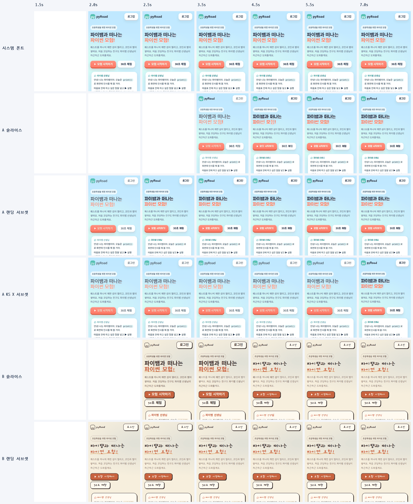
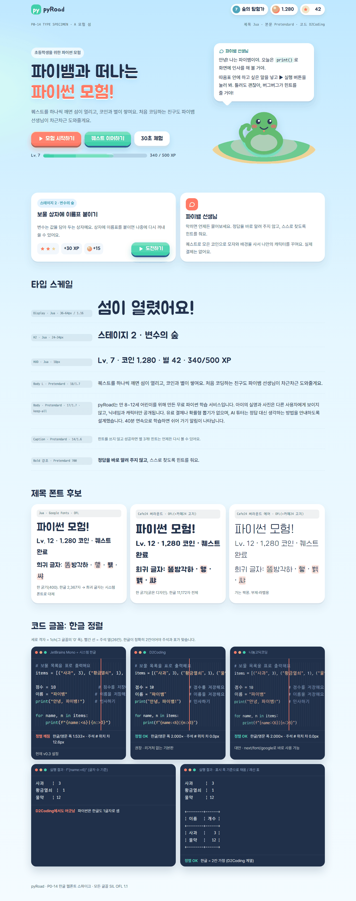
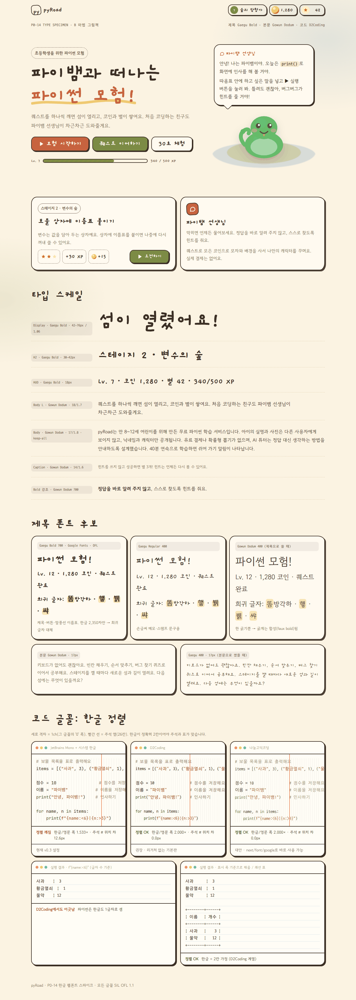
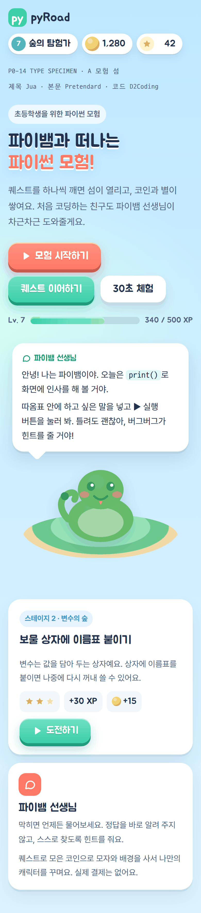
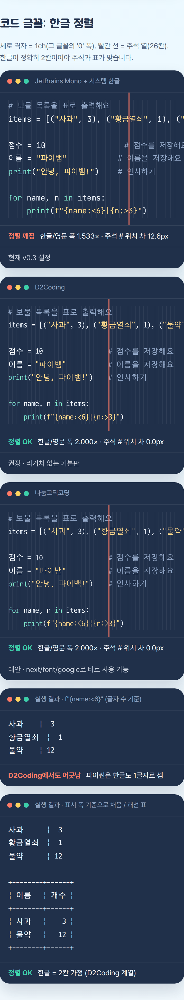
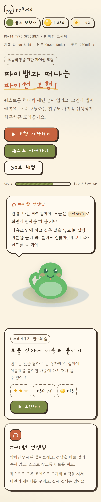
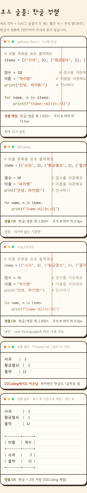

# P0-14 한글 웹폰트 로딩 전략

> - 작성일: 2026-11-03 · 브랜치 `feat/phase0`
> - 관련: [업그레이드 계획서](../4.upgrade-plan.md) §2.5, §6(타이포·D2Coding), X12, X14, P2-09·P2-10·P2-17·P2-18, P4-12 · OG 카드 폰트(satori)는 [P0-10](P0-10-og-share-card.md)에서 다룹니다
> - 코드: [`spikes/p0-14-korean-fonts/`](../../spikes/p0-14-korean-fonts/) · 원자료: `spikes/p0-14-korean-fonts/results/*.json`
> - 표기: **실측** = 이 스파이크에서 직접 잰 값 · **문서 확인** = 라이선스 원문·Next.js 15.5.14 소스·Google Fonts 응답에서 확인 · **미확인** = 실기기 확인 필요

## 1. 결론: **채택** (전부 자가 호스팅 + 화면 성격별 2단 로딩 + 코드 폰트 D2Coding)

폰트 파일은 **모두 우리 도메인에서 내려줍니다** (Google Fonts 링크·jsDelivr 같은 외부 CDN 미사용). 그 위에서 화면 성격에 따라 두 가지 방식을 씁니다.

| 화면 | 방식 | 이유 (실측) |
|---|---|---|
| **랜딩** (비로그인, 문구가 코드에 고정) | **랜딩 텍스트 서브셋**: prebuild에서 랜딩 문구에 쓰인 글자만 뽑아 폰트별 작은 파일(제목 28KB, 본문 35KB×2, 코드 6KB)을 만들고 `next/font/local`로 preload | A안 폰트 전송량 657KB → 103KB, 요청 34 → 4개, 제목 폰트 적용 3.0초 → 1.1초(첫 페인트와 거의 동시, Slow 4G). B안 517KB → 69KB. CLS 0 |
| **앱 화면** (월드맵·퀘스트·게시판: 퀘스트 제목, 닉네임, AI 튜터 답변, 아이가 입력하는 코드처럼 글자를 미리 알 수 없음) | **unicode-range 슬라이스(동적 서브셋)**: 한글 11,172자를 ~90~120조각으로 나눠 두고, 화면에 나온 글자가 든 조각만 받음 | 모든 글자를 쓸 수 있으면서 첫 방문 전송량이 통파일·고정 서브셋보다 작고, 한 번 받은 조각은 다음 페이지에서 재사용 |

범주·시안별 결정

| 범주 | A 모험 섬 | B 마법 그림책 | 앱 화면 로딩 | 랜딩 로딩 |
|---|---|---|---|---|
| 제목 | **Jua** 400 (대안: Cafe24 써라운드) | **Gaegu** 700 (제목·버튼·이름표 전용) | `next/font/google`, **weight 하나당 호출 하나**, `subsets: ['latin']`, `display: 'swap'` | 텍스트 서브셋 + preload |
| 본문 | **Pretendard Variable** | **Gowun Dodum** 400 | A: npm `pretendard`의 가변 동적 서브셋 CSS를 import (Next가 woff2를 해시 파일로 자가 호스팅) · B: `next/font/google` | 텍스트 서브셋(400·700) + preload |
| 코드 | **D2Coding** Regular (리거처 없는 기본판) | 같음 | `fontkit.py slice --no-hanja`로 자른 96조각 + CSS를 `src/fonts/d2coding/`에 두고 **퀘스트·에디터 레이아웃에서만** import | 코드 데모 글자만 서브셋 (6KB, preload 안 함) |

**대안**
- **Cafe24 써라운드(A 제목)**: 기술적으로는 Jua보다 낫습니다. 한글 11,172자 전부(Jua 2,367자), 같은 제목 글자에 122KB(Jua 227KB). 라이선스는 SIL OFL 1.1이지만 카페24가 **"사용된 광고물 이미지를 카페24 프로모션에 활용할 수 있다"**는 고지를 붙여 두었습니다 (요청하면 제외). 사용자 확인 후 채택 여부를 정합니다 (§7).
- **나눔고딕코딩**: D2Coding과 같은 정렬(한글 = 영문 2칸 실측)이고 `next/font/google`로 바로 쓸 수 있습니다. D2Coding 슬라이스 관리가 부담되면 대체합니다.
- **KS X 1001 고정 서브셋(2,350자) + preload**: FCP는 가장 빠르지만(렌더 차단 CSS가 거의 없음), 큰 파일 3~4개(550~730KB)를 preload가 한꺼번에 당겨서 브랜드 폰트 적용이 가장 늦고 CLS가 최대 0.10까지 나왔습니다. PWA 오프라인 캐시용으로만 고려합니다.

**불가 (쓰지 않음)**
- 통파일: D2Coding 1,451KB, Pretendard Variable 2,009KB, Cafe24 공식 woff2 383KB (제목 적용 5.4초).
- 외부 CDN `<link>` (Google Fonts, jsDelivr, fonts-archive): 같은 폰트를 자가 호스팅할 때보다 제목 적용이 1.4~1.9초 늦었고, 아동 서비스에서 제3자에게 요청(IP)을 보내며, fonts-archive 미러는 버전이 고정되지 않습니다.
- Pretendard 정적 동적 서브셋 CSS를 통째로 import: 9개 weight × 92 = 828개 `@font-face`라 렌더 차단 CSS가 gzip 160KB를 넘어 FCP가 Fast 3G에서 5.6초가 됐습니다.
- 정적 한글 폰트를 `next/font/google` **한 호출에 weight 2개 이상**: 둘째 weight의 한글 조각이 **전부 preload**됩니다 (Gaegu 400+700 → preload 93개, §4.2).
- Gaegu(손글씨)를 본문에 쓰기, JetBrains Mono + 시스템 한글(코드 정렬 깨짐, §4.6).

**핵심 수치** (실측, 측정용 랜딩 1회 로드, 캐시 없음, 3회 중앙값. "앱 화면" 행은 같은 랜딩을 슬라이스 방식으로 그린 값이라 첫 방문 최악 조건입니다)

| 구성 | 폰트 요청 | 폰트 전송 | 렌더 차단 CSS (gzip) | LCP Slow 4G / Fast 3G | 제목 폰트 적용 Slow 4G / Fast 3G | CLS |
|---|---|---|---|---|---|---|
| 현재 v0.3 (Noto Sans KR + JetBrains Mono) | 16 | 305KB | 54KB | 2.49 / 3.19초 | 1.57 / 2.24초 | 0.000 |
| **A 랜딩** (텍스트 서브셋) | **4** | **103KB** | 5.4KB | **1.08 / 2.05초** | **1.07 / 2.07초** | 0.000 |
| A 앱 화면 (슬라이스) | 34 | 657KB | 43KB | 1.71 / 2.35초 | 2.98 / 4.40초 | 0.000 |
| **B 랜딩** (텍스트 서브셋) | **3** | **69KB** | 5.4KB | **1.35 / 2.19초** | **1.45 / 2.21초** | 0.000 |
| B 앱 화면 (슬라이스) | 35 | 517KB | 44KB | 1.83 / 2.80초 | 2.84 / 4.82초 | 0.026 |

- **LCP는 모든 변형에서 FCP와 같았습니다.** swap이면 대체 폰트로 그린 첫 페인트가 LCP가 되고, 웹폰트로 바뀌어도 새 LCP가 생기지 않습니다. 그래서 LCP를 늦추는 것은 폰트 파일이 아니라 **렌더 차단 CSS(`@font-face` 선언)와 preload 경쟁**입니다.
- 코드 정렬: D2Coding 한글/영문 폭 **2.000배**, 주석 열 위치 차 **0.0px** / JetBrains Mono + 시스템 한글 **1.533배**, **12.6px** 어긋남.
- 라이선스 위험 신호: **Cafe24 써라운드의 프로모션 활용 고지** 하나. 나머지 6종은 표준 OFL입니다.

## 2. 검증한 질문

| # | 질문 | 답 |
|---|---|---|
| Q1 | 후보 폰트의 라이선스·출처·굵기·크기, 랜딩에서 실제로 받는 양은? | 7종 모두 SIL OFL 1.1. Cafe24만 추가 고지(프로모션 활용) 있음. 크기·다운로드량 §4.1 |
| Q2 | `next/font/google`로 한글 폰트를 쓰면 subsets·preload·자가 호스팅·display·fallback은 어떻게 동작하나? `next/font/local`은? | 한글은 이름 있는 subset이 없어 라틴 조각만 preload. 슬라이스는 빌드 때 전부 자가 호스팅. 폴백 보정은 라틴만. 정적 다중 weight 호출은 preload 폭주 (§4.2) |
| Q3 | A·B 스택의 성능 영향 (폰트 바이트, 요청 수, 폰트 적용 시각, FOUT, LCP, CLS)은? | swap이면 LCP = 대체 폰트로 그린 첫 페인트. 폰트 파일이 아니라 **렌더 차단 CSS와 preload 경쟁**이 LCP를 늦춤. 랜딩 텍스트 서브셋이 모든 지표에서 가장 좋음 (§4.3~4.5) |
| Q4 | D2Coding의 한글이 정확히 영문 2칸인가? 아이들 크기(14~18px)에서 읽기 좋은가? | 2.000배 (14·16·18px 모두), 주석 열 위치 차 0px. JetBrains Mono + 시스템 한글은 1.533배로 12.6px 어긋남. 단 **파이썬 f-string 패딩은 글자 수 기준이라 D2Coding에서도 한글 표가 어긋남** (§4.6) |
| Q5 | 8~12세 가독성: 본문 크기·행간·자간, 손글씨 본문 가능 여부 | 본문 17px(최소 16px), 행간 1.7~1.8, 자간 0, `word-break: keep-all`. 손글씨는 제목 전용 (§4.7) |

## 3. 방법 & 환경

**문서 확인**
- 라이선스: 폰트 파일 name 테이블(ID 13·14)의 OFL 문구, Cafe24 공식 zip에 든 `License-Ssurround.pdf`·`License-SsurroundAir.pdf`, Pretendard·D2Coding 저장소.
- Next.js 15.5.14 소스: `node_modules/next/dist/compiled/@next/font/dist/google/{loader,find-font-files-in-css,validate-google-font-function-call,get-fallback-font-override-metrics}.js`, `font-data.json`, `local/{loader,get-fallback-metrics-from-font-file}.js`, `next/dist/server/font-utils.js`.
- Google Fonts CSS2 응답(Chrome UA): 한글 조각 수와 주석 구조.

**실측**
- 폰트 크기·서브셋·슬라이스: fontTools 4.63 (`scripts/fontkit.py`). 서브셋은 힌팅 제거, 레이아웃 기능 전부와 라이선스 name 레코드 유지.
- 성능: 최소 Next.js 앱(`spikes/p0-14-korean-fonts/next-app/`, Next 15.5.14·React 19.2.4)을 스크래치 디렉터리에 복사해 `next build`(webpack) → `next start -p 3114`. 변형마다 라우트 그룹·루트 레이아웃을 따로 둬서 폰트가 섞이지 않게 했습니다. Turbopack 빌드는 라우트 간 preload가 새어 나가 측정용으로 쓰지 않았습니다 (§4.2 마지막 항목).
- 측정 페이지: 실제 P4 랜딩 분량을 흉내 낸 페이지 (히어로 제목·부제·CTA·마스코트·말풍선 → HUD·퀘스트 카드 → 기능 카드 4개 → 코드 데모 → 부모님 섹션 → FAQ → 푸터). 1,142자, **한글 음절 224종** (제목 폰트로 그리는 글자는 65종).
- 브라우저: Playwright 1.58.2 + Chrome for Testing 156 headless shell. 모바일 에뮬레이션 390×844, DPR 2, Android Chrome UA. CDP로 네트워크·CPU 제한: **Slow 4G** = RTT 150ms·1.6Mbps (Lighthouse 모바일 기본 수치), **Fast 3G** = 562.5ms·1.44Mbps (DevTools 프리셋), 둘 다 CPU 4배 감속. 캐시 끔, 매번 새 컨텍스트, **변형당 3회 중앙값**.
- 수집: 폰트 요청 수·전송량(CDP `encodedDataLength`), 렌더 차단 CSS 전송량, FCP, LCP(+요소), CLS(`layout-shift` 합), **제목/본문/코드 폰트 적용 시각** = 그 요소 글자를 그리는 데 필요한 웹폰트 조각이 전부 `loaded`가 된 시각(`document.fonts.check`, rAF 폴링).
- 시스템 한글 폴백: 이 리눅스에는 한글 폰트가 없어 폴백이 두부(□)로 그려집니다. 스크래치 fontconfig로 **Noto Sans KR**만 추가해 Android·크롬북(Noto Sans CJK KR) 상황을 흉내 냈습니다 (시스템 설정은 건드리지 않음).
- 장비 부하: 다른 에이전트와 동시에 돌아 load average 25~60이었습니다. **절대값보다 변형 간 상대 비교로 읽어 주세요.** 같은 변형의 3회 값 차이는 FCP 기준 ±0.5초 안팎이었습니다.

## 4. 결과

### 4.1 폰트 표 (라이선스·출처·크기·실제 다운로드량)

| 폰트 (용도) | 라이선스 | 출처 | 굵기 | 한글 음절 | 원본 | 전체 WOFF2 | KS X 1001 서브셋¹ | 슬라이스 (개수 / 합계) | 랜딩에서 받은 양² |
|---|---|---|---|---|---|---|---|---|---|
| **Jua** (A 제목) | OFL 1.1 | Google Fonts | 400 하나 | **2,367** | TTF 2,070KB | 360KB | 184KB | 87 / 581KB (Google) | **13개 / 227KB** |
| **Cafe24 써라운드** v2.0 (A 제목 대안) | OFL 1.1 + 카페24 고지³ | fonts.cafe24.com zip (공식 CDN 없음) | 하나 (굵은 디자인, weight 700) | 11,172 | TTF 3,754KB | 383KB (공식 woff2) | 123KB | 91 / 857KB (자체 슬라이스) | **12개 / 122KB** |
| Cafe24 써라운드 에어 v1.1 (부제) | 같음 | 같음 | 하나 (Light 300) | 11,172 | TTF 4,027KB | 331KB (공식) | 101KB | 91 / 730KB | (스페시멘만) |
| **Pretendard** 1.3.9 (A 본문) | OFL 1.1 (예약 이름 "Pretendard") | npm `pretendard` · GitHub orioncactus/pretendard | 9단계 + 가변(45~920) | 11,172 | — | 가변 2,009KB · Regular 748KB | Regular 191KB · Bold 194KB | 가변 92 / 2,888KB · 정적 weight당 92 / 1,135KB (공식 동적 서브셋) | **가변 14개 / 374KB** · 정적 400+700 28개 / 333KB |
| **Gaegu** (B 제목) | OFL 1.1 | Google Fonts | 300·400·700 | **2,350** | Bold TTF 2,893KB | Bold 474KB | Bold 220KB | 700: 89 / 659KB (Google) | **13개 / 236KB** |
| **Gowun Dodum** (B 본문) | OFL 1.1 | Google Fonts | 400 하나 | 11,172 | TTF 7,060KB | 436KB | 174KB | 95 / 1,304KB (Google) | **15개 / 220KB** |
| **D2Coding** 1.3.2 (코드) | OFL 1.1 | GitHub naver/d2codingfont release zip (공식 웹폰트·CDN 없음) | 400·700 (+리거처판) | 11,172 + 한자 | TTF 4,088KB | 1,451KB | 156KB | 한자 제외 96 / 773KB (자체 슬라이스) | **7개 / 57KB** (CDN 미러는 131KB) |
| 나눔고딕코딩 (코드 대안) | OFL 1.1 | Google Fonts | 400·700 | 11,172 | TTF 2,262KB | 654KB | 156KB | 93 / 1,004KB (Google) | 8개 / 78KB (추정⁴) |
| JetBrains Mono 2.211 (현재 코드) | OFL 1.1 | Google Fonts | 가변 100~800 | **0** | TTF 183KB | 70KB | — | 라틴 계열 6개 | 현재 설정 기준 아래 표 |

1. KS X 1001 서브셋 = 완성형 2,350자 + ASCII·Latin-1·문장부호·화살표·도형·호환 자모(ㅋㅎㅠ)·괘선·원문자. 힌팅 제거. (전체 WOFF2는 원본 힌팅 포함)
2. 측정 랜딩 1회 로드에서 그 폰트로 받은 조각 수/전송량 (실측, Slow 4G 1회차). 나눔고딕코딩만 Google 조각 파일을 받아 계산한 추정.
3. 공식 라이선스 PDF 원문: "SIL OPEN FONT LICENSE(Version 1.1)에 따라 사용이 허가됩니다", "글꼴 자체를 유료로 판매하는 것은 금지", "라이선스 전문을 포함하기 어려울 경우, 출처 표기를 권장", "'카페24 써라운드'가 사용된 인쇄물, 광고물(온라인 포함)의 이미지는 카페24의 프로모션을 위해 활용될 수 있습니다. 이를 원치 않는 사용자는 언제든지 당사에 요청하실 수 있습니다." 폰트 파일 name 테이블에는 라이선스 문구가 없습니다.
4. 나눔고딕코딩은 코드 데모 글자 기준 추정.

라이선스 요약: 7종 모두 **상업적 사용·웹 임베딩·수정(서브셋)·자가 호스팅 재배포 허용**. OFL 조건은 ① 폰트만 따로 판매 금지, ② 재배포 시 저작권 고지 + OFL 전문 동봉, ③ 수정본(서브셋 포함)에 예약 이름(Reserved Font Name)을 그대로 쓰지 않기입니다. ③은 Pretendard("Pretendard" 예약)에 해당합니다. 웹폰트 서브셋은 업계 관행상 원 이름으로 배포되고 Pretendard 자신도 공식 서브셋을 같은 이름으로 배포하므로 실무 위험은 낮지만, 우리가 만든 서브셋 파일의 `font-family`는 원 이름을 쓰되 파일명·주석에 "subset"을 남기고 OFL 전문을 같은 폴더에 둡니다.

**랜딩 텍스트 서브셋 크기 (실측)**: Jua 27.7KB · Cafe24 써라운드 15.9KB · Gaegu Bold 28.0KB · Pretendard Regular 35.3KB / Bold 35.7KB · Gowun Dodum 35.5KB · D2Coding 5.9KB. 같은 제목 글자 65종에 슬라이스는 Jua 13조각 227KB가 필요했습니다. 슬라이스는 "자주 쓰는 순서"로 ~100자씩 묶여 있어 드문드문 쓰인 글자 65종을 그리려고 1,200자 분량을 받기 때문입니다 (자체 슬라이스로 다시 잘라도 12조각 209KB로 거의 같음).

### 4.2 `next/font` 동작 (문서 확인 + 실측)

| 항목 | 동작 | 근거 |
|---|---|---|
| `subsets` | 한글 폰트에 `korean` subset이 **없습니다**. Jua·Gaegu·나눔고딕코딩 = `['latin']`, Gowun Dodum = `latin, latin-ext, vietnamese`, Noto Sans KR = `cyrillic, latin, latin-ext, vietnamese` | `font-data.json` (문서 확인) |
| 자가 호스팅 | 빌드할 때 Google CSS에 나온 **조각 파일을 전부** 내려받아 `/_next/static/media/`에 해시 이름으로 둡니다. 브라우저는 Google에 요청하지 않습니다 (Jua 87개 `@font-face` 전부 자가 호스팅 실측). **빌드에 네트워크가 필요**합니다 (개발 서버는 실패 시 폴백 폰트로 계속) | `loader.js`, 빌드 산출물 |
| `preload` | Google CSS의 `/* latin */` 같은 **주석으로 조각의 subset을 판별**합니다. 한글 조각에는 주석이 없어서, ① weight 하나: 라틴 조각 1개만 preload (실측: Jua 1개, Gaegu 700 + Gowun 2개). ② **정적 폰트를 weight 2개 이상 한 호출로**: 둘째 weight의 한글 조각들이 앞 weight 끝의 `/* latin */`을 물려받아 **전부 preload** (실측: Gaegu 400+700 → preload 93개, 그중 Gaegu 700 한글 조각 88개 약 640KB). 가변 폰트(Noto Sans KR)는 weight끼리 파일이 같아 중복 제거로 피해 갑니다 | `find-font-files-in-css.js`, 빌드 HTML |
| `display` | 기본 `swap`. swap이면 첫 페인트는 대체 폰트로 하고 LCP도 그 시점에 정해집니다. **모든 변형에서 LCP = FCP, LCP 항목 1개** (폰트 교체가 새 LCP를 만들지 않음) | 실측 |
| `adjustFontFallback` | Google: 미리 계산된 메트릭으로 **Arial**에 `size-adjust` 등을 겁니다. 기준이 라틴 평균 폭이고, 한글은 Arial에 없어 스택의 다음 시스템 한글 폰트로 넘어가 **보정 없이** 그려집니다. local: 폰트 파일에서 `'aaabcdeeee…'` 평균 폭으로 계산하며 소스 주석이 "Currently only works for the latin alphabet". **한글 CLS는 next/font가 막아 주지 않습니다** | `font-utils.js`, `get-fallback-metrics-from-font-file.js` |
| `next/font/local` | `src` 파일마다 `@font-face` 1개, `declarations`는 모든 파일에 공통이라 **파일별 `unicode-range`를 줄 수 없습니다** → 슬라이스(90~120조각)에는 부적합. 단일 파일(랜딩 텍스트 서브셋, KS X 서브셋)에는 적합 (preload·폴백 메트릭 자동) | `local/loader.js` |
| 슬라이스 CSS import | `import 'pretendard/dist/web/variable/pretendardvariable-dynamic-subset.css'`처럼 CSS를 import하면 Next가 `url()`의 woff2를 해시 파일로 내보냅니다. 별도 CSS 요청 없이 번들 CSS에 합쳐집니다 | 빌드 산출물 |
| Turbopack 주의 | `next build --turbopack`(15.5.14)에서 라우트 그룹마다 루트 레이아웃을 둔 실험 앱의 공용 CSS와 다른 라우트의 `next/font/local` 선언이 한 CSS 청크로 합쳐져, **모든 라우트에 쓰지 않는 폰트 preload 5개가 붙었습니다.** webpack 빌드는 라우트별로 정확했습니다. 실제 앱은 루트 레이아웃이 하나라 영향이 작지만, D2Coding처럼 특정 레이아웃에만 폰트를 두면 빌드 후 HTML의 preload 태그를 꼭 확인해야 합니다 | 실측 (`next-font-manifest.json`) |

**렌더 차단 CSS (실측, gzip)**: 슬라이스 방식의 숨은 비용은 `@font-face` 선언 CSS입니다.

| 구성 | `@font-face` 수 | CSS (gzip) |
|---|---|---|
| 웹폰트 없음 (실험 페이지 기본 CSS) | 0 | 4.3KB |
| **현재 v0.3** (Noto Sans KR 400·700 + JetBrains Mono, `next/font/google`) | 249 | 54KB |
| Jua (`next/font/google`) | 88 | 12.8KB |
| Pretendard 가변 동적 서브셋 | 92 | 13.4KB |
| Pretendard 정적 동적 서브셋 **전체 9 weight** | 828 | ~160KB (400·700만 남기면 ~27KB) |
| D2Coding 자체 슬라이스 (한자 포함 → **한자 제외**) | 124 → 96 | 23KB → **11.6KB** |
| Cafe24 써라운드 자체 슬라이스 | 91 | 10.2KB |
| **A안 앱 화면 권장 합계** (Jua + Pretendard + D2Coding) | 276 | 43KB (D2Coding을 퀘스트 레이아웃으로 빼면 ~31KB) |
| **랜딩 텍스트 서브셋** (A, B) | 3~4 | 5.4KB (기본 CSS 포함, 폰트 선언은 0.5KB) |

### 4.3 성능 (실측, 3회 중앙값)

측정 랜딩 1회 로드 (390×844 모바일, 캐시 없음, CPU 4배 감속). 시간은 초, 왼쪽 Slow 4G / 오른쪽 Fast 3G. **제목·본문 적용** = 그 요소의 글자가 모두 웹폰트로 그려질 수 있게 된 시각. 이 값이 FCP보다 늦으면 그 사이 대체 폰트가 보입니다(FOUT). 표시: ¹ 1차 측정, ² 2차 측정(D2Coding 한자 제외 슬라이스로 다시 빌드 후). 같은 조건의 1·2차 A 슬라이스 값 차이는 FCP·제목 적용 모두 0.1~0.5초였습니다.

**A안 (모험 섬: Jua · Pretendard · D2Coding)**

| 변형 | 폰트 요청 | 폰트 전송 | 렌더 차단 CSS | FCP = LCP | 제목 적용 | 본문 적용 | CLS |
|---|---|---|---|---|---|---|---|
| 웹폰트 없음 (기준)² | 0 | 0 | 4.6KB | 1.19 / 1.72 | — | — | 0 |
| 현재 v0.3 (Noto Sans KR 400·700 + JetBrains Mono)¹ | 16 | 305KB | 54KB | 2.49 / 3.19 | 1.57 / 2.24 | 1.58 / 2.25 | 0 / 0 |
| CDN `<link>` (Google Fonts + jsDelivr + fonts-archive)¹ | 34 | 735KB | 53KB | 2.22 / 2.68 | 4.98 / 6.27 | 5.56 / 7.11 | 0.002 / 0.003 |
| **슬라이스** (`next/font/google` Jua + Pretendard 가변 동적 서브셋 + D2Coding)² | 34 | 657KB | 43KB | 1.71 / 2.35 | 2.98 / 4.40 | 3.53 / 5.29 | 0 / 0 |
| 슬라이스 + 한글 기준 폴백 `size-adjust`¹ | 34 | 658KB | 56KB | 1.76 / 3.34 | 2.88 / 4.91 | 3.57 / 5.87 | 0 / 0 |
| 슬라이스, Pretendard 정적 동적 서브셋 CSS 통째로¹ | 48 | 616KB | **169KB** | 2.78 / **5.57** | 4.02 / 6.84 | 2.89 / 6.01 | 0 / 0 |
| KS X 1001 고정 서브셋 + preload¹ | 4 | 726KB | 6.7KB | 1.27 / 1.96 | 4.52 / 5.58 | 4.83 / 5.71 | 0.029 / 0.027 (최대 **0.100**) |
| **랜딩 텍스트 서브셋** + preload² | **4** | **103KB** | 5.4KB | **1.08 / 2.05** | **1.07 / 2.07** | **1.20 / 2.08** | 0 / 0 |
| 제목 Cafe24 써라운드 자체 슬라이스² | 33 | 552KB | 41KB | 1.42 / 2.36 | 2.59 / 3.88 | 3.17 / 4.76 | 0 / 0 |
| 제목 Cafe24 써라운드 공식 woff2 통파일 (preload)¹ | 22 | 814KB | 43KB | 1.58 / 2.43 | 5.44 / 6.61 | 3.47 / 5.58 | 0 / 0 |

**B안 (마법 그림책: Gaegu · Gowun Dodum · D2Coding)**

| 변형 | 폰트 요청 | 폰트 전송 | 렌더 차단 CSS | FCP = LCP | 제목 적용 | 본문 적용 | CLS |
|---|---|---|---|---|---|---|---|
| CDN `<link>` (Google Fonts + fonts-archive)¹ | 35 | 587KB | 54KB | 1.58 / 2.55 | 4.25 / 5.72 | 4.25 / 5.54 | 0.043 / 0.043 |
| **슬라이스** (`next/font/google` Gaegu 700 + Gowun Dodum + D2Coding)² | 35 | 517KB | 44KB | 1.83 / 2.80 | 2.84 / 4.82 | 3.19 / 5.31 | 0.026 / 0.027 |
| KS X 1001 고정 서브셋 + preload¹ | 3 | 550KB | 6.5KB | 0.96 / 1.68 | 3.80 / 4.83 | 3.48 / 4.35 | 0.028 / 0.028 |
| **랜딩 텍스트 서브셋** + preload² | **3** | **69KB** | 5.4KB | 1.35 / 2.19 | **1.45 / 2.21** | **1.46 / 2.21** | **0 / 0** |

코드 폰트(D2Coding) 적용: 슬라이스 4.4 / 6.7초, 랜딩 텍스트 서브셋 1.2 / 2.4초 (A). 코드 데모는 첫 화면 아래라 preload하지 않았습니다.

읽는 법
- **FCP 순서 = 렌더 차단 CSS 크기 순서**입니다. 폰트 선언이 거의 없는 KS X·텍스트 서브셋(5~7KB)이 가장 빠르고, 슬라이스(43KB)가 텍스트 서브셋보다 0.3~0.6초 늦고, Pretendard 정적 CSS 통째(169KB)는 Fast 3G에서 웹폰트 없는 페이지보다 3.8초 늦습니다.
- **브랜드 폰트가 보이는 시각**은 텍스트 서브셋이 FCP와 거의 같고(FOUT 없음), 슬라이스가 FCP 뒤 1.0~2.0초, KS X 서브셋·통파일·CDN은 2.8~3.9초 뒤였습니다. KS X 서브셋은 큰 파일 3~4개를 preload가 동시에 당겨 대역폭을 나눠 쓰기 때문에, 전송량이 비슷한 슬라이스보다 오히려 늦습니다.
- **CLS**: A는 대체 폰트(Noto Sans KR)와 Pretendard·Jua의 줄바꿈이 거의 같아 0이었습니다. B는 Gaegu로 바뀔 때 버튼 줄바꿈이 달라져 0.026(필름스트립 B 슬라이스 3.5→4.5초). KS X 서브셋은 본문 폰트가 늦게(4.5초+) 바뀌면서 최대 0.100. 텍스트 서브셋은 FCP 전에 폰트가 준비돼 0입니다. 한글 기준 폴백 `size-adjust`는 A에서 이미 CLS가 0이라 효과가 측정되지 않았습니다 (선택 사항으로 둠).
- **목표(P4-12 LCP < 2.5초)**: Slow 4G에서는 Pretendard 정적 CSS 통째를 빼고 모두 통과. 더 나쁜 Fast 3G에서는 B 슬라이스(2.80초)가 넘고, 텍스트 서브셋은 A·B 모두 통과했습니다. 실제 랜딩에는 히어로 일러스트·JS가 더 붙으므로 폰트 쪽 렌더 차단 CSS를 최소로 두는 것이 안전합니다.
- 폰트별 실제 전송량(Slow 4G 1회차): Jua 13개 227KB, Pretendard 가변 14개 374KB(정적 400+700이면 28개 333KB), D2Coding 7개 57KB(fonts-archive CDN판은 131KB), Cafe24 써라운드 12개 122KB(공식 통파일 383KB), Gaegu 700 13개 236KB, Gowun Dodum 15개 220KB.

### 4.4 FOUT (대체 폰트 → 웹폰트 교체) 필름스트립

Fast 3G, 390px, 각 칸은 그 시각의 화면(CDP screencast 1회). 위에서부터 시스템 폰트 · A 슬라이스 · A 랜딩 서브셋 · A KS X 서브셋 · B 슬라이스 · B 랜딩 서브셋.



- **A 랜딩 서브셋**: 2.0초에 대체 폰트로 첫 페인트 → 2.5초에 Jua·Pretendard로 바뀜. **B 랜딩 서브셋**은 첫 페인트부터 Gaegu입니다.
- **A 슬라이스**: 대체 폰트가 약 1초 보인 뒤 Jua로 바뀝니다. 이 1회차는 첫 페인트가 늦었습니다(장비 부하).
- **A KS X 서브셋**: 첫 페인트는 빠르지만 **7초까지 대체 폰트**가 보입니다.
- **B 슬라이스**: 대체 폰트(굵은 고딕) → Gaegu로 바뀌며 버튼 줄바꿈이 달라집니다 (CLS 0.026의 원인).

### 4.5 타입 스페시멘

실험 앱의 `/specimen-a`, `/specimen-b` (권장 로딩 방식 그대로: `next/font/google` + Pretendard 동적 서브셋 + D2Coding·Cafe24 자체 슬라이스). 히어로 제목, HUD(레벨·코인·별·XP), 버튼 3종, 튜터 말풍선, 퀘스트 카드, 타입 스케일, 제목 폰트 후보, 코드 정렬 비교를 한 페이지에 담았습니다. B안 스크린샷은 PNG 용량 때문에 종이 결(노이즈) 텍스처만 끄고 찍었습니다 (실제 페이지에는 있음).

**A 모험 섬 · 1280px** — 제목 후보 카드에서 Jua(2,367자)는 "똠·햏·쌰"를 시스템 폰트로 대체하고, Cafe24 써라운드·에어(11,172자)는 모두 자기 글꼴로 그립니다.



**B 마법 그림책 · 1280px** — "Bold 강조" 행은 Gowun Dodum이 400 하나뿐이라 합성 굵기입니다. 아래 비교 카드에서 Gaegu를 본문(17px)으로 쓰면 문단이 들쭉날쭉해 읽기 어렵습니다.



**390px (모바일)** — 위쪽(히어로~카드)과 코드 정렬 섹션

| A 위쪽 | A 코드 | B 위쪽 | B 코드 |
|---|---|---|---|
|  |  |  |  |

관찰
- Jua·Gaegu·Cafe24는 HUD 숫자 폭이 제각각이라 고정 폭 상자(`min-width: 3.2ch`, 오른쪽 정렬)를 씌웠습니다. 카운트업 애니메이션에는 필수입니다.
- Gaegu는 같은 px에서 Jua보다 작고 가늘게 보여 디스플레이 크기를 약 1.15배(42~76px)로 잡았습니다. 버튼 글자도 24px로 키웠습니다.
- 390px에서 HUD 3개가 로고와 한 줄에 들어가지 않습니다. 레벨 이름("숲의 탐험가")은 모바일에서 숨기거나 아이콘+숫자만 두는 것을 P2-11 HUD 디자인에서 정합니다.

### 4.6 코드 폰트: 한글 정렬 (실측)

스페시멘의 코드 패널 3개(같은 코드, 15px)에서 주석 `#`의 x 좌표를 DOM Range로 재고, canvas `measureText`로 '가'/'a' 폭 비를 14·16·18px에서 쟀습니다 (`results/alignment.json`).

| 글꼴 | 한글/영문 폭 (14·16·18px) | 주석 열 위치 차 (3줄) | 판정 |
|---|---|---|---|
| JetBrains Mono + 시스템 한글 (Noto Sans KR) | 1.533 | 12.6px | **깨짐** |
| **D2Coding** | **2.000** | 0.0px | 정렬 |
| 나눔고딕코딩 | 2.000 | 0.0px | 정렬 |

- 원인: JetBrains Mono는 영문 0.6em이고 한글이 없어 시스템 폰트(Noto Sans KR 0.92em)로 넘어갑니다. 2칸이 되려면 1.2em이어야 합니다. iOS(Apple SD Gothic Neo)·Windows(맑은 고딕)도 한글 폭이 1.2em이 아니라 어느 기기에서나 어긋납니다 (값은 미확인).
- D2Coding 메트릭 (fontTools): 영문 500 / 한글 1000 / UPM 1000, 호환 자모(ㅋ) 1000, 괘선 `─` 500. `+--+` 같은 ASCII 표와 한글 2칸 가정의 표가 맞습니다.
- **f-string 패딩 주의**: `f"{name:<6}"`은 글자 **수**로 채워서 "사과"(4칸)와 "황금열쇠"(8칸) 뒤 `|` 위치가 D2Coding에서도 다릅니다 (스페시멘 왼쪽 아래). 표시 폭 기준으로 채우면 맞습니다 (오른쪽 아래). 퀘스트 콘텐츠에서 한글 표 출력은 피하거나, 고학년 퀘스트에서 "한글은 2칸" 개념을 따로 가르칩니다. `output_match` 채점은 문자열 비교라 영향이 없습니다.
- 아이 크기: 15~16px에서 D2Coding 한글은 Pretendard 본문보다 약간 가늘지만 또렷합니다. 기본 16px, 모바일 최소 14px, "큰 글씨" 설정 18~20px을 권장합니다 (P2-18).
- 리거처: D2Coding은 리거처 없는 기본판을 씁니다 (리거처판은 `liga/calt`로 `->`, `!=` 등을 합침). **현재 JetBrains Mono도 `calt` 리거처가 기본으로 켜져 있어** 에디터에서 `!=`가 한 글자처럼 보일 수 있습니다. CodeMirror 테마에 `fontVariantLigatures: 'none'`을 넣습니다.
- D2Coding의 `|`는 가운데가 끊긴 모양(¦처럼 보임)입니다. 초급 파이썬에서는 거의 쓰지 않아 문제는 작습니다.

### 4.7 아이 가독성 가이드 (8~12세, 문서 확인 + 스페시멘 관찰)

| 항목 | 권장 | 이유 |
|---|---|---|
| 본문 크기 | **17px** (모바일·태블릿), 최소 16px. 긴 설명·튜터 대사 17~18px, 캡션 14px 이상 | §6 "본문 16px 이상"을 지키면서 저학년(8~9세) 읽기 속도를 고려해 한 단계 크게 |
| 행간 | 본문 **1.7** (A, Pretendard) / **1.8** (B, Gowun Dodum은 글자 면이 커서) · 제목 1.1~1.2 | 한글은 네모 틀을 꽉 채워 라틴(1.5)보다 행간이 더 필요 |
| 자간 | 본문 **0** (성인 UI에서 흔한 -0.02~-0.04em 금지). 큰 제목만 -0.01em까지 | 글자 사이가 좁으면 받침·모음이 붙어 보임 |
| 줄바꿈 | `word-break: keep-all` + `overflow-wrap: anywhere`, 제목 `text-wrap: balance`, 본문 `text-wrap: pretty` | 어절 중간에서 끊기면 아이들이 단어를 잘못 읽음 |
| 한 줄 길이 | 25~35자 (`max-width: 34em` 안팎) | 줄이 길면 다음 줄을 놓침 |
| 굵기 | 강조는 700 한 단계만. **Gowun Dodum은 400 하나뿐이라 `<strong>`이 가짜 굵게(합성)** 됩니다 → B안 강조는 색·밑줄·Gaegu로 | 스페시멘 B "Bold 강조" 행에서 확인 |
| 숫자 | HUD 숫자는 고정 폭 상자(`min-width: 3.2ch`) 또는 `tabular-nums`가 되는 폰트(Pretendard·Gowun Dodum). **Jua·Gaegu·Cafe24는 숫자 폭이 제각각이고 `tnum` 기능이 없어** 코인 카운트업 때 글자가 흔들립니다 | fontTools로 숫자 advance 확인 |
| 손글씨(Gaegu) | **제목·버튼·이름표·도장 문구 전용.** 본문 금지. 같은 크기에서 글자가 작게 보여 제목은 A 대비 약 1.15배로 키움 | 획 굵기·글자 크기가 들쭉날쭉해 문단에서는 읽기 속도가 떨어짐 (스페시멘 B 비교 카드) |
| 이탤릭 | 쓰지 않음 | 한글 이탤릭은 기울인 합성 글꼴 |
| 대비 | 본문 WCAG AA 4.5:1 이상 | §6 공통 |

## 5. 선택지 비교

| 방식 | 랜딩 전송량 (A) | 요청 수 | 렌더 차단 CSS | 제목 적용 (Slow 4G) | CLS | 동적 글자 | 운영 부담 | 판정 |
|---|---|---|---|---|---|---|---|---|
| **랜딩 텍스트 서브셋** | 103KB | 4 | 5.4KB | 1.1초 (≈ 첫 페인트) | 0.000 | 문구에 없는 글자는 시스템 폰트 | 문구 바꾸면 prebuild 재생성 (자동) | **채택 (랜딩)** |
| **슬라이스 (`next/font/google` + CSS import)** | 657KB | 34 | 43KB | 3.0~3.1초 | 0.000 | 전부 | 낮음 (D2Coding·Cafe24만 직접 자름) | **채택 (앱 화면)** |
| KS X 1001 고정 서브셋 + preload | 726KB | 4 | 6.7KB | 4.5초 | 0.03 (최대 0.10) | 2,350자 밖은 시스템 폰트 | 낮음 | 대안 (오프라인 캐시용) |
| 외부 CDN `<link>` | 735KB | 34 | 53KB (제3자) | 5.0초 | 0.002 | 전부 | 가장 낮음 | 불가 (느림·제3자·버전) |
| 통파일 (Cafe24 공식 woff2) | 814KB | 22 | 43KB | 5.4초 | 0.000 | 전부 | 낮음 | 불가 |

현재 v0.3(Noto Sans KR 400·700, JetBrains Mono)은 16개 / 305KB, 렌더 차단 CSS 54KB였습니다. 새 디자인(제목·본문·코드 폰트 3종)을 슬라이스로만 넣으면 랜딩 폰트 전송량이 2배가 되므로, 랜딩만큼은 텍스트 서브셋이 필요합니다.

## 6. 이후 Phase 영향 (계획서 수정 제안)

> 계획서는 이 스파이크에서 직접 고치지 않았습니다. 아래 문안을 P0-11에서 반영해 주세요.

**§6 표 "타이포" 행** (C열은 그대로)

> | 타이포 | 제목: Jua (대안 Cafe24 써라운드), 본문: Pretendard, 코드: D2Coding | 제목: Gaegu Bold(손글씨, 제목·버튼·이름표 전용), 본문: Gowun Dodum, 코드: D2Coding | 제목: Black Han Sans / Do Hyeon, 본문: Pretendard |

**§6 공통 적용 사항의 D2Coding 항목**

> - 코드 폰트를 JetBrains Mono → **D2Coding**(한글 = 영문 정확히 2칸인 고정폭, OFL)으로 교체합니다 (P0-14 확정: 주석 열·괘선 표 정렬 실측 0px 차이). 리거처 없는 기본판 Regular만 쓰고 `font-variant-ligatures: none`. 단, 파이썬 f-string `:<n` 패딩은 **글자 수** 기준이라 D2Coding에서도 한글 표가 어긋나므로, 표를 출력하는 퀘스트는 한글 없는 표로 내거나 표시 폭 기준 패딩을 가르칩니다.

**P2-09**

> - [ ] **P2-09** 디자인 토큰 정의: 컬러(월드별 테마 포함), 타이포 스케일(P0-14 기준: 본문 17px·행간 1.7(A)/1.8(B)·자간 0·`word-break: keep-all`, 캡션 14px 이상, 손글씨 제목은 1.15배 보정, HUD 숫자 고정 폭), 라운드, 그림자, 간격, 모션(duration·easing·spring)

**P2-10**

> - [ ] **P2-10** `globals.css` `@theme` 재정의 + 폰트 교체 (P0-14): 모든 폰트 자가 호스팅, `display: swap`. 제목은 `next/font/google`을 **weight마다 따로 호출**(`subsets: ['latin']`), A 본문 Pretendard는 npm `pretendard` 가변 동적 서브셋 CSS import, 코드 D2Coding은 `fontkit.py slice --no-hanja` 결과를 `src/fonts/d2coding/`에 두고 퀘스트·에디터 레이아웃에서만 import. 토큰: `--font-display`, `--font-sans`, `--font-mono`. 빌드 후 라우트별 HTML의 font preload 태그 수를 확인 (Turbopack 누수·다중 weight preload 폭주 방지)

**P2-17**

> - [ ] **P2-17** `docs/assets-license.md` 작성 (P0-14 초안 표 사용). 폰트 7종 SIL OFL 1.1, Cafe24 써라운드를 쓰면 카페24 고지(출처 표기 권장·프로모션 활용 조항) 포함, 자가 호스팅 폴더마다 `OFL.txt` 동봉

**P2-18**

> - [ ] **P2-18** CodeMirror 키즈 테마 (디자인 토큰 기반): 글꼴 D2Coding, 기본 16px(14~20px 조절), 행간 1.6, `fontVariantLigatures: 'none'`, 한글 주석 정렬 스냅샷 테스트

**P4-12**

> - [ ] **P4-12** 성능 예산: LCP 2.5초 미만, 히어로 에셋 우선 로딩, 아래쪽 애니메이션 지연 로딩. 폰트(P0-14): 랜딩은 **랜딩 텍스트 서브셋**(prebuild에서 문구 글자만 추출, 제목·본문·코드 폰트별 30KB 안팎)을 preload하고 슬라이스 CSS를 싣지 않음. 예산: 랜딩 폰트 전송 150KB 이하, 렌더 차단 CSS 15KB(gzip) 이하. swap이면 웹폰트는 LCP를 늦추지 않으므로 LCP 점검 대상은 렌더 차단 CSS와 preload 수

**P0-14 체크** (Phase 0 목록)

> - [x] **P0-14** (추가) 한글 웹폰트 로딩 전략 → [보고서](spikes/P0-14-korean-fonts.md): 채택. 자가 호스팅, 랜딩 = 텍스트 서브셋 preload, 앱 = unicode-range 슬라이스, 코드 = D2Coding

**`docs/assets-license.md` 초안 (폰트 부분)**

| 에셋 | 용도 | 버전 | 라이선스 | 출처 | 저작권자 | 배포 형태 | 고지 |
|---|---|---|---|---|---|---|---|
| Jua | A 제목 | 1.001 | SIL OFL 1.1 | Google Fonts (`next/font/google`) | Woowahan Brothers | Google 조각을 빌드 때 자가 호스팅 + 랜딩 텍스트 서브셋 | OFL 전문 |
| Cafe24 써라운드 / 에어 (선택 시) | A 제목·부제 | 2.0 / 1.1 | SIL OFL 1.1 + 카페24 고지 | fonts.cafe24.com 공식 zip | 카페24(주) | 자체 슬라이스 자가 호스팅 | OFL 전문 + 출처 표기("이 페이지에는 카페24(주)이 제공한 '카페24 써라운드'가 적용되어 있습니다") 권장, 프로모션 활용 조항 |
| Pretendard | A 본문 | 1.3.9 | SIL OFL 1.1 (RFN "Pretendard") | npm `pretendard` | Kil Hyung-jin | 공식 동적 서브셋 자가 호스팅 + 랜딩 텍스트 서브셋 | OFL 전문 |
| Gaegu | B 제목 | 1.00 | SIL OFL 1.1 | Google Fonts | JIKJI SOFT | 자가 호스팅 | OFL 전문 |
| Gowun Dodum | B 본문 | 2.000 | SIL OFL 1.1 | Google Fonts | Yanghee Ryu | 자가 호스팅 | OFL 전문 |
| D2Coding | 코드 | 1.3.2 | SIL OFL 1.1 | github.com/naver/d2codingfont | NAVER Corp. | 자체 슬라이스(한자 제외) 자가 호스팅 | OFL 전문 |
| 나눔고딕코딩 (대안) | 코드 | 2.000 | SIL OFL 1.1 | Google Fonts | NAVER Corp. | 자가 호스팅 | OFL 전문 |

## 7. 남은 리스크 & 사용자 확인 필요 사항

**사용자 확인**
1. **Cafe24 써라운드를 A 제목으로 쓸지.** 기술적으로는 Jua보다 유리(11,172자, 전송량 절반)하지만, 카페24가 "써라운드가 쓰인 광고물(온라인 포함) 이미지를 카페24 프로모션에 활용할 수 있다"고 고지합니다. 아동 서비스 화면이 남의 홍보물에 쓰일 수 있다는 뜻이라, 쓰려면 카페24에 제외 요청을 보내는 것을 권장합니다. 결정 전까지 기본값은 Jua입니다.
2. **닉네임 글자 규칙.** Jua(2,367자)·Gaegu(2,350자)에는 "햏·똠·뷁·쌰" 같은 글자가 없어 그 글자만 시스템 폰트로 그려집니다 (스페시멘 "희귀 글자" 줄). P0-10과 같은 결론으로, 닉네임을 완성형 2,350자 + 영문·숫자로 제한할지 결정이 필요합니다.

**남은 리스크**
- **iOS·Windows 실기기 미확인.** 폴백 폰트(Apple SD Gothic Neo, 맑은 고딕)에서의 FOUT 모양과 CLS는 측정하지 못했습니다 (리눅스 + Noto Sans KR로 Android만 흉내). Phase 2 프로토타입에서 실기기 확인 필요.
- **힌팅 제거한 서브셋의 Windows 렌더링** (미확인). Google도 조각 파일을 힌팅 없이 내려주므로(실측: `fpgm/prep/cvt` 없음) 큰 문제는 없을 것으로 보지만, 14px D2Coding을 Windows 크롬북·데스크톱에서 눈으로 확인해야 합니다.
- **`next/font/google`은 빌드에 네트워크가 필요**합니다. Vercel·GitHub Actions는 문제없지만 Google Fonts 장애 시 빌드가 실패합니다. 불안하면 같은 조각을 저장소에 넣고 CSS import로 바꿀 수 있습니다 (슬라이스 도구 그대로 사용).
- **슬라이스 CSS 비용**: 앱 화면은 렌더 차단 CSS가 40KB(gzip) 이상입니다. D2Coding을 퀘스트 레이아웃으로 한정하면 ~31KB, Pretendard를 가변 하나로 두면 더 늘지 않습니다. 저사양 모드(X12)와 무관하게 항상 드는 비용이라 P12 성능 점검 때 다시 봅니다.
- **랜딩 텍스트 서브셋은 문구가 바뀌면 다시 만들어야** 합니다. prebuild 스크립트 + "문구 글자가 모두 서브셋에 있는지" 검사를 CI에 넣지 않으면, 새 글자만 시스템 폰트로 보이는 사고가 납니다.
- **Turbopack 빌드의 preload 누수**(§4.2)는 Next 버전업 때 다시 확인합니다.

## 8. 재현 방법

```bash
# 저장소 루트에서. npm install·next 실행은 스크래치 디렉터리에서만 합니다.
WORK=/tmp/p0-14   # 아무 스크래치 경로
bash spikes/p0-14-korean-fonts/scripts/run-all.sh "$WORK" 3
```

`run-all.sh`가 하는 일 (단계별로 직접 실행해도 됩니다)

1. `download-fonts.sh $WORK/fonts` — 원본 폰트(Google Fonts GitHub, npm `pretendard`, D2Coding release, 카페24 공식 zip), Google CSS2 응답, 폴백 흉내용 Noto Sans KR + `fonts.conf`를 받습니다. **폰트 바이너리는 저장소에 커밋하지 않습니다.**
2. `next-app/`을 `$WORK/lab`에 복사하고 `npm install` (next 15.5.14, react 19.2.4, pretendard 1.3.9).
3. `build-fonts.sh $WORK/fonts $WORK/lab` — D2Coding(한자 제외)·Cafe24 슬라이스, KS X 1001 서브셋, 랜딩 텍스트 서브셋을 `$WORK/lab/generated/`에 만듭니다 (`fontkit.py`, 부하가 높으면 20~30분).
4. `next build` (webpack) → `FONTCONFIG_FILE=$WORK/fonts/sysfonts/fonts.conf next start -p 3114`.
5. `measure.mjs --runs 3` (14개 변형 × Slow 4G·Fast 3G) → `results/measure.json`, `screenshot.mjs specimen|mobile|filmstrip` → `docs/spikes/img/P0-14-*.png` (`images.py`로 256색 이하 PNG, 240KB 이하), 코드 정렬 실측 → `results/alignment.json`. 이 보고서의 수치는 1차 `results/measure.json`(12개 변형)과 2차 `results/measure-batch2.json`(D2Coding 한자 제외 + 랜딩 서브셋 추가 후 6개 변형)에서 왔습니다.
6. 서버 종료.

- 설치된 Playwright 브라우저 빌드가 패키지(1.58.2)와 다르면 `PW_CHROMIUM=<chrome-headless-shell 경로>`를 지정합니다 (이 측정은 Chrome for Testing 156 headless shell).
- 폰트 도구만 쓰려면: `python3 -P -E scripts/fontkit.py inspect|subset|slice|estimate …` (fontTools·brotli 필요).
- 스페시멘 보기: `$WORK/lab`에서 서버를 띄우고 `/specimen-a`, `/specimen-b`. 측정 변형: `/system /baseline /a-cdn /a-next /a-next-static /a-next-adj /a-subset /a-cafe24 /a-cafe24-full /a-landing /b-cdn /b-next /b-subset /b-landing`.
