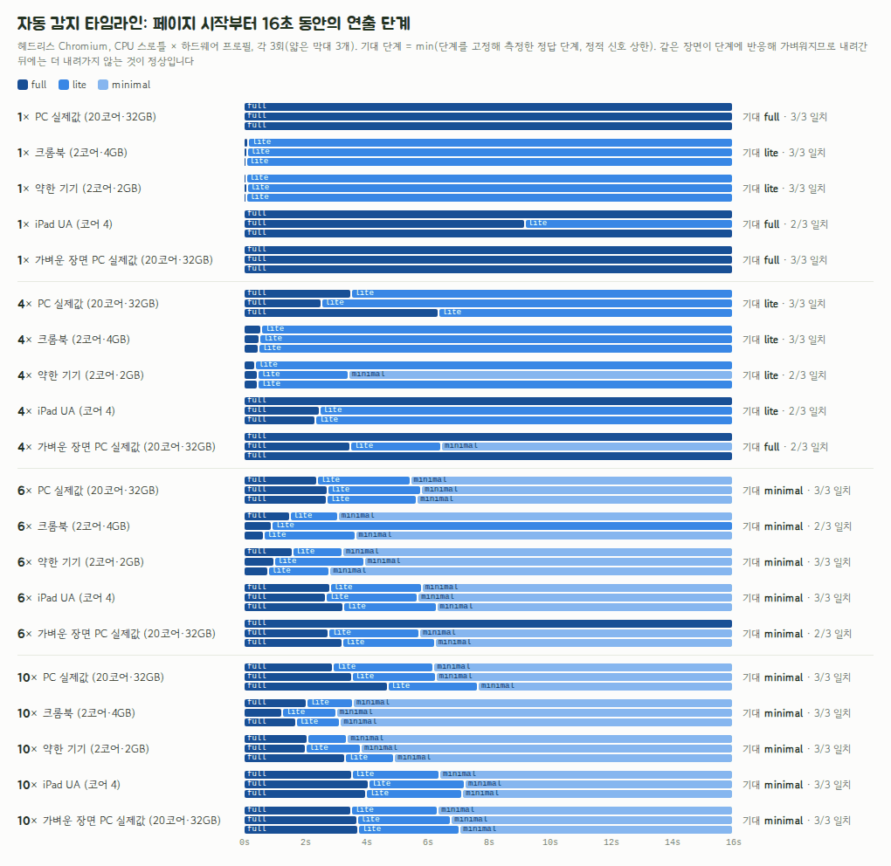

# P0-16 저사양 자동 감지 (연출 단계 full / lite / minimal)

> - 작성일: 2026-11-03 · 브랜치 `feat/phase0`
> - 코드: [`spikes/p0-16-low-spec/`](../../spikes/p0-16-low-spec/) (`src/motionTier.ts`, `src/browser.ts`, `src/useMotionTier.tsx`, 단위 테스트, Playwright 검증)
> - 관련: [업그레이드 계획서](../4.upgrade-plan.md) §2.2 `users.settings`, §2.5, §8 X12, P2-15, P5-09·P5-14, P6-16, P12-04, [P0-07](P0-07-mascot-animation.md)(마스코트 리그, 같은 장면으로 검증)
> - 범위: Chromium 헤드리스 실측 + 합성 프레임 기록 단위 테스트. 실제 크롬북·구형 iPad·안드로이드 태블릿은 측정하지 않음 (P12-04)

## 1. 결론: **채택: "정적 신호로 첫 추정 → 실측 프레임으로 하향만" 2단계 감지**

- **정적 신호만으로는 안 됩니다.** iOS의 모든 브라우저(WebKit)는 `hardwareConcurrency`를 실제 코어가 8개 미만이면 **4**, 이상이면 **8**로만 알려 줍니다 (WebKit 소스 확인). 2코어 구형 iPad도 4입니다. `deviceMemory`·`connection.saveData`·Long Tasks·LoAF·`getBattery`는 Chromium 전용이고, `prefers-reduced-data`는 어디서도 기본 지원되지 않으며, 배터리 절약 모드는 어떤 API로도 알 수 없습니다. 같은 PC를 CPU 10배로 느리게 해도 정적 신호는 그대로입니다.
- **그래서 2단계로 정합니다.** ① `detectMotionTier()`: 렌더 전 0ms에 정적 신호로 **확실히 약한 기기만** 내림(Chromium의 `deviceMemory ≤ 2` · 코어 ≤ 2 · `saveData` → lite, `deviceMemory ≤ 1` → minimal). ② `FrameSampler`: 실제 장면의 rAF 간격을 1초 창으로 보고 **하향만** 함(첫 3초 중 2초, 이후 4초 중 3초가 끊기면 한 단계). 세션 중 상향 없음, 다음 세션은 저장한 단계에서 시작, 사용자 설정이 항상 우선.
- **reduced-motion은 단계와 별개의 축**입니다. 움직임 0(표정·색·글자로 피드백), 단계는 그대로 둡니다.
- **결과 (실측)**: 2차 검증에서 CPU 1×/4×/6×/10× × 하드웨어 프로필 4종 × 3회 중 **90%(54/60)가 기준선 정답과 일치**, 어긋난 6회도 실제로는 매끄러웠거나 장비 부하가 높던 순간이었습니다. 단계가 바뀐 경우 **중앙값 3.6초에 정착**, 세션 중 상향(깜빡임) **0회**, Pyodide 로딩을 흉내 낸 긴 작업 주입에 **오탐 0/6**. 단위 테스트 16개 통과.
- **1차 검증에서 버그를 찾아 고쳤습니다**: 처음부터 느린 기기에서는 느린 프레임 간격을 "화면 주사율"로 잘못 추정해(예: 40ms) lite에서 더 내려가지 못했습니다(CPU 10× PC 프로필 3회 중 2회가 lite에 멈춘 채 58~69% 프레임 놓침). 주사율은 표준 값(144·120·90·60Hz)에만 맞추고 30Hz는 아주 고를 때만 인정하도록 고치고 회귀 테스트를 추가했습니다.
- 단계표(§4.5)와 `useMotionTier` 설계(§4.6), 설정 필드 `users.settings.motion = {tier: 'auto'|'full'|'lite'|'minimal', reduced: 'system'|'on'|'off'}`를 제안합니다.

## 2. 검증한 질문

| # | 질문 | 답 |
|---|---|---|
| Q1 | 어떤 신호를 어떤 브라우저에서 믿을 수 있나? (iOS Safari 포함) | `hardwareConcurrency`는 WebKit에서 4 또는 8로 고정(코드 확인)이라 iOS에서 무의미, `deviceMemory`·`connection`·Long Tasks·LoAF·`getBattery`는 Chromium 전용, `prefers-reduced-data`는 어디서도 기본 지원 안 함. 모든 브라우저에서 믿을 것은 **rAF 프레임 간격**과 `prefers-reduced-motion`뿐. §4.1 |
| Q2 | 정적 신호만으로 판정되나? | 안 됨. 같은 PC를 CPU 10배로 느리게 해도 정적 신호는 그대로(20코어·`deviceMemory` 32)라 full로 남음 (실측). §4.3 |
| Q3 | 실측 판정은 얼마나 빨리, 정확하게 정착하나? 깜빡이지(flip-flop) 않나? | §4.3 |
| Q4 | 한 번의 긴 작업(Pyodide 로딩, 라우트 이동)에 잘못 내려가지 않나? | §4.4 |
| Q5 | 배터리 절약 모드는 감지되나? | 직접 API 없음. iOS 저전력 모드는 rAF를 30fps로 고정(문서 확인) → "고른 30Hz"로 간접 감지해 lite. §4.1 |
| Q6 | 사용자 설정·reduced-motion과 어떻게 합치나? 무엇을 끄나? | §4.5 단계표, §4.6 훅 설계 |

## 3. 방법 & 환경

- **판정 로직**(`src/motionTier.ts`, DOM 의존 없음): `staticGuess()`(정적 신호 → 첫 추정), `FrameSampler`(rAF 간격 → 1초 창 → 하향 판정), `resolvePolicy()`(사용자 설정 > 감지, reduced-motion은 별도 축).
- **단위 테스트 16개**(`test/motionTier.test.ts`, `node --test`): 60Hz·120Hz·고른 30Hz, 계속 끊김, 긴 작업 1번·3번, 4초 중 1초만 끊김 반복(깜빡임 방지), 세션 중간부터 무거워짐, 10fps 연쇄 하향, 탭 숨김 공백, `pause()`, 주사율 추정, 정적 규칙, 정책. 실제 화면 주사율을 바꿀 수 없는 헤드리스 대신 합성 프레임 기록으로 검증했습니다.
- **Playwright 검증**(`bench/validate.mjs`): 데모 장면 = P0-07 파이뱀 리그 3개(코스튬 착용, 2.5초마다 춤·응원·기쁨 순환) + canvas-confetti + 흐린 구름 10개(`filter: blur`) + 유리 카드(`backdrop-filter`) + 큰 그림자. 장면이 단계에 반응합니다(lite: 리그 30fps 상한·파티클 30%·구름·흐림·큰 그림자 끔, minimal: 리그 전환만·파티클 0). 그래서 감지기가 내리면 실제로 가벼워집니다. 가벼운 변형(`light=1`: 흐림·유리 없음)도 함께 봤습니다.
  1. **기준선(정답 단계)**: 단계를 고정(`force=`)하고 6초간 프레임을 재서, 놓친 프레임 25% 이하인 가장 높은 단계를 정답으로 정함.
  2. **자동 감지**: CPU 1×/4×/6×/10× × 하드웨어 프로필 4종(`addInitScript`로 `hardwareConcurrency`·`deviceMemory` 덮어쓰기: PC 실제값 20코어/32GB, 크롬북 2코어/4GB, 약한 기기 2코어/2GB, iPad UA + 4코어) × 3회, 16초 관찰. 기대 단계 = min(정답 단계, 정적 상한).
  3. **긴 작업 주입**: 1×, 가벼운 장면에서 3초에 400ms + 6·7·8초에 150ms 바쁜 대기.
  4. **정적 신호**: reduced-motion 에뮬레이션, `saveData`, 약한 기기, iPad UA.
- **두 번 검증했습니다**: 1차(`validate.json`)에서 처음부터 느린 기기가 lite에서 더 내려가지 못하는 버그를 찾았고(주사율 오추정, §4.3), 회귀 테스트 2개를 추가해 고친 뒤 2차(`validate-v2.json`)를 같은 조건으로 다시 돌렸습니다. 단위 테스트는 16개가 됐습니다.
- **환경**: P0-07과 같음 (WSL2, 20 vCPU, Chromium 151 헤드리스 셸, GPU 없음 → 소프트웨어 렌더링, 기기 배율 2). WebKit 미실행.

## 4. 결과

### 4.1 신호별 지원과 쓸모 (BCD 8.1.8 2026-11-02 기준, 문서 확인 + WebKit 코드 확인)

| 신호 | Chrome·Edge (데스크톱·안드로이드) | 삼성 인터넷 | Firefox | Safari·iOS (모든 iOS 브라우저) | 쓸모 |
|---|---|---|---|---|---|
| `requestAnimationFrame` 간격 | ✅ | ✅ | ✅ | ✅ (저전력 모드에서 30fps 고정, 문서 확인) | **핵심 신호**. 실제로 그 장면을 그 기기에서 그릴 수 있는지 직접 봄 |
| `prefers-reduced-motion` | ✅ 74 | ✅ 11 | ✅ 63 | ✅ 10.1 / iOS 10.3 | **별도 축**: 움직임 0 정책 |
| `navigator.hardwareConcurrency` | ✅ 37 | ✅ 3 | ✅ 48 | ✅ 15.4부터, 그 전 없음. **값은 실제 코어 8개 미만이면 4, 이상이면 8로 고정** (WebKit `NavigatorBase.cpp`, 코드 확인) | Chromium에서 2 이하일 때만 약한 단서. iOS에서는 무시 |
| `navigator.deviceMemory` | ✅ 63 (2의 거듭제곱으로 반올림, HTTPS 전용. 이 장비의 Chromium 151은 32를 보고해 예전 상한 8보다 커짐, 실측) | ✅ 8 | ✗ | ✗ | Chromium에서 ≤2GB면 lite, ≤1GB면 minimal |
| `connection.saveData` | ✅ 65 | ✅ 9 | ✗ | ✗ | 데이터 절약 → lite (무거운 에셋을 덜 받음) |
| `connection.effectiveType` | ✅ 61 | ✅ 3 | ✗ | ✗ | 2g·slow-2g → lite. 연출보다 에셋 로딩 판단용 |
| `prefers-reduced-data` | 85+ 플래그만 | ✗ | ✗ | ✗ | **쓸 수 없음** (지원해도 무해하게 읽음) |
| Long Tasks API | ✅ 58 | ✅ 7 | ✗ | ✗ | 보조 지표(개발·텔레메트리)만, 판정에 안 씀 |
| Long Animation Frames (LoAF) | ✅ 123 | ✅ 27 | ✗ | ✗ | 같음 |
| `navigator.getBattery()` | ✅ 38 | ✅ 3 | 43–52 제거 | ✗ | 잔량·충전만, **절전 모드 여부는 어떤 API로도 알 수 없음** |
| `userAgentData.mobile` | ✅ 90 | ✅ 23 | ✗ | ✗ | 쓰지 않음 (태블릿·크롬북 구분 못 함) |

- **배터리 절약 모드**: 직접 알 방법이 없습니다. iOS 저전력 모드는 rAF를 30fps로 고정하는 것이 의도된 동작이고(WebKit 버그 215745, 문서 확인), 그래서 "고르게 30Hz"면 lite로 내립니다. Chrome 에너지 세이버도 "시각 효과·프레임률을 줄인다"고 하지만 정확한 수치는 공식 문서에서 확인하지 못했습니다.
- **헤드리스는 rAF가 항상 60Hz**라 30Hz·120Hz 동작은 단위 테스트(합성 기록)로만 확인했습니다.

### 4.2 판정 규칙

**① 첫 추정 (`detectMotionTier()`, 동기, 렌더 전)** — 확실히 약한 기기만 내리고 나머지는 실측에 맡깁니다.

| 조건 | 첫 단계 |
|---|---|
| `deviceMemory ≤ 1` | minimal |
| `deviceMemory ≤ 2`, 또는 (WebKit이 아니고) `hardwareConcurrency ≤ 2`, 또는 `saveData`, 또는 `effectiveType`이 2g 이하 | lite |
| 지난 세션 실측이 더 낮음 (localStorage, 14일, 코어·메모리 값이 같을 때만) | 그 단계 |
| 그 밖 | full |

**② 실측 (`FrameSampler`)** — rAF 간격을 1초 창으로 묶어 판단합니다.

- 목표 간격 = max(추정 주사율, 16.7ms). 120Hz 화면이 60fps로 떨어져도 정상으로 봅니다. 주사율은 처음 60프레임 간격의 하위 20% 값이 **표준 주사율(144·120·90·60Hz)에 12% 안으로 맞을 때만** 그 값으로, **30Hz는 간격이 아주 고를 때만**(상위 80%/하위 20% < 1.2) 인정하고, 나머지는 60Hz로 봅니다. (1차 검증에서 발견한 버그의 수정: §4.3)
- **나쁜 창**: 놓친 프레임 > 25%, 또는 목표의 2.5배를 넘는 프레임(눈에 띄는 끊김) ≥ 4개.
- **첫 3초(프로브)**: 3개 창 중 2개가 나쁘면 즉시 한 단계 내림 → 무거운 기기는 약 2초 만에 판정.
- **그 뒤**: 최근 4개 창 중 3개가 나쁘면 한 단계 내림. 한두 번의 긴 작업은 무시.
- 내린 직후 1.5초는 창을 버림(화면이 바뀌는 중). 내린 뒤에는 다시 프로브부터.
- **세션 중 자동 상향 없음**(깜빡임 방지). 다음 세션은 저장한 단계에서 시작.
- 고르게 30Hz(저전력 모드 또는 늘 과부하)면 full → lite.
- 1초 넘는 공백(탭 숨김·백그라운드)은 버리고, `visibilitychange`에서 일시정지. 알려진 무거운 작업(Pyodide 로딩, 큰 라우트 이동)은 `pauseSampling()`/`resumeSampling()`으로 감쌉니다.
- minimal이 되면 샘플링을 멈춥니다 (더 내릴 단계가 없음).

**③ 최종 정책 (`resolvePolicy`)** — 사용자 설정(`auto`가 아니면) > 감지. `reduced`는 단계와 별개의 축: `system`(OS 설정 따름) / `on` / `off`.

### 4.3 자동 감지 정확도·정착 시간 (실측)

2차 검증(주사율 추정 수정 후, `validate-v2.json`): 기준선 72회 + 자동 감지 60회 + 긴 작업 6회 + 정적 신호 4회, 측정 중 load 중앙값 8.3 [5.4–20.4]. 헤드리스 Chromium, 기기 배율 2.



**① 기준선**: 단계를 고정했을 때 장면 성능 (3회 중앙값, fps / 60fps 기준 놓친 프레임). 놓친 프레임 25% 이하인 가장 높은 단계를 정답으로 둡니다.

| 장면 | 스로틀 | full fps / 놓침 | lite fps / 놓침 | minimal fps / 놓침 | 정답 단계 |
|---|---|---:|---:|---:|---|
| heavy | 1× | 57 / 6% | 60 / 0% | 60 / 0% | **full** |
| heavy | 4× | 28 / 54% | 53 / 11% | 56 / 7% | **lite** |
| heavy | 6× | 26 / 57% | 44 / 26% | 55 / 9% | **minimal** |
| heavy | 10× | 8 / 87% | 11 / 81% | 34 / 43% | **minimal** |
| light | 1× | 60 / 0% | 60 / 0% | 60 / 0% | **full** |
| light | 4× | 46 / 24% | 57 / 5% | 59 / 2% | **full** |
| light | 6× | 37 / 39% | 35 / 42% | 53 / 12% | **minimal** |
| light | 10× | 12 / 80% | 12 / 80% | 31 / 48% | **minimal** |

- heavy = 흐린 구름 10개 + 유리 카드(`backdrop-filter`) + 큰 그림자 + 리그 3개 + confetti, light = 흐림·유리 없이 리그 3개 + 적은 confetti. 1×에서는 둘 다 full이 매끄럽고, 4×에서 heavy는 lite가, 6× 이상은 minimal이 정답입니다.
- 10×에서는 **minimal도 놓친 프레임 43~48%**입니다. 리그를 멈추고 파티클을 꺼도 남는 비용(React 패널, 페이지 자체)이 있어서, 이 수준의 기기에서는 감지가 할 수 있는 최선이 minimal입니다.

**② 자동 감지** (16초 관찰, 각 3회). 기대 단계 = min(정답 단계, 정적 신호 상한: 크롬북·약한 기기는 코어 2개라 lite).

| 장면 | 프로필 | 스로틀 | 기대 단계 | 결과 (반복별) | 정착 시간 ms (중앙값) | 일치 |
|---|---|---|---|---|---:|---|
| heavy | pc | 1× | full | full, full, full | 0 | 3/3 |
| heavy | chromebook | 1× | lite | lite, lite, lite | 115 | 3/3 |
| heavy | weak | 1× | lite | lite, lite, lite | 85 | 3/3 |
| heavy | ipad | 1× | full | full, lite, full | 0 | 2/3 |
| light | pc | 1× | full | full, full, full | 0 | 3/3 |
| heavy | pc | 4× | lite | lite, lite, lite | 3523 | 3/3 |
| heavy | chromebook | 4× | lite | lite, lite, lite | 526 | 3/3 |
| heavy | weak | 4× | lite | lite, minimal, lite | 465 | 2/3 |
| heavy | ipad | 4× | lite | full, lite, lite | 2354 | 2/3 |
| light | pc | 4× | full | full, minimal, full | 0 | 2/3 |
| heavy | pc | 6× | minimal | minimal, minimal, minimal | 5661 | 3/3 |
| heavy | chromebook | 6× | minimal | minimal, lite, minimal | 3080 | 2/3 |
| heavy | weak | 6× | minimal | minimal, minimal, minimal | 3226 | 3/3 |
| heavy | ipad | 6× | minimal | minimal, minimal, minimal | 5819 | 3/3 |
| light | pc | 6× | minimal | full, minimal, minimal | 5740 | 2/3 |
| heavy | pc | 10× | minimal | minimal, minimal, minimal | 6280 | 3/3 |
| heavy | chromebook | 10× | minimal | minimal, minimal, minimal | 3157 | 3/3 |
| heavy | weak | 10× | minimal | minimal, minimal, minimal | 3831 | 3/3 |
| heavy | ipad | 10× | minimal | minimal, minimal, minimal | 7152 | 3/3 |
| light | pc | 10× | minimal | minimal, minimal, minimal | 6782 | 3/3 |

**정착 후 실제로 매끄러웠나** (감지가 끝난 뒤 3초 동안 놓친 프레임 ≤ 25%): 44/60 (73%) — 1× 15/15, 4× 15/15, 6× 13/15, 10× 1/15

일치 54/60 (90%), 기대보다 낮게 3, 높게 3, 세션 중 상향 0회. 단계가 바뀐 실행의 정착 시간 중앙값 3609ms [72–9188]

- **일치율 90% (54/60)**, 세션 중 상향 0회. 단계가 바뀐 실행은 중앙값 **3.6초**에 정착했습니다(full → lite 약 2.5~3.5초, lite → minimal은 그 뒤 약 3초).
- 어긋난 6회를 하나씩 보면: **기대보다 높게 남은 3회**(iPad 4× full, 크롬북 6× lite, light 6× full)는 정착 후 놓친 프레임이 10~13%로 **실제로는 매끄러웠고**, **기대보다 낮게 내려간 3회**(iPad 1× lite, 약한 기기 4× minimal, light 4× minimal)는 그 순간 장비 load가 9.4~11.5(중앙값 8.3)로 높아 실제로 느렸던 경우입니다. 즉 오판이라기보다 기준선 측정의 흔들림입니다.
- **정착 후 실제로 매끄러웠던 비율**: 1×~6×에서 43/45 (96%). 10×는 1/15인데, 위 기준선처럼 minimal로도 매끄러울 수 없는 수준이기 때문입니다.
- **1차 검증(수정 전)과 비교**: 일치 72% (43/60) → **90%**, 정착 후 매끄러움 85% → 1×~6× 96%. 1차에서는 CPU 10× PC 프로필 3회 중 2회가 lite에 멈춘 채 58~69%를 놓쳤습니다. 원인은 처음 60프레임이 모두 느릴 때 하위 20% 간격(예: 40ms)을 그대로 "화면 주사율"로 써서 lite의 25fps를 정상으로 본 것입니다 (`estimateRefresh` 수정 + 회귀 테스트 2개). 1차 요약: `results/validate-v1-summary.md`.
- **iPad UA 프로필**: 코어 수 4를 무시하고(WebKit) full에서 시작해 실측으로만 내려갔습니다. 크롬북·약한 기기 프로필은 코어 2개라 정적 추정으로 0.1~0.5초 만에 lite에서 시작했습니다.


### 4.4 긴 작업·신호 처리 (실측)

**긴 작업 주입** (1×, light 장면, 3초에 400ms + 6·7·8초에 150ms 바쁜 대기, Pyodide 로딩·라우트 이동 흉내)

| 긴 작업 | 결과 (반복별) |
|---|---|
| 없음 | full / full / full |
| 있음 | full / full / full |

- 긴 작업 1번(400ms)과 1초 간격 3번(150ms)으로는 **한 번도 내려가지 않았습니다** (6/6). 하나의 창만 나빠지고 "4개 중 3개" 조건을 못 채우기 때문입니다. 단위 테스트(긴 작업 1번·3번, 4초 중 1초만 끊김 반복)와 같은 결과입니다.
- 앱에서는 Pyodide 로딩처럼 미리 아는 무거운 작업을 `pauseSampling()`/`resumeSampling()`으로 감싸 더 안전하게 합니다.

**정적 신호**

| 조건 | 단계 기록 | html data-* |
|---|---|---|
| reduced-motion | full | motion=full, reduced=true |
| saveData | full→lite | motion=lite, reduced=false |
| weak(hc2,dm2) | full→lite | motion=lite, reduced=false |
| ipad UA (hc4) | full | motion=full, reduced=false |

- reduced-motion: 샘플링을 하지 않고 단계는 full로 두되 `data-reduced="true"`(움직임 0 정책). saveData와 약한 기기(코어 2·메모리 2GB): 렌더 직후 lite. iPad UA(코어 4): WebKit으로 보고 코어 수를 무시해 full.
- 감지기 자체 비용: rAF 콜백에서 숫자 하나를 배열에 넣는 정도이고, 1초마다 정렬 1번입니다. minimal이 되면 멈춥니다.

### 4.5 단계표: 무엇을 끄나

| 연출 | **full** | **lite** | **minimal** | **reduced-motion** (별도 축, 단계와 무관) |
|---|---|---|---|---|
| 마스코트 리그 | 60fps, 모든 레이어(숨쉬기·깜빡임·두리번·따라보기·오버래핑 액션·소품) | 30fps 상한, 두리번·오버래핑 끔, B안 선 떨림 끔 | 상태 전환만 스프링, 대기 루프 0 (대기 CPU 0) | 움직임 0, 표정 즉시 전환 + 상태별 후광 색 |
| 일회성 이펙트 (별 팝·코인·상자) | 스프링·바운스 | 짧게 (duration 70%) | 페이드만 | 페이드 또는 즉시 + 색·글자 피드백 |
| 파티클·confetti | 100% | 30% | 0 | 0 (`disableForReducedMotion`) |
| 앰비언트 루프 (구름·물결·반짝임, P5-09) | 켬 | 끔 (정지 배경) | 끔 | 끔 |
| 패럴랙스 (지도 레이어) | 켬 | 끔 | 끔 | 끔 |
| Lottie 이펙트 | 재생 | 재생 (짧은 것만) | 정지 포즈 이미지 | 정지 포즈 이미지 |
| `backdrop-filter`·`filter: blur` | 허용 | 금지 (불투명 배경으로 대체) | 금지 | 단계 따름 |
| 큰 그림자 (흐림 반경 큰 `box-shadow`) | 허용 | 단색 오프셋 그림자 | 단색 오프셋 그림자 | 단계 따름 |
| 페이지 전환 | 슬라이드·스케일 | 짧은 페이드 | 없음 | 없음 (즉시) |
| 사운드 | 단계와 무관 (P0-15) | | | |


> 왼쪽: full 단계 장면(흐린 구름·유리 카드·큰 그림자·confetti, 설정으로 고정해 촬영). 오른쪽: CPU 6×에서 자동으로 minimal까지 내려간 같은 장면(구름·흐림·파티클 꺼짐, 리그는 전환만, 상태별 후광 색). 패널에 판정 근거가 쌓입니다.

- CSS에서는 `<html data-motion="full|lite|minimal" data-reduced="true|false">`로 분기합니다(Provider가 설정). 예: `[data-motion="lite"] .glass { backdrop-filter: none; }`.
- 데모 장면의 실측(§4.3 ①)에서 **흐림·유리 효과와 파티클이 단계 차이의 대부분**을 만들었습니다. 같은 장면에서 이것을 끄면(lite) CPU 4×에서 놓친 프레임이 54% → 11%가 됩니다 (§4.3 ①).

### 4.6 훅 설계 (`useMotionTier`)

```tsx
// app/layout.tsx (서버 컴포넌트) → 클라이언트 Provider
<MotionTierProvider
  initialSettings={user.settings.motion ?? { tier: 'auto', reduced: 'system' }}
  onSettingsChange={(motion) => saveSettings({ motion })} // users.settings jsonb, 서버 액션
>
  {children}
</MotionTierProvider>

// 어디서나
const { tier, reduced, budget, source, pauseSampling, resumeSampling } = useMotionTier();
<PybaemRig tier={tier} reducedMotion={reduced} />
confetti({ particleCount: Math.round(80 * budget.particles), disableForReducedMotion: true });
// Pyodide 로딩처럼 알려진 무거운 작업
pauseSampling(); await loadPyodide(); resumeSampling();
```

- **SSR·하이드레이션**: 서버는 항상 `full`로 렌더합니다. 첫 화면은 단계와 무관한 정적 포즈(P0-07 `PybaemStatic`)라 불일치가 없습니다. 클라이언트는 마운트 직후 `detectMotionTier()`(0ms)로 바꾸고, reduced-motion은 `useSyncExternalStore`(서버 스냅샷 `false`)로 읽습니다.
- **설정 필드** (§2.2 `users.settings jsonb`): `{"motion": {"tier": "auto" | "full" | "lite" | "minimal", "reduced": "system" | "on" | "off"}}`. 기본 `{"tier":"auto","reduced":"system"}`. 측정값(`measured`, 측정 시각)은 기기마다 다르므로 **서버에 저장하지 않고 localStorage**(`pyroad.motion.v1`)에 둡니다.
- **설정 화면 문구 제안**: "움직임: 자동(추천) / 풍성하게 / 가볍게 / 최소로", "동작 줄이기: 기기 설정 따르기 / 켜기 / 끄기". 자동일 때 "이 기기에서는 가볍게 보여 주고 있어요" 같은 현재 상태 한 줄.
- 텔레메트리(P1-17 PostHog): 단계 변경 이벤트(`from`, `to`, `why`, 경과 초)만 익명으로 보내면 실제 기기 분포로 임계값을 조정할 수 있습니다.

## 5. 선택지 비교

| 방식 | 장점 | 단점 | 판단 |
|---|---|---|---|
| A. 정적 신호만 (`deviceMemory`, `hardwareConcurrency`) | 0ms, 구현 쉬움 | iOS에서 코어 수 무의미·메모리 없음, 실제 부하(다른 탭, 발열, 저전력 모드)를 못 봄. CPU 10배 느린 PC도 full (실측) | 첫 추정으로만 사용 |
| B. 시작 시 벤치마크 (0.5초 계산·그리기 테스트) | 기기 성능을 한 번에 숫자로 | 첫 화면을 늦추고 배터리를 씀, 실제 장면과 다른 것을 잼, 부하 변화를 못 따라감 | 미채택 |
| **C. 실측 rAF 간격 + 히스테리시스 (채택)** | 모든 브라우저, 실제 장면을 실제 기기에서 봄, 부하 변화 따라감 | 무거운 장면이 처음 1~2초 끊긴 뒤에 내려감, 임계값은 실기기로 조정 필요 | 채택 (A를 첫 추정으로) |
| D. LoAF·Long Tasks 기반 | 원인(스크립트·렌더)까지 보임 | Chromium 전용 (iOS 0%) | 보조 지표·텔레메트리만 |
| E. 사용자 설정만 | 확실함 | 아이·보호자가 설정을 모름 | 자동 + 설정 덮어쓰기로 함께 |

## 6. 이후 Phase 영향 (계획서 문구 제안, 반영은 P0-11)

**§2.2 데이터 모델**, `users` 행의 `settings jsonb(사운드 등)`을 다음으로:

> `settings jsonb`(사운드, 움직임 `motion: {tier: 'auto'|'full'|'lite'|'minimal', reduced: 'system'|'on'|'off'}` 등)

**§2.5**, 애니메이션 줄 끝 문장(P0-07 제안과 합쳐서):

> 모든 연출은 `prefers-reduced-motion`과 연출 단계(full / lite / minimal)를 따릅니다. 단계는 정적 신호로 첫 추정한 뒤 실제 프레임 시간으로 하향만 하고(세션 중 상향 없음), 설정에서 직접 고를 수 있습니다 (P0-16).

**§8 X12** 교체:

> | X12 | **저사양 기기 대응** | 학교 크롬북, 구형 태블릿, iOS 저전력 모드. 정적 신호(Chromium의 `deviceMemory`·코어 수, `saveData`)로 첫 추정 → rAF 프레임 시간으로 하향만(1초 창, 첫 3초 중 2초 또는 이후 4초 중 3초 끊기면 한 단계), 단계표(full / lite / minimal), reduced-motion은 별도 축, 설정에서 덮어쓰기 (P0-16) | 2, 5, 6, 12 |

**P2-15**: P0-07 보고서 §6.1의 문구와 같음 (`MotionTierProvider`·`useMotionTier` 이식 + 단계표 + reduced-motion 대체 연출).

**P5-14** 교체:

> - [ ] **P5-14** 반응형 + reduced-motion + 저사양 검수: Playwright CPU 4×·6× + `deviceMemory`·`hardwareConcurrency` 덮어쓰기로 단계가 기대대로 내려가는지 확인(P0-16 `validate.mjs` 재사용), lite에서 지도 스크롤 50fps 이상, minimal에서 앰비언트·패럴랙스 0

**P6-16** 교체:

> - [ ] **P6-16** 반응형 + reduced-motion + 저사양 검수: Pyodide 로딩·실행 중 `pauseSampling()`으로 오탐이 없는지, 성공·에러 연출의 단계별 대체 동작, reduced-motion에서 색·글자 피드백만으로 결과를 알 수 있는지

**P12-04** 교체:

> - [ ] **P12-04** 저사양 기기 테스트 (크롬북, 구형 안드로이드 태블릿, 구형 iPad): 실기기에서 자동 단계가 정착하는 시간과 결과를 기록하고, 텔레메트리(단계 변경 이벤트)와 함께 임계값(놓친 프레임 25%, 창 4개 중 3개)을 조정. iOS 저전력 모드 → lite 확인

**설정 화면** (P3 온보딩 또는 설정 페이지, 새 항목 제안): "움직임: 자동(추천) / 풍성하게 / 가볍게 / 최소로", "동작 줄이기: 기기 설정 따르기 / 켜기 / 끄기"

## 7. 남은 리스크 & 사용자 확인 필요 사항

- **실기기 미검증**: 임계값(놓친 프레임 25%, 끊김 4개, 4개 창 중 3개)은 헤드리스(60Hz 고정, 소프트웨어 렌더링)와 합성 기록으로 정했습니다. 실제 크롬북·구형 iPad에서 너무 빨리(또는 늦게) 내리는지는 P12-04와 텔레메트리로 조정해야 합니다.
- **첫 1~2초는 끊길 수 있음**: 실측 방식이라 무거운 기기에서는 첫 무거운 장면이 약 2초 끊긴 뒤 내려갑니다. 다음 세션부터는 저장한 단계로 시작합니다.
- **한 번 내려가면 그 세션은 그대로**: 다른 앱이 잠깐 CPU를 쓴 탓에 내려가도 세션 중에는 올리지 않습니다(깜빡임 방지가 우선). 저장값은 14일 뒤 버리고, 설정의 "자동"을 다시 누르면 지우도록 하면 됩니다.
- **애니메이션이 없는 화면에서는 판정이 안 됨**: 그릴 것이 없으면 프레임이 늘 매끄럽습니다. 무거운 장면(월드맵, 축하, 보스 배틀)에 처음 들어갈 때 판정이 일어납니다.
- **부하에 민감함**: 이 장비에서도 다른 에이전트가 CPU를 쓸 때 1×에서 내려간 실행이 있었습니다(§4.3). 실제 기기에서 "그 순간 느리면 가볍게"는 의도한 동작이지만, 수업 중 크롬북처럼 백그라운드 부하가 큰 환경은 lite가 많이 나올 것으로 예상합니다.

**🔶 사용자 확인**

1. 설정 화면에 "움직임" 선택(자동/풍성하게/가볍게/최소로)을 노출할지, 보호자 설정에만 둘지
2. 단계표(§4.5)에서 lite에 남길 연출: 지금 안은 마스코트 30fps + 파티클 30% + 페이지 전환 유지, 앰비언트·패럴랙스·흐림 끔
3. reduced-motion에서 마스코트를 완전히 멈출지(지금 안), 깜빡임 정도는 남길지

## 8. 재현 방법

```bash
cd spikes/p0-16-low-spec
npm install                       # 스파이크 전용 의존성
npm test                          # 단위 테스트 16개 (합성 프레임 기록)
npx tsc --noEmit -p .
node bench/support.mjs            # 신호별 브라우저 지원 표 (MDN BCD)
# 데모는 P0-07 리그를 import하므로 spikes/p0-07-mascot-animation에서도 npm install 필요
node bench/build.mjs && node bench/serve.mjs   # http://127.0.0.1:3107/  (?force=lite, ?light=1, ?jank=1)
# 검증 (부하가 낮을 때)
node bench/validate.mjs --reps 3 --rates 1,4,6,10 --phase oracle,detect,jank,signals --detect-ms 16000 --out results/raw/validate-v2.json
node bench/analyze.mjs results/raw/validate-v2.json results/validate-summary.md
node bench/timeline.mjs results/raw/validate-v2.json   # docs/spikes/img/P0-16-detect-timeline.png
```

- P0-07과 같은 포트(3107)를 쓰므로 두 서버를 동시에 띄우지 않습니다.
